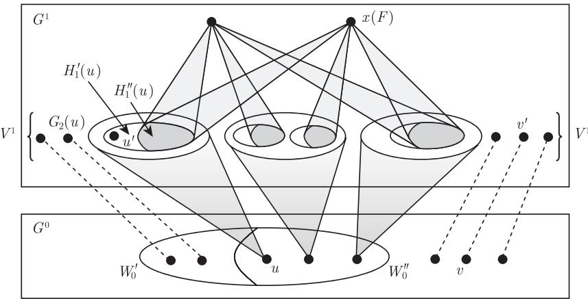
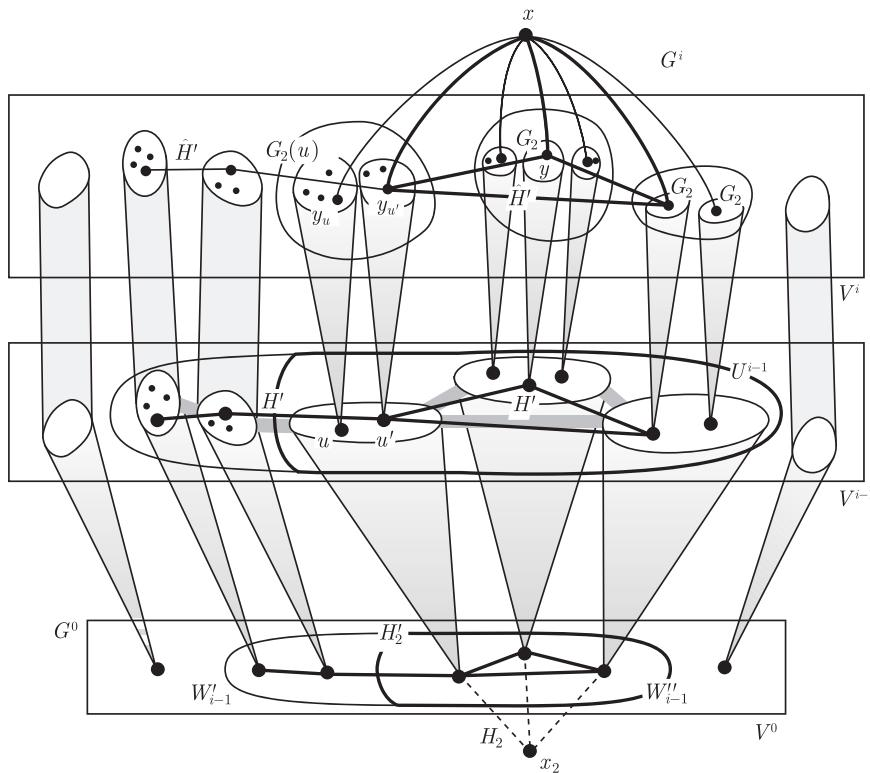
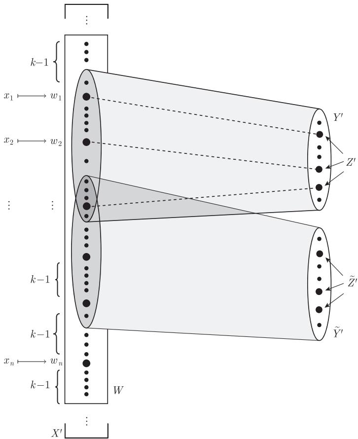
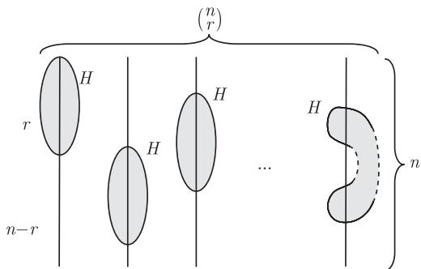

import Guide from '@/components/Guide.astro';
import Knowledge from '@/components/Knowledge.astro';
import Example from '@/components/Example.astro';
import Analysis from '@/components/Analysis.astro';
import Solution from '@/components/Solution.astro';
import Variant from '@/components/Variant.astro';
import Note from '@/components/Note.astro';
import Block from '@/components/Block.astro';
import Method from '@/components/Method.astro';
import Exercise from '@/components/Exercise.astro';

Ramsey 定理也可以这样重新叙述：对每个图 $H = K^r$ 都存在一个图 $G$ 使得 $G$ 的每个 2-边着色都有一个单色的 $H \subseteq G$。正如我们所知，这个结论的正确性可由任意足够大的完全图保证。现在把问题稍微变一下：给定任意图 $H$，我们要找一个图 $G$，它的每一个 2-边着色都有一个单色导出子图 $H \subseteq G$。

这个小小的修改极大地改变了问题的特性，现在所需要证明的不再仅仅是 $G$ 足够大 (如定理 9.1.1)，而且需要仔细地构造：构造一个图，使得它的边可以分成两部分，其中一个划分类的所有边包含 $H$ 的一个导出拷贝。我们称这个图是 $H$ 的 Ramsey 图 (Ramsey graph)。

对任选的 $H$，这样的 Ramsey 图一定存在。这个结论是图 Ramsey 理论的重要结果之一，它在 1973 年分别由 Deuber，Erdős、Hajnal 和 Pósa 四人以及 Rödl 独立地证明。

<Knowledge title="定理 9.3.1">
每个图都有 Ramsey 图。换句话说，对每个图 $H$ 都存在一个图 $G$，使得对 $E(G)$ 的每个划分 $\{E_1, E_2\}$ 都存在导出子图 $H \subseteq G$ 使得 $E(H) \subseteq E_1$ 或者 $E(H) \subseteq E_2$。

<Solution title="第一个证明">
我们给出两种证明，它们相互高度独立。然而，每个证明都使我们可以窥见 Ramsey 理论的真谛：涉及的图仅相当于建筑中的砖瓦，但完成后的建筑却令人印象深刻。

在我们构造所需要的 Ramsey 图的过程中，将反复把已经构造好的图 $G = (V, E)$ 的顶点用另一个图 $H$ 代替。对于顶点集合 $U \subseteq V$，令 $G[U \to H]$ 表示如下方法构造而成的图：在 $G$ 中将顶点 $u \in U$ 替换为图 $H$ 的拷贝 $H(u)$，对 $u' \in U$ 和 $u u' \in E$，我们就把 $H(u)$ 和 $H(u')$ 完全地连接起来，对 $v \in V \setminus U$ 且 $u v \in E$，把 $H(u)$ 和所有的 $v$ 连接起来 (图 9.3.1)。正式地，我们把 $G[U \to H]$ 定义为
$$
(U \times V(H)) \cup ((V \setminus U) \times \{\varnothing\})
$$
上的图，其中顶点 $(v, w)$ 和 $(v', w')$ 连接当且仅当要么 $v v' \in E$，要么 $v = v' \in U$ 且 $w w' \in E(H)$。$^3$

<figure class="vp-figure">
  ![图 9.3.1 对 $H = K^3$，图 $G[U \to H]$ 的例子](images/4767d0cd77f9e1d52a07bc06204f97d0ad05de26d76334c2a88758c841fe1588.jpg)
  <figcaption>图 9.3.1 对 $H = K^3$，图 $G[U \to H]$ 的例子</figcaption>
</figure>

我们下面来证明一个在形式上比定理 9.3.1 更强的结论：
$$
\begin{aligned}
&\text{对任意两个图 } H_1 \text{ 和 } H_2\text{，都存在图 } G = G(H_1, H_2)\text{，} \\
&\text{使得 } G \text{ 的每个用 } 1 \text{ 和 } 2 \text{ 两种颜色进行的边着色中，} \\
&\text{或者包含一个所有边都着色 } 1 \text{ 的导出子图 } H_1 \subseteq G\text{，} \\
&\text{或者包含一个所有边都着色 } 2 \text{ 的导出子图 } H_2 \subseteq G\text{。}
\end{aligned} \tag{$*$}
$$
这种形式上的加强使得下面对 $|H_1| + |H_2|$ 应用归纳法成为可能。

如果 $H_1$ 或 $H_2$ 不包含边 (特别地，如果 $|H_1| + |H_2| \leqslant 1$)，那么对足够大的 $n$，令 $G = \overline{K^n}$，则 $(*)$ 成立。在归纳步骤中，我们假设 $H_1$ 和 $H_2$ 都至少有一条边，且 $(*)$ 对于所有具有较小的 $|H_1'| + |H_2'|$ 的图对 $(H_1', H_2')$ 都成立。

对每个 $i = 1, 2$，取一个与某条边关联的顶点 $x_i \in H_i$，令 $H_i' := H_i - x_i$ 且 $H_i''$ 是由 $x_i$ 的所有邻点导出的 $H_i'$ 的子图。

我们将构造一个不交的图序列 $G^0, \dots, G^n$，使得 $G^n$ 为我们所要的 Ramsey 图 $G(H_1, H_2)$。在 $G^i$ 中，定义子集 $V^i \subseteq V(G^i)$ 和一个映射
$$
f: V^1 \cup \dots \cup V^n \to V^0 \cup \dots \cup V^{n - 1},
$$
使得对所有 $i \geqslant 1$，都有
$$
f(V^i) = V^{i - 1}. \tag{1}
$$
记 $f^i := f \circ \dots \circ f$ 为 $f$ 的第 $i$ 次合成且 $f^0$ 为 $V^0 = V(G^0)$ 上的恒等映射。因此对所有 $v \in V^i$，有 $f^i(v) \in V^0$。我们称 $f^i(v)$ 为 $v$ 的原点 (origin of $v$)。

子图 $G^i[V^i]$ 反映了 $G^0$ 的结构如下：
$$
\begin{aligned}
&V^i \text{ 中具有不同原点的顶点在 } G^i \text{ 中相邻当且仅当} \\
&\text{它们的原点在 } G^0 \text{ 中相邻。}
\end{aligned} \tag{2}
$$
虽然命题 (2) 在下面的证明过程中并没有正式用到，但它有利于将图 $G^i$ 形象化：每个 $G^i$ (准确地说，每个 $G^i[V^i]$；对 $i \geqslant 1$ 也存在某个顶点 $x \in G^i - V^i$) 基本上是放大了的 $G^0$ 的拷贝，这里每个顶点 $w \in G^0$ 被以 $w$ 为原点的 $V^i$ 中所有顶点的集合所替换，并且映射 $f$ 将具有同一个原点并且横跨不同 $G^i$ 的顶点连接起来。

由归纳假设，我们已有了 Ramsey 图
$$
G_1 := G(H_1, H_2') \quad \text{和} \quad G_2 := G(H_1', H_2).
$$
令 $G^0$ 是 $G_1$ 的一个拷贝，且 $V^0 := V(G^0)$。设 $W_0', \dots, W_{n - 1}'$ 为 $G^0$ 中支撑一个 $H_2'$ 的 $V^0$ 的子集。那么，$n$ 就定义为在 $G^0$ 中 $H_2'$ 的导出拷贝的个数。我们将对每个集合 $W_{i - 1}'$ 构造一个图 $G^i \ (i = 1, \dots, n)$。对 $i = 0, \dots, n - 1$，令 $W_i''$ 为 $V(H_2'')$ 在某个同构映射 $H_2' \to G^0[W_i']$ 下的象。

现在假设 $G^0, \dots, G^{i - 1}$ 和 $V^0, \dots, V^{i - 1}$ 对某个 $i \geqslant 1$ 已定义，并且假设 $f$ 已经在 $V^1 \cup \dots \cup V^{i - 1}$ 上定义且对所有 $j \leqslant i$ 都满足 (1)。我们分两步从 $G^{i - 1}$ 构造 $G^i$。第一步：考虑所有原点 $f^{i - 1}(v)$ 在 $W_{i - 1}''$ 中的顶点 $v \in V^{i - 1}$ 所组成的集合 $U^{i - 1}$。(对 $i = 1, U^0 = W_0''$。)把每个顶点 $u \in U^{i - 1}$ 替换为 $G_2$ 的一个拷贝 $G_2(u)$，这样就把 $G^{i - 1}$ 扩展成一个新图 $\widetilde{G}^{i - 1}$ (与 $G^{i - 1}$ 不相交)，即令
$$
\widetilde{G}^{i - 1} := G^{i - 1}[U^{i - 1} \to G_2],
$$
见图 9.3.2 和图 9.3.3。对所有 $u \in U^{i - 1}$ 和 $u' \in G_2(u)$，令 $f(u') := u$；且对所有满足 $v \in V^{i - 1} \setminus U^{i - 1}$ 的 $v' = (v, \varnothing)$，令 $f(v') := v$。(回顾一下，$(v, \varnothing)$ 仅是 $\widetilde{G}^{i - 1}$ 中顶点 $v \in G^{i - 1}$ 的没有进行扩展的拷贝。)令 $V^i$ 是 $\widetilde{G}^{i - 1}$ 中那些顶点 $v'$ 或 $u'$ 的集合，在此集合上 $f$ 已经被定义，即这些顶点或者直接对应于 $V^{i - 1}$ 中的顶点 $v$ 或者属于这样一个顶点 $u$ 的扩展 $G_2(u)$。这样的话，对于 $i$，(1) 成立。并且，如果我们假设 (2) 对 $i - 1$ 归纳地成立，那么 (2) 对 $i$ 也成立 (在 $\widetilde{G}^{i - 1}$ 中)。图 $\widetilde{G}^{i - 1}$ 已经是 $G^i$ 的基本组成部分：这部分看起来像 $G^0$ 的放大了的拷贝。

<figure class="vp-figure">
  
  <figcaption>图 9.3.2 图 $G^1$ 的构造</figcaption>
</figure>

在第二步中，我们通过进一步添加一些顶点 $x \notin V^i$ 来扩展图 $\widetilde{G}^{i - 1}$ 以得到我们所要的图 $G^i$。令 $\mathcal{F}$ 表示形式为
$$
F = (H_1'(u) \mid u \in U^{i - 1})
$$
的所有族 $F$ 的集合，其中每个 $H_1'(u)$ 都是一个同构于 $H_1'$ 的 $G_2(u)$ 的导出子图。(不太严格地说，$\mathcal{F}$ 是从每个 $G_2(u)$ 中同时选取 $H_1'$ 的一个导出拷贝的方法的集合。)对每个 $F \in \mathcal{F}$，在 $\widetilde{G}^{i - 1}$ 中增加一个顶点 $x(F)$；对每个 $u \in U^{i - 1}$，以及由 $F$ 选择的从 $H_1'$ 到 $H_1'(u) \subseteq G_2(u)$ 的同构下 $H_1''$ 的象 $H_1''(u) \subseteq H_1'(u)$ 中的顶点，将 $x(F)$ 与这些顶点连接 (图 9.3.2)。把所得到的图记为 $G^i$，这样就完成了对 $G_0, \dots, G_n$ 的归纳定义。

现在我们来证明 $G := G_n$ 满足 $(*)$。为此，对于 $i = 0, \dots, n$，我们证明以下关于 $G^i$ 的命题 $(**)$：
$$
\begin{aligned}
&\text{对每个只用 } 1, 2 \text{ 两种颜色的边着色，} G^i \text{ 或者包含一个着} \\
&\text{色 } 1 \text{ 的导出子图 } H_1\text{，或者包含一个着色 } 2 \text{ 的导出子图 } H_2\text{，} \\
&\text{或者包含一个着色 } 2 \text{ 的导出子图 } H \text{ 使得 } V(H) \subseteq V^i\text{，并且} \\
&\text{限制在 } V(H) \text{ 上的 } f^i \text{ 对某个 } k \in \{i, \dots, n - 1\} \text{ 而言是 } H \text{ 与} \\
&\text{某个 } G^0[W_k'] \text{ 之间的同构。}
\end{aligned} \tag{$**$}
$$
注意到，上面的第三种情况对 $i = n$ 不成立，所以对于 $n$，$(**)$ 等价于 $G := G^n$ 时的 $(*)$。

对 $i = 0$，选择 $G_1 = G(H_1, H_2')$ 的一个拷贝作为 $G^0$，并根据集合 $W_k'$ 的定义可推出 $(**)$。现令 $1 \leqslant i \leqslant n$，并假设对较小的 $i$，$(**)$ 成立。

给定 $G^i$ 的一个边着色，对每个 $u \in U^{i - 1}$，$G^i$ 中都存在 $G_2$ 的一个拷贝：
$$
G^i \supseteq G_2(u) \simeq G(H_1', H_2).
$$
如果对某个 $u \in U^{i - 1}$，$G_2(u)$ 包含一个着色 2 的导出子图 $H_2$，证明结束；否则，每个 $G_2(u)$ 都有一个导出子图 $H_1'(u) \simeq H_1'$ 着色 1。设 $F$ 是这些图 $H_1'(u)$ 的集合，每个元素对应一个 $u \in U^{i - 1}$，且令 $x := x(F)$。如果对某个 $u \in U^{i - 1}$，$G^i$ 中的所有 $x\text{-}H_1''(u)$ 边也着色 1，则在 $G_i$ 中，我们得到 $H_1$ 的一个导出拷贝，证明结束。因此，我们可以假设每个 $H_1''(u)$ 都有一个顶点 $y_u$，使得 $x y_u$ 着色 2。$f$ 在
$$
\widehat{U}^{i - 1} := \{y_u \mid u \in U^{i - 1}\} \subseteq V^i
$$
上的限制 $y_u \mapsto u$ 通过 $(v, \varnothing) \mapsto v$ 扩展成为一个从
$$
\widehat{G}^{i - 1} := G^i\left[\widehat{U}^{i - 1} \cup \{(v, \varnothing) \mid v \in V(G^{i - 1}) \setminus U^{i - 1}\}\right]
$$
到 $G^{i - 1}$ 的同构，因此 $G^i$ 的边着色导出一个 $G^{i - 1}$ 的边着色。如果这个边着色能导出着色 1 的 $H_1 \subseteq G^{i - 1}$ 或者着色 2 的 $H_2 \subseteq G^{i - 1}$，那么在 $\widehat{G}^{i - 1} \subseteq G^i$ 中也成立，我们的目的达到了。

根据 $(**)$，对 $i - 1$，我们可以假设 $G^{i - 1}$ 包含一个着色 2 的导出子图 $H'$，使得 $V(H') \subseteq V^{i - 1}$ 并且 $f^{i - 1}$ 在 $V(H')$ 上的限制是一个对某个 $k \in \{i - 1, \dots, n - 1\}$ 而言，从 $H'$ 到 $G^0[W_k'] \simeq H_2'$ 的同构。设 $\widehat{H}'$ 是 $\widehat{G}^{i - 1} \subseteq G^i$ 的对应导出子图 (也被着色 2)。故 $V(\widehat{H}') \subseteq V^i$，
$$
f^i(V(\widehat{H}')) = f^{i - 1}(V(H')) = W_k',
$$
并且 $f^i: \widehat{H}' \to G^0[W_k']$ 是一个同构。

<figure class="vp-figure">
  
  <figcaption>图 9.3.3 $G^i$ 中的单色 $H_2$ 拷贝</figcaption>
</figure>

如果 $k \geqslant i$，取 $H := \widehat{H}'$，我们就完成了对 $(**)$ 的证明。所以下面我们假定 $k < i$，因此 $k = i - 1$ (图 9.3.3)。由 $U^{i - 1}$ 和 $\widehat{G}^{i - 1}$ 的定义知，$W_{i - 1}''$ 在同构 $f^i: \widehat{H}' \to G^0[W_{i - 1}']$ 下的逆映象是 $\widehat{U}^{i - 1}$ 的一个子集。因为 $x$ 只与 $\widehat{H}'$ 的位于 $\widehat{U}^{i - 1}$ 中的那些顶点连接，且所有这些边 $x y_u$ 被着色 2，所以图 $\widehat{H}'$ 和 $x$ 一起在 $G^i$ 中导出一个着色 2 的 $H_2$ 的拷贝，我们就完成了 $(**)$ 的证明。∎
</Solution>
</Knowledge>

我们再次回到本节开头提到的 Ramsey 定理的重新描述：对每个图 $H = K^r$ 都存在一个图 $G$，使得 $G$ 的每个 2-边着色都包含一个单色的 $H \subseteq G$。使 Ramsey 定理明显成立的图是充分大的完全图。但是，如果我们要求 $G$ 不包含任意完全子图比 $H$ 中的完全子图大，即 $\omega(G) = \omega(H)$，那么即使我们不要求 $H$ 是 $G$ 的导出子图，问题也会变得非常困难。

定理 9.3.1 的第二个证明把两个问题一起解决了：给定 $H$，我们构造一个与 $H$ 有相同团数的 Ramsey 图。

对这个证明，也即这一节的余下部分，我们把二部图 $P$ 看作一个三元组 $(V_1, V_2, E)$，其中 $V_1$ 和 $V_2$ 是两个顶点划分类而 $E \subseteq V_1 \times V_2$ 是它的边集合。采用这种直观表示的原因是，我们想在二部图之间按照二部划分进行嵌入：给定另一个二部图 $P' = (V_1', V_2', E')$，我们称单射 $\varphi: V_1 \cup V_2 \to V_1' \cup V_2'$ 是 $P$ 在 $P'$ 中的嵌入 (embedding)，如果对于 $i = 1, 2, \varphi(V_i) \subseteq V_i'$ 且 $\varphi(v_1)\varphi(v_2)$ 是 $P'$ 的边当且仅当 $v_1 v_2$ 是 $P$ 中的边。(注意到，这个嵌入是“导出的”。)我们将 $\varphi: V_1 \cup V_2 \to V_1' \cup V_2'$ 简单地记作 $\varphi: P \to P'$。

我们需要两个引理：

<Knowledge title="引理 9.3.2">
每个二部图都可以嵌入到一个形式为 $(X, [X]^k, E)$ 的二部图中，其中 $E = \{xY \mid x \in Y\}$。

<Solution title="证明">
设 $P$ 是任意一个二部图，其顶点划分类为 $\{a_1, \dots, a_n\}$ 和 $\{b_1, \dots, b_m\}$。令 $X$ 是一个有 $2n + m$ 个元素的集合：
$$
X = \{x_1, \dots, x_n, y_1, \dots, y_n, z_1, \dots, z_m\}.
$$
我们定义一个嵌入 $\varphi: P \to (X, [X]^{n + 1}, E)$。

一开始，对 $i = 1, \dots, n$，我们定义 $\varphi(a_i) := x_i$。对于给定的顶点 $b_i$，哪些 $(n + 1)$-集 $Y \subseteq X$ 是 $\varphi(b_i)$ 的合适候选对象呢？显然，它们是只与 $b_i$ 的邻点的象连接的那些 $(n + 1)$-集，即满足
$$
Y \cap \{x_1, \dots, x_n\} = \varphi(N_P(b_i)) \tag{1}
$$
的集合。因为 $d(b_i) \leqslant n$，所以 (1) 成立的条件使得 $Y$ 的 $n + 1$ 个元素中至少有一个是还没有指定的。除了 $\varphi(N_P(b_i))$ 之外，我们可以把顶点 $z_i$ 作为每个 $Y = \varphi(b_i)$ 的“指标”，这样就保证了对 $i \neq j$，有 $\varphi(b_i) \neq \varphi(b_j)$，即使当 $b_i$ 和 $b_j$ 在 $P$ 中有相同的邻点时也一样。为了完全地指定集合 $Y = \varphi(b_i)$，我们可以用“虚拟”元素 $y_j$ 来填补，直到 $|Y| = n + 1$。∎
</Solution>
</Knowledge>

第二个引理已经包括了定理中二部图的情况：每个二部图都有一个 Ramsey 图，这个 Ramsey 图甚至是个二部图。

<Knowledge title="引理 9.3.3">
对每个二部图 $P$，都存在二部图 $P'$，使得对 $P'$ 的每个 2-边着色，都存在一个嵌入 $\varphi: P \to P'$ 满足 $\varphi(P)$ 中的所有边都着相同的颜色。

<Solution title="证明">
由引理 9.3.2，我们可以假设 $P$ 具有形式 $(X, [X]^k, E)$，且 $E = \{xY \mid x \in Y\}$。我们对图 $P' := (X', [X']^{k'}, E')$ 证明命题成立，这里 $k' := 2k - 1$，而 $X'$ 是任意一个基数为
$$
|X'| = R\left(k', 2\binom{k'}{k}, k|X| + k - 1\right)
$$
(这就是定理 9.1.3 之后定义的 Ramsey 数) 的集合，并且
$$
E' := \{x'Y' \mid x' \in Y'\}.
$$

然后，我们用两种颜色 $\alpha$ 和 $\beta$ 对 $P'$ 的边进行着色。在与顶点 $Y' \in [X']^{k'}$ 相关联的 $|Y'| = 2k - 1$ 条边中至少有 $k$ 条着同一颜色。因此，对每个 $Y'$ 都可以选择一个固定的 $k$-集 $Z' \subseteq Y'$ 使得具有 $x' \in Z'$ 的所有边 $x' Y'$ 都着同一颜色，我们称这是与 $Y'$ 相关联 (associated) 的颜色。

集合 $Z'$ 在它的母集 $Y'$ 中有 $\binom{k'}{k}$ 种选取方法，细节如下：设 $X'$ 已被线性地排序，那么对每个 $Y' \in [X']^{k'}$，存在一个唯一的保持排序的双射 $\sigma_{Y'}: Y' \to \{1, \dots, k'\}$，将 $Z'$ 映射到 $\binom{k'}{k}$ 个可能的象中的一个。

我们现在用集合
$$
[\{1, \dots, k'\}]^k \times \{\alpha, \beta\}
$$
中的 $2\binom{k'}{k}$ 个元素当做颜色对 $[X']^{k'}$ 进行着色：给定一个 $Y' \in [X']^{k'}$，用 $(\sigma_{Y'}(Z'), \gamma)$ 作为它的颜色，其中 $\gamma$ 是与 $Y'$ 相关联的颜色 $\alpha$ 或 $\beta$。因为 $|X'|$ 被选择作为具有参数 $k', 2\binom{k'}{k}$ 和 $k|X| + k - 1$ 的 Ramsey 数，所以我们知道 $X'$ 有一个基数为 $k|X| + k - 1$ 的单色子集 $W$。这样，所有具有 $Y' \subseteq W$ 的 $Z'$ 以相同的方式包含在 $Y'$ 中，即存在 $S \in [\{1, \dots, k'\}]^k$ 使得对所有的 $Y' \in [W]^{k'}$ 都有 $\sigma_{Y'}(Z') = S$，并且所有的 $Y' \in [W]^{k'}$ 都与同一颜色相关联，不妨设该颜色为 $\alpha$。

现在，我们构造 $P'$ 中我们想要的 $P$ 的嵌入 $\varphi$。首先，在 $X := \{x_1, \dots, x_n\}$ 上定义 $\varphi$，选取象 $\varphi(x_i) =: w_i \in W$ 使得在 $X'$ 的排序下只要 $i < j$ 就有 $w_i < w_j$。进一步地，选择 $w_i$ 使得 $W$ 中恰好有 $k - 1$ 个元素小于 $w_1$，并且对 $i = 1, \dots, n - 1$，恰好有 $k - 1$ 个元素在 $w_i$ 与 $w_{i + 1}$ 之间，同时恰好有 $k - 1$ 个元素大于 $w_n$。由于 $|W| = k n + k - 1$，这是可以做到的 (图 9.3.4)。

其次，我们在 $[X]^k$ 上定义 $\varphi$。给定 $Y \in [X]^k$，我们希望选择 $\varphi(Y) =: Y' \in [X']^{k'}$ 使得在 $\varphi(X)$ 中 $Y'$ 的邻点正好是 $Y$ 的邻点在 $P$ 中的象，即 $k$ 个具有 $x \in Y$ 的顶点 $\varphi(x)$，并且使得与 $Y'$ 中顶点相关联的那些边都着色 $\alpha$。为了找到这样的集合 $Y'$，我们首先把子集 $Z'$ 固定为 $\{\varphi(x) \mid x \in Y\}$ (它们是 $k$ 个 $w_i$ 类型的顶点)，然后通过增加另外 $k' - k$ 个顶点 $u \in W \setminus \varphi(X)$ 把 $Z'$ 扩张成集合 $Y' \in [W]^{k'}$。这样的话，$Z'$ 包含在 $Y'$ 中了，即 $\sigma_{Y'}(Z') = S$。这是可以做到的，因为 $W$ 中 $k - 1 = k' - k$ 个其他顶点处于任意两个 $w_i$ 之间，故
$$
Y' \cap \varphi(X) = Z' = \{\varphi(x) \mid x \in Y\},
$$
所以 $Y'$ 在 $\varphi(X)$ 中有正好的邻点，并且所有在 $Y'$ 与这些邻点之间的边都着色 $\alpha$ (因为这些邻点在 $Z'$ 中，并且 $Y'$ 与颜色 $\alpha$ 相关联)。最后，$\varphi$ 在 $[X]^k$ 上是单射的：不同顶点 $Y$ 的象 $Y'$ 是不同的，这是因为它们与 $\varphi(X)$ 的交集是不同的。因此，映射 $\varphi$ 的确是 $P$ 在 $P'$ 中的一个嵌入。∎
</Solution>
</Knowledge>

<figure class="vp-figure">
  
  <figcaption>图 9.3.4 引理 9.3.3 中的图</figcaption>
</figure>

### 第二个证明

<Solution title="定理 9.3.1 的第二个证明">
设 $H$ 是定理中给出的图，且 $n := R(r)$ 是 $r := |H|$ 的 Ramsey 数。那么，对它的每一个 2-边着色，图 $K = K^n$ 包含一个单色的 $H$ 的拷贝，尽管它不一定是导出的。

我们首先构造图 $G^0$ 如下：设想把 $K$ 中的顶点排成一列，然后把每个顶点用由 $\binom{n}{r}$ 个顶点组成的行代替，那么所形成的 $\binom{n}{r}$ 列中的每一列都可以与将 $V(H)$ 嵌入到 $V(K)$ 的 $\binom{n}{r}$ 种方法相关联；我们将这一列和 $H$ 的这样一个拷贝中的边相联系，所以图 $G^0$ 就由 $\binom{n}{r}$ 个不相交的 $H$ 的拷贝和 $(n - r)\binom{n}{r}$ 个独立顶点所组成 (图 9.3.5)。

为了正式地定义 $G^0$，我们假设 $V(K) = \{1, \dots, n\}$，并且在 $K$ 中选取 $H$ 的两两顶点不同的拷贝 $H_1, \dots, H_{\binom{n}{r}}$。(这样，在 $V(K)$ 的每个 $r$-集中，都有 $H$ 的一个固定的拷贝 $H_j$。)然后我们定义
$$
V(G^0) := \left\{(i, j) \mathrel{\Big|} i = 1, \dots, n; j = 1, \dots, \binom{n}{r}\right\},
$$
并且
$$
E(G^0) := \bigcup_{j = 1}^{\binom{n}{r}} \{(i, j)(i', j) \mid i i' \in E(H_j)\}.
$$

<figure class="vp-figure">
  
  <figcaption>图 9.3.5 图 $G^0$</figcaption>
</figure>

证明的思路如下：我们的目的是把定理中的一般情形简化为引理 9.3.3 中的二部图的情形。对 $G^0$ 的每对行重复运用这个引理，便构造出一个很大的图 $G$ 使得对 $G$ 的每个边着色，$G$ 中都存在一个导出的 $G^0$ 的拷贝，它在由行对导出的所有二部子图中是单色的，即相同两行之间的边都着同一颜色。那么从 $G^0 \subseteq G$ 到 $\{1, \dots, n\}$ 的投影 (通过收缩它的行) 就定义了一个 $K$ 的边着色。(如果收缩不能生成 $K$ 的所有边，对缺失的边可任意着色。)根据 $|K|$ 的选择，某个 $K^r \subseteq K$ 将是单色的。这个 $K^r$ 中的 $H_j$ 也将在 $G^0$ 的第 $j$ 列中着同一颜色，这里它是 $G^0$ 的一个导出子图，因此也是 $G$ 的导出子图。

我们将正式地定义一个 $n$-部图 $G^k$ 的序列：$G^0, \dots, G^m$，其中 $G^k$ 的 $n$-划分记为 $V_1^k, \dots, V_n^k$，并且令 $G := G^m$。图 $G^0$ 在上面已经定义过了，记 $V_1^0, \dots, V_n^0$ 是它的行：
$$
V_i^0 := \left\{(i, j) \mathrel{\Big|} j = 1, \dots, \binom{n}{r}\right\}.
$$
现在令 $e_1, \dots, e_m$ 是 $K$ 中边的排列。对 $k = 0, \dots, m - 1$，我们由 $G^k$ 构造 $G^{k + 1}$ 的方法如下：如果 $e_{k + 1} = i_1 i_2$，则令 $P = (V_{i_1}^k, V_{i_2}^k, E)$ 是 $G^k$ 的第 $i_1$ 行和第 $i_2$ 行导出的二部子图。由引理 9.3.3 知，$P$ 有一个二部的 Ramsey 图 $P' = (W_1, W_2, E')$。我们希望通过某种方式定义 $G^{k + 1} \supseteq P'$ 使得，每个 (单色的) 嵌入 $P \to P'$ 都能扩展为对应于它们的 $n$-划分的嵌入 $G^k \to G^{k + 1}$。设 $\{\varphi_1, \dots, \varphi_q\}$ 是 $P'$ 中所有 $P$ 的嵌入的集合，且令
$$
V(G^{k + 1}) := V_1^{k + 1} \cup \dots \cup V_n^{k + 1},
$$
这里
$$
V_i^{k + 1} := \begin{cases}
W_1, & i = i_1, \\
W_2, & i = i_2, \\
\bigcup_{p = 1}^q (V_i^k \times \{p\}), & i \notin \{i_1, i_2\}.
\end{cases}
$$
(因此，对 $i \neq i_1, i_2$，只用 $q$ 个不相交的 $V_i^k$ 的拷贝作为 $V_i^{k + 1}$ 就可以了。)现在我们来定义 $G^{k + 1}$ 的边集，使得 $\varphi_p$ 向整个 $V(G^k)$ 的自然扩展成为 $G^k$ 在 $G^{k + 1}$ 中的嵌入：对 $p = 1, \dots, q$，令 $\psi_p: V(G^k) \to V(G^{k + 1})$ 定义为
$$
\psi_p(v) := \begin{cases}
\varphi_p(v), & v \in P, \\
(v, p), & v \notin P,
\end{cases}
$$
且令
$$
E(G^{k + 1}) := \bigcup_{p = 1}^q \{\psi_p(v)\psi_p(v') \mid v v' \in E(G^k)\}.
$$

现在，对边的每个 2-着色，$G^{k + 1}$ 包含了 $G^k$ 的一个导出拷贝 $\psi_p(G^k)$，它的所有在 $P$ 中的边，即那些在第 $i_1$ 行和第 $i_2$ 行之间的边，着相同颜色：只需选择 $p$ 使得 $\varphi_p(P)$ 是 $P'$ 的单色导出拷贝，而它的存在性由引理 9.3.3 保证。

下面我们证明 $G := G^m$ 满足定理的结论。先取定 $G$ 的一个 2-边着色，由从 $G^{m - 1}$ 到 $G^m$ 的构造知，我们可以在 $G^m$ 中找到 $G^{m - 1}$ 的一个导出拷贝，使得对 $e_m = i i'$，所有的在第 $i$ 行和第 $i'$ 行之间的边都着相同的颜色。按同样的方法，我们在 $G^{m - 1}$ 这个拷贝里找到 $G^{m - 2}$ 的一个导出拷贝，在这个拷贝中，对于 $i i' = e_{m - 1}$，第 $i$ 行和第 $i'$ 行之间的边也都着相同颜色。这样继续下去，最后我们在 $G$ 中找到 $G^0$ 的导出拷贝，使得对每个对 $(i, i')$，在 $V_i^0$ 和 $V_{i'}^0$ 之间的所有边都着同一颜色。正如前面已证明的那样，$G^0$ 包含 $H$ 的一个单色导出拷贝 $H_j$。∎
</Solution>
