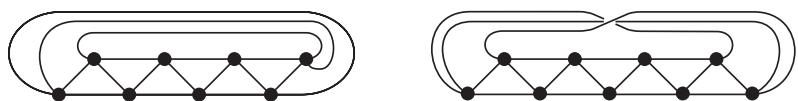

import Guide from '@/components/Guide.astro';
import Knowledge from '@/components/Knowledge.astro';
import Example from '@/components/Example.astro';
import Analysis from '@/components/Analysis.astro';
import Solution from '@/components/Solution.astro';
import Variant from '@/components/Variant.astro';
import Note from '@/components/Note.astro';
import Block from '@/components/Block.astro';
import Method from '@/components/Method.astro';
import Exercise from '@/components/Exercise.astro';

根据 Ramsey 定理，每一个足够大的图 $G$ 中都有一个很稠密或者很稀疏的给定阶数的导出子图 $K^r$ 或者 $\overline{K^r}$。如果假设 $G$ 是连通的，还能得到更多的结论。

<Knowledge title="命题 9.4.1">
对每个 $r \in \mathbb{N}$，都存在 $n \in \mathbb{N}$，使得每个阶数至少为 $n$ 的连通图都包含 $K^r, K_{1, r}$ 或 $P^r$ 作为导出子图。

<Solution title="证明">
令 $d + 1$ 为 $r$ 的 Ramsey 数，且 $n \geqslant \frac{d}{d - 2}(d - 1)^r$，并令 $G$ 是一个阶数至少为 $n$ 的图。若 $G$ 有一个度至少为 $d + 1$ 的顶点 $v$，由定理 9.1.1 以及 $d$ 的选择，要么 $N(v)$ 在 $G$ 中导出一个 $K^r$，要么 $\{v\} \cup N(v)$ 导出一个 $K_{1, r}$。另一方面，如果 $\Delta(G) \leqslant d$，那么由命题 1.3.3 知，$G$ 的半径 $> r$，因此 $G$ 包含两个距离 $\geqslant r$ 的顶点，这两个顶点在 $G$ 中的任意最短路都包含一个 $P^r$。∎
</Solution>
</Knowledge>

原则上讲，对于任意给定的连通度 $k$，我们可以寻找一个“不可避免”的 $k$-连通子图的集合。为使这些“不可避免集”较小，可以把包含关系方面的约束放松，从对 $k = 1$ (见上) 的“导出子图”，减弱到 $k = 2$ 时的“拓扑子式”，以及到 $k = 3$ 和 $k = 4$ 时的“子式”。对更大的 $k$，还没有已知的类似结论。

<Knowledge title="命题 9.4.2">
对每个 $r \in \mathbb{N}$，都存在 $n \in \mathbb{N}$，使得每个阶数至少为 $n$ 的 2-连通图都包含 $C^r$ 或 $K_{2, r}$ 作为拓扑子式。

<Solution title="证明">
设 $d$ 为命题 9.4.1 中与 $r$ 关联的那个 $n$，$G$ 是至少包含 $\frac{d}{d - 2}(d - 1)^r$ 个顶点的 2-连通图。由命题 1.3.3，$G$ 或者包含一个度 $> d$ 的顶点，或者 $\operatorname{diam} G \geqslant \operatorname{rad} G > r$。

在后一种情况，令 $a, b \in G$ 是两个距离 $> r$ 的顶点。由 Menger 定理 (3.3.6) 知，$G$ 包含两条独立的 $a\text{--}b$ 路，它们组成一个长度 $> r$ 的圈。

其次，假设 $G$ 包含一个度 $> d$ 的顶点 $v$。由于 $G$ 是 2-连通的，$G - v$ 是连通的，因此 $G - v$ 有一棵支撑树，令 $T$ 为 $G - v$ 中一棵包含 $v$ 的所有邻点的极小树，那么 $T$ 的每个叶子都是 $v$ 的邻点。由 $d$ 的选取知，或者 $T$ 有一个度 $\geqslant r$ 的顶点，或者 $T$ 包含一条长度 $\geqslant r$ 的路，不失一般性，我们假设这条路连接两个叶子。这条路与 $v$ 一起构成了一个长度 $\geqslant r$ 的圈。$T$ 中一个度 $\geqslant r$ 的顶点 $u$ 可以通过 $r$ 条独立的路与 $v$ 连接，从而组成一个 $TK_{2, r}$。∎
</Solution>
</Knowledge>

<Knowledge title="定理 9.4.3 (Oporowski, Oxley and Thomas, 1993)">
对每个 $r \in \mathbb{N}$，都存在 $n \in \mathbb{N}$，使得每个阶数至少为 $n$ 的 3-连通图都包含一个阶数为 $r$ 的轮图或 $K_{3, r}$ 作为子式。
</Knowledge>

我们称形如 $C^n * \overline{K^2} \ (n \geqslant 4)$ 的图为双轮 (double wheel)；称圆柱面的三角剖分的 1-支架为一个冠 (crown) (图 9.4.1)；称 Möbius 带的三角剖分的 1-支架为一个 Möbius 冠 (Möbius crown)。

<figure class="vp-figure">
  
  <figcaption>图 9.4.1 冠和 Möbius 冠</figcaption>
</figure>

<Knowledge title="定理 9.4.4 (Oporowski, Oxley and Thomas, 1993)">
对每个 $r \in \mathbb{N}$，都存在 $n \in \mathbb{N}$，使得每个阶数至少为 $n$ 的 4-连通图都有一个阶数 $\geqslant r$ 的子式为双轮、冠、Möbius 冠或 $K_{4, r}$。
</Knowledge>

注意到，定理 9.4.3 和定理 9.4.4 中列举的图类本身也分别是 3-连通和 4-连通的，正如定理中要求的那样。

乍看上去，上面四个定理中这些“不可避免”的子图结构似乎有某种随意性。事实上，恰恰相反：这些集合是最小可能的并且是唯一的。

为了详细地描述这个事实，我们称一个图性质是非平凡的 (non-trivial)，如果它包含无限多个非同构的图。给定两个图性质 $\mathcal{P}$ 和 $\mathcal{P}'$ 以及图之间的序关系 $\leqslant$ (比如子图包含关系 $\subseteq$ 或子式关系 $\preceq$)，如果对每个 $G \in \mathcal{P}$，都存在一个 $G' \in \mathcal{P}'$ 使得 $G \leqslant G'$，那么我们记 $\mathcal{P} \leqslant \mathcal{P}'$。如果 $\mathcal{P} \leqslant \mathcal{P}'$ 同时 $\mathcal{P} \geqslant \mathcal{P}'$，则我们称 $\mathcal{P}$ 和 $\mathcal{P}'$ 是等价的 (equivalent)，记作 $\mathcal{P} \sim \mathcal{P}'$。例如，若 $\leqslant$ 是子图包含关系，$\mathcal{P}$ 是所有路的集合，$\mathcal{P}'$ 为所有长度为偶数的路的集合，而 $\mathcal{S}$ 是星的所有细分的集合，那么 $\mathcal{P} \sim \mathcal{P}' \leqslant \mathcal{S} \not\leqslant \mathcal{P}$。

给定一个非平凡图性质 $\mathcal{G}$，我们称非平凡图性质 $\mathcal{P}_i \subseteq \mathcal{G}$ 的一个有限集合 $\{\mathcal{P}_1, \dots, \mathcal{P}_k\}$ 是一个关于 $\mathcal{G}$ 和 $\leqslant$ 的 Kuratowski 集 (Kuratowski set)，如果 $\mathcal{P}_i$ 是不可比的 (即只要 $i \neq j$，就有 $\mathcal{P}_i \not\leqslant \mathcal{P}_j$)，并且对每个非平凡图性质 $\mathcal{P} \subseteq \mathcal{G}$ 存在一个 $i$ 使得 $\mathcal{P}_i \leqslant \mathcal{P}$。这样的 Kuratowski 集 $\{\mathcal{P}_1, \dots, \mathcal{P}_k\}$ 在等价意义下是唯一的：如果 $\{\mathcal{Q}_1, \dots, \mathcal{Q}_\ell\}$ 是关于 $\mathcal{G}$ 的另一个 Kuratowski 集，则 $\ell = k$ 并且经过适当的排列，对每个 $i = 1, \dots, k$ 都有 $\mathcal{Q}_i \sim \mathcal{P}_i$。(为什么呢？)

我们把所有 $k$-连通有限图的集合称作 $k$-连通集，而所有 1-连通有限图称作连通集，那么上面四个定理可以统一地表达成如下更易理解的形式：

<Knowledge title="定理 9.4.5">
(i) 对于连通集和子图关系，星和路组成了 (2-元素) Kuratowski 集。

(ii) 对于 2-连通集和拓扑子式，圈和图 $K_{2, r} \ (r \in \mathbb{N})$ 组成了 (2-元素) Kuratowski 集。

(iii) 对于 3-连通集和子式关系，轮图和图 $K_{3, r} \ (r \in \mathbb{N})$ 组成了 (2-元素) Kuratowski 集。

(iv) 对于 4-连通集和子式关系，双轮、冠、Möbius 冠和图 $K_{4, r} \ (r \in \mathbb{N})$ 组成了 (4-元素) Kuratowski 集。∎
</Knowledge>
