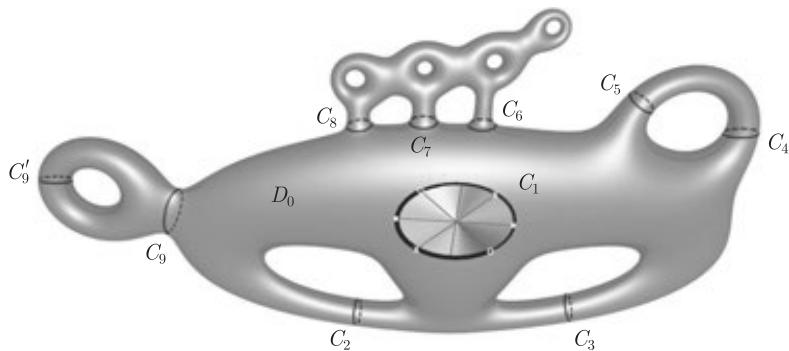

import Guide from '@/components/Guide.astro';
import Knowledge from '@/components/Knowledge.astro';
import Example from '@/components/Example.astro';
import Analysis from '@/components/Analysis.astro';
import Solution from '@/components/Solution.astro';
import Variant from '@/components/Variant.astro';
import Note from '@/components/Note.astro';
import Block from '@/components/Block.astro';
import Method from '@/components/Method.astro';
import Exercise from '@/components/Exercise.astro';

这个附录简单地总结了有关曲面的背景资料，这将有助于理解曲面在图子式定理证明中或者 12.7 节关于任意曲面在“广义 Kuratowski 定理”证明中的作用. 为了能够严谨地理解这部分的内容，也需要熟悉一般拓扑的某些基本概念（例如拓扑乘积以及同化拓扑），但不需要更多知识.

在本书中，曲面 (surface) 指一个紧致连通 Hausdorff 拓扑空间 $S$，使得每一个点有一个邻集同胚于欧氏平面 $\mathbb{R}^2$. $S$ 中的弧 (arc)、圆 (circle) 及圆盘 (disc) 为子空间拓扑中的子集，它分别同胚于实线段 $[0, 1]$、单位圆 $S^1 = \{ x \in \mathbb{R}^2 \mid \|x\| = 1 \}$ 以及单位圆盘 $\{ x \in \mathbb{R}^2 \mid \|x\| \leqslant 1 \}$ 或 $\{ x \in \mathbb{R}^2 \mid \|x\| < 1 \}$.

曲面 $S$ 的子集 $X$ 的分支 (component) 定义为 $X$ 中点的等价类，这里如果两个点可以被 $X$ 的一个弧连接，则称它们是等价的 (equivalent). 如果曲面本身是连通的，那么它只有一个分支.

$X$ 的前沿 (frontier) 指 $S$ 中所有点 $y$ 的集合，使得 $y$ 的每一个邻集都和 $X$ 以及 $S \setminus X$ 相交. $X$ 的前沿把 $X$ 和 $S \setminus X$ 分离 (separate) 开来. 因为 $X \cup F$ 是闭的，所以从 $X$ 到 $S \setminus X$ 的每个弧的第一个不在 $X$ 中的点一定在 $F$ 中. 如果前沿的分支是一个圆，则称这个分支是 $X$ 的边界圆 (boundary circle); 而圆盘的边界圆叫做这个圆盘的界 (boundary).

关于曲面，有一个基本分类定理，即在同胚意义下，每一个曲面可以通过在球面 $S^2 = \{ x \in \mathbb{R}^3 \mid \|x\| = 1 \}$ 上“添加有限个环柄或有限个交叉套”而得到，并且添加不同个环柄或交叉套所得到的曲面是不同的. 我们并不需要这个分类定理，但是为了直观理解，看看上面运算的效果. 为了在曲面 $S$ 上添加一个环柄 (handle)，移走其两个闭包在 $S$ 中不交的开圆盘，然后把它的边界圆和圆柱面 $S^1 \times [0, 1]$ 的两个边界圆分别重合. 为了添加一个交叉套 (cross-cap)，移走一个开圆盘，然后把它的边界圆与一个 Möbius 带的边界圆重合.

要确定这些运算确实生成给定的新曲面，需要验证每个重合点有一个邻域同胚于 $\mathbb{R}^2$. 为了严格地验证这个事实，我们先从更一般的意义上考虑圆.

柱面是乘积空间 $S^1 \times [0, 1]$，或者任何同胚于它的空间; 而它的中间圆 (middle circle) 则指 $S^1 \times \{ \frac{1}{2} \}$. Möbius 带是一个空间，它同胚于通过把所有 $(1, y)$ 和 $(0, 1 - y)$（这里 $y \in [0, 1]$）重合而得到的乘积空间 $[0, 1] \times [0, 1]$，它的中间圆是点集 $\{ (x, \frac{1}{2}) \mid 0 < x < 1 \} \cup \{ p \}$，这里 $p$ 是把 $(1, \frac{1}{2})$ 和 $(0, \frac{1}{2})$ 重合后得到的点. 可以证明，曲面 $S$ 上的每一个圆 $C$ 是一个适当的柱面或者 Möbius 带的中间圆，它可以被选取得足够小从而避开 $S \setminus C$ 的任意给定紧致子集. 如果这个带邻域 (strip neighbourhood) 是一个柱面，则称 $C$ 是双面的 (two-sided); 如果它是一个 Möbius 带，则称 $C$ 是单面的 (one-sided).

为了连接交叉套或环柄，我们从曲面上移走一个或两个圆盘，利用圆盘的边界圆的带邻域，可以容易地证明上面的两种运算确实产生新的曲面.

因为 $S$ 是连通的，所以 $S \setminus C$ 不能比 $N \setminus C$ 有更多的分支. 如果 $S \setminus C$ 有两个分支，称 $C$ 是分离圆 (separating circle); 如果它只有一个分支，那么 $C$ 是非分离的 (non-separating). 虽然单面圆显然是非分离的，但双面圆可以是分离的也可以是非分离的.

因此分类定理可以导出以下结论:

<Knowledge title="引理 B.1">
除球面外，每一个曲面包含一个非分离圆.
</Knowledge>

下面我们会看到，从某种意义上讲，上面的两个非分离圆的例子是所有的可能。沿着任何非分离圆割开曲面（并修补产生的洞）总是生成一个具有更少交叉套或环柄的曲面.

图 $G$ 在曲面 $S$ 中的嵌入 (embedding) 是一个映射，它把 $G$ 的顶点映射到 $S$ 的不同的点，把边 $xy$ 映射到 $S$ 的弧 $\sigma(x)\text{--}\sigma(y)$ 使得这样的弧的内点没有一个是顶点的象或者位于另一个弧上，那么我们把 $G$ 的所有这些点和弧的并记为 $\sigma(G)$. $G$ 在 $S$ 中的面 (face) 是 $S \setminus \sigma(G)$ 的一个分支，而 $G$ 的被 $\sigma$ 映射到这个面的前沿上的子图是它的边界 (boundary). 注意到，虽然球面上的面总是圆盘（如果 $G$ 是连通的），但对于一般曲面不一定成立.

我们可以证明，在每个曲面中，总可以把恰当的图嵌入其中使得每一个面是圆盘. 下面是 Euler 公式（定理 4.2.9）的一般形式，它可以应用到任何曲面 $S$：

<Knowledge title="定理 B.2">
对每个曲面 $S$，存在一个整数 $\chi(S)$，只要具有 $n$ 个顶点和 $m$ 条边的图 $G$ 可以嵌入到具有 $\ell$ 个面的 $S$ 中使得每个面是圆盘，那么
$$
n - m + \ell = \chi(S).
$$
$S$ 的不变量 $\chi$ 称为 Euler 特征标 (Euler characteristic). 为了计算的方便，通常我们使用它的导出不变量 Euler 亏格 (Euler genus):
$$
\varepsilon(S) := 2 - \chi(S),
$$
这是因为对大多数曲面来说，$\chi$ 是负的，而 $\varepsilon$ 取值于 $\mathbb{N}$.
</Knowledge>

也许 Euler 定理最令人瞩目的特点是，它对几乎任何嵌入到 $S$ 中的图都成立，这使得我们可以容易地看到增加交叉套或环柄对 Euler 亏格的影响.

确实，设 $D, D'$ 是 $S$ 中的两个开圆盘，我们希望去掉它们以便在那里安装环柄. 另设 $G$ 是任意嵌入到 $S$ 中的图，使得每一个面是圆盘. 如果必要，移动 $G$ 使得 $D, D'$ 分别位于面 $f$ 和 $f'$ 中. 在 $D$ 和 $D'$ 的边界圆上添加圈 $C$ 和 $C'$，并把它们和 $f$ 以及 $f'$ 的原来边界分别地连接一条边，那么得到的图的每个面还是一个圆盘. 现在再去掉 $D$ 和 $D'$，并沿着新加的边添加一个环柄. 这个运算使得新的环柄位于一个新的面中，这个面是个圆盘，从而面的总数减少了一个，边的个数增加了一个，但顶点个数没有变化，结果是 $\varepsilon$ 增加了 2.

类似地，把边界为圈 $C \subseteq G$ 的圆盘 $D$ 替换成交叉套，会把面的个数减少一个. 然而，如果我们适当地安排 $G$ 使得当重合相对的点时，顶点和顶点重合，那么 $n - m$ 不会变.

从而，我们证明了下面的命题:

<Knowledge title="引理 B.3">
(i) 在曲面上添加一个环柄会使 Euler 亏格增加 2.

(ii) 在曲面上添加一个交叉套会使 Euler 亏格增加 1.
</Knowledge>

因为球面的 Euler 亏格为 0（定理 4.2.9），所以分类定理和引理 B.3 蕴含着 $\varepsilon$ 的值都在 $\mathbb{N}$ 中，从而证明有关曲面的定理时可以考虑对 $\varepsilon$ 使用归纳法. 在归纳步骤中，我们可以简单地逆转前面提到的添加环柄或交叉套的过程: 沿着所生成的新非分离圆进行切割，并把移走的一个或两个圆盘放回去，从而恢复成原来的曲面.

然而，减少亏格的割补运算 (surgery) 可以对任意非分离圆进行，而不需要使用新的环柄或交叉套所产生的圆. 设 $C$ 是曲面 $S$ 上的任意圆，且 $N$ 是它的一个带邻域. 容易看出，$N \setminus C$ 包含一个或两个圆，分别在 $C$ 的“两边”，使得割开 $S \setminus C$ 后这些圆成为边界. 从 $S \setminus C$ 构造一个新曲面 $S'$，取一个或两个开圆盘遮盖这些边界圆. 如果我们假定图可以嵌入到 $S$ 中，使得每一个面是圆盘且 $C$ 是一个圈的象，计算这些运算如何影响 Euler 亏格并不难:

<Knowledge title="引理 B.4">
设 $C$ 是曲面 $S$ 上的任意非分离圆，且 $S'$ 是通过在 $S$ 上沿 $C$ 进行切割并把形成的一个或两个洞遮盖而得到的曲面.

(i) 如果 $C$ 在 $S$ 中是单面的，则 $\varepsilon(S') = \varepsilon(S) - 1$;

(ii) 如果 $C$ 在 $S$ 中是双面的，则 $\varepsilon(S') = \varepsilon(S) - 2$.
</Knowledge>

对 Euler 亏格使用归纳法时，引理 B.4 提供了大量的圆供我们进行切割，但有时沿着分离圆切割会更方便，也存在很多这种圆可供使用.

<Knowledge title="引理 B.5">
设 $C$ 是曲面 $S$ 上的任意分离圆，且 $S'$ 和 $S''$ 是通过在 $S$ 上沿 $C$ 进行切割并把形成的洞遮盖而得到的两个曲面，则
$$
\varepsilon(S) = \varepsilon(S') + \varepsilon(S'').
$$
特别地，如果 $C$ 不是 $S$ 中一个圆盘的边界，那么 $S'$ 和 $S''$ 的 Euler 亏格都比 $S$ 的小.

<Solution title="证明">
和前面一样，把图 $G$ 嵌入到 $S$ 中使得每个面是一个圆盘而 $C$ 是 $G$ 中一个圈的象. 设 $G' \hookrightarrow S'$ 和 $G'' \hookrightarrow S''$ 是进行割补后而得到的两个图，所以 $G'$ 和 $G''$ 都包含 $C$ 上一个圈的拷贝，这里我们假定圈包含 $k$ 个顶点和边. 使用通常的符号，我们有:
$$
\begin{aligned}
\varepsilon(S') + \varepsilon(S'') &= (2 - n' + m' - \ell') + (2 - n'' + m'' - \ell'') \\
&= 4 - (n + k) + (m + k) - (\ell + 2) \\
&= 2 - n + m - \ell \\
&= \varepsilon(S).
\end{aligned}
$$
如果 $S'$ 是一个球面，那么 $S' \cap S$ 就是 $S$ 中由 $C$ 作为边界的一个圆盘. 所以，假定 $C$ 在 $S$ 中不界定一个圆盘，则 $\varepsilon(S')$ 和 $\varepsilon(S'')$ 都不为零，从而证明了引理的第二部分. ∎
</Solution>
</Knowledge>

我们现在使用这些技巧来证明一个引理，它可用来给出第 12 章的推论 12.7.3（即“任意曲面的 Kuratowski 定理”）的一个直接证明.

<Knowledge title="引理 B.6">
设 $S$ 是一个曲面，$\mathcal{C}$ 是 $S$ 中不相交圆的有限集. 假定 $S \setminus \bigcup \mathcal{C}$ 有一个分支 $D_0$，它在 $S$ 中的闭包和 $\mathcal{C}$ 中的每一个圆相交，并且 $\mathcal{C}$ 中的圆不界定 $S$ 中任何和 $D_0$ 不交的圆盘，那么 $\varepsilon(S) \geqslant |\mathcal{C}|$.

<Solution title="证明">
首先，我们观察到 $D_0$ 的闭包不仅相交而且包含每一个圆 $C \in \mathcal{C}$，这是因为 $C$ 有一个和 $\mathcal{C}$ 中所有其他圆不交的带邻域 $N$（由于 $\mathcal{C}$ 中圆的并是紧致的），且 $N \setminus C$ 的（一个或两个）分支的每一个的闭包包含 $C$. 因为 $D_0$ 与 $C$ 相交，所以包含 $N \setminus C$ 的至少一个分支，因此它的闭包包含 $C$.

我们把 $\mathcal{C}$ 划分成 $\mathcal{C} = \mathcal{C}_1 \cup \mathcal{C}_2^1 \cup \mathcal{C}_2^2$，这里 $\mathcal{C}_1$ 中的每一个圆是单面的，$\mathcal{C}_2^1$ 中的是双面的且非分离的，而 $\mathcal{C}_2^2$ 中的是双面的且分离的. 我们逐步地沿着圆进行切割，先是 $\mathcal{C}_1$ 中的所有圆，然后是 $|\mathcal{C}_2^2|$ 个非分离圆，最后是 $\mathcal{C}_2^1$ 中至少半数以上的圆. 这样，我们得到了曲面序列 $S_0, \dots, S_n$，其中 $S_0 = S$，$S_{i+1}$ 是在 $S_i$ 上沿 $C_i$ 进行切割并把形成的洞遮盖而得到的曲面. 我们的工作是保证每个 $C_i$ 在 $S_i$ 中是非分离的 ($i = 0, \dots, n-1$). 从而引理 B.4 蕴含着，对所有的 $i$ 有 $\varepsilon(S_{i+1}) \leqslant \varepsilon(S_i) - 1$，对 $C_i \in \mathcal{C}_2^1$ 有 $\varepsilon(S_{i+1}) \leqslant \varepsilon(S_i) - 2$，所以有:
$$
\varepsilon(S) \geqslant \varepsilon(S_n) + |\mathcal{C}_1| + |\mathcal{C}_2^2| + 2|\mathcal{C}_2^1| / 2 \geqslant |\mathcal{C}|.
$$
沿 $\mathcal{C}_1$ 中的圆进行切割（并把洞遮盖）是可行的，因为这些圆是单面的，而且都是非分离的.

下一步，考虑 $\mathcal{C}_2^2$ 中的圆. 对每个 $C \in \mathcal{C}_2^2$，$D(C)$ 表示 $S \setminus C$ 的不包含 $D_0$ 的分支. 因为 $\mathcal{C}$ 的每个圆处于 $D_0$ 的闭包中，但没有 $D(C)$ 的点属于闭包，所以这些 $D(C)$ 也是 $S \setminus \bigcup \mathcal{C}$ 的分支. 特别地，对不同的 $C$ 它们是不交的. 给定一个固定的圆 $C \in \mathcal{C}_2^2$，设 $S'$ 是由遮盖 $D(C)$ 的洞而得到的曲面. 因为 $C$ 不是 $S$ 中任何与 $D_0$ 不交的圆盘的边界，所以 $S'$ 不是一个球面，即它包含非分离圆 $C'$（引理 B.1）. 选择 $C'$ 使得它避免 $S'$ 上添加的遮盖，即 $C' \subseteq S \setminus C$，则 $C'$ 在当前的曲面 $S_i$ 中也是非分离的，且可以选择 $C'$ 作为切割圆 $C_i$.

<figure class="vp-figure">
  
  <figcaption>图 B.1 切割单面圆 $C_1$ 以及双面圆 $C_2, C_3$ 和 $C_5$，而 $C_7, C_8$ 和 $C_9'$ 不分离</figcaption>
</figure>

剩下的是选择 $\mathcal{C}_2^1$ 中至少半数以上的圆作为切割圆 $C_i$. 一开始我们选择所有那些其整个带邻域（即它的“两面”）在 $D_0$ 中的圆（在图 B.1 中，这种圆是 $C_2$ 和 $C_3$）. 这些圆是非分离的，这是因为 $D_0$ 会处于 $S_i \setminus C$ 的一个分支中. 每个其他的 $C \in \mathcal{C}_2^1$ 也处于 $S \setminus \bigcup \mathcal{C}$ 的分支 $D(C) \neq D_0$ 的闭包中（在图 B.1 中，这种圆是 $C_4, \dots, C_8$）. 对 $S \setminus \bigcup \mathcal{C}$ 的每个分支 $D$，我们选择所有的圆（除了 $C \in \mathcal{C}_2^1$ 中满足 $D(C) = D$ 的那个圆）作为切割圆 $C_i$. 显然，这些 $C_i$ 的每一个在当前的曲面 $S_i$ 中也是非分离的，而它们的总数至少为 $|\mathcal{C}_2^1| / 2$. ∎
</Solution>
</Knowledge>
