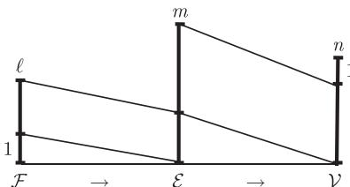

import Guide from '@/components/Guide.astro';
import Knowledge from '@/components/Knowledge.astro';
import Example from '@/components/Example.astro';
import Analysis from '@/components/Analysis.astro';
import Solution from '@/components/Solution.astro';
import Variant from '@/components/Variant.astro';
import Note from '@/components/Note.astro';
import Block from '@/components/Block.astro';
import Method from '@/components/Method.astro';
import Exercise from '@/components/Exercise.astro';

## 所有练习的提示

本书练习题旨在帮助读者深入掌握图论概念与前沿证明技巧。解题遇到困难时，可参考对应章节的提示。

<Solution title="第1章 练习提示">
**1.** 在每个顶点上有多少条边?

**2.** 对于平均度和边数 考虑顶点度对于直径:如何从两个顶点所对应的0- 序列决定距离?对于围长 这个图有长度为 的圄吗?对于周长 维立方体划分成为低维的立方体并运用归纳法.

**3.** 考察路是如何与 相交的图的圈都在哪里呢?它们可以都是短圈吗?

**4.** 是否可以找到一个图使得命题1.3.2 中的不等式成为等式

**5.** 用归纳法

**6.** 从中心顶点看，估计 中的距离

**7.** 如同命题1.3.3 的证明一样，计算顶点个数 对偶数情形，由两个相邻的顶点开始-

**8.** 从本质上讲 我们的任务是证明围长至少为 的圈也不能有相对于它的阶来说大的最小度等价地说，相对于它的阶，这些图一定有很多顶点你可以容易地看到多少个顶点呢?

**9.** + 考虑 中的最长路 它的端点的邻点在哪里呢?

**10.** 取定两个具有最大距离的顶点 和目，证明很多(但不一定是每个)到 的距离为集合 $D _ { i }$ 一定是太的

**11.** 用反证法，导出矛盾.

**12.** 一找到两个顶点，它们被两条独立的路连接

**13.** 对每一类圈，为了决定参数的值，要分别证明上界和下界是相同的.对于立方体，对归纳法

**14.** k= 找到 个反倒.

**15.** + (i) (ii) 重新叙述成两个 函数的存在性命题.为了证明等价性，把每个函数用另一个表达出来证明即使 (i) 和(均不成立， (iii) 也可能成立，然后加强(血)来修补这种不等价性。

16+ 如果 不是 (k + 1)-边连通的，那么它的顶点可以划分成集合 使得从边至多有 条如果 G[A] 不是 (k + 1)-边连远的，那么它也有类似的划分.这样继续下去，我们得到了顶点集 $A _ { 0 } \supsetneq A _ { 1 } \supset \cdots$ .假如选择得好的话，从这些集合\~J 的余下部分最多有多少条边呢?这些边的个数会被某个只依赖于 的常数限定吗?

**17.** 例证明中的归纳总路是基于，如果 有大的平均度并且 $\{ U _ { 1 } , U _ { 2 } \}$ 是 的阶最多为的分离，那么图 $G [ U _ { i } ] ~ ( i = 1 , 2 )$ 中的至少一个也一定具有大的平均度 是否可以构造一个 $G = G _ { 1 } \cup G _ { 2 }$ 的例子，使得如果"大的平均皮"意味着对于某个常数 $c _ { k }$ 有 $m \geqslant c _ { k } n .$ 那么这一步就不成立了?

**18.** + 我们试图证明"很多边"会蕴含一个高边连通子图这一假设如果 $\lambda ( G ) \leqslant k ,$ 我们把分离成两个子 $G _ { 1 } , G _ { 2 }$ 并希望可以继续迭代 的平均度足够大(比如说 2k) 这一简单假设的问题是，从 $G _ { 1 }$ ，和 $G _ { 2 }$ 的过程中，我们损失了两个子圈之间的边，因此两个 $G _ { i }$ ，的平均度都可能比 的平均度小.现在的思路是把假设条件要求的稍微低点要求 $\vert \vert G \vert \vert > k \vert G \vert + b$ 和 $b < 0 .$ 为了取最好的 $b ,$ Ibl 尽量大，并具有多于 $k \left| G \right| + b$ 条边，同时要求 不能是 $K ^ { k + 1 }$ ，因为它没有 $( k + 1 )$ -边连边的子图

**19.** 从相关概念的定义出发，证明 ${ \mathrm { ( i ) } } \Rightarrow { \mathrm { ( i i ) } } \Rightarrow { \mathrm { ( i i i ) } } \Rightarrow { \mathrm { ( i v ) } } \Rightarrow { \mathrm { ( i ) } }$

**20.** - 如何把不同的邻点变成不同的叶子.

**21.** 用平均度.

运用推论 5.3

运用定理1.5.1..

运用正则支撑树

**25.** + 在归纳步骤中删去一个顶点为了方便，加强命题会更容易使用归纳法

施+运用归纳法.

**27.** 最简单的方法是对 ITI 使用归纳法在归纳步骤中，去掉 $T$ 中什么样的顶点最好呢?也可以对 $| \tau |$ 用归纳法

**28.** 对 $| T |$ 用归纳法是一种解法，但不是唯一的办法

**29.** - 计算边数.

**30.** 证Ij)j，如果一个图包含任何奇周就一定包含导出奇圈

**31.** 其中一个蕴含方向的判断很容易，要决定另外一个是否成立，可以参考命题1.3.2 的证明

**32.** + 给定图 $G ,$ ，如何把顶点集分成两部分 使得由 A-B 边所定义的工部图有尽可能大的最小度?为了找到 $f ,$ 对给定阁 $G ^{\prime}$ 的恰当子图 $G$ 应用这个办法，同时决定多大的 $d ( G ^{\prime} )$ 可以保证 $\delta ( H ) \geqslant k$ 成立.

**33.** 把对有限图的证明推广到无限图上.

**34.** 验证定理的"容易"蕴含方向

**35.** 考虑一个最长的途径，它在每个方向通过每条边不多于一次，或者使用归纳法，

**36.** 为了证明某个边集不包含割，我们需要证明顶点集的每个二部划分都具有某种性质自

**37.** 因为圈中的圈支撑了它的圈空间 我们只需证明导出圈或测地圈生成每一个其他圈即可.对要生成的圆的长度用归纳法来证明这一结论

**38.** - 画图也许有帮助

**39.** 并不需要使用所有的 $C _ { j } ^ { i }$

**40.** 为什么需要所有的割 $E ( v )$ 来生成部壁间呢?去掉一个后还可以生成吗?去掉两个呢?

**41.** 从当图是团时的特剧曹形开始

**42.** 在树中，任意一对给定顶点之间存在一条唯一的路-

**43.** 每个支撑连通子图都包含一棵支撑树

**44.** 先证明 (i); 然后利用 (i) 对偶地给出 (ii) 的证明，

$4 5 . ^ { + }$ 考虑一条 $a { - } b$ 路 $P .$ 这条路与那些割有什么关系呢?

$4 6 . ^ { + }$ IGI 用归纳法，删除一个具有奇数度的顶点 $v ,$ 然后对进行了适当修正过的 $G - v$ (使得可以反映 中的作用)运用归纳假设如果把 看作由割 D(除非 $D = \varnothing$ ，这种情况是允许的)定义的顶点三部划分，这可能对证明有帮助

**47.** 一个边在关联矩 午下的象是什么呢?一条路的边集的象又是什么呢?

**48.** 对给定集合 $U \subseteq V$ 在 $B ^ { t }$ 下的象使用 (i)，从而来刻画在合成 $B B ^ { t }$ 下宫的象然后刻画下的象，来比较它和在 $A + D$ 下的象有什么不同

**49.** 用归纳法
</Solution>

<Solution title="第2章 练习提示">
**1.** -运用推论 2.2.2.

22+ 是满足婚姻条件的ι部圈，其二部划分为 \{A B\} 一开始制 问题简化到 $| A | = | B |$ 的特殊情形.在这种情形，关于 (A B) 的婚姻条件蕴含着关于 (B 码的婚姻条件，这在证明中会有用

**2.** 使用可扩路

**3.** 把函数转换成多重图，然后考虑它的分支-

**4.** 考虑 中的极大匹配

**5.** 如果不存在饱和 的匹配，那么由 Kön嗯定颈知道可以用更少的顶点覆盖所有的边如何根据这个假设找到 的较大子集使得它具有更少的邻点

**6.** 证明对 $A _ { 1 } \cup A _ { 2 }$ 婚姻条件在 中不成立这个证明儿乎是第三个证明的镜像，只需把井和交进行交换即可.

**7.** 在有限的情形，如果存在 $S \subsetneq S ^{\prime} \subseteq A$ 使得 $| S | = | N ( S ) |$ ，那么婚姻条件蕴含着 $N ( S ) \subsetneqq$ $N ( S ^{\prime} )$ 增加 可产生更多的邻点当 是无限的时候，这一结论成立吗?

运用婚姻定理

**9.** 构造一个二部图，一部分是 另一部分由若干个集合 $A _ { i }$ ‘的拷贝组成定义这个图的边集使得想要证明的结果可以由婚姻定理推出，

10+ 的幕集格中构造如下的链 对每个 $k < n / 2$ 找到从 子集的集合 X 的(k + 1)-子集的集合 之间的 1-1 映射 $\varphi$ 使得对于所有的 $Y \in A$ 都有 $Y \subseteq \varphi ( Y )$

**11.** 宦观地看，集合 $S \subseteq A$ N(S) 之间的边在 中比在 $N ( S )$ 中产生了更大的顶点度，因此这些边在 N(S) 中比在 中关联更多的顶点严格地说，我们可以把这些边作指标来分别计算 N(S) 的和.换句话说，考虑违反婚姻条件的极小集合 并用两种不同的方法计算 $N ( S )$ 之间的边

对第二部分 注意到，交化最可能发生的情形是，不快乐的顶点不需要得到其他快乐顶点的帮助也可以变得快乐如果这些花泛的讨论对你没有帮助的话，可以考虑 $K ^ { 3 }$

**13.** - 考虑从匹配边 ab 到后来的匹配边 $a b ^{\prime}$ 的转变，假定 倾向 $b ^{\prime}$ 而不是 $b ,$ 那么为什么它不一开始就和 b' 结婚呢?

**14.** 使用交错路

**15.** + 把命题加强，从而我们可以使用归纳法

16+ 首先解决练习 12 的第二部分.

**17.** 匹配是独立边的集合.

**18.** 决定叶子属于哪个部分 在国子临近分支中或 中.

**19.** 由传递性，如同定程 2.2.3 中的那样，每个顶点属于一个集舍

**20.** + 对于"当且"部分，对图 $G * K ^ { | G | - 2 k }$ 运用Th 因子定理，或者运用定理 2.2.3 后面的关于最大基数匹配的注解.

**23.** - 对于第一部分，考虑典型的非二部图对第二部分，从任意极大的独立边集开始.

**24.** 找到集合 以及互不相交树 $T _ { x } \in \tau$ (这里 $x \in T _ { x } )$ 的集合 $\mathcal { X } \subseteq \mathcal { T }$ 首先找到一个这样的 $T _ { x }$ 和 然后使用归纳法，要检验选择 $T _ { x }$ 和 是否合适，把它放在选择 的不同顶点作为根而导出的树序中考虑

**25.** 在引理 2.3.1 的证明中，哪里我们用了. $\Delta ( G ) \leqslant 3 ?$

**26.** 找到一个同构于圃或者 $K ^ { 2 }$ 或者 $K ^ { 1 }$ 的子图 包含一个不与 G-H 中任何顶点相邻的顶点，然后对 运用归纳法.

**27.** 从一个支撑树开始，然后通过添加一条另一个树上的合适边，对奇数度的顶点进行修正

**28.** 在哪一步，如果不是多重图我们会损失信息?

**29.** 如果通过仔细地阅读证明还是找不到错误(当然你应该可以找到，但这次可能有点棘手)，可以尝试对极端情形或者小的图验证命题.当找到反倒后，通过对反倒仔细检查证明，看看到底哪垦不成立

**30.** (i) 在哪个图中 删除任意顶点集可以减少平均度?对于(吗?首先尝试 ，这可能不起作用，但可以进行改进. (温)的解可能有些意想不到

**31.** 使用 Galla .gram 定理

**32.** 考虑任意最小路覆盖，

**33.** 把所有的边定向为从 B.

**34.** 运用 Dilworth 定理

**35.** 如果你愿意 可以使用练习 31 Dilworth 定理的筒单定性形式从 的极小元集合开始，找到 个想要的反链‘

**36.** 的元素看成比它在 中的邻点还要小.

**37.** 从任意大的有限反链来构造一个偏序集
</Solution>

<Solution title="第3章 练习提示">
**1.** 运用"分离"和"分立"的定义.

**2.** 用文字描述一下示意图所表达的含义

**3.** 用练习 回答第一个问题第二个问题需要一个初等计算，示意图中已经给出了提示

**4.** 只有第一部分需要证明，第二部分由对称性即可得到.记得用练习

**5.** - 根据四个顶点中的多少个连接到新的 路上，对归纳步骤分情况讨论-

**6.** 一个块怎样才不是一个极大的 连通子圈?由此还可得到什么结果?

**7.** 由图本身的连通性推导块图的连迪性，同时由每个块的极大性可推出它的无圈性

**8.** - 假设 $G / x y$ 不是 连通的，分情况讨论。 $v _ { x y }$ 在一个至多有 $k - 1$ 个顶点的分隔的内部或者它的外部-

**9.** 根据命题 3.1. ，用归纳法证明.

10+ 假设收缩 和删除 之后所得到的闺中都有一个坠分隔，那么这些分隔相茸的位置有什么关系呢?

**11.** 模仿定理 3.2.6 的证明

12‘ $G - e$ 中的非分离导出圃，而 中是 的弦时，则 的两个非分离导出圈上.

13+ $e = x y$ 是被收缩的边如果顶点 $v \in G$ 和 $x , y$ 都相邻，则认为四在 $G / e$ 中也出现(它变为边 $v v _ { e } )$ 而 $v y$ 成删去的平行边.因此，把 $E ( G / e )$ 看作 $E ( G )$ 的一个子集如中要生成的圃，则我们希望它的边集也是 $G / e$ 中的一个圈，这个圈由 $G / e$ 中的非分离导出圈生戚，并希望它们对应于 的非分离导出圈.这个方法对于后者不一定行得遇，但对于需要时添加三角形四百是可以的.这样的三角形在 巾是非分离的，因此它们可以随意地添加

**14.** + 练习 以及引理 3.2.4的证明会有所帮助

**15.** - 一步一步地 仔细阅读证明，直到找到论证不成立的地方构造一个恰当的反例来解释

**16.** 在这个问题中，命题 $a , b$ 的具体内容是什么?蕴含关系 $b \Rightarrow c$ 是否可以帮助我们评估通过 的证明路径是个危险的选择?

**17.** (i) 检查归纳法. (ii) 尝试去删除这样一个顶点或者边，然后使用归纳法如果我们找不到这样的顶点或者边 会是什么样的图呢?如果认为有必要，可以使用 Könìg 的匹配定理.

**18.** 有多大?为了证明剩下的筒单情形，先解决前一个练习将会有帮助.

**19.** $L ( G )$ 中选取极小的不交 A-B

**20.** 把问题简化为书中已证明的某个定理

**21.** 考虑最长圈 其他的顶点是如何连接到 上的?

22‘ 考虑个经过尽可能多的给定 个顶点的国如果其中的个顶点漏掉了，是否可以重新安排圈上的顶点来经过它?

**23.** 尝试让 是闭的单位正方形.

**24.** + 两个版本在两方面是不同的不交的 s-路对比独立 一路，所有的划分对比某些划分对这两方面的不同分别处理:基于 $( G - H ) - X$ 的任意划分来寻找 H-路的版本，然后证明这个练习和书中的版本都与 路版本等价.

**25.** 考虑提示中所给的图证明 和所有 H-路相交的任意顶点集对应于 $E ( G ) \setminus E ( H )$ 中的

一个类似集合辅助闺中的一对独立 H-路对应 中的什么?

**26.** 单个 $K ^ { 2 m + 1 }$ 可以包含多少条路?

**27.** 对于 中的顶点，选择适当的顶点度

也+设 是新的顶点集上的(无边)图.如果 $G ^{\prime}$ 不包含 IGI/2 条独立 路，则考虑 Mader定程提供的集合 F. 如果 不包含 园子，使用这两个集合来寻找一个合适的集合作为Tutte 定理中 的角色

**29.** - 让所有的路都通过一个顶点，

**30.** - 如果两个顶点 被少于放 个顶点分离，则把 \{5\} \{t\} 扩充成证明 不是 连接的.

**31.** 为了构造一个不是 连接的商连通圈，首先给定顶 $s _ { 1 } , s _ { 2 } , \cdots , s _ { k } , t _ { 1 } , t _ { 2 } , \cdots , t _ { k }$ ，通过指定某些边不存在使得想要的连接路所需要的顶点总数大子圈中所剩下的顶点个数为了使得图具有商连迪性，除指定的不存在的边外，添加所有其他边

32‘ $2 k - | S \cup T |$ 使用归纳法，其中 $S : = \{ s _ { 1 } , \cdot \cdot \cdot , s _ { k } \} , T : = \{ t _ { 1 } , \cdot \cdot \cdot , t _ { k } \}$ . 在归纳步攘，记得使用 ð(G) 2k -1 (练习 30).

**33.** 特别注意归纳论证部分

**34.** 为了构造 $T K ^ { r }$ J 首先选取分支顶点和它们的邻点，
</Solution>

<Solution title="第4章 练习提示">
**1.** 归纳地把顶点嵌入进去那么，哪里不可以放置新顶点?

**2.** 参考圈1.6.2

**3.** 对(斗，如果需要提示，可以重新考虑一下归纳法为什么以及如何成立的间的主妥任务不是找到一个反例(这很容易)，而是好好地理解为什么"证明"不仅"违反"归纳证明的规则，而且它不成立.

**4.** 使用定理 2.4.3.

**5.** (i)，使用 Euler 公式以及双重计数来证明 不能同时都很大对 (ii)，分步构造同构也

**6.** 为了把给定立方阁变成 正则多重图，需要傲的是找出哪些边需要加倍。一旦确定了要找的东西，就可以参考本书前面章节的有关结果

**7.** 这个练习不是一个笑话使用 Euler 公式进行双重计数，你会投意到自己是多么幸运

**8.** … 如果五边形不共享一条边，那么它们在图中的位雷在哪里?

模仿推论 4.2.10 的证明.

**10.** 运用命题 4.2.7

**11.** 把两种画法之间的差别表达达成关于顶点、面和它们之间关联关系的正式命题

**12.** 组合的使用定义;拓扑的=把 $H ^{\prime}$ 的短的(分别地，长的)分支的相对位置严格地表达成$H ^{\prime}$ 的性质，这个性质被任何拓扑同构所保持，但 不具有这个性质.

**13.** - 考虑自反性、对称性、传递性.

**14.** 找到一个圈，它的面法看起来都一样，但它存在一个自同构不能推广成平面 的一个同

胚把这个同胚解释成 $\sigma _ { 2 } \circ \sigma _ { 1 } ^ { - 1 }$

**15.** + 星形 每一个内部面都包含一个点，它可以看到整个面边界.

**16.** 考虑平面图而不是可平面圈，

**17.** (i) 集舍 可能是无限的

(ii) 考虑所有有限图的族，它的序由于式关系给出那么，由"禁用子式"的集合 $\chi$ 所刻画的图性质是如何包含在这个族中呢?

**18.** 由下一个练习知，任何反倒可以被最多两个顶点分离.

**19.** 把额外的条件结合到证明的归纳假设中 如果我们禁止具有 180 度角的多边形，这会有助于我们的证明

**20.** 考虑边数

**21.** 使用事实 极大可平面图总是\$崽匾的，以及每个顶点的邻点导出一千圈.

**22.** 如果 $G = G _ { 1 } \cup G _ { 2 }$ 且 $G _ { 1 } \cap G _ { 2 } = \overline { { K ^ { 2 } } }$ 证明就遇到了问题;但是，如果我们比必要的再多嵌入一点，问题就没有了

**23.** - 对给定的图 进行适当的修改来模拟外平面性-

**24.** 面边界将生成 C(G)

**25.** 使用事实 ${ \mathcal { C } } ( G )$ 是 $\mathcal { C } ( G _ { 1 } )$ 和 $\mathcal { C } ( G _ { 2 } )$ 的直和

**26.** 是面边界证明 我们需要所有其他的面边界来生成 C(G) 中的 要么为了方便我们使用练习 39(i) 直接证明这个结论，要么利用 Eul由公式和定理1.9.5 给出漂亮的证明.

**27.** 使用闺赞间维数.

**28.** + 参考示意图.

<figure class="vp-figure">
  
</figure>

**29.** 是杏覆盖每一条边至少一次?我们是杏可以重新覆盖那些没有覆盖两次的边，而不覆盖任何一条边工三次?

**30.** + (i) 我们主要是证明每个顶点"有一个邻域同胚于 $\mathbb { R } ^ { 2 }$ 在与 关联的边上，定义一个辅助图 $H _ { v }$ 对于两条边 $e , f \in V ( H _ { v } )$ 如果存在 中的--1'-圈包含 $f ,$ 那么连接和 $f . H _ { v }$ 具有什么结构呢?为了证明 是连通的，首先假定它不成立，然后找到的一个圈使得它不能被 生成.在 (ii) 中，我们需要证明的是 不可能是线性独立的

**31.** $| \mathcal D \backslash B |$ 有多大?

**32.** + 先解决练习 24.

**33.** 它具有多少个顶点?

**34.** 用直线连接对偶的两个给定顶点 然后使用这个在对偶图中找到它们之间的一条路

35+ 依次定义所需要的双射 $F \to V ^ { * } , E \to E ^ { * } , V \to F ^ { * }$ 憾，同时构造阁 $G ^ { * }$

**36.** 使用与两个对偶图对应的双射来定义想要的同构 并证明这个问构是组合的

**37.** 观察一下平面上发生的事情 在证明中使用抽象对偶来避免连通性问题如果在间的证明中遇到困难，可以使用 道路集舍包含关系，而不使用集合等式.

**38.** 考虑画法.

**39.** 在平面中使用 Menger 定理的恰当形式，我们可以容易地证明。)和 (ii). 不用 ger定理来证明 (i) 也有启发性，这可以通过在平面中删除一个不破坏 $G ^ { * }$ 的连迪性的顶点而直接证明. (但是，注意到，如果你用不到 的鸟连迪性，那么证明中就一定有错误最后，只使用抽象对俩，也可以对 (i) 给自一个简单而漂亮的证明.对 (iii)，记得使用命4.2.8

**40.** 借助抽象对偶的准确定义

**41.** (i)，一开始先决定哪个边集应该来界定 的面对 (ii)，运用画法的唯一性对 (iii)重新安排那些块.

**42.** 可以直接证明这个结论，而不需要平面性.
</Solution>

<Solution title="第5章 练习提示">
**1.** +尝试着对 用归纳法.在归纳步骤中，我们要删掉一对顶点，并删掉其他顶点的列表中的一种颜色如果这样的删除做不到，它们的列表会是什么样子呢?这些信息就能使得我们直接地找到一种着色，而不用再去考虑原来的阁

**2.** 当有超过三个国家享有公共顶点时，我们对地图 的这种顶点进行小的局部改变

一在五色定理的证明中，什么地方用到 v 的邻点个数不比所用颜色数多这一事实?

**4.** 不同块的着色是怎样互相影响的?

**5.** 考虑一下，某些边的删除是如何导致贪婪算法使用更多颜色的

**6.** 详细地描述一 ，到底如何来实现这个不同的算法那么，它和传统的贪婪算法有什么区呢?

**7.** 和命题 5.2.2 中一样，比较一下子图 中的边数和 中的边数 m.

**8.** 使用命题1.6. 1.

**9.** + 删除若干边直到图成为 k-色(临界)的边极小图 并考虑它的一个最小割.

**10.** 使用函数来正式叙述这个命题关于证明，通过最小度来进行

**11.** 考虑一个使 $\operatorname { c o l } ^{\prime} ( G )$ 种颜色的着色，是否只从这个着色就可以找回顶点着色的顺序?

**12.** 为了找到 $f ,$ 考虑一个给定的具有小着色数的图，并且归纳地把它划分成数目不多的森林.对于 运用命题 ι2.2 和定理 .4.3 中的必要条件.

**13.** 使用命题1.3. 1.

**14.** - 对于哪些具有较大最大度的图，命题 5.2.2 能够给出特别小的上界呢

15+ 对于第一个命题，压缩一个度数为 的顶点，然后使用归纳法

(i) $v _ { 1 }$ 和 $v _ { 2 }$ 如何被着色的呢? $v _ { n }$ 呢?

(ü) 根据 是否是 连通的，分两种情况讨论.

**16.** + 为了证明蕴含关系。i) →(斗，对阁 的一个不含有向圆的给定走向，考虑它的一个极大立撑有向子圈 为了对它的无向底图进行 着色，运用这个事实 中的所有有向路都是短的，从而证明这个着色也是 的一个 着色

**17.** 在归纳步骤中，比较 $P _ { G } ( k ) , P _ { G - e } ( k )$ 和 $P _ { G / e } ( k )$ 的取值

18+ 注意零点的重数

**19.** 应用 Erd缸定理‘

**20.** 模仿定理且2.6 的证明.

**21.** 参考 $K _ { n , n }$

**22.** 边着色是怎么和匹配联系起来的?

**23.** 构造一个包含 作为子圈的二部 $\Delta ( G )$ -正则图(也许需要增加一些顶点)

**24.** + 用归纳法，在归纳步骤 k+1 巾，使用关于 已经构造的阁的几个拷贝.

**25.** 首先证明两个同态的合成还是一个同态

**26.** 注意到，如果 同态于 $C$ 是一个充分长的 G-路，那么 GuP 也同态于 $C .$ 4

**27.** - 考虑顶点度.

**28.** $K _ { n , n }$ ，仲为了选择 使得 $K _ { n , n }$ 饥不是 可选择的，考虑一个 $k ^ { 2 } \cdot$ 集合的一族 子集，

**29.** 使用 Viz 定理.

**30.** 只需要使用相关的定义、命题 5.2.2 以及1. 节中的典型证法

**32.** 证明 $\chi ^{\prime\prime} ( G ) \leqslant \mathrm { c h } ^{\prime} ( G ) + 2$ ，运用这个结论从列表着色猜想来推出 $\chi ^{\prime\prime} ( G ) \leqslant \Delta ( G ) + 3$

**33.** 对于第一个问题，尝试着一条边一条边地构造一个没有核的定向图对于第二个和第三个问题，回想一下书中引入核这个概念的动机

34+ 我们称一个有向图 的顶点集合 是一个核心(∞re)，如果对每个顶点 $v \in D - S$ 都包含一条有向的 $v { - } S$ 路.进一步地，如果 $S$ 中的任意两个顶点之间都不包含 D 中的有向路，我们称 为一个强核心 (Btrong re) 首先证明每个核心都包含一个强核心然后，归纳地把 V(D) 划分成"层次 $L _ { 0 } , \cdots , L _ { n }$ ，使得对于偶数 $i , \ L _ { i }$ 是 $D _ { i } : =$ $D - \left( L _ { 0 } \cup \dots \cup L _ { i - 1 } \right)$ )中的一个适当的强核心，而对于奇数的 $L _ { i }$ 乌是 $D _ { i }$ 中与 $L _ { i - 1 }$ 连接的顶点组成的.证明:如果 不包含有向奇凰则它的偶层次舍起来构成 的一个核 .[i\

**35.** 逐步地构造引理 5.4.3 中所需要的定向 如果在目前的定向中，仍然存在顶点"满足$d ^ { + } ( v ) \geqslant 3 ,$ ，那么把与顶点 关联的边的方向反过来，并且注意调整由这个改变所引起的效应-如果我们想界定可平面二部图的平均度，记得使用 Euler 公式

**36.** - 从'个非完美图开始.

**37.** 奇圈或它的补满足(对吗?

**38.** $\mathcal { H } _ { 2 }$ 中的图运用? $\mathcal { H } _ { 1 }$ 的性质，反之亦然

**39.** König 定理意味着存在一个顶点集和每条边相交，把完美性的定义重新叙述为，与所有着色类都相交的顶点集合的存在性.

**40.** 考察补图.

**41.** 归纳地定义一个给定导出子图 $H \subseteq G$ 的着色类，从所有的极小元组成的类开始，

**42.** (i) 一个导出圈上的顶点是否可以作为区间互相包含?

(ii) 使用实数的自然序

**43.** 比较 $\omega ( H )$ 和 $\Delta ( G )$ (这显 $H = L ( G ) )$

**44.** + 什么样的图具有它们的线图不包含长度 $\geqslant 5$ 的导出奇圈?模仿 Vizin吕定理的证明方法，证明这样的图 的边可以用 $\omega ( L ( G ) )$ 种颜色来着色.

**45.** 当成一个着色类

**46.** 带着这两个问题，重新阅读定理的证明

$4 7 . ^ { + }$ (i) 用归纳法也

(ii) 假设 不包含导出的 $P ^ { 3 }$ ，并且某个 包含一个极大的完全子圈 以及一个与不相交的极大独立集 对每个顶点 $v \in K$ 考虑。在 中的邻点集合，这些集合是怎祥相交的呢?有没有一个最小的呢?

$4 8 . ^ { + }$ 作为 的候选，从阶为 $\omega : = \omega ( G )$ 的所有完全子图的集合开始如果它们覆盖 中所有的Jjjî点，则给 $\omega$ 种颜色，并且把 取成着色类的集合 否则，就像引理 5.5.5一样试图扩展那些未被覆盖的顶点，使得它们在扩展图 $G ^{\prime}$ 中可以属于一个 $K ^ { \omega }$ 中，并且 $G ^{\prime}$ 的一个着色也定义 $\vec { \textbf { J } } G$ 的一个由独立集组成的集合

$4 9 . ^ { + }$ 把一般的情形简化成除了一个外，其他 $G _ { x }$ 都足平凡的情况，然后模仿引理 5.5.5 的证明
</Solution>

<Solution title="第6章 练习提示">
**1.** +可能存在一个直接的归纳证明，但是并不容易 一定要保证在绘图中那些看起来不同或不相邻的顶点，在图中确实也是不同或不连接的。一个更简单但并不初等的证明可以从定理 6.5.3 得到

**2.** (i) 在改进解的过程中，引导算法往返地反复使用中间的边

(ii) 在使用算法的每一步，对顶点 考虑最短的 $s { - } v$ 途径，它符合作为可扩路的 $s { - } v$ 的初始路段的条件证明:对每个顶点 $v ,$ 这个 $s { - } v$ 途径的长度在算法中不会减少其次，考虑一条边，它被可扩路使用并饱和了若干次.证明这些路的每一个都比前面的要长，然后推出想要的界

$3 . ^ { + }$ 对于边的形式，使用推理 6.2.3 把定理所提供的流归纳地转换成充分多个边不交的路对于顶点的形式，把每个顶点分离成两个相邻的顶点 $x ^ { - } , x ^ { + }$ ，并如下定义新图的边和容量:通过边 $x ^ { - } x ^ { + }$ 具有正值的流对应于在 中包含 的路

**4.** 由定义知 H-流是处处非零的

**5.** 考虑顶点度-

**6.** 为了证明唯一性，考虑基本割.

**7.** (i) 给定 $\psi \in { \mathcal { D } } _ { H }$ 像定理 6.5.3 的证明中的着色 样构造 $\varphi \in { \mathscr { V } } _ { H }$

(ii) 基本圈也生成"具有定向的'圈空间

$8 . ^ { + }$ 明这个问题的一种方法是，证明。)中的两个群都同构于 $m + n - 1$ 的拷贝的直积，而(且)中的两个群都同构于 $n - 1$ 的拷贝的直职(和往常一样，这里 $n = | G |$ 而$m = | | G | | )$ I)我们不是直接定义自然的同构，而是找到一个具有核 $\boldsymbol { B } _ { H }$ 的满射 $\mathcal { E } _ { H } \longrightarrow \mathcal { C } _ { H }$ 以及一个具有核 $\mathcal { C } _ { H }$ 的满射 $\mathcal { E } _ { H } \to \mathcal { B } _ { H }$

**9.** 使用定义以及命题 6.1.1

**10.** 子图是否也可看作子式?

**11.** 依次尝试 $k = 2 , 3 , \cdots$ .在寻找 流的过程中，暂时固定通过一条边的流值，然后考察这对相邻边的影响

**12.** 表达成圈的并

**13.** 一开始，通过树 外部的每条边发送小量的流.

**14.** 结合若干适当子图上的 $\mathbb { Z } _ { 2 } .$ 流来得到UG 上的流

**15.** 利用前一个练习，并回忆树填装方面的知识

**16.** 看成恰当选择的圈的并.

**17.** 使用推论 6.3.2 和命题 .4.1.

**18.** 利用对偶性

**19.** 取成具有较大流数的圈，我们是否可以通过加边来减少它的流数呢?

**20.** 使用 Euler 环游-

**22.** 使用定理 6.5.3.

**23.** (i) 使用定理 6.5.3

(均可以通过考虑最小的反例，证明 如果每一个 连通立方可平丽多重图是 ←边可着色的(所以有 流)，那么每一个无桥立方可平丽多重圈也是岳边可着色的.

**24.** + 对于"仅芽'部分，运用命题 6.1.1反过来，考虑 上的循环 $f ,$ 它取值在 $\{ 0 , \pm 1 , \cdots , \pm ( k -$ l)\} 中，并遵循给定的定向(即在 所决定的边定向上取正值或零)，并且在尽可能少的边上取零值.然后，如下证明 是处处非零的 如果 $e = s t \in E$ 上取零值且已在中的定向是从 自U $s ,$ ，定义网络 $N = ( G , s , t , c )$ 使得 中的每个具有正的总和的流的选择矛盾，但是 中的任何具有零容量的割与 所假定的性质矛盾

**25.** 把给定的多重图转换成具有同样流性质的图
</Solution>

<Solution title="第7章 练习提示">
**1.** 由定义直接推出

**2.** - 当构造极图时，首先固定着色类

**3.** - 运用命题1. 7.3 (ii).

**4.** 抉定 $\mathrm { e x } ( n , K _ { 1 , r } )$ 的下界并不难，需要证明的是对于所有的 和饲这个界可以达到.

$5 . { } ^ { + }$ 在定理 2.2.3 中的结构所决定的阁中，如果没有边数为 的匹配，那么它的最太可能的边数是多少呢?S $G - S$ 的分支之间顶点的最优分布是怎样的呢?是否总是存在一个图使得它的边数达到对应的上界?

**6.** 考虑 的具有最大度的顶点 $x ,$ 并计算 $G - x$ 中的边数.

**7.** 选择 使得 $n = ( r - 1 ) k + i$ 且 $0 \leqslant i < r - 1$ .先处理 $i = 0$ 的情形，然后证明在

一般情形省 $t _ { r - 1 } ( n ) = { \frac { 1 } { 2 } } { \frac { r - 2 } { r - 1 } } ( n ^ { 2 } - i ^ { 2 } ) + { \binom { i } { 2 } }$

B 提示中给出的界是两个特别简单的Tur缸圈的边敛，到底是哪一介的呢?

**9.** Turán 图.

**10.** 个顶点中，选择一个具有 个顶点的集合使得它仍然与尽可能多的边相关联

**11.** 对第一个不等式，将不包含 $K _ { s , t }$ 的极圈的顶点集加倍从而得到一个二部图具有双倍的边数，同时也不包含 $K _ { s , t }$

12+ 为了证明第一个不等式，计算满足 $x \in A$ 且具有 $| Y | = r$ 的 $Y \subseteq B$ 同时 关联肺腑的有制川对于 $\mathrm { e x } ( n , K _ { r , r } )$ 的界利用不等式 $( s / t ) ^ { t } \leqslant { \binom { s } { t } } \leqslant s ^ { t }$ 以及函数 $z \mapsto z ^ { r }$ 是凸的这两个结果.

**13.** Erdós Stone 定理.

**14.** 运用命题1.2.2 和推论1. .4

**15.** 考虑完全图

**16.** 一考虑平均度

**17.** 具有多于 $\frac { 1 } { 2 } ( k - 1 ) n$ 倒是否能保证拥有适当最小度的子图的存在呢?

**18.** 考虑一介具有高平均顶点度和低色数的图，它的哪个树是导出树呢?是否存在某种原因使得我们可以期待在具有商平均顶点度和低色数的图中，这些树恰好总是导出的

**19.** 所有的蕴含关系要么很容易证明 要么可以从书中的结论推出(不只限于本章的内容).

**20.** + 一开始，取 是小的遥远顶点集 $V _ { 0 } ,$ 如果它的邻点导出的子图需要很多颜色，那么由归纳法它应该可以收缩成 $K ^ { r - 1 }$ ，在这种情形，收 $V _ { 0 }$ 可产生 $K ^ { r }$ 如果它只需要很少颜色，令它的邻点的集合为 $V _ { 1 }$ ，并收缩 $V _ { 0 } \cup V _ { 1 }$ 归纳地进行下去如果每个 $V _ { n }$ 只需要很少几种颜色，那么这与 $\chi ( G )$ 很大这一假设矛盾.作为 $\chi ( G )$ 的函数，什么意义下的"很少气上面最后的论证还成立?对应的"很太"的概念会给我们一个使定理成立的函数 f.

**21.** 模仿命题 7.2.1 的证明.

22+ 首先证明我们只需要考虑最小度至少为 的图 ，然后利用推论1.3.5 可以看出存在长度最多约 2logn 的圈 C. 不妨假设 恰好有 $n + \lceil 2 k ( \log k + \log \log k + c ) \rceil \geqslant 3 n / 2$ 条边，从而给出 IICII 的一个用 表达的上界，然后证明，恰当地选择 $c ,$ ，只需要删去这么多条边就可以使归纳步骤成立

**23.** 一开始和定理 7.2.3 的证明一样，然后不定义 $H ^{\prime}$ ，而是把 中的顶点直接连接到H中.

**24.** + 当我们希望保持 较小时，如何使得 $T K ^ { r }$ 很好地适应 $K _ { s , s } ?$

**25.** 根据提示所构造的圈中，哪一个具有最大的平均度?

**26.** - 平面性与子式有什么关系呢?

**27.** 考虑一个恰当的母圈，

**28.** 把这个练习中给定的 $\chi$ 的下界和本章中考虑过的界进行比较

**29.** 对构造的步骤数目使用归纳法

**30.** IGI 用归纳法

**31.** 利用上一个练习

**32.** 从一个具有较大最小度的恰当的子图开始 7.2 节中的哪一个结果或技巧可以用来进一步增加最小度，使得它成为定理 7.2.4的舍适输入图?

**33.** + IGI 用归纳法证明， $G \not \approx K ^ { 4 }$ 的导出圈的任意 着色可以延展到整个 上.

**34.** + 把要证的命题筒化到临界 着色图上 然后运用 Vizing 定理

**35.** 在定理 7.3.4 构造的图中，哪个图有最大的平均度?

**36.** - 进行比较时 为什么包含类似于 元素集合 是不现实的

**37.** - 利用 正则对的定义.

**38.** 练习中"太约"的意思是 相比， IVI 较大对于第二部分，不要参考定理 7.1. 的证明细节，而是遵循定理后的非正式解释

**39.** 对(斗，取 足够大，对于(剖，对考虑的图使用类似于(斗的结论当处理大的图时，令$k : = m$
</Solution>

<Solution title="第8章 练习提示">
**1.** -尝试和 $\mathcal { P } _ { n }$ 一起构造 G.

**2.** - $\sigma$ 从 $s _ { i }$ 优于，， $\sigma ^ { i }$ .

**3.** 是可数集 的子集的集合，使得对于不同的 $A ^{\prime} , A ^{\prime\prime} \in { \mathcal { A } }$ 和某个固定的 $k \in \mathbb N$ 有$| A ^{\prime} \cap A ^{\prime\prime} | \leqslant k .$ 考虑一个固定 集合 中有多少个集合包含 $S ?$

**4.** 考虑一条射线 $v _ { 0 } v _ { 1 } \cdots$ ，它可以是递减的吗，即 $v _ { 0 } > v _ { 1 } > \cdot \cdot \cdot ?$ 如果不可以，它是否可以递增后再递减昵，即它包含三个顶点使 $x _ { i - 1 } < x _ { i } > x _ { i + 1 } ?$

了归纳地构造这些路另外，也可以运用 Zorn 引理来找到一个不交 A-B 赂的极大集个集合可以是有限的吗?

**6.** 如果你不能使这种方法成立，解释为什么它过不去呢?

**7.** - 这个圈中有多少个圈?多少个基本圈?

在圈空间中 如何才能生成无限多个圈呢?

**9.** 对每一个可数集 存在点对 $\{ u , v \} \in [ V ] ^ { 2 }$ 的序列使得每一个这样的对出现无限多次，

**10.** 从一个顶点或一个团开始归纳地构造这个图为了保许最后的图有高连通度，把每个新的顶点和将要走义的无限顶点集之间连接很多条边.

**11.** 考虑树，并利用前一个练习.

**12.** 模仿定理 8.7.3 的证明练习 98 提供了一也有用的筒单框架

**13.** 逐步地生成这个有限子图在每一步，看看在己生成的子图里是否每个顶点的度数至少为 $d ;$ ，如果没有，给它增加几个新的邻点

**14.** 用反证法证明对某个整数饵，一个不包含 $T K ^ { n }$ 的图的色数是多少呢?

**15.** - 建立一个广义无限引理使得当 $P = N$ 时，它与定理 8.1. 的第一个证明中的无限引理是相同的

**16.** 一开始从 上的拓扑的定义出发，描述 中点序列收敛的涵义，序列到底需要具有什么性质才能保证它的收敛子序列都可以决定 的恰当着色呢?我们是告可以从假设来推导这样一个序列的存在性呢?也许可以从无限引理中找到一些想法

**17.** - 这是一个典型的紧致性证明 对可数图用无限寻|理，然后对任意图运用附录 中的紧致性原理或 'ychonov 定理.

**18.** + 首先使用 Zorn 引理来找到 $V ( G )$ 的一个划分 使得 的划分类 满足每个 $G [ U ]$ 具有一个 棵支撑树的填装，我们选取 有尽可能多的划分族 U. 然后，使用附录 中的广义无限引理，这里选取 $G / P$ 的有限子圈，来证明 $G / P$ 的边可以划分成 个森林(注还有另外一种方法把填装覆盖定理推广\~J无限圈，它是基于"拓扑支撑树"的，参见练习 12晴)

**19.** + 细分 中的每条边一次，然后把 $G _ { 0 }$ 的新拷贝移植到这些细分顶点上，这需要 $C$ 的长度至少为 $k ,$ 做到这点只需要要求给定的 $G _ { 0 }$ 。有足够大的围长，但是围长到底多大需要在构造的过程中重新考虑.对于树填装的推论，考虑其中一个支撑尉的基本圈.

**20.** 对于必要性，取 $S = \{ 0 , 1 \}$ ，然后把到 的函数看成子集.对于充分性，考虑 $\mathcal { F }$ 中集合的子集

**21.** 尝试证明没作修改的命题，

**22.** (i)，考虑一个无限序列中的顶点，其中这个无限序列使用每个顶点无限次.在每次考虑一个顶点时，让它更开心一点对于 (ii)，首先使得一类顶点开心，然后再考虑别的顶点.

**23.** 运用无限引理或者附录 中的紧致性原理对无限引理，找到一个有关 $G _ { n } = G [ v _ { 1 } , \cdot \cdot \cdot$ $v _ { n } ]$ 的顶点划分的命题，使得它蕴含着关于 $G _ { n - 1 }$ 的导出划分的对应命题，同时，当它对的一个给定划分导出的 $G _ { n }$ 的划分成立时，它对 的这个划分也成立

**24.** 对有限子图的一个恰当的减弱命题运用无限引理或者附录 中的紧致性原理.

**25.** 对于反例部分，注意到如果在有限的情形 $S \subseteq S ^{\prime} \subseteq A$ 满足 $\vert { S } \vert = \vert { N } ( { S } ) \vert$ ，那么婚姻条件保证了 $N ( S ) \subseteq N ( S ^{\prime} )$ 增加 可产生更多的邻点但是，当 是无穷时，这可能不成立我们可以利用这一事实

**26.** 使用紧致性.

**27.** + 注意到，为了运用无限引理，只需在 的每一个有限导曲子圈 $G _ { n }$ 中找到一个独立边的集合，使得这个边集合覆盖那些在 $G - G _ { n }$ 中没有邻点的顶点为了找到这样的边集合，对圈 $H _ { n }$ 运用有限 1-因子定理(这里 $H _ { n }$ 是在 $G _ { n }$ 上添加一个大的完全图 $K ,$ 并完全连接K到 $G _ { n }$ 中所有在 $G - G _ { n }$ 中具有邻点的那些顶点).如果你遇到困难，改变 $| K |$ 的奇偶性.

28卢应用 4.3 节的内容，使得画法可以容易地运用无限引理。在无限引理图中，为了从一条射线构造最后的画法，要保证通过归纳构造的部分画法确实是平面上的明确画法，而不只是某类抽象等价的画法

**29.** - 借用练习 的提示，证明 Menger 定理的某种变化的扇子版本

**30.** 归纳地构造 $T K ^ { \aleph _ { 0 } }$

$3 1 . ^ { + }$ 对于 (i)，首先考虑证明存在一个顶点，它不支配一个末端 但是可以被有限多条边和

分离关于俏，分析一下(斗的证明中哪里用到了有限可分离性

曲二分树 $T _ { 2 }$ 开始，在保持图的可数性的同时，使得末端变厚

**33.** 假设局部有限连通图 有三个不同的末端 是一个有限顶点集，它两两分别分离这些末端。取一个自同构把 映射到"远处的 ${ } ^ { \ ' } G - S$ 的分支，是否可以证明 的映象分离这个分支使得 一定有多于三个末端?

**34.** + 取定一个顶点叫它的轨道 $U = \{ v , \sigma ( v ) , \sigma ( \sigma ( v ) ) , \cdot \cdot \cdot \}$ 是有限的还是无限的呢?为了决中的位置，令 是从。到jσ间的路，考虑无限并 $P \cup \sigma ( P ) \cup \sigma ( \sigma ( P ) ) \cup \cdot \cdot \cdot$ 这个并是否以某种形式定义一个末端呢?另外，由序列 $v , \sigma ^ { - 1 } ( v ) , \sigma ^ { - 2 } ( v ) , \cdot \cdot \cdot$ 可以得到什么结论呢?

**35.** 使用引理 8.2.2.

**36.** 运用引理 8.2.3.

**37.** 为了证明命题对树成立，假定树有不可数个末端，然后在树中构造一个细分的 $T _ { 2 }$

38‘ 找到一个与正则支撑树相关的等价命题。

**39.** 使用上一个练习.

**40.** 考虑正则支撑树中的基本圈

**41.** 为了构造。)中的正规支撑树，模仿关于可数图 的证明把每个分散的集合排成良序集，然后连接这些良序成为 V(G) 上的良序 再递归地构造想要的树

**42.** + 采用顶点的情形，来构造无限多个边不交的途径，这些途径不重复使用边但只重复使用顶点有限多次，分段地构造这些途径使得，除了最后一段外，每段与前面的段落是顶点不交的(也不与其他途径相交)

**43.** 模仿定理 8.2.5 的证明，选择与给定的来端所使用的所有射线，那么构造的射线是否也属于这个末端?如果不属于，怎么才能实现呢

**44.** 模仿定理且2.5 的证明 只要可能，尽量选择射线而不是双射线，

**45.** 我们需要证明的是，在任何一个包含任意多个 的不交模型的图 中，找到一个具有同样性质的局部有限子图第一步是找到一个这样的可数图 $G ^{\prime}$ ，并排列它的顶点，然后运用这个排列来找到一个局部有限子图 $G ^{\prime\prime} \subseteq G ^{\prime}$ 使得 $G ^{\prime}$ 的每个顶点只被有限多个的模型使用.

**46.** 为了构造一个包含任意多个改进型梳子 同时不是无穷多个 的拷贝的图，从无限多个不交的 的拷贝开始，然后把它们分成不交的集合 $S _ { 1 } , S _ { 2 } , \cdots$ 使得 $S _ { n }$ 是 n 个 T 的拷贝的不交并，再把不同的集合 $S _ { n }$ 中的顶点重合起来使得它们破坏 的不交拷贝的无限"对角线"集合

47‘ 与定理 8.2.6 的证明不同，我们可以使用(很大但是有限的)集合 $\textstyle { \mathcal { R } } _ { 0 }$ 。中所有射线的合适的尾巴作为射线 $R _ { n }$ .所以，证明中由假定(树)开始的部分可以替换为更筒单的算法来找到 $R _ { n }$ 和不交 $R _ { n } \ – R _ { p ( n ) }$ 赂的无限集为了决定需要多少条射线，考虑无限引理的恰当有限形式的命题 任何足够大的根树要么包含一个至少有 个后继的顶点，要么包含一条长度为 的路

**48.** 假定存在一个广义罔 ，构造一个局部有限连通图 使得它的顶点度对于的任何嵌入都"增长太快"

**49.** 修改 $K ^ { \aleph _ { 0 } }$ 或者Rad 圈，也可以尝试直接构造-

**50.** - 运用性质的.

**51.** 运用往复技巧

**52.** 运用往复技巧

**53.** 归纳地找到划分，每次删除一个图的边集并证明剩下的图仍然同构于 如何才能保证一旦删除了所有必需的边集，就没有边剩下了呢?

饵， 把密度像性质的一样使用。

**55.** R

**56.** 对于性质的中的顶点。，先令 $v : = U$ 这样的设定为什么不行呢?如果不行，如何修改呢?你可以运用基础公理 (axiom of foundation)，由它知道不存在集合的序列$x _ { 1 } \in \cdot \cdot \cdot \in x _ { n } \ ( n \geqslant 2 )$ 且 $x _ { 1 } = x _ { n }$

**57.** 贪婪地收集这些路

**58.** 参考练习 59 对于局部有限图 ，找到集合 $S _ { i }$ 很容易.

**59.** + 首先处理支配剧的那些顶点如果你认为有帮助，可以假定 有一棵正则支撑树

60+ 使用练习 59 中的思路

**62.** 选取 $a \in A ,$ 并构造一序列被 $\mathcal { W } _ { 1 } , \mathcal { W } _ { 2 } , \cdot \cdot \cdot$ 使得每个波包含平凡路 \{α\} 定义在 $a$ 的边使得 在每个 $\mathcal { W } _ { n }$ 的边界上，但不在限制波的边界上

**63.** + 正如可数的情形一样，一般性的问题可以简化\~J寻|理 8.4.3. 对森林证明这个引理

$6 4 . ^ { + }$ 由?开始，递归地定义路系统 $\mathcal { P } _ { \alpha }$ 使得它从 逐步地连接更多的 B. 在递归步骤中，选取非覆盖顶点 $b \in B$ 并沿着包含它的路 $Q \in \mathcal { Q }$ 后退直到它碰上 $\mathcal { P } _ { \alpha }$ ，这里记 $P = a \cdots b ^{\prime}$ 我们可以重新调整 使得它沿着 $Q$ 到达 $b ,$ 但这会让 $b ^{\prime}$ 成为非覆盖的那么，在有限步骤后，这些变化是否可以使得 的覆盖部分增加?为了证明这是会发生的，我们可否定义一个"指标"参数 它随着步数的增加而增加(或减少)但不能无限地增加(或减少)1作为选择，也可以证明并运用稳定婚姻定理 (2.1玛的某种无限形式，

**65.** (i) 恰好是紧致性，这是一个运用定理 8.1. 且只需一行的漂亮证明，对于间，由若干任意大的有限反链构造一个偏序集.对于 (iii)，定义一个二部罔如下=对每一个点 $x \in P .$ 选取两个顶点 $x ^{\prime}$ 和 $x ^{\prime\prime}$ ，并添加满足 $x < y$ 的所有边 $x ^{\prime} y ^{\prime\prime}$ 在定理 .4.8 所提供的圈中，考虑匹配 和顶点覆盖 是如何定义了一个 的链划分呢?对于这样一个链的多少个点 $x ,$ 对应的 $x ^{\prime}$ 或 $x ^{\prime\prime}$ 属于 呢?

**66.** 由定理 8.4.11 包含一个 因子你是否可以使用这一事实对 (ii) 给出一个肯定的答案.

**67.** 为了保证每一个部分匹配是可扩展的，这样的图需要有很多边，然而如何避免 因子的出现呢?

**68.** 先考虑 的完全子图是有限界阶的情形，我们可以使用 8.1 节的结果.

$6 9 . ^ { + }$ 对于 (ii) 的完美性 证明 $T _ { 2 }$ 的每个具有任意大的有限反链的子集也有一个无限反链.

$7 0 . ^ { + }$ 为了简单起见，把图替换成它的一棵支撑树 哪些顶点比其他顶点需要在排列中出现

的更早?对(吟，考虑正则支撑树

**71.** 提醒 $T _ { \alpha }$ 是由递归剪枝算法定义的，所以它在 中是下集合

**72.** 如果 $U ^{\prime}$ 是另外一个这样的集合，那么考虑顶点 $u \in U \setminus U ^{\prime}$ 以及 $G - U ^{\prime}$ 中包含甸的分支的秩。

**73.** 对图的边进行细分会对它的秩产生什么影响呢?

**74.** 对(斗，注意一条射线有可数多条子射线对(盐i) 中的充分性?递归地修剪给定树，把已经界定的子树剪掉

75+ $T _ { \aleph _ { 1 } }$ 有这样的标号吗?如果 $T T _ { \aleph _ { 1 } }$ 递归地构造 的一个标号假定标号已存在，在中标号为零的顶点的位置在哪里呢?标号为 的顶点在哪里呢?

**76.** 是局部有限图时， (垣)中所需要的射线的存在性可以立即从星-梳子引现得到.当 $G$ 不是局部有限图时，要么直接构造这条射线，要么对构造过程中所产生的局部有限树使用屋-梳子引理.

77‘ 对于必要性，注意到不存在顶点的有限集合把 分离开来.运用这一事实归纳地构造 R-U 路，或者使用 Menger 定理的平凡形式。

**78.** 答案也许依赖于 是否是局部有限的提醒，从紧致空间到 Hausdorlf 空间的连续双射是一个同胚，对于 (iii)，可以使用引理1.5.5 (坦).

**79.** (ti) 中，我们可以假定实数已表达成二进位形式.实区间 [0 11 保持了从 继承来的子空间拓扑，它就是 上通常度量所生成的拓扑.

**80.** 注意对未端空间所傲的并非故意的变化

**81.** 可以对树使用定理自 6.2 运周引理1.5.5 (ti) 或者练习 78 的答案，从 (i) 的解答推出。i).

**82.** 对于 (i)，定义一个问胚，它把 的射线映射到 的射线，但反之不然对于间，证明$T _ { n }$ 可以从 $T _ { 2 }$ 通过收缩有限集合来得到，

**83.** 如果序列紧致壁阳(即每一个点的无限序列都有一个收敛的子序列)有可数萎，那么它是紧致的假如无限引理看起来没有什么帮助 可以参考引理 8.2.2

**84.** + 为了定义 上的拓扑，模仿标准的单点紧致化的定义

$8 5 . ^ { + }$ 对于紧致性的证明，使用正则支撑树并模仿命题 8.6.1 的证明.

$8 6 . ^ { + }$ 对于第一部分，减少树的边长度使得由根开始的一个射线的总长度变成有限，然后调整中另外边的长度，并拓展所得到的度量到 的未端1:.对于第二部分，注意到对 $V \cup \Omega$ 上给定拓扑所生成的度量，距离每个末端至少 $1 / n$ 的顶点的集合 $V _ { n }$ 是封闭的，并证明取正整数时，这些集合覆盖

**87.** 在度量空间中，每个点是可数多个开集的交集这里的开集是围绕点的半径为 $1 / n$ 的开球 $( n \in \mathbb { N } )$

**88.** + 给定连通的标准予空间 ，以及一个来端 $\omega \in X$ ，考虑足够小的开邻域 $\hat { C } _ { \epsilon } ( S , \omega )$ 使得$| E ( S , \omega ) \cap E ( X ) |$ 是最小的然后使用引理 8.6.7

**89.** + 给定 的一个弧分支 和一个末端 $\omega \in { \overline { { A } } } .$ ，选取 中收敛于 $\omega$ 的点序列 $x _ { 1 } , x _ { 2 } , \cdots$ 尝试通过把 $x _ { n } { - } x _ { n + 1 }$ 弧的段藩拼凑在一起，来构造一个从这些点到j $\omega$ 的弧

**90.** 可以运用事实 从单位圆上删除一个开区间，剩下的部分还是连通的，但删除两个不交的开区间则不连通记住 ]G] 的闭连通子集是路连逝的

**91.** 构造两个属于同一个末端的射线，它们起始于同一个顶点但在其他顶点不交这种构造可以通过考虑正规射线并运用射线的顶点都不是割点这一事实实现.

**92.** 由回路所生成的子图的分支是什么呢?两个结果都需要使用跳跃弧寻|理.

**93.** 前面提到，在 $S ^ { 1 }$ 中每一个点有一个由 $\mathbb { R } ^ { 2 }$ 中的弧组成的邻域基.可否证明 中连接两个末端的每一个弧一定在一个边相交?如果不能证明，可否证明它交于一个顶点?如果还不行，记得使用引理 8.6.3

**94.** + 在一个无穷序列中，排列双射线 和 $D _ { l }$ ，并归纳地定义这些 $D _ { l }$ 和 $S ^ { 1 }$ 的适当线段之间的局部同胚.当完成这个后，把所有双射线的井的局部同胚拓展到tlG 的末端上，使得最后的映射连续.定义想要的双射的一个好办法是，一方面使用。 序列集合的线性序的结构 另一二 面，把 $S ^ { 1 }$ 的区间看成 [0 1] 的一个拷贝，并考虑它的线性序的结构

**95.** 证明 每个包含不可数多个来端的弧的区问都包含一个顶点，使得这个顶点把它分离成两个区间参考练习 54.

96‘ 需要多少个不交的国才能使得它们的交可以具有一个遥远闭包?你是否见过一个遥远标准予空间，它是不交孤的并的闭包?

**97.** 需要证明的主要命题是满足条件的每一个子空间 是一个圈设 $A \subseteq C$ 是连接两个顶点 $x _ { 0 }$ 和脚的弧如果 $y _ { 0 }$ $C \setminus A$ 的任意顶点，那么 的连通性导出了 的一个$v { - } A$ 弧，它是 上的第一个点，由皮条件知它一定是 $x _ { 0 }$ 或 $y _ { 0 }$ 。从 中顶点的一个排序 $v _ { 0 } , v _ { 1 } , \cdot \cdot \cdot$ "开始，构造一个顶点的耳道路无限序列 $\cdot \cdot \cdot , x _ { - 2 } , x _ { - 1 } , x _ { 0 } , y _ { 0 } , y _ { 1 } , y _ { 2 } , \cdot \cdot \cdot$ 使包含连接 $x _ { - i - 1 }$ 到 $x _ { - i }$ ‘的弧 $A _ { i }$ 以及连接 $y _ { i }$ 到如 $y _ { i + 1 }$ 的弧 $B _ { i }$ (对所有 $i \in \mathbb { N } )$ 1)，使的并 和所有的这些弧是 $( 0 , 1 )$ 的同胚拷贝运用它的尾巴的连通性证明它们收敛于 的唯一末端从度假设导出这两个末端重舍，且 $\overline { { U } } = C$ 是一个圈

**98.** 设 $T _ { n }$ 是由树 中前面 层组成的子树那么容易地定义一个映射 $\sigma _ { n }$ :把 $T _ { n }$ 嵌入平面中，然后"沿着"它行走，使得你的右手放 $T _ { n }$ 旦上，而你的脚紧挨 $T _ { n }$ .为了保证 $\sigma _ { n }$ 的兼容性，有必要要求 $\sigma _ { n }$ 在 $T _ { n }$ 每个叶子"停顿"一会，即把[口 1] 的一个非平凡子区间映射到每个叶子上在这些区间，我们可以把内 $\sigma _ { n }$ 展从而得到内+ $\sigma _ { n + 1 }$ 剩下的工作是，当 $n \to \infty$ 时，对于在 $\sigma _ { n }$ 中不断改变取值的那些点 $x \in [ 0 , 1 ]$ ，怎样正确地定义极限 $\sigma$ 并且证明在这些点上的连续性.

**99.** 应用引理 8.6.5 和引理 8.6.7. 也可以使用每个圈包含一条边这一事实.

100- (i) 如果一个拓扑支撑树同)fF..于一个空间 $| T |$ (这里 是一棵树)，但它本身没有这种形式，那么它包含一个末端，这个同胚把末端酣才到一个点(即不是一个末端)你能找到一个拓扑支撑树使得这些不成立吗?(ii) 对任意这样的树 $T$ 去存在 的个末端，它不能被 个射线代表.从这个末端 $T$ 如何支撑 的一个射线呢?

**101.** 使用基本割

**102.** 不要使用紧致性

**103.** 罔顾引理 8.6.11 以及它的证明对 (i)，可以使用一个简单的事实， $S ^ { 1 }$ 并不真包含 $S ^ { 1 }$ 的另外一个拷贝对 (ii)，证明 每个不包含有限键的边集都避开一个拓扑支撑树.

**104.** 我们需要通常的立捧树，也需要拓扑立捺树可以考虑使用练习 117 的结果 每个普

含一个键

**105.** + 为了找到正确的条件，考虑一个容易的蕴含关系，然后模仿定理 8.6.9 的证明，即收缩X $\backslash S _ { n }$ 的弧分支 这里 $S _ { n }$ 的最前面 个顶点的集合首先证明 $X \setminus S _ { n }$ 只有有限多个弧分支.你能把 V(X) 所对应的划分拓广成 $V ( G )$ 的一个划分，同时只有有限多个交叉边?

**106.** 记得，有限平面图的非分离导出圈都是边界.

**107.** - 为什么 不能成为拓扑支撑树?

**108.** - 用贪婪方法找到 回路，使得所有的边都包括在内

**109.** - 考虑薄度

**110.** 从同一个拓扑支撑树的基本回路来律成每个被加数.

**111.** 回顾所有关于圈空间的结果.

**112.** 跟随定理 8.7.3 的证明直到需要一个弧来连接一个给定地的端点 $x , y$ 这个地方这个弧可以通过找到一个包含 的恰当选通标准予空间来得到，然后应用引理 8.6.5.

**113.** 定理 8.7.3 的证明中，对任意边 $e = x y \in G _ { n }$ l 园为 一定属于 $G _ { n }$ 的一个圃，所以可以找到一条在 $G _ { n } - e$ 中的 $x { - } y$ 路还有哪个其他假设你可以用来找到这条路呢?

**114.** 使用 的"有限性"描述

**115.** 这不能从定义直接得到tl，一个 的给定有限元素可以表达为(可能无限个)罔路的无限薄和.书中的哪个定理可能有用呢?你是否可以不用整个定理，而是只使用证明中半路二建立的一个结论呢?

**116.** (i) 中的第一个命题，先解决练习 115 或者使用书中的一个定理对(垣)中的第一个命题可以直接证明 由可能产生给定的有限割 的基本回路的唯一和开始，要证明它确实加起来等于 同时使用它与 的和是另外一个有限割这一事实

**117.** (i) 容易证明. (ii) 可以类似于第 章的练习 39 来证明.对于 (ili)，参考定理1.9.5 的证晚在那里基本割的和可能形成一个给定的割，这里直接证明这是可以实现的(不要使用(时，除非你可以不使用 (i植)而直接证明 (iv).) 证明命题 (iv) 并不能像关于 ${ \mathcal { C } } ( G )$ 的证明那样可以简单地从 (ii) 推出(为什么不可以呢?)然而， (iv) 可以从(温)推出·把给定和的每项重新表达成基本割的和，证明所有的被加项是恰当定义的，并找到一个顶点划分来证明这个和确实是一个割.另一个更漂亮的证明可以从练习 118 (i) 得到

**118.** 对于(斗的第二-个命题，参考1. 节仰的第一个命题容易证明，但需要书中的某冲定理对于第二个命题，因为 是耳边远远的，所以每条边属于一个有限回路.我们需要证明的基本事实是:对每个无限割 我们可以找到一个集合 $D \in { \mathcal { C } }$ 使得 $D$ 与 $F$ 在无限多条边上相交令 是不交的有限回路的无限并‘如果这些回路互相相交得太多，记得使用事实 正则支撑树的基本回路组成一个薄族。

$1 1 9 . ^ { + }$ (i) 这个命题可以容易地证明但并不平凡

(ii) 对第一个命题，首先证明每个集合 $F \in \hat { \mathcal { C } } ^ { \perp }$ l.是一个割，然后从 $F$ 中删除不交有限键的一个极大集合，从而得到一个警tl $F ^{\prime}$ ! 需要证明 $F ^{\prime} = \varnothing$ (ii) 的第二部分是这个的对偶.

(iii) 任意集舍 $F \in \hat { \mathcal { C } } ^ { \bot } \setminus \mathcal { C } ^ { \bot }$ 是一个无限割，它与每个回路相交偶数次.不难构造$F$ 使得 不与任何回路相交无限次构造的一个难点是，构造对鸟连通图成立，但对卢连通图不成立(因为我们不知道 $\hat { \mathcal { C } } ^ { \perp } = \mathcal { C } ^ { \perp }$ L是否成立)，使得我们不能和回路相交奇数次构造满足 $B ^ { \bot } \subsetneq \hat { B } ^ { \bot }$ 2-连通图时可以使用对偶技巧.

**120.** 一开始，把有限定理运用到引理 8.6.10 或定理 8.7.1 (iii) 的证明中所定义的子式 $G _ { n }$ ，我们可以得到两个明显的紧致证明:第一个构造一个顶点划分，它导出想要的边划分二‘个将直接构造想要的边划分.考虑使用练习 118 (i).

**121.** (i) 有一个非常简单的证明，但是它不能对 (ii) 提供一个对偶解.为了证明 (ii)，尝试把表达成一个拓扑支撑树的基本回路的和你如何选择这棵树使得所有 $e \in F$ 都属于和式中呢?

**122.** + 关键是找到恰当的支撑树.

**124.** + 容易看出给定条件是必要的为了证明充分性，归纳地构造一个 Euler 环游，在构造过程中对余下图中出现的任何有限分支立即结合进来为了保证所有的地包含在内，把地排列，总是把 一个边作为包含的对象.需要考虑两种情形 如果 有奇割，首先覆盖割中的边，并把它们尽量远的端点成对地连接起来，然后分剔地处理剩下的两个无限分支，如果 没有奇寄tl，归纳地用一个有限闭途径的序列来覆盖它的边 使得其中的每一个有限闭回路和下一个相交于一个顶点，然后在这些圈的并中找到一个 Euler 环游

**125.** 使用第 章的练习 23 来证明在 8.8 节中定义的 的子式 $G _ { n }$ 包含 Hamilton 圈然后使用练习 97 或者引理 8.8.4证明，它们的边集合收敛于 IGI 中一个 Hamilton 圆的边集舍，选择 $S _ { n }$ 连遁对证明会有所帮助，

12晴+首先解答更容易的练习 18 对拓扑支撑树，从覆盖开始，然后考虑填装使用 Zorn 引理来寻找"极大的 森林填装.为了简单，开始时对某些 $G / P$ 可以允许森林包含拓扑回路，这里"大的"填装指使用更多边和更细致的顶点划分 然后，对 的划分类在由子图 $G [ U ]$ 定义的标准子空问中寻找拓扑支撑树填装，

**127.** 对所有非流通图 ，证明不成立吗?或者只对部分不成立?或者都成立?

**128.** 这个练习的目标是，对在坷的的某个合适的共尾子集 中的所有 $p ,$ 找到一族和引理8.8.4中一样的映射 $g _ { p } \colon S ^ { 1 } \to X _ { p }$

**129.** + 首先证明，如果我们从一个连通标准子空间 中删除 个顶点的集合 $S _ { n }$ 那么 $X \backslash S _ { n }$ 只有有限多个弧分支.然后对某个合适的共尾集 $P \subseteq P ( G )$ 中的所有 找到树 $p ,$ $X _ { p } ^{\prime} \subseteq$ $X _ { p } = | G / p |$ 它们在通常的键合映射! $f _ { q p } \colon X _ { q } \to X _ { p }$ 的限制 $f _ { \boldsymbol { q p } } ^{\prime}$ 下组成了一个逆系统下一步证明，它们的逆极限 $X ^{\prime} \subseteq \varprojlim X _ { p }$ 中是一个拓扑支撑树 证明的诀窍是选择 时也需要考虑 但是如果你不想重新证明这个特别的逆系统，而是使用定理8.8.2，那么你要考虑 V(G) :划分巾不仅仅是 $V ( X )$

$1 3 0 . ^ { + }$ 使用超滤子 (ultrafilter). 这个练习适合以前学习过紧致化知识的学生.
</Solution>

<Solution title="第9章 练习提示">
**1.** - 能否可以使用红和绿两种颜色来给 $K ^ { 5 }$ 的边着色，使得没有红色的三角形或绿色的三角形?是杏可以对 $K ^ { 6 }$ 进行同样的着色呢?

**2.** 运用归纳法.在归纳步骤中，把两个着色类结合起来

构造一个划分使得任何一个类中都不包含一个无限的等差数列，归纳的同时构造这两个类.

**4.** 如果一个图的色数很小，这是否意味着它包含一个大的导出 $\overline { { K ^ { r } } }$ 呢?如果是，有多大呢?

$5 . { } ^ { + }$ 选择 上的一个良序，并且把它和自然序做比较，对于可数的论证，运用有理数.

$6 . { } ^ { + }$ 假设存在很多弦 $x y$ (不妨设 $x < _ { T } y )$ 使得路 $x T y$ 两两至少有一条公共边要么找到一个这样的顶点 的大集合使得 所对应顶点 都重合，要么找到t $T$ 中的一个顶点，它有很多不可比较的百位于它之上，要么找到 中一条长的递增路使得 $x T y$ 中的极大顶点 $t _ { y }$ 对于很多宫是不同的.然后找到一个对应于这些 $y$ 的顶点 的一个长序列$x _ { 1 } \leqslant \cdots \leqslant x _ { n }$ ，并且证明这些路 $x _ { i } T y _ { i }$ 和弦 $x _ { i } y _ { i }$ 的并包含很多边不交的困

$7 . ^ { + }$ 第一个和第二个问题容易证明为了证明 $n = k \ell + 1$ 时有这个性质，对于固定的 $\ell ,$ 对k运用归纳法，并且在归纳步骤中考虑长度为 的递增子序列中的最后一个元素.另一种方法是，运用前面章节中的一个著名定理，

**8.** 运用 $^ { * } n$ 个点 $( n \geqslant 4 )$ 支撑一个凸多边形当且仅当它们中的任意四个点可以支撑一个凸多边形"这一事实

**9.** $\{ 1 , 2 , \cdots , n \}$ 的一个给定 划分转化成 $K ^ { n }$ 的一个 边着色

**10.** (i) 容易证明.对于 (ii) ，运用 $R ( 2 , k , 3 )$ 的存在性.

**11.** 首先找到无限多个集合使得它们两两的交有相同的元素个数.

**12.** 这个练习给出了比需要更多的信息.查询 7.2 节的内容看看哪些喘息是相关的.

**13.** 模仿命题 9.2.1 的证明

**14.** 下界容易证明对于上界，给定一个着色，考虑一个顶点以及通无崎当的着色边与这个顶点连接的邻点

**15.** 如何选择飞 的顺序呢?哪些论证蕴含着 $k = \ell$ 的情形呢?

**16.** 给定 $H _ { 1 }$ 和 $H _ { 2 }$ 构造一个图 使得定理 9.3.1 中的 满足的

**17.** 饨的取值是间接定义的，在 第一次出现的稍后给出.

**18.** $G [ U  H ]$

**19.** 对于 $k = 0 , \cdots , m$ 归纳地证明 $\omega ( G ^ { k } ) = \omega ( H )$

**20.** 我们是如何使用那些从 $P ^{\prime}$ 到另外 $V _ { i } ^ { k }$ 之间的边的?

**21.** 对同一个性质，考虑两个 Kuratowski 集，设它们为\{ $\{ \mathcal { P } _ { 1 } , \cdots , \mathcal { P } _ { k } \}$ \{毡 $\{ \mathcal { Q } _ { 1 } , \cdots , \mathcal { Q } _ { \ell } \}$ 是否存在 $\mathcal { P } _ { i } \leqslant \mathcal { Q } _ { 1 } ?$ 如果存在，它是否一定和 $\mathcal { Q } _ { 1 }$ ，等价?

**22.** 只需小心地遵循定义即可-
</Solution>

<Solution title="第10章 练习提示">
**1.** 一个可平面图的遥远度可以有多大呢?

**2.** 考虑两个着色类的并.

**3.** 对于回定的 $n ,$ 对 用归纳法，在归纳步骤中考虑 $\overline { G }$

**4.** 什么样的 连通图 满足 $\chi ( G ) \geqslant | G | / k$ 但是不满足 $\alpha ( G ) \leqslant k ?$

**5.** 对(斗，首先考虑 本身有 Euler 环游的情形对 (ii)，使用定理1.8.1 和推论 .4.2

**6.** 注意到，却 分一个与奇数度顶点相关联的地是生成非 Ha ilton 图的一个有用技巧.为了找到 关于间的例子，对一个高连通的小图运用这个技巧.

**8.** 回想一下 Ha nton 序列的定义，

**9.** - Chváta.l条件在什么样的顶点上发生呢?为了验证 满足条件，首先找到一个这样的顶点.

**10.** 考虑 $G ^ { 2 }$ 中的 分隔，它的顶点把那些 G-边连到哪里了?

**11.** 使用定理 10.2. 1.

**12.** 度条件指出，对每一个导出路 UVW 和凹的公共邻点的个数至少和"的不与 或者四关联的邻点个数一样多.你是否可以构造一个"长"图使得它对所有这样的阻四满足这个条件?也许这个圈还具有有界的最大

13‘ 根据 Fleischner 定理，某些图的平方图中包含 nilton 圃，那么这些图和任意的连通圈有什么不同?这种不同会如何妨碍 阻且阳也圈的存在呢?

14+ 为了使用归纳法，考虑一个更强的命题

**15.** 把一个新的顶点连接到两个给定的顶点上.

16+ 如何把一条 Hamilton $P \in \mathcal { H }$ 修改成另外一条呢？有多少种方法呢？它与P的最后一个顶点在 中的度数有什么关系呢?
</Solution>

<Solution title="第11章 练习提示">
**1.** 考虑 $\{ 0 , 1 , \cdots , n \}$ 上的 条固定边， $G \in \mathcal { G } ( n , p )$ 恰好包含这个边集的概率是多少?

**2.** 像引理 1.1. 的证明一样，考虑适当的指示随机变量.

**3.** 考虑适当的指示随机变量

**4.** 使用 Erdãa 定理，

**5.** 对于一个固定的 ，集合 \{G\} 的度量是什么呢?

**6.** 考虑互补性质

**7.** $\mathcal { P } _ { i , j }$

**8.** 应用引理 1.3.2

**9.** 在练习 的帮助下，对 IHI 用归纳法.

**10.** 模仿命题 1.3.1 的证明为了限制相关的概率，像引理 11.2.1 的证明中那样使用不等式$1 - x \leqslant e ^ { - x }$

**11.** + (i) 计算孤立顶点的期望值，然后像定理 11.4.5 的证明中那样使用引理 11.4.2.(玛利用线性性质.

**12.** + 使用 5.2 节中 Erdõs 定理的证明 以及少许 Chebyshev 不等式

**13.** 对第一部分 寻找一个递增性质，使得它的概率并不真正依赖于 p. 对第二部分，少许修改递增性质，使得它停止一直增长但保持它的阙函数，

**14.** 使用 V(H) 的置换

**15.** 这是书中一个经过伪装的结果

这些圈是平衡的

**17.** 只存在有限多个阶为 的树

**18.** 对于 $p / t \to 0 ,$ ，使用引理 1 1.1. 和引理 11. 1. 5; 对于 $p / t \to \infty$ ，使用推理 11 .4.6.

**19.** (i) ，使用事实 对 $i \geqslant 1 , A _ { i }  0 .$ 。对俏，回忆一下 $A _ { 1 }$ 是如何定义的，以及它和 $A _ { 0 }$ 有什么不同之处如果必要的话，重新读一下当 $i = 1$ 时计算 $A _ { i }$ 的细节，找出和计算 $A _ { 0 }$ 的不同之处.

20+ 首先证明不存在阙函数 $t = t ( n )$ ，使得当 $n \to \infty$ 它趋向零，然后使用练习 10
</Solution>

<Solution title="第12章 练习提示">
**1.** +是的.要证明这个结论，首先证明每冲连遁阁 包含一条路?删除这条路后会增加路宽. (使用 的一个路分解来找到这条路.)接着构造一棵树的序列 $T _ { 1 } , T _ { 2 } , \cdots$ 使得在$T _ { n + 1 }$ 中删除这样一条路后剩下的部分包含 $T _ { n }$ 最后，归纳地假设 $T _ { n }$ 具有大的路宽

**2.** 对充分性，首先假设 有一个无限的反链，这种情况是比较容易的.其他情况的证明不十分显然但也比较类似，注意到 A=Z 并不是一个反例.

**3.** 为了证明命题 12.1. ，考虑一个无限序列，使得这个序列的每个严格递减子序列是有限的一个极大递减子序列的最后一项和它后面的项相比会有什么不同呢?对推论 12.1.先证明至少有一项和它后面的无限多项构成好对

**4.** - 这是一个需要细节的练习: tI不难看出"并不是一个证明.

**5.** 任何坏序列中的树一定变得任意大.因此，我们寻找树 $T , T ^{\prime}$ 使得 $| T | < | T ^{\prime} |$ 但是 $T \not \leqslant T ^{\prime}$ 考虑一些简单的例子，然后重复其中的一个使得它成为--1'坏序列.

**6.** 在原证明中，是否曾经把一棵树的根映射到另外一棵树的一般顶点上

**7.** 结合引理 12. 1. 和定理 12.2.1 的证明

**8.** 我们是否可以把一个给定图 扩展到另外一个图，使得 可以由这个图通过删除边而不经过收缩而得到?我们可以法代这个图建立一个无限反链吗?

**9.** + 一个坏序列中的图 是否可以有任意多条独立边?如果不能，它们包含若干有界的顶点子集覆盖所有的边(为什么呢?)考虑一个子序列，它里面的那些顶点集都导出同一个图，并且在这个子序列中找到一个好子序列.

**10.** + 当我们试图把一个阁 TG 嵌入到另外一个阁 中时 TG 的分支顶点只能映射到具有至少相同度数的顶点上扩展一个适当的图 到一个不包含 作为拓扑子式的类似图H(因为这些顶点被安排在不方便的位置上).重复这个例子来得到一个无限反链

**12.** - 关于"子树"的关键点在于它们是连通的.记得我们的约定 遥远图是非壁的.

**13.** 对给定树分解进行修改，每次删除一个非极大的部分.

**14.** 对充分性，应用推论1.5.2 反过来，对 用归纳法

**15.** 为了证明 (T功，考虑圈 12.3.1 中的边 验证 (T3) 会比较容易

**16.** (i)，把兼容性条件叙述成一个(关于 的两种选择)1 $T - e$ 的分支上的类似条件，对(ü)，要么找到一个巧妙的办法直接定义 $V _ { t }$ ，要么对 $| S |$ 进行归纳 并从 中删除一个具有极小 的分割 \{A B\}. 在对版于 ${ \cal { S } } \setminus \{ \{ A , B \} \}$ 的树分解中，像引理 12.3.4的证明中那样，把树分解的边定向从而找到一个部分使得新的部分与树边连接.

**17.** + 在建议的树分解中，考虑一个非岳连通的躯干 $H = H _ { t }$ 证明存在一个圃 $C = v _ { 1 } \cdot \cdot \cdot v _ { k } v _ { 1 }$ 且 $V ( C ) \subseteq V ( H )$ (但不一定有 $C \subseteq H )$ 使得，对所有的 $u , v , x , y \in V ( C )$ ，顶点也和v 在 C 中分离 x 和 $y$ 当且仅当在 中也是这样.选取 是关于细分极大的，证明$H = C .$ 对逆命题，从它的树分解的躯干开始，归纳地构造这个图，构造中始终保持己构造分解树的连通性

**18.** 我们的任务是对每个顶点 $h \in H$ 找到 $T _ { h }$ 的正确定义在练习 12 中，集合 $T _ { v }$ 描述了的给定树分解，我们可以 $T _ { v }$ 来定义 $T _ { h }$ ，或者直接使用分解中的部分 $V _ { t }$ 来定义.你能找到这两种描述吗?

**19.** 使用归纳法.

**20.** 使用归纳法.

**21.** 借用第 7.3 节的一个结果 不要对 的子图失主理!

22‘+证明:分解中的部分恰好是 的极大不可约导出于圈，

**23.** 使用练习 12.

**24.** $C ^ { n }$ 有一个宽度为 的分解使得每个顶点至多属于两个部分这个分解为得到网格的一个好分解指明了方向.严格地证明 $K ^ { n }$ 和 $C ^ { n }$ 的给定值是最优的要比看起来的更难你不妨尝试运用引理 12.3.1.

**25.** 对第一个问题，回忆一下引理 12.4.1.对第二个问题，试着修正 的树分解使得它成为TG 的一个树分解但是不增加它的树宽度.

**26.** 使用练习 13

**27.** + 用一棵正规的支撑树作为分解树，设t $t _ { 1 } , \cdots , t _ { n }$ 是 $V ( T )$ 的一个列举使得 $t _ { 1 }$ 是根且所有的集合 $\{ t _ { 1 } , \cdots , t _ { i } \}$ 在 $T$ 中是连通的对 $t = t _ { 1 } , \cdots , t _ { n }$ 递归地定义部分 $V _ { t }$ 以便满足练14 中的条件.

啤+应用平面对偶性

**29.** 对充分性，把分解路的子路看成是线段，哪条子路自然地对应于 的一个给定顶点?

**30.** 遵循命题 12.4.4 的证明.

**32.** + 关于必要性，对每个 $i = 1 , \cdots , n - 1$ 选择一个阶数 $\leqslant k$ 的分割 $\{ A _ { i } , B _ { i } \}$ 使得吨， $v _ { 1 } , \cdots , v _ { i } \in$ $A _ { i }$ 且盹 $v _ { i + 1 } , \cdots , v _ { n } \in B _ { i }$ . 选择这些 $\{ A _ { i } , B _ { i } \}$ 满足 (i) $\{ A _ { i } , B _ { i } \}$ 的阶数最小; $( \mathrm { i i } ) \mid A _ { i } \mid$ 是最小的(在满足 (i) 的条件的，设 $V _ { i } : = A _ { i } \cap B _ { i - 1 }$ 是所需的路分解的部分，证明 只要$i < j$ 就有 $A _ { i } \subseteq A _ { j }$

**33.** 使用引理 12.3.1

**34.** 构造一个恰当的路分解来证明树宽最多为 为了证明树宽至少为 $n$ 在 $n \times n$ 网格中，我们对 $( n - 1 ) \times ( n - 1 )$ 网格的交叉刺藤通过增加两个集合来拓

**35.** - 存在性由定理 12.4.3 给出;我们的任务是证明唯一性，我们说一个部分是唯一的，是指官作为一个集合或者子图是唯一的，这个唯一的部分可能是某个或者几个 $V _ { t } ~ ( t \in T )$

**36.** 把 $\mathcal { K } _ { \mathcal { P } }$ 和它的类似概念进行比较，从而引进--1'更强的概念

**37.** 要回答第一部分，对每个禁用子式 构造一个图的有限集合，使得禁止这些图作为拓扑子式等价于禁止 作为子式对第二部分，我们可以使用练习 10

**38.** + 对第一个蕴含关系，模仿引理 12.3.4的证明.对第二个蕴含关系，贪婪地构造一个具有小树宽的树分解.首先定义几个覆盖 的某个导出子图 的部分，递归地假定 $G - H$ 的任意分支 的邻集 满足 $| N | \leqslant 3 k$ 并且 属于 的树分解的一个已经构造好的部分中把 扩展成 来组成树分解的另一个部分，比如把 扩展成 $H ^{\prime}$ 要证明新的部分可以选的足够小使得 $C - H ^{\prime}$ 的每个分支有最多 3k 邻点(都属于新的部分)，同时使用 中不是 (k+ 1) 连道的这一假设，

**39.** 是图 的具有 个顶点的 连通集，这里 是大的整数.在定理 12.4.3易证明的蕴含关系中，我们把 的边进行走向使得边指向 中包含"刺藤线"的一边.证明，反过来，我们可以如此定义刺藤=每一个具有至少 个顶点的分离集 $S$ 都"指向"G-S 的一个分支 使得 U V(C) 包含 中至少三分之二的顶点，并且这些集合V(C) 组成一个阶 >k 的刺藤.

**40.** 尝试贪婪地构造当选取一个分离集的定向并把它添加到己完成定向的部分时，新的分离集是否影响其他分离集的定向呢?

**41.** 找到一个结束点 (sink)

**42.** 一旦把 定义为一个阁，记得证明它是一棵树.

**43.** (i) 中的两种情形都只需要一行证明，但它们稍有不同.对 (iv)，满足 $A \cap B = X$ 的分离集 $( A , B ) \in \theta$ 是否定义了 G-X 的分支上的一个超滤子呢?

**44.** (i) (ii)，参考上一个练习对 (iii)，有一个明显的方法来定义纠缠.要证明它确实是一个纠缠，考虑集合 $\{ ( A _ { 1 } , B _ { 1 } ) , ( A _ { 2 } , B _ { 2 } ) , ( A _ { 3 } , B _ { 3 } ) \} \in \mathcal { T }$ "，那么 $B _ { 1 } \cap B _ { 2 } \cap B _ { 3 }$ 可以是多大呢?

**45.** 对(斗，你可能需要给分解树增加一些新的叶子对 (ii) 中的纠缠集，考虑 G-X 的分支，这里 是小的

$4 6 . ^ { + }$ 两个证明几乎完全相同，除了在定理 12.5.1 中我们证明了对 $T _ { i }$ 的内点 的星 $\alpha _ { i } ^{\prime} ( \overrightarrow { F } _ { t } )$ 在$\tau$ 中，而这里要证明在 $\mathcal { F } _ { k }$ 中，这是唯一需要证明的.要证明这一点， $\mathcal { F } _ { k }$ 中的一个星$\sigma ,$ 尝试把星 $\sigma$ 中分离集的大的一边的交 $B _ { 0 } \cap \cdots \cap B _ { n }$ 写成 $S _ { k }$ 中一个合适的分离集的两边的交然后使用前面已证明的一个事实z $\alpha _ { i } ^{\prime}$ 把定向的分离集(例如 $\overrightarrow { E } ( T _ { i } )$ 中的那些分离集)映射到 $\vec { S } _ { k }$

**47.** 和图 $X \in { \mathcal { X } }$ 变得很太肘，覆盖 中所有的 IX 的难度有多大的变化呢?如果我们替换成它的"极小子式"兀素的集舍，这个问题会有多少变化呢?

**48.** + 可以嵌入到上面的曲面。我们可以利用事实=可以不相交地嵌入到 上的的拷贝数目被某个数值 $n \in \mathbb N$ 所界定为了证明对 $k > n$ 不能定义 $f ,$ 对 $f ( k )$ 考虑一个候选值 $\ell \in \mathbb { N }$ I!，并把 的一个固定画法扩展到 上一个图 $H ^{\prime}$ 的画法，使得删除任意的 个顶点后剩下的图仍有一个 子式.

**49.** + 找一个反倒

$5 0 . ^ { + }$ 为了说明非平凡树分解是必要的，我们可以利用练习 31 以及不存在一个曲面可以容纳无界多个不交 $K ^ { 5 }$ 的拷贝这一事实，来构造相应的例子.对余下的例子，考虑对非球丽的曲面上的大网格或者类似网格的圈进行修改

51+ 我们的任务是找到一个圈，它不包含 $T K ^ { n }$ 但它的结构需耍一个容纳 $K ^ { n }$ 的曲面回忆前一个练习，在不包含通常的 $K ^ { n + 1 }$ 子式的结构定理中，我们需要一个具有最大 Euler亏格的曲面使得 $K ^ { n + 1 } \not  S$ .图 $G \not \approx K ^ { n + 1 }$ 稠密地嵌入到Us 中，特别地， $G$ 有一个 $K ^ { n }$ 子式 因为它可以有小的最大度 所以它不包含一个 $T K ^ { n }$ 现在，利用 的选择来把修改成一个图 $G ^{\prime}$ 使得 $G ^{\prime}$ 有(无界多个)大度的顶点但并不包含 $T K ^ { n }$ 气和定理 12.6.7一样 我们需要曲面 来描述 $G ^{\prime}$

饵， 参考 7.2 节中具有大色数图的子结构-

**53.** $K ^ { 5 }$

**54.** 首先对连通图推导子式定理.

**55.** 使用1. 节中证明的正规支撑树的分离性质如果需要，你可以使用第 章的任何练习

56‘ 选择 中合适的射线作为分支集，并用新边连接它们.

**57.** 对第一个问题，考虑 $\mathbb { Z } \times \mathbb { Z }$ 网格中的同心圆以及它们之间的路，并运用 $\mathbb { Z } \times \mathbb { N }$ 网格是可平面的这一事实

**58.** + 充分性的证明和有限情形证明的不同之处在于=现在需要构造分解树以及部分可以尝试归纳地傲，首先把一个极大完全子图 作为第一个部分为了把分解扩展到 $G - H$ 的一个分支 上，我们考虑 中一个在 中具有尽可能多邻点的顶点，并证明这些邻点包含 中的所有邻点.

**59.** 使用\~致件‘证明 如果 的每个有限于图有一个团数苇少为 的弦图，那么 $G$ 也有-

**60.** 使用可平面性你可以使用第 章中的任何练习
</Solution>
