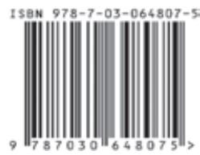

import Guide from '@/components/Guide.astro';
import Knowledge from '@/components/Knowledge.astro';
import Example from '@/components/Example.astro';
import Analysis from '@/components/Analysis.astro';
import Solution from '@/components/Solution.astro';
import Variant from '@/components/Variant.astro';
import Note from '@/components/Note.astro';
import Block from '@/components/Block.astro';
import Method from '@/components/Method.astro';
import Exercise from '@/components/Exercise.astro';

(按出版时间排序)

1 椭圆曲线及其在密码学中的应用——导引 2007.12 （德）Andreas Enge 著
吴 铤 董军武 王明强 译

2 金融数学引论——从风险管理到期权定价 2008.1 （美）Steven Roman 著
邓欣雨 译

3 现代非参数统计 2008.5 （美）Larry Wasserman 著 吴喜之 译

4 最优化问题的扰动分析 2008.6 （法）J. Frédéric Bonnans （美）Alexander Shapiro 著
张立卫 译

5 统计学完全教程 2008.6（美）Larry Wasserman 著 张波 等译

6 应用偏微分方程 2008.7（英）John Ockendon, Sam Howison, Andrew Lacey & Alexander Movchan 著 谭永基 程 晋 蔡志杰 译

7 有向图的理论、算法及其应用 2009.1 （丹）J. 邦詹森 （英）G. 古廷 著 姚兵 张忠辅 译

8 微分方程的对称与积分方法 2009.1（加）乔治 W. 布卢曼 斯蒂芬 C. 安科 著 闫振亚 译

9 动力系统入门教程及最新发展概述 2009.8 （美）Boris Hasselblatt & Anatole Katok 著
朱玉峻 郑宏文 张金莲 阎欣华 译 胡虎翼 校

10 调和分析基础教程 2009.10 （德）Anton Deitmar 著 丁 勇 译

11 应用分支理论基础 2009.12 （俄）尤里·阿·库兹涅佐夫 著 金成桴 译

12 多尺度计算方法——均匀化及平均化 2010.6 Grigorios A. Pavliotis, Andrew M. Stuart 著
郑健龙 李友云 钱国平 译

13 最优可靠性设计：基础与应用 2011.3 （美）Way Kuo, V. Rajendra Prasad, Frank A. Tillman, Ching-Lai Hwang 著 郭进利 闫春宁 译 史定华 校

14 非线性最优化基础 2011.4 （日） Masao Fukushima 著 林贵华 译

15 图像处理与分析：变分，PDE，小波及随机方法 2011.6 Tony F. Chan, Jianhong (Jackie) Shen 著 陈文斌，程 晋 译

16 马氏过程 2011.6 （日）福岛正俊 竹田雅好 著 何萍 译 应坚刚 校

17 合作博弈理论模型 2011.7 （罗）Rodica Branzei （德）Dinko Dimitrov （荷）Stef Tijs 著

刘小冬 刘九强 译

18 变分分析与广义微分 I：基础理论 2011.9 （美） Boris S. Mordukhovich 著
赵亚莉 王炳武 钱伟懿 译

19 随机微分方程导论应用(第6版) 2012.4〔挪〕Bernt ∅ksendal 著 刘金山 吴付科 译

20 金融衍生产品的数学模型 2012.4 郭宇权(Yue-Kuen Kwok) 著
张寄洲 边保军 徐承龙 等 译

21 欧拉图与相关专题 2012.4（英）Herbert Fleischner 著
孙志人 李皓 刘桂真 刘振宏 束金龙 译 张昭 黄晓晖 审校

22 重分形：理论及应用 2012.5 （美）戴维·哈特 著 华南理工分形课题组 译

23 组合最优化：理论与算法 2014.1 （德） Bernhard Korte Jens Vygen 著
姚恩瑜 林治勋 越民义 张国川 译

24 变分分析与广义微分II：应用 2014.1 （美） Boris S. Mordukhovich 著
李 春 王炳武 赵亚莉 王 东 译

25 算子理论的 Banach 代数方法(原书第二版) 2014.3 （美） Ronald G. Douglas 著
颜 军 徐胜芝 舒永录 蒋卫生 郑德超 孙顺华 译

26 Bäcklund 变换和 Darboux 变换——几何与孤立子理论中的应用 2015.5 （澳） C. Rogers W. K. Schief 著 周子翔 译

28 利己主义的数学解析 2017.8 （奥） K. Sigmund 著 徐金亚 杨 静 汪 芳 译

29 整数分拆 2017.9 （美） George E. Andrews （瑞典） Kimmo Eriksson 著
傅士硕 杨子辰 译

30 群的表示和特征标 2017.9 （英） Gordon James, Martin Liebeck 著
杨义川 刘瑞珊 任燕梅 庄 晓 译

31 动力系统仿真、分析与动画——XPPAUT 使用指南 2018.2 （美） Bard Ermentrout 著
孝鹏程 段利霞 苏建忠 译

32 微积分及其应用 2018.3 （美） Peter Lax Maria Terrell 著
林开亮 刘帅 邵红亮 等译

34 图论(原书第五版) 2020.4（德） Reinhard Diestel 著 （加）于青林 译

<figure class="vp-figure">
  
</figure>

<figure class="vp-figure">
  
</figure>

科学出版社互联网入口

科学数理分社

电话：(010)64019814

Email: lijingke@mail.sciencep.com

销售分类建议：高等数学

www.sciencep.com

ISBN 978-7-03-064807-5

<figure class="vp-figure">
  
</figure>

定价：128.00元
