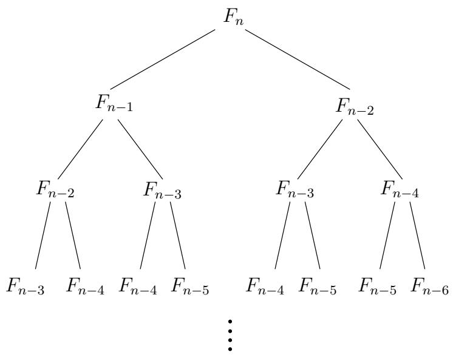

import Guide from '@/components/Guide.astro';
import Knowledge from '@/components/Knowledge.astro';
import Example from '@/components/Example.astro';
import Analysis from '@/components/Analysis.astro';
import Solution from '@/components/Solution.astro';
import Variant from '@/components/Variant.astro';
import Note from '@/components/Note.astro';
import Block from '@/components/Block.astro';
import Method from '@/components/Method.astro';
import Exercise from '@/components/Exercise.astro';

## 0.2 输入斐波那契数

如果没有一个人的努力，花剌子米的著作不可能在西方站稳脚跟：15世纪的意大利数学家列奥纳多·斐波那契看到了位置系统的潜力，并努力进一步发展和宣传它。

但今天斐波那契因其著名的数字序列而广为人知

$$
0, 1, 1, 2, 3, 5, 8, 1 3, 2 1, 3 4, \ldots ,
$$

每个都是其两个直接前任的总和。更正式地说，斐波那契数 $F _ { n }$ 是由简单的规则生成的

$$
F _ {n} = \left\{ \begin{array}{c l} F _ {n - 1} + F _ {n - 2} & \text {if} n > 1 \\ 1 & \text {if} n = 1 \\ 0 & \text {if} n = 0. \end{array} \right.
$$

没有其他数字序列得到如此广泛的研究，或应用于更多领域：生物学、人口学、艺术、建筑、音乐等等。而且，与 2 的幂一起，它是计算机科学最喜欢的序列。

事实上，斐波那契数的增长速度几乎与 2 的幂一样快：例如，$F _ { 3 0 }$ 超过一百万，而 $F _ { 1 0 0 }$ 已经有 21 位数字了！一般来说，$F _ { n } \approx 2 ^ { 0 . 6 9 4 n }$（参见练习 0.3）。

但是 $F _ { 1 0 0 ; }$ 或 $F _ { 2 0 0 } ?$ 的精确值是多少 斐波那契本人肯定想知道这些事情。为了回答这个问题，我们需要一个计算第 n 个斐波那契数的算法。

## 指数算法

一种想法是盲目地实现 $F _ { n }$ 的递归定义。以下是最终的算法，采用本书中使用的“伪代码”表示法：

```txt
function fib1(n)
if n = 0: return 0
if n = 1: return 1
return fib1(n - 1) + fib1(n - 2)
```

每当我们有了一个算法时，我们总是会问三个问题：

1.是否正确？

2. 作为 n 的函数，需要多少时间？

3. 我们能做得更好吗？

第一个问题在这里没有意义，因为这个算法正是斐波那契对 $F _ { n } .$ 的定义，但第二个问题需要答案。令 $T ( n )$ 为计算 fib1 $( n ) ;$ 所需的计算机步骤数，关于这个函数我们能说什么呢？对于初学者来说，如果 n 小于 $^ { 2 , }$，则过程几乎立即停止，只需几个步骤即可。因此，

$$
T (n) \leq 2 \text {   for   } n \leq 1.
$$

对于较大的 $n ,$ 值，有两次 fib1 递归调用，分别花费时间 $T ( n - 1 )$ 和 $T ( n - 2 )$ ，加上三个计算机步骤（检查 n 的值和最后的加法）。因此，

$$
T (n) = T (n - 1) + T (n - 2) + 3 \text {   for   } n > 1.
$$

将其与 $F _ { n } { \mathrm { : } }$ 的递推关系进行比较，我们立即发现 $T ( n ) \geq F _ { n }$

这是一个非常坏的消息：算法的运行时间增长与斐波那契数一样快！ $T ( n )$ 是 $n _ { : }$ 的指数，这意味着除了 $n .$ 的值非常小之外，该算法非常慢，不切实际。

让我们更具体地说明指数时间有多糟糕。为了计算 $F _ { 2 0 0 }$，fib1 算法执行 $T ( 2 0 0 ) \geq F _ { 2 0 0 } \geq 2 ^ { 1 3 8 }$ 基本计算机步骤。当然，这实际上需要多长时间取决于所使用的计算机。目前，世界上最快的计算机是 NEC 地球模拟器，每秒计算 40 万亿步。即使在这台机器上，fib1(200) 也至少需要 $2 ^ { 9 2 }$ 秒。这意味着，如果我们今天开始计算，距离太阳变成红巨星还需要很长时间。

但技术正在迅速进步——计算机速度大约每 18 个月就会翻一番，这种现象有时被称为摩尔定律。随着这种非凡的增长，也许 fib1 在明年的机器上运行得更快。让我们看看，fib1(n) 的运行时间与 $2 ^ { 0 . 6 9 4 n } \approx ( 1 . 6 ) ^ { n }$ 成正比，因此计算 $F _ { n + 1 }$ 的时间是计算 $F _ { n }$ 的 1.6 倍。根据摩尔定律，计算机每年的速度大约提高 1.6 倍。因此，如果我们能够用今年的技术合理地计算 $F _ { 1 0 0 }$，那么明年我们就可以管理 $F _ { 1 0 1 }$。后年，$F _ { 1 0 2 }$。等等：每年只多一个斐波那契数！这就是指数时间的诅咒。

简而言之，我们的简单递归算法是正确的，但效率低得令人绝望。我们可以做得更好吗？

## 多项式算法

让我们尝试理解为什么 fib1 如此慢。图 0.1 显示了对 fib1(n) 的单次调用所触发的级联递归调用。请注意，许多计算都是重复的！

更明智的方案是在知道中间结果后立即存储值 $F _ { 0 } , F _ { 1 } , \dots , F _ { n - 1 } -$。

```python
function fib2(n)
if n=0 return 0
create an array f[0...n]
f[0] = 0, f[1] = 1
for i=2...n:
    f[i] = f[i-1] + f[i-2]
return f[n]
```

图 0.1 fib1 中递归调用的激增。  


与 fib1 一样，该算法的正确性是不言而喻的，因为它直接使用了 $F _ { n }$ 的定义。多久时间？内部循环由单个计算机步骤组成，并执行 $n - 1$ 次。因此 fib2 使用的计算机步骤数与 n 成线性关系。从指数到多项式，这是运行时间的巨大突破。现在计算 $F _ { 2 0 0 }$ 甚至 $F _ { 2 0 0 , 0 0 0 }$ 是完全合理的。<sup>1</sup>

正如我们将在本书中反复看到的那样，正确的算法会带来一切不同。

## 更仔细的分析

在到目前为止的讨论中，我们一直在计算每个算法执行的基本计算机步骤的数量，并将这些基本步骤视为花费恒定的时间。这是一个非常有用的简化。毕竟，处理器的指令集具有各种基本原语（分支、存储到内存、比较数字、简单算术等等），而不是区分这些基本操作，将它们归为一类要方便得多。

但回顾我们对斐波那契算法的处理，我们对我们认为的基本步骤过于自由。如果要进行小数字（如 32 位数字）的加法运算，则将加法视为单个计算机步骤是合理的。但第 n 个斐波那契数大约有 0.694n 位长，随着 n 的增长，这个数字可能远远超过 32。对任意大数的算术运算不可能在单个恒定时间步骤中执行。我们需要审核我们之前的运行时间估计并使其更加诚实。

我们将在第 1 章中看到，两个 n 位数字的加法所需的时间大致与 $n ;$ 成正比，如果你回想一下小学的加法程序（每次只处理一位数字），这并不难理解。因此，fib1 执行大约 $F _ { n }$ 加法，实际上使用了一些大致与 $n F _ { n }$ 成比例的基本步骤。同样，fib2 采取的步数与 $n ^ { 2 }$ 成正比，仍然是 $n$ 的多项式，因此指数优于 fib1。对运行时间分析的修正并没有削弱我们的突破。

但我们能做得比 fib2 更好吗？事实上我们可以：参见练习 0.4。