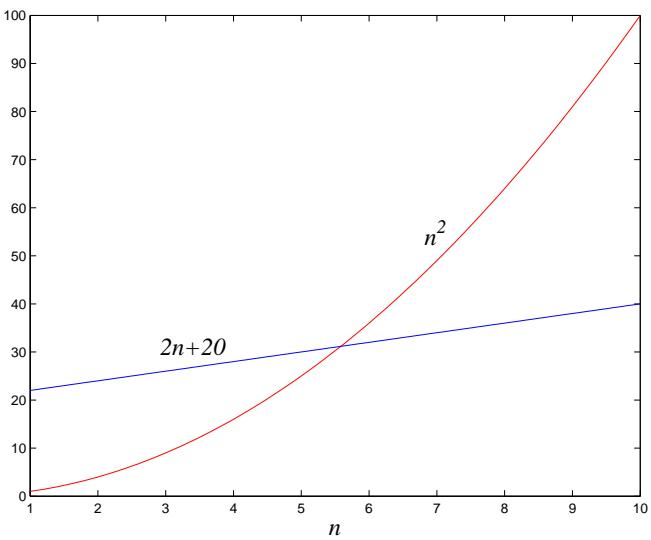

import Guide from '@/components/Guide.astro';
import Knowledge from '@/components/Knowledge.astro';
import Example from '@/components/Example.astro';
import Analysis from '@/components/Analysis.astro';
import Solution from '@/components/Solution.astro';
import Variant from '@/components/Variant.astro';
import Note from '@/components/Note.astro';
import Block from '@/components/Block.astro';
import Method from '@/components/Method.astro';
import Exercise from '@/components/Exercise.astro';

## 0.3 大 O 表示法

我们刚刚看到了运行时间分析中的草率如何导致结果不准确的程度。但相反的危险也存在：可能过于精确。富有洞察力的分析基于正确的简化。

用基本计算机步骤来表示运行时间已经是一种简化。毕竟，这样一个步骤所花费的时间在很大程度上取决于特定的处理器，甚至取决于缓存策略等细节（因此，每次执行的运行时间可能会略有不同）。考虑这些特定于体系结构的细节是一项极其复杂的任务，并且产生的结果不能从一台计算机推广到另一台计算机。因此，寻找一种整洁的、独立于机器的算法效率表征更有意义。为此，我们始终通过计算基本计算机步骤的数量来表示运行时间，作为输入大小的函数。

这种简化又导致了另一种简化。与报告算法采用 $5 n ^ { 3 } + 4 n + 3$ 执行大小为 $n ,$ 的输入相比，忽略低阶项（例如 4n 和 3）（随着 $n$ 的增长而变得微不足道），甚至首项中系数 5 的细节（计算机在几年内将快五倍）要简单得多。无论如何），只是说该算法需要时间 $O ( n ^ { 3 } )$（发音为 $\mathrm { ^ { 6 6 } b i g }$ oh of $n ^ { 3 \mathfrak { s } } )$）

是时候精确定义这个符号了。接下来，将 $f ( n )$ 和 $g ( n )$ 视为两个算法在大小为 $n .$ 的输入上的运行时间。

令 $f ( n )$ 和 $g ( n )$ 为从正整数到正实数的函数。我们说 $f = O ( g )$（这意味着 $^ { 6 6 } f$ 的增长不会比 $\boldsymbol { g } ^ { \mathfrak { s } } )$ 快，如果存在一个常数 $c > 0$ 使得 $f ( n ) \leq c \cdot g ( n )$

说 $f = O ( g )$ 是 $^ { \ast } f \ \leq \ g . ^ { \ast }$ 的一个非常松散的类比，它与通常的概念 $\mathbf { o f } \leq$ 不同，因为常量 $c ,$ 因此，例如 $1 0 n = O ( n )$ 这个常量还允许我们忽略小值时发生的情况 $n .$ 。例如，假设我们正在针对特定计算任务在两种算法之间进行选择。一个需要 $f _ { 1 } ( n ) = n ^ { 2 }$ 步，而另一个则需要 $f _ { 2 } ( n ) = 2 n + 2 0$ 步（图 0.2）。哪个更好？嗯，这取决于 $n .$ 的值。对于 $n \leq 5 , f _ { 1 }$ 较小；此后，$f _ { 2 }$ 明显获胜。在这种情况下，随着 n 的增长，$f _ { 2 }$ 的伸缩性会更好，因此它更优越。

这种优越性由大 O 表示法体现： $f _ { 2 } = O ( f _ { 1 } )$ ，因为

$$
\frac {f _ {2} (n)}{f _ {1} (n)} = \frac {2 n + 2 0}{n ^ {2}} \leq 2 2
$$

另一方面，对于所有 $n ;$ ，$f _ { 1 } \neq O ( f _ { 2 } )$ ，因为比率 $f _ { 1 } ( n ) / f _ { 2 } ( n ) = n ^ { 2 } / ( 2 n + 2 0 )$ 可以变得任意大，因此没有常量 c 可以使定义起作用。

图0.2 哪个运行时间更好？  

现在出现了另一种算法，该算法使用 $f _ { 3 } ( n ) = n + 1$ 步骤。这比 $f _ { 2 } { ? }$ 更好吗？当然，但只是一个常数因子。与 $f _ { 1 }$ 和 $f _ { 2 }$ 之间的巨大差距相比，$f _ { 2 }$ 和 $f _ { 3 }$ 之间的差异很小。为了专注于大局，如果函数仅在乘法常数上有所不同，我们将它们视为等价的。

回到big-O的定义，我们看到 $f _ { 2 } = O ( f _ { 3 } )$

$$
\frac {f _ {2} (n)}{f _ {3} (n)} = \frac {2 n + 2 0}{n + 1} \leq 2 0,
$$

当然还有 $f _ { 3 } = O ( f _ { 2 } )$，这次是 $c = 1$

正如 $O ( \cdot )$ 是 $\mathbf { o f } \leq$ 的类似物一样，我们也可以定义 $\geq$ 和 = 的类似物，如下所示：

$$
\begin{array}{c} f = \Omega (g) \text { means } g = O (f) \\ f = \Theta (g) \text { means } f = O (g) \text { and } f = \Omega (g). \end{array}
$$

在前面的示例中，$f _ { 2 } = \Theta ( f _ { 3 } )$ 和 $f _ { 1 } = \Omega ( f _ { 3 } )$

Big-O 表示法让我们专注于大局。当遇到像 $3 n ^ { 2 } + 4 n + 5$ 这样复杂的函数时，我们只需将其替换为 $O ( f ( n ) )$ ，其中 $f ( n )$ 尽可能简单。在这个特定的示例中，我们将使用 $O ( n ^ { 2 } )$ ，因为总和的二次部分主导其余部分。以下是一些常识性规则，可通过省略主导术语来帮助简化函数：

1. 乘法常数可以省略： $1 4 n ^ { 2 }$ 变为 $n ^ { 2 }$ 。

2. $n ^ { a }$ 支配 $n ^ { b } \operatorname { i f } a > b \colon$ 例如，$n ^ { 2 }$ 支配 $n .$

3. 任何指数支配任何多项式：$3 ^ { n }$ 支配 $n ^ { 5 }$（甚至支配 $2 ^ { n } )$）。

4. 同样，任何多项式支配任何对数：n 支配 $( \log n ) ^ { 3 }$。例如，这也意味着 $n ^ { 2 }$ 支配 n log n。

不要误解这种对常数的漫不经心的态度。程序员和算法开发人员对常量非常感兴趣，并且很乐意熬夜以使算法运行速度提高 2 倍。但是，如果没有大 O 表示法所提供的简单性，要理解本书级别的算法是不可能的。