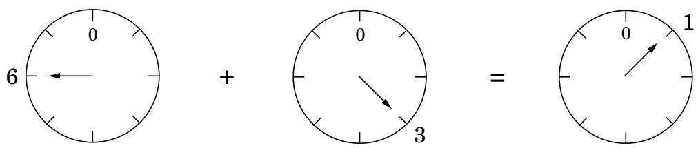
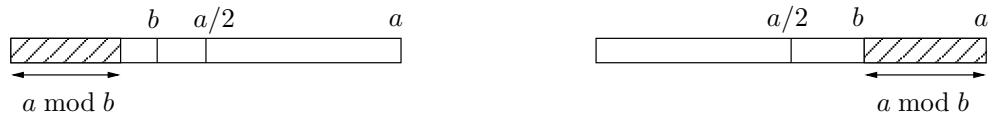

import Guide from '@/components/Guide.astro';
import Knowledge from '@/components/Knowledge.astro';
import Example from '@/components/Example.astro';
import Analysis from '@/components/Analysis.astro';
import Solution from '@/components/Solution.astro';
import Variant from '@/components/Variant.astro';
import Note from '@/components/Note.astro';
import Block from '@/components/Block.astro';
import Method from '@/components/Method.astro';
import Exercise from '@/components/Exercise.astro';
import Algorithm from '@/components/Algorithm.astro';

## 1.2 模运算

通过重复加法或乘法，数字可能会变得非常大。因此，幸运的是，每当到达 24 点时，我们都会将小时重置为零，并在每 12 个月之后将月份重置为 1 月。类似地，对于计算机处理器的内置算术运算，数字被限制在一定的大小，例如 32 位，这对于大多数用途来说已经足够了。

对于我们正在致力于的应用程序（素性测试和密码学），有必要处理明显大于 32 位的数字，但其范围仍然有限。

模算术是一种处理有限范围整数的系统。我们定义 x 模 N 为 x 除以 N 时的余数；也就是说，如果 $x = q N + r { \mathrm { ~ w i t h ~ } } 0 \leq r < N$ 2 则 x 模 N 等于 r。这给出了数字之间等价的增强概念：如果 x 和 y 相差 N 的倍数或符号，则它们以 N 为模全等，

图 1.3 模 8 的加法。  

$$
x \equiv y \pmod {N} \iff N \text {   divides   } (x - y).
$$

例如，$2 5 3 \equiv 1 3$ (mod 60)，因为 253 13 是 60 的倍数；更熟悉的说法是，253 分钟是 4 小时 13 分钟。这些数字也可以是负数，如 $5 9 \ \equiv \ - 1$ (mod 60) 中所示：当一小时过去 59 分钟时，也比下一小时短 1 分钟。

考虑模块化算术的一种方法是，它将数字限制在预定义的范围 $\{ 0 , 1 , \ldots , N - 1 \}$ 内，并在您尝试离开此范围时进行环绕，就像时钟的指针一样（图 1.3）。

另一种解释是模算术处理所有整数，但将它们分为 N 个等价类，每个等价类的形式为 $\{ i + k N : k \in \mathbb { Z } \}$ ，其中 i 介于 0 和 $N - 1$ 之间。例如，模 3 存在三个等价类：

$$
\begin{array}{c c c c c c c c c} \dots & - 9 & - 6 & - 3 & 0 & 3 & 6 & 9 & \dots \\ \dots & - 8 & - 5 & - 2 & 1 & 4 & 7 & 1 0 & \dots \\ \dots & - 7 & - 4 & - 1 & 2 & 5 & 8 & 1 1 & \dots \end{array}
$$

等价类的任何成员都可以替代任何其他成员；当以 3 为模时，数字 5 和 11 没有什么不同。在这种替换下，加法和乘法仍然是明确定义的：

替换规则 ${ \cal I } f x \equiv x ^ { \prime }$ (mod N) 和 $y \equiv y ^ { \prime }$ (mod N)，则：

$$
x + y \equiv x ^ {\prime} + y ^ {\prime} \pmod {N} \textbf {a n d} x y \equiv x ^ {\prime} y ^ {\prime} \pmod {N}.
$$

（参见练习 1.9。）例如，假设您从午夜开始一口气看完一整季您最喜欢的电视节目。共有25集，每集时长3小时。你一天什么时候完成？答案：完成的时间是 $( 2 5 \times 3 )$ mod 24，（自 25 1 mod 24 起）是 $1 \times 3 = 3$ mod 24，即凌晨三点。

不难看出，在模算术中，加法和乘法的通常结合性、交换性和分配性仍然适用，例如：

$$
\begin{array}{r l r} x + (y + z) \equiv (x + y) + z \pmod {N} & \text { Associativity } \\ x y \equiv y x \pmod {N} & \text { Commutativity } \\ x (y + z) \equiv x y + y z \pmod {N} & \text { Distributivity } \end{array}
$$

与替换规则一起考虑，这意味着在执行一系列算术运算时，在任何阶段将中间结果减少到其模 N 的余数都是合法的。这种简化对于大型计算来说是一个巨大的帮助。见证者，例如：

$$
2 ^ {3 4 5} \equiv (2 ^ {5}) ^ {6 9} \equiv 3 2 ^ {6 9} \equiv 1 ^ {6 9} \equiv 1 \pmod {3 1}.
$$

<Knowledge title="Box: Two's complement">

模算术以二进制补码很好地说明了，这是存储有符号整数的最常见格式。它使用n位来表示 $[ - 2 ^ { n - 1 } , 2 ^ { n - 1 } - 1 ]$ 范围内的数字，通常描述如下：

0 到 $2 ^ { n - 1 } - 1$ 范围内的正整数以常规二进制存储，并且前导位为 0。

负整数 $- \boldsymbol { x } ,$ 和 $1 \leq x \leq 2 ^ { n - 1 }$ ，通过首先以二进制构造 $x$，然后翻转所有位，最后加 1 来存储。在这种情况下，前导位是 1。

（这种格式的加法和乘法的通常描述更加晦涩难懂！）

这是一种更简单的思考方式：$- 2 ^ { n - 1 } \mathrm { t } 0 \ 2 ^ { n - 1 } - 1$ 范围内的任何数字都以 $2 ^ { n }$ 为模进行存储。因此，负数 $- x$ 最终为 $2 ^ { n } - x$ 。加法和减法等算术运算可以直接以此格式执行，忽略出现的任何溢出位。

</Knowledge>
## 1.2.1 模加法和模乘法

为了将两个数字 x 和 y 模 N 相加，我们从常规加法开始。由于 x 和 y 均在 0 到 $N - 1$ 范围内，因此它们的总和在 0 到 $2 ( N - 1 )$ 之间。如果总和超过 $N - 1$ ，我们只需减去 N 即可使其回到所需的范围内。因此，整体计算包括永远不会超过 $2 N$ 的数字的加法，也可能是减法。它的运行时间与这些数字的大小成线性关系，换句话说，$O ( n )$，其中 $n = \lceil \log N \rceil$ 是 $N ;$ 的大小；提醒一下，我们的惯例是使用字母 $n$ 来表示输入大小。

为了将两个 mod-N 数字 x 和 $y ,$ 相乘，我们再次从常规乘法开始，然后减少模 N 的答案。乘积可以与 $( N - 1 ) ^ { 2 }$ 一样大，但这仍然是自 $\log ( N - 1 ) ^ { 2 } = 2 \log ( N - 1 ) \leq 2 n$ 以来最多 2n 位长。为了减少以 N 为模的答案，我们使用二次时间除法算法计算除以 N 后的余数。因此，乘法仍然是二次运算。

划分并不是那么容易。在普通算术中，只有一种棘手的情况——除以零。事实证明，在模算术中还可能存在其他此类情况，我们将在本节末尾对其进行描述。然而，只要除法合法，就可以在立方时间内进行管理，$O ( n ^ { 3 } )$。

为了完成密码学所需的模算术原语套件，我们接下来转向模幂，然后转向最大公约数，这是除法的关键。对于这两项任务，最明显的过程需要指数级的时间，但通过一些独创性，可以找到多项式时间的解决方案。仔细选择算法会让一切变得不同。

<Algorithm title="Figure 1.4 Modular exponentiation.">
<u>函数 modexp</u>(x, y, N)
输入：两个n位整数x和N，一个整数指数y
输出：$x^y \bmod N$

如果 y = 0：返回 1
$z = \text{modexp}(x, \lfloor y/2 \rfloor, N)$
如果 y 是偶数：
    返回 $z^2 \bmod N$
其他：
    返回 $x \cdot z^2 \bmod N$
</Algorithm>

## 1.2.2 模幂

在我们正在研究的密码系统中，有必要针对 $x , y ,$ 和数百位长的 N 的值计算 $x ^ { y }$ mod N。这可以很快完成吗？

结果是某个模 N 的数字，因此本身有几百位长。然而，$x ^ { y }$ 的原始值可能比这个长得多。即使 x 和 $y$ 只是 20 位数字，$x ^ { y }$ 至少是 $\left( 2 ^ { 1 9 } \right) ^ { ( 2 ^ { 1 9 } ) } = 2 ^ { ( 1 9 ) ( 5 2 4 2 8 8 ) }$ ，大约 1000 万位长！想象一下如果 $y$ 是一个 500 位数字会发生什么！

为了确保我们处理的数字不会变得太大，我们需要以 N 为模执行所有中间计算。所以这里有一个想法：通过重复乘以 x 模 $N$ 来计算 $x ^ { y }$ mod $N$ 。由此产生的中间产品序列，

$$
x \bmod N \to x ^ {2} \bmod N \to x ^ {3} \bmod N \to \dots \to x ^ {y} \bmod N,
$$

由小于 $N ,$ 的数字组成，因此各个乘法不会花费太长时间。但有一个问题：如果 $y$ 是500位长，我们需要执行 $y - 1 \approx 2 ^ { 5 0 0 }$ 乘法！该算法显然在 $y .$ 的大小上呈指数增长。

幸运的是，我们可以做得更好：从 x 开始，反复对 $N _ { : }$ 取模，我们得到

$$
x \bmod N \to x ^ {2} \bmod N \to x ^ {4} \bmod N \to x ^ {8} \bmod N \to \dots \to x ^ {2 ^ {\lfloor \log y \rfloor}} \bmod N.
$$

每个只需要 $O ( \log ^ { 2 } N )$ 时间来计算，在这种情况下，只有 log $y$ 乘法。为了确定 $x ^ { y }$ mod N，我们只需将这些幂的适当子集相乘，这些幂对应于 ${ \bf { \dot { y } } } .$ 二进制表示中的 1。例如，

$$
x ^ {2 5} = x ^ {1 1 0 0 1 _ {2}} = x ^ {1 0 0 0 0 _ {2}} \cdot x ^ {1 0 0 0 _ {2}} \cdot x ^ {1 _ {2}} = x ^ {1 6} \cdot x ^ {8} \cdot x ^ {1}.
$$

多项式时间算法终于触手可及！

<Algorithm title="Figure 1.5 Euclid's algorithm for finding the greatest common divisor of two numbers.">
<u>函数欧几里得</u>(a, b)
输入：两个整数 a 和 b 以及 $a \geq b \geq 0$
输出：$\gcd(a, b)$

如果 b = 0：返回 a
返回欧几里得(b, a mod b)
</Algorithm>

我们可以用一种特别简单的形式封装这个想法：图 1.4 的递归算法，它通过执行模 $N$ 来工作，这是不言而喻的规则

$$
x ^ {y} = \left\{ \begin{array}{c l} (x ^ {\lfloor y / 2 \rfloor}) ^ {2} & \text {if y is even} \\ x \cdot (x ^ {\lfloor y / 2 \rfloor}) ^ {2} & \text {if y is odd.} \end{array} \right.
$$

在这样做时，它与我们的递归乘法算法非常相似（图 1.1）。例如，该算法将通过与我们刚刚看到的类似分解来计算乘积 $x \cdot 2 5$ ： $x \cdot 2 5 = x \cdot 1 6 + x \cdot 8 + x \cdot 1$ 。对于乘法，项 $x \cdot 2 ^ { i }$ 来自重复加倍，而对于求幂，相应项 $x ^ { 2 ^ { i } }$ 通过重复平方生成。

令 n 为 $x , y ,$ 的位大小，N（以三者中最大者为准）。与乘法一样，该算法将在最多 n 次递归调用后停止，并且在每次调用期间，它都会将 n 位数字相乘（在这里进行模 N 的计算可以节省我们的时间），总运行时间为 $O ( n ^ { 3 } )$

## 1.2.3 欧几里得最大公约数算法

我们的下一个算法是由古希腊数学家欧几里得在 2000 多年前发现的。给定两个整数 a 和 $b ,$，它会找到能整除这两个整数的最大整数，称为它们的最大公约数 (gcd)。

最明显的方法是首先对 a 和 $b ,$ 进行因式分解，然后将它们的公因式相乘。例如， $1 0 3 5 = 3 ^ { 2 } \cdot 5 \cdot 2 3$ 和 $7 5 9 = 3 \cdot 1 1 \cdot 2 3$ ，所以它们的 gcd 是 $3 \cdot 2 3 = 6 9$ 但是，我们没有有效的因式分解算法。还有其他方法可以计算最大公约数吗？

欧几里得算法使用以下简单公式。

欧几里得规则 如果 x 和 y 是正整数且 $x \geq y ,$ ，则 gcd $( x , y ) = \operatorname* { g c d } ( x \ \mathrm { m o d } \ y , y )$

<Solution title="证明">

显示稍微简单的规则 $\operatorname* { g c d } ( x , y ) = \operatorname* { g c d } ( x - y , y )$ 就足够了，可以通过重复从 x 中减去 y 来导出所述规则。

</Solution>

就这样吧。任何除以 x 和 $y$ 的整数也必须除以 $x - y _ { ; }$ ，因此 gcd $( x , y ) \leq$ $\operatorname* { g c d } ( x - y , y )$ 。同样，任何除以 $x - y$ 和 y 的整数也必须除以 x 和 y，因此 gcd $( x , y ) \geq \operatorname* { g c d } ( x - y , y )$ 。

欧几里得规则允许我们写出一个优雅的递归算法（图1.5），并且它的正确性立即从该规则中得出。为了计算出它的运行时间，我们需要了解参数 $( a , b )$ 随着每次连续的递归调用而减少的速度。在单轮中，参数 $( a , b )$ 变为 (b, a mod b)：它们的顺序被交换，其中较大的一个，$^ { a , }$ 减少为 $a$ mod b。这是大幅减少。

<Algorithm title="Figure 1.6 A simple extension of Euclid's algorithm.">
<u>函数扩展欧几里得</u>(a, b)
输入：两个正整数 a 和 b 以及 $a \geq b \geq 0$
输出：整数 x、y、d，使得 $d = \gcd(a, b)$ 和 $ax + by = d$

如果 b = 0：返回 (1, 0, a)
$(x', y', d) = \text{extended-Euclid}(b, a \bmod b)$
返回 $(y', x' - \lfloor a/b \rfloor y', d)$
</Algorithm>

<Knowledge title="引理">

$H a \geq b ,$ 然后是 mod $b < a / 2 .$

</Knowledge>

<Solution title="证明">

见证 $b \leq a / 2$ 或 $b > a / 2$ 。这两种情况如下图所示。 $\mathrm { I f } b \le a / 2$，那么我们有一个 mod $b < b \leq a / 2 ;$，如果 $b > a / 2$，那么我们有一个 mod $b = a - b < a / 2$

</Solution>

这意味着在任何连续两轮之后，两个参数 a 和 $b ,$ 的值至少减半——每个参数的长度至少减少一位。如果它们最初是 n 位整数，则将在 $2 n$ 递归调用内达到基本情况。由于每次调用都涉及二次时间划分，因此总时间为 $O ( n ^ { 3 } )$

## 1.2.4 欧几里得算法的扩展

对欧几里得算法的一个小扩展是模块化世界中划分的关键。

为了激发它，假设有人声称 d 是 a 和 b 的最大公约数：我们如何检查这一点？验证 d 能否整除 a 和 $b ,$ 是不够的，因为这仅表明 d 是一个公因子，而不一定是最大的因子。如果 d 具有特定形式，则可以使用以下测试。

<Knowledge title="引理">

对于某些整数 x 和 $y ,$，如果d 将 a 和 $b ,$ 和 $d = a x + b y$ 相除，那么必然是 $d = \operatorname* { g c d } ( a , b )$

</Knowledge>

<Solution title="证明">

根据前两个条件，d是a和b的公约数，因此它不能超过最大公约数；即 $d \leq \operatorname* { g c d } ( a , b )$ 。另一方面，由于 $\operatorname { g c d } ( a , b )$ 是 a 和 $b ,$ 的公约数，它也必须整除 $a x + b y = d , $ ，这意味着 gcd $( a , b ) \leq d .$ 。将这些放在一起，$d = \operatorname* { g c d } ( a , b )$。

</Solution>

因此，如果我们可以提供两个数字 x 和 y 使得 $d = a x + b y .$ ，那么我们就可以确定 $d = \operatorname* { g c d } ( a , b )$ 。例如，我们知道 gcd $( 1 3 , 4 ) = 1$ 因为 $1 3 \cdot 1 + 4 \cdot ( - 3 ) = 1$ 。但是我们什么时候才能找到这些数字：什么情况下 $\operatorname* { g c d } ( a , b )$ 可以用这种可检查的形式表示？事实证明它总是可以。更好的是，系数 x 和 y 可以通过欧几里得算法的小扩展找到；参见图 1.6。

<Knowledge title="引理">

对于任何正整数 a 和 $b ,$，扩展欧几里得算法返回整数 $x ,$ $y ,$ 和 d，使得 $\operatorname* { g c d } ( a , b ) = d = a x + b y$

</Knowledge>

<Solution title="证明">

首先要确认的是，如果忽略 $x _ { \mathbf { s } }$ 和 $y ^ { \prime } \mathbf { s } ,$ ，扩展后的算法与原始算法完全相同。所以，至少我们计算了 $d = \operatorname* { g c d } ( a , b )$

</Solution>

对于其余部分，算法的递归性质建议通过归纳法进行证明。当 $b = 0 .$ 时递归结束，方便对b的值进行归纳。

基本情况 $b = 0$ 很容易直接检查。现在选择 $b .$ 的任何较大值 该算法通过调用 gcd(b, a mod b) 找到 $\operatorname* { g c d } ( a , b )$。由于 $a$ mod $b < b ,$，我们可以将归纳假设应用于此递归调用，并得出结论：它返回的 $x ^ { \prime }$ 和 $y ^ { \prime }$ 是正确的：

$$
\operatorname * {g c d} (b, a \bmod b) = b x ^ {\prime} + (a \bmod b) y ^ {\prime}.
$$

将 (a mod b) 写为 $( a - \lfloor a / b \rfloor b )$ ，我们发现

$$
d = \operatorname * {g c d} (a, b) = \operatorname * {g c d} (b, a \bmod b) = b x ^ {\prime} + (a \bmod b) y ^ {\prime} = b x ^ {\prime} + (a - \lfloor a / b \rfloor b) y ^ {\prime} = a y ^ {\prime} + b (x ^ {\prime} - \lfloor a / b \rfloor y ^ {\prime}).
$$

因此 $d = a x + b y$ 与 $x = y ^ { \prime }$ 和 $y = x ^ { \prime } - \lfloor a / b \rfloor y ^ { \prime }$ ，从而验证算法在输入 (a, b) 上的行为。

例子。为了计算 gcd(25, 11)，欧几里得算法将按如下方式进行：

$$
\begin{array}{r c l} \underline {{2 5}} & = & 2 \cdot \underline {{1 1}} + 3 \\ \underline {{1 1}} & = & 3 \cdot \underline {{3}} + 2 \\ \underline {{3}} & = & 1 \cdot \underline {{2}} + 1 \\ \underline {{2}} & = & 2 \cdot \underline {{1}} + 0 \end{array}
$$

（在每个阶段，gcd 计算已减少到下划线数字）。因此 $\operatorname* { g c d } ( 2 5 , 1 1 ) = \operatorname* { g c d } ( 1 1 , 3 ) = \operatorname* { g c d } ( 3 , 2 ) = \operatorname* { g c d } ( 2 , 1 ) = \operatorname* { g c d } ( 1 , 0 ) = 1$

为了找到满足 $2 5 x + 1 1 y = 1$ 的 x 和 y，我们首先用最后一对 (1, 0) 来表示 1。然后我们逆向计算并用 (2, 1)、(3, 2)、(11, 3) 和最后 (25, 11) 来表示。第一步是：

$$
1 = \underline {{1}} - \underline {{0}}.
$$

为了用 (2, 1) 重写它，我们使用 gcd 计算最后一行的替换 $0 = 2 - 2 \cdot 1$ 来得到：

$$
1 = \underline {{1}} - (\underline {{2}} - 2 \cdot \underline {{1}}) = - 1 \cdot \underline {{2}} + 3 \cdot \underline {{1}}.
$$

gcd 计算的倒数第二行告诉我们 $1 = 3 - 1 \cdot 2$ 。替换：

$$
1 = - 1 \cdot \underline {{2}} + 3 (\underline {{3}} - 1 \cdot \underline {{2}}) = 3 \cdot \underline {{3}} - 4 \cdot \underline {{2}}.
$$

以同样的方式继续替换 $2 = 1 1 - 3 \cdot 3$ 和 3 = 25 2 11 给出：

$$
1 = 3 \cdot \underline {{3}} - 4 (\underline {{1 1}} - 3 \cdot \underline {{3}}) = - 4 \cdot \underline {{1 1}} + 1 5 \cdot \underline {{3}} = - 4 \cdot \underline {{1 1}} + 1 5 (\underline {{2 5}} - 2 \cdot \underline {{1 1}}) = 1 5 \cdot \underline {{2 5}} - 3 4 \cdot \underline {{1 1}}.
$$

我们完成了：$1 5 \cdot 2 5 - 3 4 \cdot 1 1 = 1 , \mathbf { s _ { 0 } } x = 1 5 \mathrm { ~ a n d ~ } y = - 3 4 .$

## 1.2.5 模块化划分

在实际算术中，每个数字 $a \neq 0$ 都有一个逆数 $1 / a ,$ ，除以 a 与乘以该逆数相同。在模算术中，我们可以做出类似的定义。

如果 $a x \equiv 1$ (mod N)，我们说 x 是模 N 的乘法逆元。

最多可以有一个这样的 x 模 N（练习 1.23），我们用 a−1 表示它。然而，这种逆并不总是存在！例如，2 不可逆模 6：也就是说，对于 x 的每个可能选择，2x 1 mod 6。在这种情况下，a 和 N 都是偶数，因此 mod N 始终是偶数，因为对于某个 k，mod $N = a - k N$ 。更一般地，我们可以确定 gcd(a, N) 除以 ax mod N，因为后一个量可以写成 $a x + k N$ 的形式。因此，如果 $\operatorname* { g c d } ( a , N ) > 1$ ，则 ax $\not\equiv$ 1 mod N，无论 x 可能是什么，因此 a 不能有模 N 的乘法逆元。

事实上，这是 a 不可逆的唯一情况。当 $\operatorname* { g c d } ( a , N ) = 1$（我们说a和N互质）时，扩展欧几里得算法给我们整数x和y，使得 $a x + N y = 1$，这意味着 $a x \equiv 1$（mod N）。因此 x 是 a 所求的逆。

例子。继续我们前面的例子，假设我们希望计算 11−1 mod 25。使用扩展的欧几里得算法，我们发现 $1 5 \cdot 2 5 - 3 4 \cdot 1 1 = 1$ 。两边都对 25 求模，得到 $- 3 4 \cdot 1 1 \equiv 1$ mod 25。所以 34 16 mod 25 是 11 mod 25 的逆。

模除定理 对于任何 a mod N a，当且仅当它与 N 互质时，a 才具有模 N 的乘法逆元。当该逆元存在时，可以通过运行扩展欧几里得算法在时间 $O ( n ^ { 3 } )$ 中找到它（其中通常 n 表示 N 的位数）。

这解决了模除法的问题：当对 N 进行模运算时，我们可以除以与 N 互素的数字——而且只能除以这些数字。为了实际执行除法，我们乘以倒数。

## 您的社会安全号码是质数吗？

数字 7、17、19、71 和 79 都是质数，但是 717-19-7179 呢？判断一个相当大的数是否是素数似乎很乏味，因为有太多的候选因子需要尝试。然而，有一些巧妙的技巧可以加快这一过程。例如，在消除数字 2 后，您可以省略偶数候选项。实际上，您可以省略除那些本身是素数的候选项之外的所有候选项。

事实上，进一步思考一下就会让你相信，一旦你拒绝了 $\sqrt { N }$ 之前的所有候选者，你就可以宣布 N 是素数，因为如果 N 确实可以分解为 $N = K \cdot L ,$，那么两个因子都不可能超过 $\sqrt { N }$

我们似乎正在进步！也许通过省略越来越多的候选因素，可以发现真正有效的素性测试。

不幸的是，这条路上没有快速的素性测试。原因是我们一直试图通过分解一个数来判断它是否是素数。因式分解是一个难题！

现代密码学以及本章的平衡是关于以下重要思想：因式分解很难，素性很容易。我们无法分解大数，但我们可以轻松测试大数的素数！ （据推测，如果一个数字是合数，这样的测试将检测到这一点而无需找到因子。）