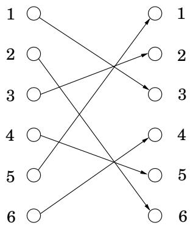
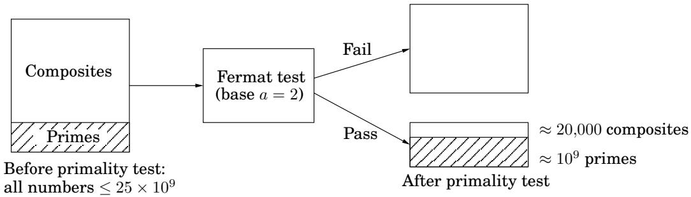

import Guide from '@/components/Guide.astro';
import Knowledge from '@/components/Knowledge.astro';
import Example from '@/components/Example.astro';
import Analysis from '@/components/Analysis.astro';
import Solution from '@/components/Solution.astro';
import Variant from '@/components/Variant.astro';
import Note from '@/components/Note.astro';
import Block from '@/components/Block.astro';
import Method from '@/components/Method.astro';
import Exercise from '@/components/Exercise.astro';
import Algorithm from '@/components/Algorithm.astro';

## 1.3 素性测试

是否有一些试金石可以告诉我们一个数字是否是质数，而无需实际尝试分解该数字？我们把希望寄托在 1640 年的一个定理上。

费马小定理 $H p$ 是素数，则对于每个 $1 \leq a < p ,$

$$
a ^ {p - 1} \equiv 1 \pmod {p}.
$$

<Solution title="证明">

令 S 为以 $p ;$ 为模的非零整数，即 $S = \{ 1 , 2 , \dots , p - 1 \}$ 。这是关键的观察结果：将这些数字乘以 (模 $p )$ 的效果只是对它们进行排列。例如，这是案例 $a = 3 , p = 7 ;$ 的图片

</Solution>

让我们进一步讨论这个例子。从图中我们可以得出结论

$$
\{1, 2, \dots , 6 \} = \{3 \cdot 1 \bmod 7, 3 \cdot 2 \bmod 7, \dots , 3 \cdot 6 \bmod 7 \}.
$$

将每个表示中的所有数字相乘，得到 $6 ! \equiv 3 ^ { 6 } \cdot 6 !$ (mod 7)，然后除以 6！我们得到 $3 ^ { 6 } \equiv 1$ (mod $7 )$ ，正是我们在案例 $a = 3 , p = 7$ 中想要的结果

现在让我们将此参数推广到 a 和 $p ,$ 和 $S = \{ 1 , 2 , \dots , p - 1 \}$ 的其他值。我们将证明，当 S 的元素乘以 $a$ 模 $p ,$ 时，所得数字都是不同且非零的。由于它们位于 $[ 1 , p - 1 ]$ 范围内，因此它们一定只是 S 的排列。

数字 $a \cdot i$ mod $p$ 是不同的，因为如果 $a \cdot i \equiv a \cdot j$ (mod $p )$ ，则两边除以 a 得到 $i \equiv j$ (mod $p )$ 。它们是非零，因为 $a \cdot i \equiv 0$ 类似地意味着 $i \equiv 0$ 。（我们可以除以 $a ,$，因为假设它是非零的，因此与 $p . )$ 互质。

现在我们有两种方法来写集合S：

$$
S = \{1, 2, \dots , p - 1 \} = \{a \cdot 1 \bmod p, a \cdot 2 \bmod p, \dots , a \cdot (p - 1) \bmod p \}.
$$

我们可以将每个表示中的元素相乘，得到

$$
(p - 1)! \equiv a ^ {p - 1} \cdot (p - 1)! \pmod {p}.
$$

除以 $( p - 1 ) !$ （我们可以这样做，因为它与 $p ,$ 互质，因为假设 $p$ 是质数）然后给出定理。

该定理建议使用“无因子”测试来确定数字 N 是否为素数：

<Algorithm title="Figure 1.7 An algorithm for testing primality.">
<u>函数素数</u>(N)
输入：正整数 N
输出：是/否

随机选择一个正整数 $a < N$
如果 $a^{N-1} \equiv 1 \pmod{N}$：
    返回是
其他：
    返回没有
</Algorithm>

$$
\text { Pick   some } a \longrightarrow \boxed {\text { Is } a ^ {N - 1} \equiv 1 \bmod N?} \begin{array}{l} \text { Pass } \\ \text { Fail } \end{array} \begin{array}{l} \text { “prime” } \\ \text { “composite” } \end{array}
$$

问题在于费马定理不是一个当且仅当条件；而是一个条件。它没有说明当 N 不是素数时会发生什么，因此在这些情况下，前面的图是有问题的。事实上，对于 $a .$ 的某些选择，合数N有可能通过费马测试（即 $a ^ { N - 1 } \equiv 1$ mod N）。例如，$3 4 1 = 1 1 \cdot 3 1$ 不是素数，而 $2 ^ { 3 4 0 } \equiv 1$ mod 341。尽管如此，我们可能希望对于合数N，大多数值 $a$ 将无法通过测试。这确实是真的，从某种意义上说，我们很快就会变得精确，并激发图 1.7 的算法：我们不应该预先固定 a 的任意值，而是应该从 $\{ 1 , \ldots , N - 1 \}$ 中随机选择它

在分析该算法的行为时，我们首先需要排除一个较小的不良情况。事实证明，某些极其罕见的复合数 $N _ { ; }$ ，称为卡迈克尔数，通过了费马对所有与 N 互质的测试。对于这些数，我们的算法将失败；但它们在病理上很少见，我们稍后会看到如何处理它们（第 36 页），所以让我们暂时忽略这些数字。

在没有卡迈克尔的宇宙中，我们的算法运行良好。任何素数 N 当然都会通过费马测试并产生正确的答案。另一方面，任何非卡迈克尔合数 N 都必须无法通过费马对 $a ;$ 的某些值的测试，正如我们现在将要展示的，这立即意味着 N 无法通过费马对 a 的至少一半可能值的测试！

<Knowledge title="引理">

${ \cal I } f a ^ { N - 1 } \not \equiv 1$ mod N 对于一些与 $N ,$ 互质的东西，那么它必须至少保留一半的选择 $o f a < N$

</Knowledge>

<Solution title="证明">

修复 $a ^ { N - 1 } \not \equiv 1$ mod N 的 a 的某些值。关键是要注意，通过关于 N 的 Fermat 测试的每个元素 $b < N$（即 $b ^ { \bar { N } - 1 } \equiv 1$ mod N）都有一个未通过测试的双胞胎 $a \cdot b ,$：

</Solution>

$$
(a \cdot b) ^ {N - 1} \equiv a ^ {N - 1} \cdot b ^ {N - 1} \equiv a ^ {N - 1} \not \equiv 1 \bmod N.
$$

此外，对于固定但不同选择的 $b ,$，所有这些元素 $a \cdot b ,$ 都是不同的，出于同样的原因费马测试证明中的 $a \cdot i \not \equiv a \cdot j$：只需除以 $a .$

集合&#123; 1， 2， . . . , N − 1 &#125;

<table> <tr> <td>b</td> <td>a·b</td> </tr> <tr> <td>通过</td> <td>失败</td> </tr> </table>

一对一函数 $b \mapsto a \cdot b$ 显示未通过测试的元素至少与通过测试的元素一样多。我

嘿，那是群论！

对于任何整数 N，与 N 互质的所有数字 mod N 的集合构成了数学家所说的群：

该集合上定义了一个乘法运算。

该集合包含一个中性元素（即 1：任何数字乘以该元素保持不变）。

所有元素都有明确定义的逆元素。

这个特殊的群称为 N 的乘法群，通常表示为 $\mathbb { Z } _ { N } ^ { * }$ 。

群论是一个非常发达的数学分支。它的关键概念之一是一个组可以包含一个 su $\mathbf { \partial } _ { b g r o u p - a }$ 子集，该子集本身就是一个组。关于子组的一个重要事实是，它的大小必须除以整个组的大小。

现在考虑集合 $B = \{ b : b ^ { N - 1 } \equiv 1$ mod N 。不难看出它是 $\mathbb { Z } _ { N } ^ { * }$ 的子群（只需检查B在乘法和逆运算下是闭集）。因此 B 的大小必须除以 $\mathbb { Z } _ { N } ^ { * }$ 的大小，这意味着如果 B 不包含所有 $\mathbb { Z } _ { N } ^ { * }$ ，则它可以拥有的下一个最大大小是 $\lvert \mathbb { Z } _ { N } ^ { * } \rvert / 2$

我们忽略了卡迈克尔数，所以我们现在可以断言

如果 N 是素数，则 $a ^ { N - 1 } \equiv 1$ mod N 对于所有 $a < N .$

如果 N 不是素数，则 $a ^ { N - 1 } \equiv 1$ mod N 最多为 $a < N$ 的值的一半

因此，图 1.7 的算法具有以下概率行为。

Pr(当 N 为素数时，算法 1.7 返回 yes) = 1

Pr（当 N 不是素数时，算法 1.7 返回 yes）$\leq \ \frac { 1 } { 2 }$

我们可以通过多次重复该过程、随机选取几个 a 值并对它们进行测试来减少这种单方面误差（图 1.8）。

Pr（当 N 不是素数时，算法 1.8 返回 yes）$\leq \ { \frac { 1 } { 2 ^ { k } } }$

<Algorithm title="Figure 1.8 An algorithm for testing primality, with low error probability.">
<u>函数素数2</u>(N)
输入：正整数 N
输出：是/否

随机选择正整数 $a_1, a_2, \ldots, a_k < N$
如果 $a_i^{N-1} \equiv 1 \pmod{N}$ 对于所有 $i = 1, 2, \ldots, k$：
    返回是
其他：
    返回没有
</Algorithm>

这种错误概率以指数速度快速下降，并且可以通过选择足够大的 k 将其降低到任意低的水平。测试 a 的 $k = 1 0 0$ 值使得失败的概率最多为 $2 ^ { - 1 0 0 }$，这是很小的：例如，远小于随机宇宙射线在计算过程中破坏计算机的概率！

<Knowledge title="Box: Carmichael numbers">

最小的卡迈克尔数是 561。它不是素数：561 = 3 11 17；但它欺骗了 Fermat 测试，因为 $a ^ { 5 6 0 } \equiv 1$ (mod 561) 对于所有与 561 互质的值。很长一段时间以来，人们认为这种类型的数可能只有有限多个；事实上，这种类型的数是有限的。现在我们知道它们是无限的，但极其罕见。

有一种方法可以绕过卡迈克尔数，即使用拉宾和米勒提出的稍微更精确的素性测试。以 $2 ^ { t } u$ 的形式写入 $N - 1$ 与之前一样，我们将选择一个随机基 a 并检查 $a ^ { N - 1 }$ mod N 的值。通过首先确定 $a ^ { u }$ mod N 然后重复平方来执行此计算，以获得序列：

$$
a ^ {u} \bmod N, a ^ {2 u} \bmod N, \ldots , a ^ {2 ^ {t} u} = a ^ {N - 1} \bmod N.
$$

${ \mathrm { I f ~ } } a ^ { N - 1 } \neq 1$ mod N，然后N通过费马小定理合成，就完成了。但是如果 $a ^ { N - 1 } \equiv 1$ mod N，我们进行一些后续测试：在前面的序列中的某个地方，我们第一次遇到 1。如果这发生在第一个位置之后（即 $\mathrm { i f } a ^ { u }$ mod $N \neq$ 1），并且列表中的前一个值不是 1 mod N，则我们声明 N 复合。

在后一种情况下，我们发现了 1 mod N 的非平凡平方根：一个不是 1 mod N 但平方等于 1 mod N 的数。这样的数只有在 N 是合数时才存在（练习 1.40）。事实证明，如果我们将此平方根检查与之前的费马测试结合起来，那么 1 到 $N - 1$ 之间的 a 可能值中至少四分之三将显示复合 N，即使它是卡迈克尔数。

</Knowledge>
## 1.3.1 生成随机素数

我们现在即将拥有加密应用程序所需的所有工具。难题的最后一部分是一种快速算法，用于选择几百位长的随机素数。这项任务之所以变得非常简单，是因为素数非常丰富——一个随机的 n 位数字大约有 n 分之一的机会成为素数（实际上大约是 $1 / ( \ln 2 ^ { n } ) \approx 1 . 4 4 / n )$ 。例如，大约 20 个社会安全号码中就有 1 个是素数！

拉格朗日素数定理 令 $\pi ( x )$ 为素数 $\leq x$ 。然后 $\pi ( x )$ ≈ $x / ( \ln x )$ 或更多 precisely

$$
\lim _ {x \to \infty} \frac {\pi (x)}{(x / \ln x)} = 1.
$$

如此丰富的数据使得生成随机 n 位素数变得简单：

选择一个随机的 n 位数字 N。

对 N 运行素性测试。

如果通过测试，则输出N；否则重复该过程。

这个算法有多快？如果随机选择的 N 确实是素数，这种情况发生的概率至少为 $1 / n$ ，那么它肯定会通过测试。因此，在每次迭代中，该过程至少有 $1 / n$ 的机会停止。因此，平均而言，它将在 $O ( n )$ 轮内停止（练习1.34）。

接下来，究竟应该使用哪种素性测试？在此应用中，由于我们测试素数的数字是随机选择的，而不是由对手选择的，因此使用基数 $a \ = \ 2$ 执行费马测试就足够了（或者为了真正安全，使用 $a \ = \ 2 , 3 , 5 )$ ，因为对于随机数，费马测试的失败概率比我们证明的最坏情况 $1 / 2$ 边界要小得多早些时候，通过此测试的数字被戏称为“工业级素数”。由此产生的算法非常快，可以在 PC 上在不到一秒的时间内生成数百位长的素数。

剩下的重要问题是：算法的输出确实是素数的概率是多少？要回答这个问题，我们必须首先了解费马检验的辨别力。作为一个具体的例子，假设我们使用基数 $a = 2$ 对所有数字 $N \leq 2 5 \times 1 0 ^ { 9 }$ 进行测试。在这个范围内，大约有 $1 0 ^ { 9 }$ 素数，以及通过测试的约20,000个复合数（见下图）。因此，错误输出复合的几率大约为 $2 0 , 0 0 0 / 1 0 ^ { 9 } = 2 \times 1 0 ^ { - 5 }$ 。随着涉及的数字长度的增加（达到我们在应用程序中预期的几百位数字），这种错误的可能性会迅速减少。

<Knowledge title="Box: Randomized algorithms: a virtual chapter">

令人惊讶的是，几乎自相矛盾的是，我们拥有的一些最快、最聪明的算法依赖于机会：在指定的步骤中，它们根据随机抛硬币的结果进行。这些随机算法通常非常简单和优雅，并且它们的输出正确的概率很高。这个成功概率并不取决于输入的随机性；它仅取决于算法本身做出的随机选择。

在本书中，我们没有专门用一章来讨论这个主题，而是将随机算法散布在它们最自然出现的章节中。此外，不需要专门的概率知识来了解正在发生的事情。你只需要熟悉概率、期望值、在得到正面之前我们必须抛硬币的期望次数以及被称为“期望线性”的属性的概念。

以下是本书中主要随机算法的提示： 随机算法最早也是最引人注目的例子之一是图 1.8 中的随机素性测试。散列是一种通用的随机数据结构，支持插入、删除和查找，将在本章后面的 1.5 节中进行描述。第 2 章描述了排序和中值查找的随机算法。最小割问题的随机算法在第 143 页的方框中描述。随机化在启发式算法中也发挥着重要作用。这些在第 9.3 节中进行了描述。最后，因式分解的量子算法（第 10.7 节）的工作原理非常类似于随机算法，其输出正确的概率很高，只不过它的随机性不是来自抛硬币，而是来自量子力学中的叠加原理。

虚拟练习：1.29、1.34、2.24、9.8、10.8。

</Knowledge>