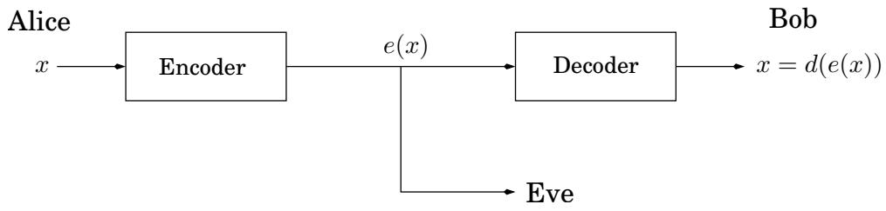
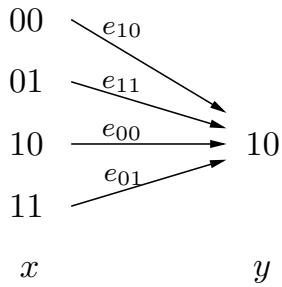

import Guide from '@/components/Guide.astro';
import Knowledge from '@/components/Knowledge.astro';
import Example from '@/components/Example.astro';
import Analysis from '@/components/Analysis.astro';
import Solution from '@/components/Solution.astro';
import Variant from '@/components/Variant.astro';
import Note from '@/components/Note.astro';
import Block from '@/components/Block.astro';
import Method from '@/components/Method.astro';
import Exercise from '@/components/Exercise.astro';

## 1.4 密码学

我们的下一个主题是 Rivest-Shamir-Adelman (RSA) 密码系统，它使用了我们在本章中介绍的所有想法！它通过巧妙地利用某些数论任务（模幂、最大公约数、素性测试）的多项式时间可计算性与其他任务（因式分解）的难处理性之间的巨大鸿沟，获得了非常强大的安全保证。

密码学的典型设置可以通过三个角色来描述：爱丽丝和鲍勃，他们希望私下交流，而夏娃，一个窃听者，她会不遗余力地找出他们所说的内容。具体来说，假设爱丽丝想向她的朋友鲍勃发送一条以二进制编写的特定消息 x（为什么不呢）。她将其编码为 e(x)，发送过来，然后 Bob 应用他的解密函数 d() 对其进行解码：$d ( e ( x ) ) = x$。这里 e() 和 d() 是消息的适当转换。



Alice 和 Bob 担心窃听者 Eve 会拦截 e(x)：例如，她可能是网络上的嗅探者。但理想情况下，加密函数 e(·) 的选择应使得在不知道 d(·) 的情况下，Eve 无法对她获取的信息执行任何操作。换句话说，知道 e(x) 并不能告诉她 x 可能是什么。

几个世纪以来，密码学都是基于我们现在所说的私钥协议。在这样的方案中，爱丽丝和鲍勃事先会面并共同选择一个秘密密码本，他们用它来加密他们之间的所有未来通信。那么，夏娃唯一的希望就是收集一些编码消息并使用它们至少部分地找出密码本。

RSA 等公钥方案明显更加微妙和棘手：它们允许 Alice 在以前从未见过 Bob 的情况下向 Bob 发送消息。这听起来几乎不可能，因为在这种情况下，Bob 和 Eve 之间存在对称性：为什么 Bob 在能够理解 Alice 的消息方面比 Eve 有任何优势？ RSA 密码系统背后的中心思想是，利用因式分解和素性之间的巨大对比，Bob 能够实现只有他拥有钥匙的数字锁。现在，通过公开这个数字锁，他为爱丽丝提供了一种向他发送安全消息的方法，只有他可以打开该消息。此外，这正是互联网商务中出现的情况，例如，当您希望通过互联网将信用卡号发送给某个公司时。

在RSA协议中，Bob只需要执行最简单的计算，例如乘法，就可以实现他的数字锁。类似地，爱丽丝和鲍勃只需要执行简单的计算来分别锁定和解锁消息——任何袖珍计算设备都可以处理的操作。相比之下，要在没有密钥的情况下解锁消息，夏娃必须执行诸如分解大数之类的操作，这需要比世界上最强大的计算机加起来还要多的计算能力。这种令人信服的安全保证解释了为什么 RSA 密码系统是密码学领域的革命性发展。

## 数论的应用？

著名数学家G.H.哈代曾这样评价自己的工作：“我从来没有做过任何有用的事情。”哈代是数论方面的专家，长期以来，数论一直被认为是最纯粹的数学领域之一，不受物质动机和后果的影响。然而，数世纪以来，包括哈代在内的数以千计的数论学家的工作现在对于网络浏览器和手机的操作以及全球金融交易的安全至关重要。

## 1.4.1 私钥方案：一次性密码本和 AES

如果爱丽丝想向鲍勃传输一条重要的私人消息，她最好用加密函数对其进行加扰，

$$
e: \langle \text { messages } \rangle \to \langle \text { encoded   messages } \rangle .
$$

当然，这个函数必须是可逆的——以便解码成为可能——因此是一个双射。它的反函数是解密函数d(·)。

在一次性密码本中，Alice 和 Bob 事先会面，并秘密选择一个相同长度（例如 n 位）的二进制字符串 r，作为 Alice 稍后要发送的重要消息 x。

Alice 的加密函数是按位异或，$e _ { r } ( x ) = x \oplus r \colon$ 编码消息中的每个位置都是 x 和 r 中相应位置的异或。例如，如果 $r = 0 1 1 1 0 0 1 0$ ，则消息 11110000 将被加扰：

$$
e _ {r} (1 1 1 1 0 0 0 0) = 1 1 1 1 0 0 0 0 \oplus 0 1 1 1 0 0 1 0 = 1 0 0 0 0 0 1 0.
$$

这个函数 $e _ { r }$ 是从 n 位字符串到 n 位字符串的双射，事实证明它是它自己的逆！

$$
e _ {r} (e _ {r} (x)) = (x \oplus r) \oplus r = x \oplus (r \oplus r) = x \oplus \overline {{0}} = x,
$$

其中 $\overline { { 0 } }$ 是全零的字符串。因此，Bob 可以通过第二次应用相同的加密函数来解码 Alice 的传输：$d _ { r } ( y ) = y \oplus r$

Alice 和 Bob 应该如何选择 r 才能使该方案安全？很简单：他们应该随机选择 r，为每个位掷一枚硬币，以便生成的字符串同样可能是 $\{ 0 , 1 \} ^ { n }$ 的任何元素。这将确保如果 Eve 拦截了编码消息 $\boldsymbol { y } = \boldsymbol { e } _ { r } ( \boldsymbol { x } )$ ，她不会获得有关 $x .$ 的信息，例如，假设 Eve 发现了 $y = 1 0 ;$ 她可以推断出什么？她不知道 $^ { r , }$，并且它可以采取的可能值都对应于不同的原始消息x：



因此，考虑到 Eve 所知道的，x 的所有可能性都是同等可能的！

一次性卫生巾的缺点是使用后必须丢弃，因此得名。使用相同 pad 编码的第二条消息将不安全，因为如果 Eve 知道两条消息 x 和 $z ,$ 的 x r 和 $z \oplus r$，那么她可以采用异或来获得 $x \oplus z ,$，这可能是重要信息 - 例如，（1）它揭示了两条消息是否开始或结束相同，以及（2）一条消息是否包含一长序列零（如果消息是图像，则很容易出现这种情况），那么另一条消息的相应部分将被暴露。因此，Alice 和 Bob 共享的随机字符串必须是他们需要交换的所有消息的组合长度。

一次性密码本是一种玩具密码方案，其行为和理论属性是完全清楚的。另一方面是高级加密标准 (AES)，这是一种使用非常广泛的加密协议，于 2001 年获得美国国家标准与技术研究所的批准。AES 再次成为私钥：Alice 和 Bob 必须就共享随机字符串 r 达成一致。但这次字符串的大小固定较小，准确地说是 128（也存在 192 或 256 位的变体），并指定从 128 位字符串到 128 位字符串的双射 $e _ { r }$。关键的区别在于该函数可以重复使用，因此例如可以通过将长消息分成 128 位的片段并对每个片段应用 $e _ { r }$ 来进行编码。

AES 的安全性尚未得到严格确立，但目前公众肯定不知道如何破解代码（从 $e _ { r } ( x )$ 恢复 x），除非使用比尝试共享字符串 r 的所有可能性的暴力方法好不了多少的技术。

## 1.4.2 RSA

与前两个协议不同，RSA 方案是公钥加密的一个示例：任何人都可以使用公开信息（例如地址或电话号码）向其他人发送消息。每个人都有一个全世界都知道的公钥和一个只有他或她自己知道的秘密密钥。当爱丽丝想要将消息 x 发送给鲍勃时，她使用他的公钥对其进行编码。他使用他的秘密密钥对其进行解密，以检索 x。 Eve 很乐意看到 Bob 的加密消息，但在某些简单的假设下，她将无法解码它们。

RSA 方案很大程度上基于数论。将从 Alice 到 Bob 的消息视为以 $N ;$ 为模的数字，大于 N 的消息可以分解为更小的片段。加密函数将是 $\{ 0 , 1 , \ldots , N - 1 \}$ 上的双射，解密函数将是其逆函数。 $N$ 的什么值是合适的，以及应该使用什么双射？

<Knowledge title="Property">

选择任意两个素数 $p$ 和 $q$ 并令 $N = p q$ 。对于任何 e 与 $( p -$ $1 ) ( q - 1 )$ 互质

</Knowledge>

1. 映射 $x \mapsto x ^ { e }$ mod N是 $\{ 0 , 1 , \ldots , N - 1 \}$ 上的双射

2. 此外，逆映射很容易实现：令 d 为模 $( p$ $1 ) ( q - 1 )$ 的逆）。那么对于所有 $x \in \{ 0 , \ldots , N - 1 \}$ ，

$$
(x ^ {e}) ^ {d} \equiv x \bmod N.
$$

第一个属性告诉我们映射 $x \mapsto x ^ { e }$ mod N 是对消息 $x ;$ 进行编码的合理方法，不会丢失任何信息。因此，如果 Bob 发布 $( N , e )$ 作为他的公钥，其他人都可以使用它向他发送加密消息。第二个属性告诉我们如何实现解密。 Bob 应该保留值 d 作为他的密钥，用它他可以通过简单地将消息取模 N 的 d 次方来解码发送给他的所有消息。

示例。让 $N = 5 5 = 5 \cdot 1 1$。选择加密指数 $e = 3$ ，满足条件 gcd $\lfloor ( e , ( p - 1 ) ( q - 1 ) ) = \operatorname* { g c d } ( 3 , 4 0 ) = 1$ 。则解密指数为 $d = 3 ^ { - 1 }$ mod $4 0 = 2 7$ 现在对于任何消息 x mod 55，x 的加密为 $y = x ^ { 3 }$ mod 55，$y$ 的解密为 $x = y ^ { 2 7 }$ mod 55。所以，例如，$\mathrm { i f } x = 1 3$，然后 $y = 1 3 ^ { 3 } = 5 2$ mod 55。和 $1 3 = 5 2 ^ { 2 7 }$ mod 55。

我们来证明上面的断言，然后检验该方案的安全性。

<Solution title="证明">

如果映射 $x \mapsto x ^ { e }$ mod N 是可逆的，那么它一定是双射；因此语句 2 隐含着语句 1。为了证明语句 2，我们首先观察 e 是可逆模 $( p - 1 ) ( q - 1 )$，因为它与这个数互质。为了查看 $( x ^ { e } ) ^ { d } \equiv x$ mod N，我们检查指数：由于 $e d \equiv 1$ mod $( p - 1 ) ( q - 1 )$ ，我们可以将 ed 写成 $1 + k ( p -$ $1 ) ( q - 1 )$ 对于某些 k 。现在我们需要证明差异

</Solution>

$$
x ^ {e d} - x = x ^ {1 + k (p - 1) (q - 1)} - x
$$

```txt
Figure 1.9 RSA.

Bob chooses his public and secret keys.
```

他首先选择两个大的（n 位）随机素数 $p$ 和 $q .$

他的公钥是 $( N , e )$，其中 $N \ : = \ : p q$ 和 $e$ 是与 $( p - 1 ) ( q - 1 )$ 互质的2n位数字。常见的选择是 $e = 3$，因为它允许快速编码。

他的秘密密钥是 $d ,$ e modulo $( p - 1 ) ( q - 1 )$ 的倒数，使用​​扩展欧几里得算法计算。

```txt
Alice wishes to send message x to Bob.
```

她查找他的公钥 $( N , e )$ 并向他发送 $y = \left( x ^ { e } \mathrm { m o d } \ N \right)$ ，使用高效的模幂算法计算得出。

他通过计算 $y ^ { d }$ mod $N .$ 来解码消息。

始终为 0 模 $N .$ 。表达式的第二种形式很方便，因为它可以使用费马小定理进行简化。它可以被 $p$ 整除（因为 $x ^ { p - 1 } \equiv 1$ mod $p )$，同样可以被 q 整除。由于 p 和 q 是素数，所以这个表达式也必须能被它们的乘积 N 整除。因此 $x ^ { e d } - x = x ^ { 1 + k ( p - 1 ) ( q - 1 ) } - x \equiv 0$ (mod N)，正是我们所需要的。

RSA 协议总结如图 1.9 所示。这当然很方便：Alice 和 Bob 所需的计算是基本的。但它对 Eve 的安全性如何呢？

RSA 的安全性取决于一个简单的假设：

给定 $N , e ,$ 和 $y = x ^ { e }$ mod $N _ { ; }$ ，确定 x 在计算上很困难。

这个假设是非常合理的。 Eve 会如何尝试猜测 x？她可以尝试 $x ,$ 的所有可能值，每次检查是否 $x ^ { e } \equiv y$ mod N，但这需要指数时间。或者她可以尝试分解 $N$ 来检索 $p$ 和 $q ,$ ，然后通过对 e 取模 $( p - 1 ) ( q - 1 )$ 求逆来计算出 d ，但我们认为分解是很困难的。棘手通常会让人沮丧。 RSA 的洞察力在于充分利用它。