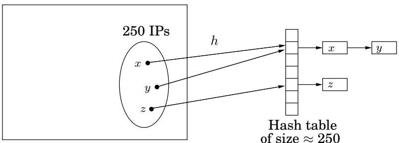

import Guide from '@/components/Guide.astro';
import Knowledge from '@/components/Knowledge.astro';
import Example from '@/components/Example.astro';
import Analysis from '@/components/Analysis.astro';
import Solution from '@/components/Solution.astro';
import Variant from '@/components/Variant.astro';
import Note from '@/components/Note.astro';
import Block from '@/components/Block.astro';
import Method from '@/components/Method.astro';
import Exercise from '@/components/Exercise.astro';

## 1.5 通用哈希

我们以数论在哈希函数设计中的应用来结束本章。散列是一种在表中存储数据项以支持插入、删除和查找的非常有用的方法。

例如，假设我们需要维护一个包含大约 250 个 IP（互联网协议）地址的不断变化的列表，这些地址可能是 Web 服务当前活跃客户的地址。 （回想一下，IP 地址由 32 位组成，编码计算机在 Internet 上的位置，通常分为四个 8 位字段，例如 128.32.168.80。）如果我们将记录维护在按 IP 地址索引的数组中，则可以获得快速查找时间。但这会非常浪费内存：数组将有 $2 ^ { 3 2 } \approx 4 \times 1 0 ^ { 9 }$ 条目，其中绝大多数是空白的。或者，我们可以使用仅包含 250 条记录的链接列表。但这样访问记录就会非常慢，所需时间与客户总数 250 成正比。有没有一种方法可以两全其美，使用与客户数量成正比的内存量，同时实现快速查找时间？这正是散列的用武之地。

## 1.5.1 哈希表

这是哈希的高级视图。我们将为 232 个可能的 IP 地址中的每一个指定一个简短的“昵称”。您可以将这个短名称视为 1 到 250 之间的数字（稍后我们将稍微调整此范围）。因此，许多IP地址将不可避免地具有相同的昵称；然而，我们希望为特定客户的 250 个 IP 地址中的大多数分配不同的名称，并且我们将把他们的记录存储在由这些名称索引的大小为 250 的数组中。如果有多个记录与同一名称关联怎么办？简单：数组的每个条目都指向一个包含具有该名称的所有记录的链接列表。因此，存储总量与客户数量 250 成正比，并且与可能的 IP 地址总数无关。此外，如果没有太多客户IP地址被分配相同的名称，查找速度会很快，因为我们必须扫描的链表的平均大小很小。

但是我们如何为每个 IP 地址分配一个短名称呢？这就是哈希函数的作用：在我们的示例中，函数 h 将 IP 地址映射到长度约为 250（预期数据项数量）的表中的位置。因此，分配给 IP 地址 x 的名称为 h(x)，并且 x 的记录存储在表的位置 h(x) 中。如前所述，表的每个位置实际上是一个桶，一个包含映射到它的当前所有 IP 地址的链表。希望很少有存储桶包含多个 IP 地址。

  
所有 $2 ^ { 3 2 }$ IP 地址的空间

## 1.5.2 哈希函数族

设计哈希函数很棘手。哈希函数在某种意义上必须是“随机的”（以便它分散数据项），但它也应该是一个函数，因此“一致”（以便我们每次应用它时都会得到相同的结果）。而且数据项的统计可能会对我们不利。在我们的示例中，一个可能的哈希函数会将 IP 地址映射到其最后一段的 8 位数字： $h ( 1 2 8 . 3 2 . 1 6 8 . 8 0 ) = 8 0$ 。然后需要一个包含 $n = 2 5 6$ 存储桶的表。但这是一个好的哈希函数吗？例如，如果 IP 地址的最后一段往往是一个小数字（一位或两位数），则不会；那么数量少的桶就会变得拥挤。获取 IP 地址的第一部分也会带来灾难 - 例如，如果我们的大多数客户来自亚洲。

这两个函数本身并没有什么问题。如果我们的 250 个 IP 地址是从所有 $N = 2 ^ { 3 2 }$ 可能性中统一抽取的，那么这些函数将会表现良好。问题是我们不能保证IP地址的分配是统一的。

相反，没有任何一个哈希函数，无论多么复杂，都能在所有数据集上表现良好。由于哈希函数将 $2 ^ { 3 2 }$ IP 地址映射到 250 个名称，因此必须存在至少 $2 ^ { 3 2 } / 2 5 0 \approx 2 ^ { 2 4 } \approx 1 6 { , } 0 0 0 { , } 0 0 0$ IP 地址的集合，这些地址被分配了相同的名称（或者，用哈希术语来说，“冲突”）。如果其中许多出现在我们的客户集中，我们就有麻烦了。

显然，我们需要某种随机化。这是一个想法：让我们从某类函数中随机选择一个哈希函数。然后我们将证明，无论我们真正关心哪一组 250 个 IP 地址，哈希函数的大多数选择都会在这些地址之间产生很少的冲突。

为此，我们需要定义一类哈希函数，我们可以从中随机选择；这就是我们转向数论的地方。我们假设桶的数量不是 250，而是 $n = 2 5 7 { - } a$ 素数！我们将每个 IP 地址 x 视为以 n 为模的整数的四元数 $x =$ $( x _ { 1 } , \ldots , x _ { 4 } )$ — 回想一下，它实际上是 0 到 255 之间的整数的四元数，因此这没有坏处。我们可以定义一个从 IP 地址到数字 mod n 的函数 h，如下所示：固定任意四个数字 mod $n = 2 5 7$ ，例如 87、23、125 和 4。现在将 IP 地址 $( x _ { 1 } , . . . , x _ { 4 } )$ 映射到 $h ( x _ { 1 } , . . . , x _ { 4 } ) = ( 8 7 x _ { 1 } + 2 3 x _ { 2 } + 1 2 5 x _ { 3 } + 4 x _ { 4 } )$ mod 257。事实上，任何四个数字 mod n 都定义了一个哈希函数。

对于任意四个系数 $a _ { 1 } , \dots , a _ { 4 } \in \{ 0 , 1 , \dots , n - 1 \}$ ，写入 $a = ( a _ { 1 } , a _ { 2 } , a _ { 3 } , a _ { 4 } )$ 并将 $h _ { a }$ 定义为以下哈希函数：

$$
h _ {a} (x _ {1}, \dots , x _ {4}) = \sum_ {i = 1} ^ {4} a _ {i} \cdot x _ {i} \bmod n.
$$

我们将证明，如果我们随机选择这些系数 a，那么 $h _ { a }$ 很可能在以下意义上是好的。

<Knowledge title="Property">

考虑任何一对不同的 IP 地址 $x = ( x _ { 1 } , \ldots , x _ { 4 } )$ 和 $y = ( y _ { 1 } , \dotsc , y _ { 4 } )$ 。如果系数 $a = ( a _ { 1 } , a _ { 2 } , a _ { 3 } , a _ { 4 } )$ 是从 $\{ 0 , 1 , \ldots , n - 1 \}$ 中均匀随机选择的，则

</Knowledge>

$$
\operatorname * {P r} \left\{h _ {a} (x _ {1}, \ldots , x _ {4}) = h _ {a} (y _ {1}, \ldots , y _ {4}) \right\} = \frac {1}{n}.
$$

换句话说，x 和 $y$ 在 $h _ { a }$ 下碰撞的几率与如果每个都被随机且独立地分配昵称的情况相同。此条件保证任何项目的预期查找时间都很短。原因如下。如果我们希望在哈希表中查找 x，所需的时间取决于其存储桶的大小，即与 x 分配相同名称的项的数量。但哈希表中只有 250 个项目，任何一项与 x 同名的概率是 $1 / n = 1 / 2 5 7$ 。因此，通过随机选择的哈希函数 $h _ { a }$ 分配与 x 相同名称的项目的预期数量为 $2 5 0 / 2 5 7 \approx 1$ ，这意味着 $x _ { \mathbf { s } }$ 存储桶的预期大小小于 2。1

现在让我们证明前面的性质。

<Solution title="证明">

由于 $\boldsymbol { x } = ( x _ { 1 } , \dots , x _ { 4 } )$ 和 $y = ( y _ { 1 } , \dotsc , y _ { 4 } )$ 不同，因此这些四元组在某些组件中必定不同；不失一般性，让我们假设 $x _ { 4 } \neq y _ { 4 }$ 。我们希望计算概率 $\mathbf { P r } [ h _ { a } ( x _ { 1 } , \ldots , x _ { 4 } ) = h _ { a } ( y _ { 1 } , \ldots , y _ { 4 } ) ]$ ，即 $\textstyle \sum _ { i = 1 } ^ { 4 } a _ { i } \cdot x _ { i } \equiv$ $\textstyle \sum _ { i = 1 } ^ { 4 } a _ { i } \cdot y _ { i }$ mod $n .$ 的概率。最后一个方程可以重写为

</Solution>

$$
\sum_ {i = 1} ^ {3} a _ {i} \cdot (x _ {i} - y _ {i}) \equiv a _ {4} \cdot (y _ {4} - x _ {4}) \bmod n\tag{1}
$$

假设我们通过随机选取 $a = ( a _ { 1 } , a _ { 2 } , a _ { 3 } , a _ { 4 } )$ 来绘制随机哈希函数 $h _ { a }$。我们首先绘制 $a _ { 1 } , a _ { 2 }$ 和 $a _ { 3 } ,$ ，然后我们暂停并思考：最后绘制的数字 $a _ { 4 }$ 满足等式（1）的概率是多少？到目前为止，方程 (1) 的左侧计算为某个数字，将其称为 $c .$ 并且由于 $n$ 是质数并且 $x _ { 4 } \neq y _ { 4 } , ( y _ { 4 } - x _ { 4 } )$ 具有唯一的逆模 $n$ 。因此，要使等式（1）成立，最后一个数字 $a _ { 4 }$ 必须精确为 $c \cdot \left( y _ { 4 } - x _ { 4 } \right)$ −1 mod $n ,$ ，在其 n 个可能值中。这种情况发生的概率是 $1 / n _ { ; }$，证明已经完成。

让我们退后一步，看看我们刚刚取得了什么成就。由于我们无法控制数据项集，因此我们决定从哈希函数族 $\mathcal { H }$ 中均匀随机选择一个哈希函数 h。在我们的例子中，

$$
\mathcal {H} = \{h _ {a}: a \in \{0, \dots , n - 1 \} ^ {4} \}.
$$

为了从这个族中均匀随机地绘制哈希函数，我们只需绘制四个数字 $a _ { 1 } , \ldots , a _ { 4 }$ 模 $n$ 。 （顺便说一句，请注意，我们之前考虑的两个简单哈希函数，即取最后一个或第一个 8 位段，都属于此类。它们分别是 $h _ { ( 0 , 0 , 0 , 1 ) }$ 和 $h _ { ( 1 , 0 , 0 , 0 ) }$ 。）并且我们坚持认为该族具有以下属性：

对于任意两个不同的数据项 $x$ 和 $y ,$，将x和 $y$ 中所有哈希函数的 $| \mathcal { H } | / n$ 精确地映射到同一个桶，其中n是桶的数量。

具有此属性的一系列哈希函数称为通用哈希函数。换句话说，对于任意两个数据项，如果哈希函数是从通用族中随机抽取的，那么这些项发生冲突的概率为 $1 / n$。如果我们将 x 和 $y$ 均匀随机地映射到存储桶，这也是碰撞概率 - 在某种意义上是哈希的黄金标准。然后我们证明这个属性意味着哈希表操作具有预期的良好性能。

这个想法是由假设的 IP 地址应用激发的，当然可以更广泛地应用。首先将表大小 $n$ 选择为比表中预期的项目数稍大的素数（通常有一个接近于我们开始的任何数字的素数；实际上，为了确保哈希表操作具有良好的性能，最好让哈希表的大小约为项目数的两倍）。接下来假设所有数据项的域大小为 $N = n ^ { k }$ ，即 n 的幂（如果我们需要高估数据项的真实数量，那就这样吧）。那么每个数据项可以被认为是整数模 $n ,$ 的k元组，并且 ${ \mathcal { H } } = \{ h _ { a } : a \in \{ 0 , \ldots , n - 1 \} ^ { k } \}$ 是哈希函数的通用族。