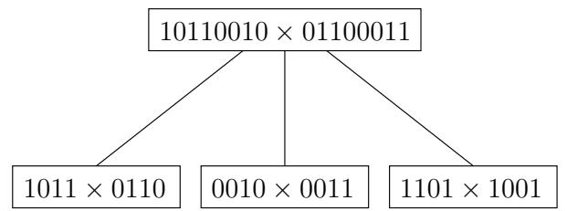
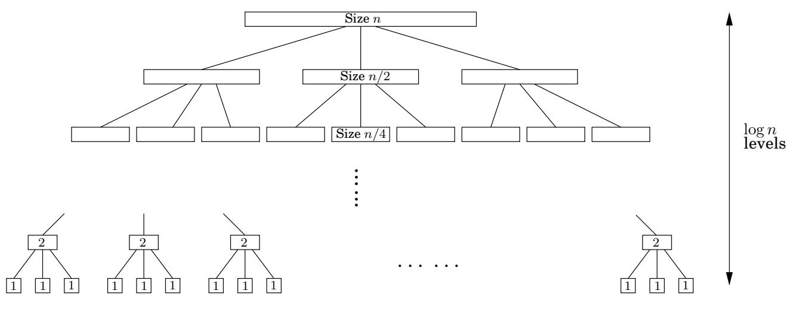
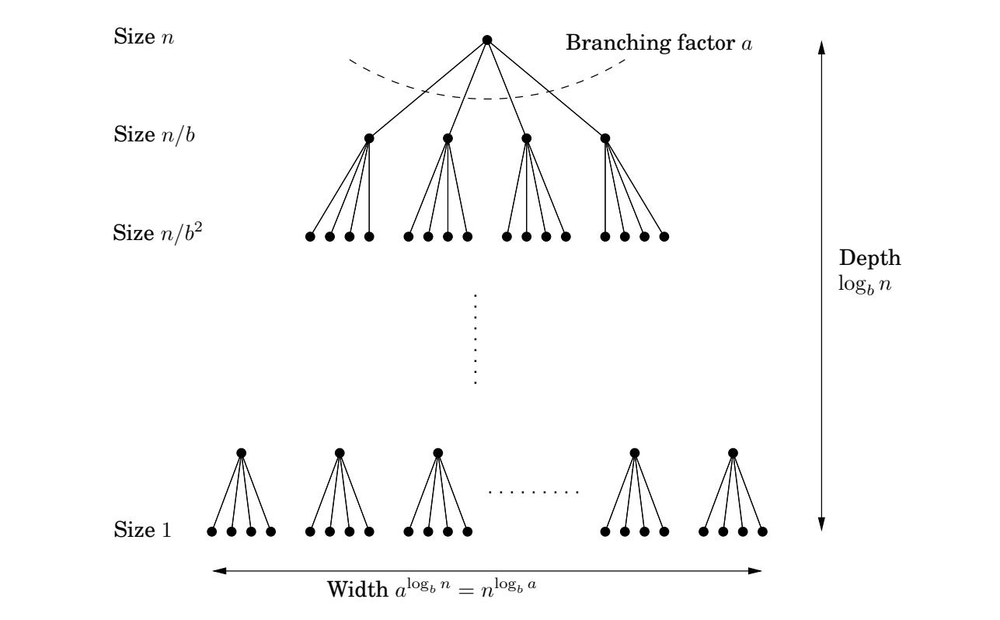

import Guide from '@/components/Guide.astro';
import Knowledge from '@/components/Knowledge.astro';
import Example from '@/components/Example.astro';
import Analysis from '@/components/Analysis.astro';
import Solution from '@/components/Solution.astro';
import Variant from '@/components/Variant.astro';
import Note from '@/components/Note.astro';
import Block from '@/components/Block.astro';
import Method from '@/components/Method.astro';
import Exercise from '@/components/Exercise.astro';

## 2.2 递归关系

分而治之算法通常遵循通用模式：它们通过递归地解决大小为 n 的问题，例如大小为 $n / b$ 的子问题，然后在 $O ( n ^ { d } )$ 时间内组合这些答案，对于某些 $a , b , d > 0$ （在乘法算法中，$a = 3 , b = 2 ,$ ，和 $d = 1 )$ 。因此，它们的运行时间可以通过方程 $T ( n ) = a T ( \lceil n / b \rceil ) + O ( n ^ { d } )$ 来捕获。接下来，我们导出此一般递归的封闭形式解，以便我们不再需要在每个新实例中显式求解它。

图 2.2 整数乘法的分而治之。 (a) 每个问题又分为三个子问题。 (b) 递归的级别。

(一)  

(二)  

对于一些常量 $a > 0 , b > 1$ 和 $d \geq 0 .$ 掌握定理2 $I f T ( n ) = a T ( \lceil n / b \rceil ) + O ( n ^ { d } )$ 然后

$$
T (n) = \left\{ \begin{array}{l l} O (n ^ {d}) & \text {if} d > \log_ {b} a \\ O (n ^ {d} \log n) & \text {if} d = \log_ {b} a \\ O (n ^ {\log_ {b} a}) & \text {if} d <   \log_ {b} a. \end{array} \right.
$$

这个定理告诉我们我们可能使用的大多数分而治之过程的运行时间。

<Solution title="证明">

为了证明这一说法，为了方便起见，我们首先假设 n 是 $b .$ 的幂，这不会以任何重要方式影响最终界限 - 毕竟，n 至多是 b 的乘法因子，远离 b 的某个幂（练习 2.2） - 并且它允许我们忽略 $\lceil n / b \rceil$ 中的舍入效应

</Solution>

接下来，请注意，子问题的大小随着每个递归级别而减小 b 倍，因此在 $\log _ { b } n$ 级别后达到基本情况。这是递归树的高度。它的分支因子是 $^ { a , }$，因此树的第 k 层由 $a ^ { k }$ 个子问题组成，每个子问题的大小为 $n / b ^ { k }$（图 2.3）。此级别完成的总工作是

图2.3 每个大小为n的问题被分为大小为 $n / b .$ 的子问题  

$$
a ^ {k} \times O \left(\frac {n}{b ^ {k}}\right) ^ {d} = O (n ^ {d}) \times \left(\frac {a}{b ^ {d}}\right) ^ {k}.
$$

当 k 从 0（根）到 $\log _ { b } n$（叶子）时，这些数字形成一个比例为 $a / b ^ { d }$ 的几何级数。用大 O 表示法求出这样一个级数的和很容易（练习 0.2），可以归结为三种情况。

## 1. 比率小于1。

然后级数递减，其总和由第一项 $O ( n ^ { d } )$ 给出

2. 比率大于1。

该级数正在递增，其总和由最后一项 $O ( n ^ { \log _ { b } a } )$ 给出

$$
n ^ {d} \left(\frac {a}{b ^ {d}}\right) ^ {\log_ {b} n} = n ^ {d} \left(\frac {a ^ {\log_ {b} n}}{(b ^ {\log_ {b} n}) ^ {d}}\right) = a ^ {\log_ {b} n} = a ^ {(\log_ {a} n) (\log_ {b} a)} = n ^ {\log_ {b} a}.
$$

3. 比率正好为1。

在这种情况下，级数的所有 $O ( \log n )$ 项都等于 $O ( n ^ { d } )$

这些情况直接转化为定理陈述中的三种意外情况。

<Knowledge title="Box: Binary search">

最终的分而治之算法当然是二分搜索：为了在包含按排序顺序的键 $z [ 0 , 1 , \ldots , n - 1 ]$ 的大文件中查找键 k，我们首先将 k 与 $z [ n / 2 ]$ 进行比较，然后根据结果，我们在文件的前半部分 $z [ 0 , \ldots , n / 2 - 1 ]$ 或后半部分进行递归， $z [ n / 2 , \ldots , n - 1 ]$ 。现在的递归是 $T ( n ) = T ( \lceil n / 2 \rceil ) + O ( 1 )$ ，即 $a = 1 , b = 2 , d = 0 .$ 代入我们的主定理，我们得到熟悉的解决方案：运行时间仅为 O(log n)。

</Knowledge>