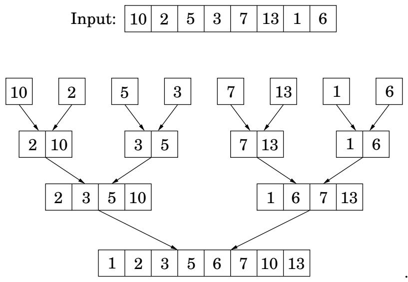
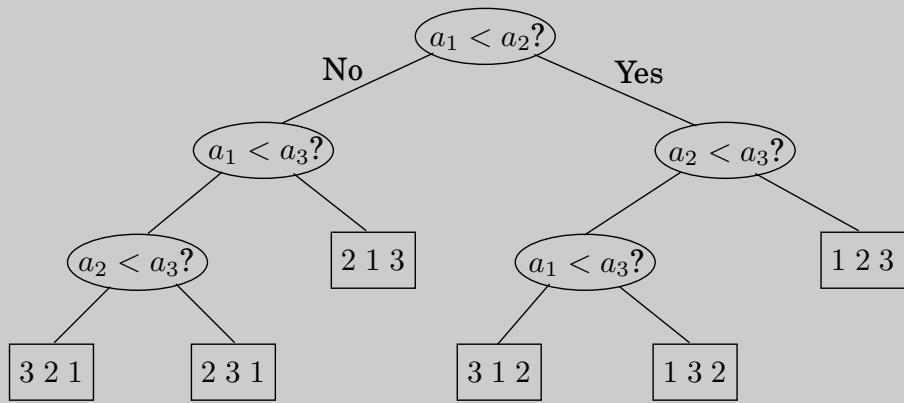

import Guide from '@/components/Guide.astro';
import Knowledge from '@/components/Knowledge.astro';
import Example from '@/components/Example.astro';
import Analysis from '@/components/Analysis.astro';
import Solution from '@/components/Solution.astro';
import Variant from '@/components/Variant.astro';
import Note from '@/components/Note.astro';
import Block from '@/components/Block.astro';
import Method from '@/components/Method.astro';
import Exercise from '@/components/Exercise.astro';
import Algorithm from '@/components/Algorithm.astro';

## 2.3 归并排序

对数字列表进行排序的问题立即适用于分而治之的策略：将列表分成两半，对每一半进行递归排序，然后合并两个已排序的子列表。

<Algorithm>
<u>函数合并排序</u>(a[1...n])
输入：数字数组 a[1...n]
输出：该数组的排序版本

如果 n > 1：
    返回合并（合并排序（a[1...$\lfloor n/2 
楼层 $]), mergesort(a[$\l楼层n/2 
楼层$ + 1...n]))
其他：
    返回一个
</Algorithm>

只要指定正确的合并子程序，该算法的正确性是不言而喻的。如果给定两个排序数组 $x [ 1 \ldots k ]$ 和 $y [ 1 \ldots l ]$ ，我们如何有效地将它们合并为单个排序数组 $z [ 1 \ldots k + l ] ?$ 那么，z 的第一个元素是 x[1] 或 y[1]，以较小者为准。然后可以递归地构造 z[ ] 的其余部分。

<Algorithm>
<u>函数合并</u>(x[1...k], y[1...l])
如果 k = 0：返回 y[1...l]
如果 l = 0：返回 x[1...k]
如果 x[1] ≤ y[1]：
    返回 x[1] ∘ 合并(x[2...k], y[1...l])
其他：
    返回 y[1] ∘ 合并(x[1...k], y[2...l])
</Algorithm>

这里表示串联。此合并过程每次递归调用都会执行恒定量的工作（前提是提前分配所需的数组空间），总运行时间为 O(k + l)。因此合并是线性的，合并排序所花费的总时间是

$$
T (n) = 2 T (n / 2) + O (n),
$$

或 $O(n\log n)$。

回顾归并排序算法，我们发现所有真正的工作都是在合并中完成的，直到递归到单例数组时合并才开始。单例是

图 2.4 归并排序中合并操作的顺序。

成对合并，产生具有两个元素的数组。然后将这些 2 元组对合并，生成 4 元组，依此类推。图 2.4 显示了一个示例。

这个观点还表明了如何进行合并排序迭代。在任何给定时刻，都有一组“活动”数组（最初是单例），它们成对合并以提供下一批活动数组。这些数组可以组织在一个队列中，并通过重复地从队列前面删除两个数组、合并它们并将结果放在队列末尾来进行处理。

在下面的伪代码中，基元操作注入将元素添加到队列末尾，而弹出操作删除并返回队列前端的元素。

<Algorithm>
<u>函数迭代合并排序</u>(a[1...n])
输入：要排序的元素 $a_1, a_2, \ldots, a_n$

Q = [ ]（空队列）
对于 i = 1 到 n：
    注入（Q，[a_i]）
而|Q| > 1：
    注入（Q，合并（弹出(Q) ，弹出(Q) ））
返回弹出(Q)
</Algorithm>

<Knowledge title="Box: An n log n lower bound for sorting">

排序算法可以描述为树。下图中的对三个元素的数组 $a _ { 1 } , a _ { 2 } , a _ { 3 }$ 进行排序，它首先将 $a _ { 1 }$ 与 $a _ { 2 }$ 进行比较，如果第一个较大，则将其与 $^ { a _ { 3 } ; }$ 进行比较，否则将与 $a _ { 2 }$ 进行比较， $a _ { 3 }$ 。等等。最终我们得到一个叶子，这个叶子被标记为三个元素的真实顺序，即 1, 2, 3 的排列。例如，如果 $a _ { 2 } < a _ { 1 } < a _ { 3 }$ ，我们得到的叶子被标记为“2 1 3”。

树的深度（从根到叶子的最长路径上的比较次数，在本例中为 3）正是算法最坏情况的时间复杂度。

这种看待排序算法的方式很有用，因为它允许人们认为归并排序是最优的，即 Ω(n log n) 比较对于排序 n 个元素是必要的。

论据如下：考虑任何对 n 个元素的数组进行排序的树。它的每个叶子都由 $\{ 1 , 2 , \ldots , n \}$ 的排列标记。事实上，每个排列都必须显示为叶子的标签。原因很简单：如果缺少特定的排列，如果我们向算法提供根据相同排列排序的输入，会发生什么？由于有 n! n 个元素的排列，因此树至少有 n!树叶。

我们快完成了：这是一棵二叉树，我们认为它至少有 n！树叶。现在回想一下，深度为 d 的二叉树最多有 $2 ^ { d }$ 叶子（证明：对 d 的简单归纳）。 $\mathrm { S } 0 ,$ 树的深度以及算法的复杂度必须至少为 log(n!)。

众所周知，对于某些 $c > 0$ ，$\log ( n ! ) \geq c$ n log n 。有很多方法可以看到这一点。最简单的是注意到 n! $\ge ( n / 2 ) ^ { ( n / 2 ) }$ 因为 n！ $= 1 \cdot 2 \cdot \cdot \cdot \cdot n$ 至少包含大于 $n / 2 ;$ 的 $n / 2$ 因子，然后取双方的日志。另一个是回忆斯特林公式

$$
n! \approx \sqrt {\pi \left(2 n + \frac {1}{3}\right)} \cdot n ^ {n} \cdot e ^ {- n}.
$$

不管怎样，我们已经确定，任何对 n 个元素进行排序的比较树在最坏的情况下都必须进行 Ω(n log n) 次比较，因此归并排序是最佳的！

嗯，有一些细则：这个简洁的论点仅适用于使用比较的算法。是否可以想象存在替代的排序策略，也许使用复杂的数值操作，在线性时间内工作？答案是肯定的，在某些特殊情况下：典型的例子是当要排序的元素是位于小范围内的整数时（练习2.20）。

</Knowledge>