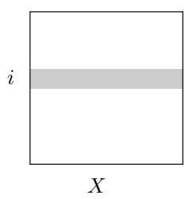
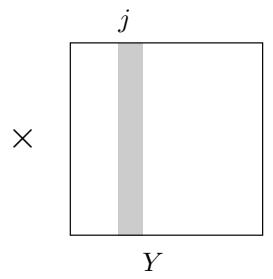
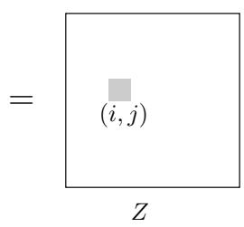

import Guide from '@/components/Guide.astro';
import Knowledge from '@/components/Knowledge.astro';
import Example from '@/components/Example.astro';
import Analysis from '@/components/Analysis.astro';
import Solution from '@/components/Solution.astro';
import Variant from '@/components/Variant.astro';
import Note from '@/components/Note.astro';
import Block from '@/components/Block.astro';
import Method from '@/components/Method.astro';
import Exercise from '@/components/Exercise.astro';

## 2.5 矩阵乘法

两个 $n \times n$ 矩阵 X 和 Y 的乘积是第三个 $n \times n$ 矩阵 $Z = X Y$ ，第 $( i , j )$ 条目

$$
Z _ {i j} = \sum_ {k = 1} ^ {n} X _ {i k} Y _ {k j}.
$$

为了更加直观，$Z _ { i j }$ 是 X 的第 i 行与 Y 的第 j 列的点积：

一般来说，XY 与 $Y X ;$ 不同；矩阵乘法不可交换。

上面的公式暗示了矩阵乘法的 $O ( n ^ { 3 } )$ 算法：有 $n ^ { 2 }$ 个条目需要计算，每个条目需要 $O ( n )$ 时间。在相当长的一段时间里，这被广泛认为是可能的最佳运行时间，甚至证明在某些计算模型中没有算法可以做得更好。因此，当 1969 年德国数学家 Volker Strassen 宣布一种基于分治法的高效算法时，引起了极大的兴奋。

矩阵乘法特别容易分解为子问题，因为它可以按块执行。要了解这意味着什么，请将 X 分成四个 $n / 2 \times n / 2$ 块，以及 $Y { : }$

$$
X = \left[ \begin{array}{c c} A & B \\ C & D \end{array} \right], Y = \left[ \begin{array}{c c} E & F \\ G & H \end{array} \right].
$$

然后它们的乘积可以用这些块来表示，并且就像这些块是单个元素一样（练习 2.11）。

$$
X Y = \left[ \begin{array}{c c} A & B \\ C & D \end{array} \right] \left[ \begin{array}{c c} E & F \\ G & H \end{array} \right] = \left[ \begin{array}{c c} A E + B G & A F + B H \\ C E + D G & C F + D H \end{array} \right]
$$

我们现在有一个分而治之的策略：为了计算大小为 n 的乘积 $X Y$ ，递归计算 8 个 si $\scriptstyle \mathtt { z e - n / 2 }$ 乘积 AE、BG、AF、BH、CE、DG、CF、DH，然后进行一些 $O ( n ^ { 2 } )$ 时间加法。总运行时间由递推关系描述

$$
T (n) = 8 T (n / 2) + O (n ^ {2}).
$$

结果是一个不起眼的 $O ( n ^ { 3 } )$ ，与默认算法相同。但效率还可以进一步提高，和整数乘法一样，关键是一些巧妙的代数。事实证明，XY 可以仅由七个 $n / 2 \times n / 2$ 子问题计算出来，通过如此棘手和复杂的分解，人们想知道 Strassen 是如何发现它的！

$$
\begin{array}{r l r} {X Y} & = & {\left[ \begin{array}{c c} P _ {5} + P _ {4} - P _ {2} + P _ {6} & P _ {1} + P _ {2} \\ P _ {3} + P _ {4} & P _ {1} + P _ {5} - P _ {3} - P _ {7} \end{array} \right]} \end{array}
$$

哪里

$$
\begin{array}{r c l} P _ {1} & = & A (F - H) \\ P _ {2} & = & (A + B) H \\ P _ {3} & = & (C + D) E \\ P _ {4} & = & D (G - E) \end{array} \qquad \qquad \begin{array}{r c l} P _ {5} & = & (A + D) (E + H) \\ P _ {6} & = & (B - D) (G + H) \\ P _ {7} & = & (A - C) (E + F) \end{array}
$$

新的运行时间是

$$
T (n) = 7 T (n / 2) + O (n ^ {2}),
$$

根据主定理可得出 $O ( n ^ { \log _ { 2 } 7 } ) \approx O ( n ^ { 2 . 8 1 } )$