import Guide from '@/components/Guide.astro';
import Knowledge from '@/components/Knowledge.astro';
import Example from '@/components/Example.astro';
import Analysis from '@/components/Analysis.astro';
import Solution from '@/components/Solution.astro';
import Variant from '@/components/Variant.astro';
import Note from '@/components/Note.astro';
import Block from '@/components/Block.astro';
import Method from '@/components/Method.astro';
import Exercise from '@/components/Exercise.astro';
import Algorithm from '@/components/Algorithm.astro';

## 2.6 快速傅里叶变换

到目前为止，我们已经了解了分而治之如何提供整数和矩阵相乘的快速算法；我们的下一个目标是多项式。两个 d 次多项式的乘积是 2d 次多项式，例如：

$$
(1 + 2 x + 3 x ^ {2}) \cdot (2 + x + 4 x ^ {2}) = 2 + 5 x + 1 2 x ^ {2} + 1 1 x ^ {3} + 1 2 x ^ {4}.
$$

更一般地，如果 $A ( x ) = a _ { 0 } + a _ { 1 } x + \cdot \cdot \cdot + a _ { d } x ^ { d }$ 和 $B ( x ) = b _ { 0 } + b _ { 1 } x + \cdot \cdot \cdot + b _ { d } x ^ { d }$ ，它们的乘积 $C ( x ) = A ( x ) \cdot B ( x ) = c _ { 0 } + c _ { 1 } x + \cdot \cdot \cdot + c _ { 2 d } x ^ { 2 d }$ 有系数

$$
c _ {k} = a _ {0} b _ {k} + a _ {1} b _ {k - 1} + \dots + a _ {k} b _ {0} = \sum_ {i = 0} ^ {k} a _ {i} b _ {k - i}
$$

（对于 $i > d ,$ ，将 $a _ { i }$ 和 $b _ { i }$ 设为零）。根据该公式计算 $c _ { k }$ 需要 $O ( k )$ 步骤，因此查找所有 $2 d + 1$ 系数似乎需要 $\Theta ( d ^ { 2 } )$ 时间。我们可以比这更快地乘多项式吗？

我们将开发的解决方案，即快速傅立叶变换，已经彻底改变了信号处理领域——实际上，定义了信号处理领域（见下框）。由于它的巨大重要性，以及来自不同研究领域的丰富见解，我们将比平时更悠闲地对待它。只想要核心算法的读者可以直接跳到2.6.4节。

## 为什么要乘多项式？

一方面，事实证明我们拥有的最快的整数乘法算法在很大程度上依赖于多项式乘法；毕竟，多项式和二进制整数非常相似——只需将变量 x 替换为基数 2，并注意进位即可。但也许更重要的是，多项式相乘对于信号处理至关重要。

信号是时间（如图 (a) 所示）或位置的函数的任何量。例如，它可以通过测量说话者嘴部附近的气压波动来捕获人的声音，或者通过测量作为角度函数的亮度来捕获夜空中的星星图案。

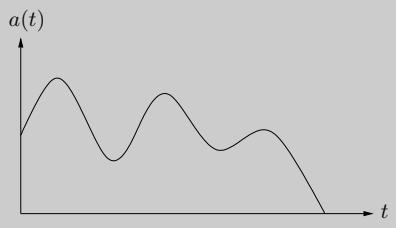  
(一)

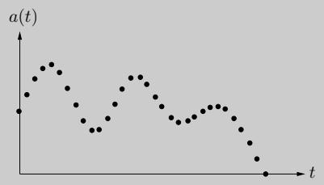  
(二)

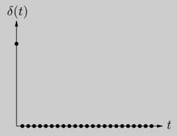  
(三)

为了从信号中提取信息，我们需要首先通过采样将其数字化（图 (b)），然后将其放入一个系统中，以某种方式对其进行转换。输出称为系统的响应：

$$
\text { signal } \longrightarrow \boxed {\text { SYSTEM }} \longrightarrow \text { response }
$$

一类重要的系统是线性系统（对两个信号之和的响应只是它们各自响应的总和），并且是时间不变的系统（将输入信号移动时间 t 会产生相同的输出，也移动 t）。具有这些属性的任何系统都完全由其对最简单的输入信号的响应来表征：单位脉冲 $\delta ( t )$，仅由 $t = 0$ 处的 $\mathbf { \Psi } ^ { 6 6 } \mathbf { j } \mathbf { e r k } ^ { \mathbf { \prime } \mathbf { \prime } }$ 组成（图(c) ）。要了解这一点，首先考虑近亲 $\delta ( t - i )$ ，这是一个在时间 i 发生急动的偏移脉冲。任何信号 $a ( t )$ 都可以表示为这些信号的线性组合，让 $\delta ( t - i )$ 挑选出其在时间 $i ,$ 的行为

$$
a (t) = \sum_ {i = 0} ^ {T - 1} a (i) \delta (t - i)
$$

（如果信号由 $T$ 样本组成）。根据线性，系统对输入 $a ( t )$ 的响应由对各种 $\delta ( t - i )$ 的响应决定。根据时间不变性，这些又只是脉冲响应 $b ( t )$ 的移位副本，即对 $\delta ( t )$ 的响应

换句话说，系统在 k 时刻的输出为

$$
c (k) = \sum_ {i = 0} ^ {k} a (i) b (k - i),
$$

正是多项式乘法的公式！

## 2.6.1 多项式的另一种表示

为了获得多项式乘法的快速算法，我们从多项式的一个重要属性中获得灵感。

事实 d 次多项式的唯一特征在于它在任意 $d + 1$ 不同点处的值。

一个常见的例子是“任意两点决定一条线”。稍后我们将看到为什么更一般的陈述是正确的（第 72 页），但目前它为我们提供了多项式的另一种表示形式。修复任何不同点 $x _ { 0 } , \ldots , x _ { d } .$ 我们可以通过以下任一方式指定 d 次多项式 $A ( x ) = a _ { 0 } + a _ { 1 } x + \cdot \cdot \cdot + a _ { d } x ^ { d }$：

1.它的系数 $a _ { 0 } , a _ { 1 } , \ldots , a _ { d }$

2. 值 $A(x_0), A(x_1), \ldots, A(x_d)$

在这两种表示中，第二种对于多项式乘法更有吸引力。由于乘积 $C ( x )$ 的度数为 2d，因此它完全由其在任意 $2 d + 1$ 点处的值决定。它在任何给定点 z 的值都很容易计算出来，只需 $A ( z )$ 乘以 $B ( z )$ 因此，多项式乘法在值表示中需要线性时间。

问题是我们期望输入多项式及其乘积由系数指定。因此，我们需要首先将系数转换为值（这只是在所选点处评估多项式的​​问题），然后乘以值表示，最后转换回系数，这个过程称为插值。

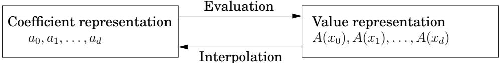

图 2.5 展示了最终的算法。

<Algorithm title="Figure 2.5 Polynomial multiplication">
输入：d 次多项式 A(x) 和 B(x) 的系数
输出：他们的乘积 C = A · B

选择
选择一些点 $x_0, x_1, \ldots, x_{n-1}$，其中 $n \geq 2d + 1$

评价
计算 $A(x_0), A(x_1), \ldots, A(x_{n-1})$ 和 $B(x_0), B(x_1), \ldots, B(x_{n-1})$

乘法
计算所有 $k = 0, \ldots, n - 1$ 的 $C(x_k) = A(x_k)B(x_k)$

插值法
恢复 $C(x) = c_0 + c_1 x + \cdots + c_{2d} x^{2d}$
</Algorithm>

两个多项式表示的等价性清楚地表明这种高级方法是正确的，但它的效率如何？当然，选择步骤和n次乘法根本不麻烦，只是线性时间。<sup>3</sup>但是（抛开插值，我们对此知之甚少）评估怎么样？在单个点处计算次数为 $d \leq n$ 的多项式需要 $O ( n )$ 步骤（练习 2.29），因此 n 个点的基线为 $\Theta ( n ^ { 2 } )$ 。现在，我们将看到快速傅立叶变换 (FFT) 只需 $O ( n \log n )$ 时间即可完成，这是一种特别聪明的选择 $x _ { 0 } , \ldots , x _ { n - 1 }$，其中各个点所需的计算相互重叠并且可以共享。

## 2.6.2 分治法评估

以下是如何选择 n 个点来评估次数为 $\leq n - 1$ 的多项式 $A ( x )$ 的想法。如果我们选择它们是正负对，即

$$
\pm x _ {0}, \pm x _ {1}, \ldots , \pm x _ {n / 2 - 1},
$$

那么每个 $A ( x _ { i } )$ 和 $A ( - x _ { i } )$ 所需的计算重叠很多，因为偶次幂 $\mathbf { o f } \ x _ { i }$ 与那些 $\mathbf { o f } - x _ { i }$ 一致

为了研究这个问题，我们需要将 $A ( x )$ 分解为其奇数次幂和偶数次幂，例如

$$
3 + 4 x + 6 x ^ {2} + 2 x ^ {3} + x ^ {4} + 1 0 x ^ {5} = (3 + 6 x ^ {2} + x ^ {4}) + x (4 + 2 x ^ {2} + 1 0 x ^ {4}).
$$

请注意，括号中的项是 $x ^ { 2 }$ 中的多项式。更一般地说，

$$
A (x) = A _ {e} (x ^ {2}) + x A _ {o} (x ^ {2}),
$$

其中，具有偶数系数的 $A _ { e } ( \cdot )$ 和具有奇数系数的 $A _ { o } ( \cdot )$ 是次数为 $\leq n / 2 - 1$ 的多项式（为方便起见，假设 $n$ 是偶数）。给定配对点 $\pm x _ { i } ,$，$A ( x _ { i } )$ 所需的计算可以循环用于计算 $A ( - x _ { i } )$

$$
\begin{array}{r c l} {A (x _ {i})} & = & {A _ {e} (x _ {i} ^ {2}) + x _ {i} A _ {o} (x _ {i} ^ {2})} \\ {A (- x _ {i})} & = & {A _ {e} (x _ {i} ^ {2}) - x _ {i} A _ {o} (x _ {i} ^ {2}).} \end{array}
$$

换句话说，在n个配对点 $\pm x _ { 0 } , \ldots , \pm x _ { n / 2 - 1 }$ 评估 $A ( x )$ 减少为评估 $A _ { e } ( x )$ 和 $A _ { o } ( x )$（它们各自的度数是 $A ( x ) )$ 的一半） $n / 2$ 点，$x _ { 0 } ^ { 2 } , \ldots , x _ { n / 2 - 1 } ^ { 2 } .$

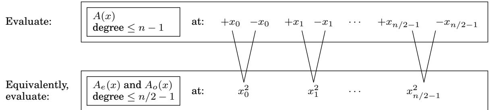

大小为 n 的原始问题以这种方式重新转换为大小为 $n / 2 ,$ 的两个子问题，然后进行一些线性时间算术。如果我们可以递归，我们将得到一个具有运行时间的分而治之的过程

$$
T (n) = 2 T (n / 2) + O (n),
$$

这就是 $O ( n \log n )$ ，正是我们想要的。

但我们有一个问题：加减技巧仅适用于递归的顶层。为了在下一级递归，我们需要 $n / 2$ 评估点 $x _ { 0 } ^ { 2 } , x _ { 1 } ^ { 2 } , . . . , x _ { n / 2 - 1 } ^ { 2 }$ 本身就是正负对。但平方怎么可能是负数呢？这个任务看来是不可能完成的！当然，除非我们使用复数。

很好，但是哪些复数呢？为了弄清楚这一点，让我们对这个过程进行“逆向工程”。在递归的最底部，我们有一个点。该点也可能是 1，在这种情况下，其上方的级别必须由其平方根组成，$\pm { \sqrt { 1 } } = \pm 1$

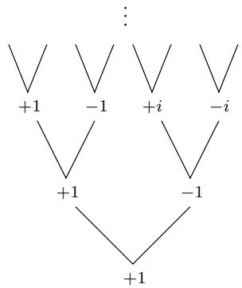

下一个级别有 $\pm { \sqrt { + 1 } } = \pm 1$ 以及复数 $\pm { \sqrt { - 1 } } = \pm i$ ，其中 i 是虚数单位。通过这种方式继续，我们最终到达初始的 n 个点集。也许你已经猜到它们是什么了：复数n次单位根，即方程 $z ^ { n } = 1$ 的n个复数解

图 2.6 形象地回顾了一些关于复数的基本事实。该图的第三个面板介绍了单位的 n 次根：复数 $1 , \omega , \omega ^ { 2 } , \ldots , \omega ^ { n - 1 }$ ，其中 $\omega = e ^ { 2 \pi i / n }$ 。如果 n 是偶数，

1.第n个根是正负配对，$\omega ^ { n / 2 + j } = - \omega ^ { j }$

2. 将它们平方得到 $( n / 2 )$ nd 单位根。

因此，如果我们从这些数字开始，n 是 2 的幂，那么在连续的递归级别上，我们将得到 $( n / 2 ^ { k } )$ 单位根，对于 $k = 0 , 1 , 2 , 3 , \dotsc \dotsc \operatorname { A l l }$，这些数字集是正负配对的，因此我们的分而治之，如最后一个面板所示，可以完美地工作。由此产生的算法是快速傅立叶变换（图 2.7）。

图 2.6 复数单位根非常适合我们的分而治之方案。

<table> <tr> <td> 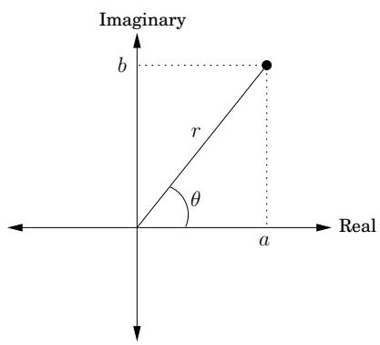 </td> <td>复平面 $z = a + bi$ 绘制在位置 $(a, b)$ .极坐标：重写为 $z = r(\cos\theta + i\sin\theta) = re^{i\theta}$ ，表示为 $(r, \theta)$ .•长度 $r = \sqrt{a^2 + b^2}$ .•角度 $\theta \in [0, 2\pi)$ ： $\cos\theta = a/r$ , $\sin\theta = b/r$ .• $\theta$ 始终可以模 $2\pi$ 减少。示例：数字 -1 i 5+5i 极坐标 (1,π) (1,π/2) (5√2,π/4)</td> </tr> <tr> <td> 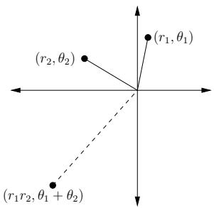 </td> <td>乘以在极坐标中很容易将长度相乘并添加角度： $(r_1, \theta_1) \times (r_2, \theta_2) = (r_1r_2, \theta_1 + \theta_2)$ 。对于任何 $z = (r, \theta)$ ，• $-z = (r, \theta + \pi)$ 自 $-1 = (1, \pi)$ 。•如果 $z$ 在单位圆上（即， $r = 1$ )，然后 $z^n = (1, n\theta)$ .</td> </tr> <tr> <td> 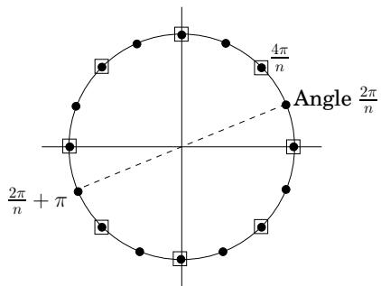 </td> <td>unity的n次复数根的解方程 $z^n = 1$ 。根据乘法规则：解为 $z = (1, \theta)$ ，对于 $\theta$ 是 $2\pi/n$ 的倍数（此处显示的是 $n = 16$ ）。对于偶数 $n$ :•这些数字是正负配对的：$-(1, \theta) = (1, \theta + \pi)$ .•它们的平方是 $(n/2)$ 和单位根，此处用方框显示他们。</td> </tr> <tr> <td colspan="2">分而治之步骤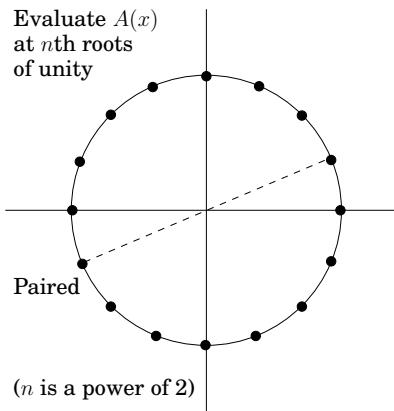 </td> </tr> </table>

```txt
Figure 2.7 The fast Fourier transform (polynomial formulation)

function FFT(A,ω)

Input: Coefficient representation of a polynomial A(x)
of degree ≤ n-1, where n is a power of 2
ω, an nth root of unity

Output: Value representation A(ω⁰), ..., A(ωⁿ⁻¹)

if ω=1: return A(1)
express A(x) in the form Ae(x²) + xAo(x²)
call FFT(Ae,ω²) to evaluate Ae at even powers of ω
call FFT(Ao,ω²) to evaluate Ao at even powers of ω
for j=0 to n-1:
compute A(ωj) = Ae(ω²j) + ωjAo(ω²j)

return A(ω⁰), ..., A(ωⁿ⁻¹)
```

## 2.6.3 插值

让我们评估一下我们现在所处的位置。我们首先开发了一个多项式乘法的高级方案（图 2.5），基于这样的观察：多项式可以用两种方式表示，即用它们的系数或用它们在选定的一组点上的值来表示。

<table> <tr> <td rowspan="2">系数表示 $a_0, a_1, \ldots, a_{n-1}$ </td> <td>评估</td> <td rowspan="2">值表示 $A(x_0), A(x_1), \ldots, A(x_{n-1})$ </td> </tr> <tr> <td>插值</td> </tr> </table>

值表示使得多项式相乘变得微不足道，但我们不能忽略系数表示，因为它是指定整个算法的输入和输出的形式。

因此，我们设计了 FFT，当点 $\{ x _ { i } \}$ 是复数 n 次单位根 $( 1 , \omega , \omega ^ { 2 } , \ldots , \omega ^ { n - 1 } )$ 时，只需 O(n log n) 的时间即可从系数移动到值。

$$
\langle \text { values } \rangle = \text { FFT } (\langle \text { coefficients } \rangle , \omega).
$$

最后剩下的一块拼图是逆运算，即插值。令人惊讶的是，结果将会是这样

$$
\langle \text { coefficients } \rangle = \frac {1}{n} \mathbf {F F T} (\langle \text { values } \rangle , \omega^ {- 1}).
$$

因此，插值以我们可能希望的最简单、最优雅的方式解决——使用相同的 FFT 算法，但用 $\omega ^ { - 1 }$ 代替 $\dot { \omega } !$ 进行调用。这似乎是一个奇迹般的巧合，但当我们用线性代数语言重新编写多项式运算时，它会更有意义。同时，我们的 O(n log n) 多项式乘法算法（图 2.5）现已完全指定。

## 矩阵重构

为了获得更清晰的插值视图，让我们显式地设置次数为 $\leq n - 1$ 的多项式 $A ( x )$ 的两个表示之间的关系。它们都是 n 个数字的向量，其中一个是另一个的线性变换：

$$
\left[ \begin{array}{c} A (x _ {0}) \\ A (x _ {1}) \\ \vdots \\ A (x _ {n - 1}) \end{array} \right] = \left[ \begin{array}{c c c c c} 1 & x _ {0} & x _ {0} ^ {2} & \dots & x _ {0} ^ {n - 1} \\ 1 & x _ {1} & x _ {1} ^ {2} & \dots & x _ {1} ^ {n - 1} \\ & & \vdots & & \\ 1 & x _ {n - 1} & x _ {n - 1} ^ {2} & \dots & x _ {n - 1} ^ {n - 1} \end{array} \right] \left[ \begin{array}{c} a _ {0} \\ a _ {1} \\ \vdots \\ a _ {n - 1} \end{array} \right].
$$

将中间的矩阵称为 M。它的特殊格式 - 范德蒙矩阵 - 赋予它许多显着的属性，其中以下内容与我们特别相关。

$H x _ { 0 } , \ldots , x _ { n - 1 }$ 是不同的数字，则 M 是可逆的

$M ^ { - 1 }$ 的存在使我们能够将前面的矩阵方程求逆，从而用值来表达系数。简而言之，

求值是乘以M，插值是乘以 $M ^ { - 1 }$

我们对多项式运算的重新表述更清楚地揭示了它们的本质。除此之外，它最终证明了我们一直在做的一个假设，即 $A ( x )$ 的唯一特征在于它在任何 n 个点上的值 - 事实上，我们现在有一个明确的公式，可以在这种情况下给出 $A ( x )$ 的系数。 Vandermonde 矩阵还具有比更一般的矩阵更快的特点，需要 $O ( n ^ { 2 } )$ 时间而不是 $O ( n ^ { 3 } )$ ）。然而，使用它进行插值对我们来说仍然不够快，所以我们再次转向我们对点的特殊选择——复数单位根。

## 插值已解决

用线性代数术语来说，FFT 将任意 n 维向量（我们称之为系数表示）乘以 $n \times n$ 矩阵

$$
M _ {n} (\omega) = \left[ \begin{array}{c c c c c} 1 & 1 & 1 & \dots & 1 \\ 1 & \omega & \omega^ {2} & \dots & \omega^ {n - 1} \\ 1 & \omega^ {2} & \omega^ {4} & \dots & \omega^ {2 (n - 1)} \\ & & \vdots & & \\ 1 & \omega^ {j} & \omega^ {2 j} & \dots & \omega^ {(n - 1) j} \\ & & \vdots & & \\ 1 & \omega^ {(n - 1)} & \omega^ {2 (n - 1)} & \dots & \omega^ {(n - 1) (n - 1)} \end{array} \right] \begin{array}{l l l} \longleftarrow & \mathbf {r o w f o r}   \omega^ {0} = 1 \\ \longleftarrow & \omega \\ \longleftarrow & \omega^ {2} \\ & \vdots \\ \longleftarrow & \omega^ {j} \\ & \vdots \\ \longleftarrow & \omega^ {n - 1} \end{array}
$$

其中 $\omega$ 是复数 n 次单位根，n 是 2 的幂。请注意这个矩阵的描述是多么简单：它的 $( j , k )$ 第一个条目（行数和列数从零开始）是 $\omega ^ { j k }$

乘以 $M = M _ { n } ( \omega )$ 将第 k 个坐标轴（除了位置 k 处的 1 之外全为零的向量）映射到 M 的第 k 列。现在这是关键的观察结果，我们将很快证明：M 的列彼此正交（成直角）。因此，它们可以被认为是替代坐标系的轴，通常称为

图 2.8 FFT 在标准坐标系中获取点，其轴在此显示为 $x _ { 1 } , x _ { 2 } , x _ { 3 }$ ，并将它们旋转到傅立叶基中，其轴是 $M _ { n } ( \omega )$ 的列，在此处显示为 $f _ { 1 } , f _ { 2 } , f _ { 3 }$ 。例如，方向 $x _ { 1 }$ 的点被映射到方向 $f _ { 1 }$

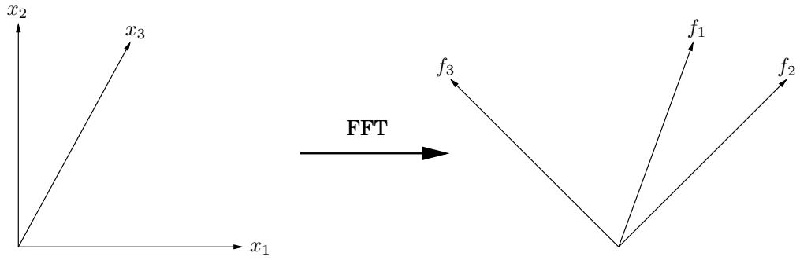

傅里叶基础。将向量乘以 M 的效果是将其从具有通常轴集的标准基旋转到由 M 的列定义的傅立叶基（图 2.8）。因此，FFT 是基础的变化，是刚性旋转。 M 的逆是相反的旋转，从傅立叶基回到标准基。当我们精确地写出正交条件时，我们将能够轻松地读出这个逆变换：

反演公式 $\begin{array} { r } { M _ { n } ( \omega ) ^ { - 1 } = \frac { 1 } { n } M _ { n } ( \omega ^ { - 1 } ) } \end{array}$

但 $\omega ^ { - 1 }$ 也是单位的n次方根，因此插值（或等效地乘以 $M _ { n } ( \omega ) ^ { - 1 }$）本身只是一个FFT运算，但将 $\omega$ 替换为 $\omega ^ { - 1 }$

现在让我们详细了解一下。为了方便起见，将 $\omega$ 设为 $e ^ { 2 \pi i / n }$ ，并将 M 的列视为 $\mathbb { C } ^ { n }$ 中的向量。回想一下，$\mathbb { C } ^ { n }$ 中两个向量 $u = ( u _ { 0 } , \ldots , u _ { n - 1 } )$ 和 $v = \left( v _ { 0 } , \ldots , v _ { n - 1 } \right)$ 之间的角度只是缩放因子乘以它们的内积

$$
u \cdot v ^ {*} = u _ {0} v _ {0} ^ {*} + u _ {1} v _ {1} ^ {*} + \dots + u _ {n - 1} v _ {n - 1} ^ {*},
$$

其中 $z ^ { * }$ 表示 z 的复数 $\mathrm { c o n j u g a t e ^ { 4 } }$。当矢量方向相同时，该量最大；当矢量彼此正交时，该量为零。

我们需要的基本观察如下。

<Knowledge title="引理">

矩阵 M 的列彼此正交

</Knowledge>

<Solution title="证明">

取矩阵 $M$ 任意列 $j$ 和 k 的内积，

</Solution>

$$
1 + \omega^ {j - k} + \omega^ {2 (j - k)} + \dots + \omega^ {(n - 1) (j - k)}.
$$

这是一个几何级数，第一项为 1，最后一项为 $\omega ^ { ( n - 1 ) ( j - k ) }$ ，比率为 $\boldsymbol { \omega } ^ { ( j - k ) }$ 。因此，它的计算结果为 $( 1 - \omega ^ { n ( j - k ) } ) / ( 1 - \omega ^ { ( j - k ) } )$ ，即 0 — 除非 $j = k$ ，在这种情况下，所有项均为 1 并且总和为 n。

正交性可以概括为单个方程

$$
M M ^ {*} = n I,
$$

因为 $( M M ^ { * } ) _ { i j }$ 是 M 的第 i 列和 $j \mathrm { t h }$ 列的内积（你明白为什么吗？）。这立即意味着 $M ^ { - 1 } = ( 1 / n ) M ^ { * }$：我们有一个反演公式！但这与我们之前声称的公式相同吗？让我们看看 - $M ^ { * }$ 的第 (j, k) 个条目是 M 相应条目的复共轭，换句话说 $\omega ^ { - j k }$ 。于是 $M ^ { * } = M _ { n } ( \omega ^ { - 1 } )$，我们就完成了。

现在我们终于可以退后一步，从几何角度来看待整个事件了。我们需要执行的任务（多项式乘法）在傅里叶基中比在标准基中容易得多。因此，我们首先将向量旋转到傅里叶基（求值），然后执行任务（乘法），最后旋转回来（插值）。初始向量是系数表示，而它们的旋转对应向量是值表示。 FFT 的职责就是在这些之间来回高效地切换。

## 2.6.4 仔细观察快速傅里叶变换

现在我们已经完全实现了多项式乘法的高效方案，让我们更仔细地研究使这一切成为可能的核心子程序，即快速傅里叶变换。

## 权威的 FFT 算法

FFT 将向量 $a = \left( a _ { 0 } , \ldots , a _ { n - 1 } \right)$ 和复数 ω 作为输入，其幂 $1 , \omega , \omega ^ { 2 } , \ldots , \omega ^ { n - 1 }$ 是复数 n 次单位根。它将向量 a 乘以 $n \times n$ 矩阵 $M _ { n } ( \omega )$ ，该矩阵有 $( j , k )$ 第一个条目（从零开始行数和列数） $\omega ^ { j k }$ 。当 M 的列被分为偶数和奇数时，在矩阵向量乘法中使用分而治之的潜力就变得显而易见：

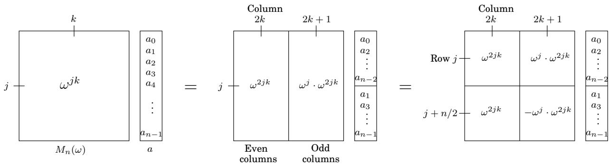  
在第二步中，我们使用 $\omega ^ { n / 2 } = - 1$ 和 $\omega ^ { n } = 1$ 简化了矩阵下半部分的条目。请注意，左上角的 $n / 2 \times n / 2$ 子矩阵是 $M _ { n / 2 } ( \omega ^ { 2 } )$ ，左下角的子矩阵也是如此。右上和右下子矩阵几乎与 $M _ { n / 2 } ( \omega ^ { 2 } )$ 相同，但它们的第 j 行分别乘以 $\omega ^ { j }$ 和 $- \omega ^ { j }$ 。因此最终的结果就是向量

```txt
Figure 2.9 The fast Fourier transform
function FFT(a,ω)
Input: An array a=(a0,a1,...,an-1), for n a power of 2
A primitive nth root of unity, ω
Output: Mn(ω)a
if ω=1: return a
(s0,s1,...,sn/2-1)=FFT((a0,a2,...,an-2),ω²)
(s′0,s′1,...,sn′/2-1)=FFT((a1,a3,...,an-1),ω²)
for j=0 to n/2-1:
rj=sj+ωjs′j
rj+n/2=sj-ωjs′j
return (r0,r1,...,rn-1)
```

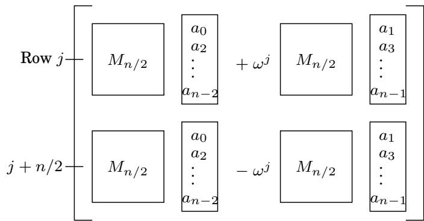

简而言之，$M _ { n } ( \omega )$ 与向量 $( a _ { 0 } , \ldots , a _ { n - 1 } )$ 的乘积（大小为 n 的问题）可以用两个 $\mathrm { s i z e } { - n / 2 }$ 问题来表示：$M _ { n / 2 } ( \omega ^ { 2 } )$ 与 $( a _ { 0 } , a _ { 2 } , \ldots , a _ { n - 2 } )$ 的乘积以及 $( a _ { 1 } , a _ { 3 } , \ldots , a _ { n - 1 } )$ 。这种分而治之的策略导致了图 2.9 所示的最终 FFT 算法，其运行时间为 $T ( n ) = 2 T ( n / 2 ) + O ( n ) = O ( n \log n )$

## 快速傅立叶变换揭秘

在迄今为止我们所有的讨论中，快速傅里叶变换仍然被紧紧地包裹在分而治之的形式主义中。为了充分揭示其结构，我们现在解开递归。

FFT 的分而治之步骤可以画成一个非常简单的电路。以下是如何将大小为 n 的问题简化为两个大小为 $n / 2$ 的子问题（为清楚起见，单独挑选出一对输出 $( j , j + n / 2 )$）：

$$
a _ {0}, \dots , a _ {n - 1},
$$

$$
\left. r _ {0}, \dots , r _ {n - 1}\right)
$$

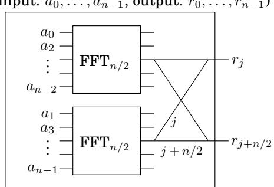

我们使用一种特殊的速记法：边缘是从左到右携带复数的电线。 $\cdot _ { j }$ 的权重意味着“将此电线上的数字乘以 $\omega ^ { j } . ^ { \mathsf { \tiny { p } } }$ 当两条电线从左侧进入连接点时，它们所携带的数字就会相加。因此，所描述的两个输出正在执行命令

$$
\begin{array}{r c l} {r _ {j}} & = & {s _ {j} + \omega^ {j} s _ {j} ^ {\prime}} \\ {r _ {j + n / 2}} & = & {s _ {j} - \omega^ {j} s _ {j} ^ {\prime}} \end{array}
$$

来自 FFT 算法（图 2.9），通过称为 $b u t t e r f l y : \sum$ 的电线图案

完全解开 $n = 8$ 元素的FFT电路，我们得到图10.4。请注意以下事项。

1. 对于 n 个输入，有 $\log _ { 2 }$ n 个级别，每个级别有 n 个节点，总共 n log n 个操作。

2. 输入按特定顺序排列：0、4、2、6、1、5、3、7。

为什么？回想一下，在递归的顶层，我们首先提出输入的偶数系数，然后继续讨论奇数系数。然后在下一级，提出第一组的偶系数（因此是 $^ { 4 , }$ 的倍数或等效地，其两个最低有效位为零），依此类推。换句话说，输入是通过增加其索引的二进制表示的最后一位来排列的，通过查看下一个更重要的位来解决关系。生成的二进制顺序 000, 100, 010, 110, 001, 101, 011, 111 与自然顺序 000, 001, 010, 011, 100, 101, 110, 111 相同，只是位是镜像的！

3. 每个输入 $a _ { j }$ 和每个输出 $A ( \omega ^ { k } )$ 之间有唯一的路径

使用 $j$ 和 $k$ 的二进制表示形式最容易描述这条路径（为方便起见，如图 10.4 所示）。每个节点有两条边，一条向上（0 边），一条向下（1 边）。要从任何输入节点到达 $A ( \omega ^ { k } )$，只需从最右边的位开始沿着 $k ,$ 的位表示中指定的边即可。 （你能类似地指定相反方向的路径吗？）

4. 在 $a _ { j }$ 和 $A ( \omega ^ { k } )$ 之间的路径上，标签总计为 $j k$ mod $8 .$ 。

由于 $\omega ^ { 8 } \ = \ 1$ ，这意味着输入 $a _ { j }$ 对输出 $A ( \omega ^ { k } )$ 的贡献为 $a _ { j } \omega ^ { j k }$ ，因此电路正确计算多项式 $A ( x )$ 的值

5. 最后，请注意，FFT 电路非常适合并行计算和直接在硬件中实现。

图 2.10 快速傅里叶变换电路。

<table> <tr> <td>000</td> </tr> <tr> <td>100</td> </tr> <tr> <td>010</td> </tr> <tr> <td>110</td> </tr> <tr> <td>001</td> </tr> <tr> <td>101</td> </tr> <tr> <td>011</td> </tr> <tr> <td>111</td> </tr> </table>

<Knowledge title="Box: The slow spread of a fast algorithm">

1963 年，在一次肯尼迪总统的科学顾问会议上，普林斯顿大学数学家 John Tukey 向 IBM 的 Dick Garwin 解释了一种计算傅里叶变换的快速方法。加文仔细地听着，因为他当时正在研究从地震数据中探测核爆炸的方法，而傅里叶变换是他方法的瓶颈。当他回到 IBM 时，他请 John Cooley 实现 Tukey 的算法；他们决定应该发表一篇论文，这样这个想法就不能申请专利。

图基不太热衷于写一篇关于这个主题的论文，所以库利采取了主动。 1965 年，库利和图基合着的最著名、引用最多的科学论文之一就是这样发表的。 Tukey 不愿意公布 FFT 的原因并不是出于保密或通过专利追求利润。他只是觉得这只是一个简单的观察，可能已经是众所周知的了。这是那个时期的典型现象：当时（以及后来的一段时间）算法被认为是二流数学对象，缺乏深度和优雅，不值得认真关注。

但 Tukey 在一件事情上是对的：后来发现英国工程师在 20 世纪 30 年代末使用 FFT 进行手工计算。而且——以同样一位伟大的数学家开始这一章来结束这一章——高斯在 1800 年代初发表的一篇关于（还有什么？）插值的论文基本上包含了相同的想法！高斯的论文长期以来一直是秘密，因为它受到老式密码技术的保护：像那个时代的大多数科学论文一样，它是用拉丁文写的。

</Knowledge>