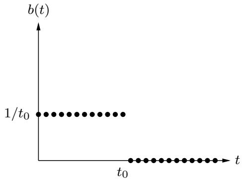

import Guide from '@/components/Guide.astro';
import Knowledge from '@/components/Knowledge.astro';
import Example from '@/components/Example.astro';
import Analysis from '@/components/Analysis.astro';
import Solution from '@/components/Solution.astro';
import Variant from '@/components/Variant.astro';
import Note from '@/components/Note.astro';
import Block from '@/components/Block.astro';
import Method from '@/components/Method.astro';
import Exercise from '@/components/Exercise.astro';
import Algorithm from '@/components/Algorithm.astro';

## 第 2 章练习

<Exercise title="Exercise 2.1">

使用分治整数乘法算法将两个二进制整数 10011011 和 10111010 相乘。

</Exercise>

<Exercise title="Exercise 2.2">

证明对于任何正整数 n 和任何基数 $b ,$，b 的幂一定在 [n, bn] 范围内。

</Exercise>

<Exercise title="Exercise 2.3">

2.2节描述了一种解决递归关系的方法，该方法基于分析递归树并导出每个级别所做工作的公式。另一种（密切相关的）方法是将重复次数扩展几次，直到出现模式。例如，让我们从熟悉的 $T ( n ) = 2 T ( n / 2 ) + O ( n )$ 开始。对于某个常量 $c ,$，将 $O ( n )$ 视为 $\leq c n$，因此：$T ( n ) \leq 2 T ( n / 2 )$ + cn。通过重复应用此规则，我们可以根据 $T ( n / 2 )$ 绑定 $T ( n )$，然后是 $T ( n / 4 )$ ，然后是 $T ( n / 8 )$ ，依此类推，每一步都越来越接近我们确实知道的 $T ( \cdot )$ 的值，即 $T ( 1 ) = O ( 1 )$

$$
\begin{array}{r c l} T (n) & \leq & 2 T (n / 2) + c n \\ & \leq & 2 [ 2 T (n / 4) + c n / 2 ] + c n = 4 T (n / 4) + 2 c n \\ & \leq & 4 [ 2 T (n / 8) + c n / 4 ] + 2 c n = 8 T (n / 8) + 3 c n \\ & \leq & 8 [ 2 T (n / 1 6) + c n / 8 ] + 3 c n = 1 6 T (n / 1 6) + 4 c n \\ & \vdots \end{array}
$$

一种模式正在出现......通用术语是

$$
T (n) \leq 2 ^ {k} T (n / 2 ^ {k}) + k c n.
$$

插入 $k = \log _ { 2 } n ,$ ，我们得到 $T ( n ) \leq n T ( 1 ) + c n \log _ { 2 } n = O ( n \log n ) .$

(a) 对重复 $T ( n ) = 3 T ( n / 2 ) + O ( n )$ 执行相同的操作。在这种情况下，一般的第 k 项是什么？应该代入什么值才能得到答案？

(b) 现在尝试递归 $T ( n ) = T ( n - 1 ) + O ( 1 )$ ，这是主定理未涵盖的情况。你也能解决这个问题吗？

</Exercise>

<Exercise title="Exercise 2.4">

假设您在以下三种算法之间进行选择：

算法A通过将问题分成五个大小一半的子问题，递归地求解每个子问题，然后在线性时间内组合解来解决问题。

算法 B 通过递归求解两个大小为 $n - 1$ 的子问题，然后在常数时间内组合解决方案来解决大小为 n 的问题。

算法 C 通过将大小为 n 的问题分为 9 个大小为 $n / 3$ 的子问题，递归地求解每个子问题，然后在 $O ( n ^ { 2 } )$ 时间内组合解决方案来解决大小为 n 的问题。

这些算法的运行时间是多少（以大 O 表示法），您会选择哪一个？

</Exercise>

<Exercise title="Exercise 2.5">

求解以下递推关系并给出每个关系的 θ 界。

$$
(a) T (n) = 2 T (n / 3) + 1
$$

$$
\text { (b) } T (n) = 5 T (n / 4) + n
$$

$$
(\mathbf {c}) T (n) = 7 T (n / 7) + n
$$

$$
(\mathbf {d}) T (n) = 9 T (n / 3) + n ^ {2}
$$

(e) $T ( n ) = 8 T ( n / 2 ) + n ^ { 3 }$ (f) $T ( n ) = 4 9 T ( n / 2 5 ) + n ^ { 3 / 2 } \log n$ (g) $T ( n ) = T ( n - 1 ) + 2$ (h) $T ( n ) = T ( n - 1 ) + n ^ { c } ;$ ，其中 $c \geq 1$ 是常数 (i) $T ( n ) = T ( n - 1 ) + c ^ { n }$ ，其中 $c > 1$ 是某个常数 (j) $T ( n ) = 2 T ( n - 1 ) + 1$ (k) $T ( n ) = T ( { \sqrt { n } } ) + 1$

</Exercise>

<Exercise title="Exercise 2.6">

线性时不变系统具有以下脉冲响应：



(a) 用文字描述该系统的效果。

(b) 相应的多项式是什么？

</Exercise>

<Exercise title="Exercise 2.7">

n 次单位根之和是多少？如果 n 是奇数，它们的乘积是多少？如果n是偶数？

</Exercise>

<Exercise title="Exercise 2.8">

练习快速傅立叶变换。

(a) $( 1 , 0 , 0 , 0 ) ?$ 的 FFT 是多少？在这种情况下，ω 的适当值是多少？ $( 1 , 0 , 0 , 0 )$ 是哪个序列的 FFT？

(b) 重复 $( 1 , 0 , 1 , - 1 )$

</Exercise>

<Exercise title="Exercise 2.9">

通过 FFT 练习多项式乘法。

(a) 假设您要使用 FFT 将两个多项式 $x + 1$ 和 $x ^ { 2 } + 1$ 相乘。选择适当的2的幂，求两个序列的FFT，将结果按分量相乘，并计算逆FFT以获得最终结果。

(b) 对多项式对 $1 + x + 2 x ^ { 2 }$ 和 $2 + 3 x$ 重复

</Exercise>

<Exercise title="Exercise 2.10">

找到具有值 $p ( 1 ) = 2 , p ( 2 ) = 1 , p ( 3 ) = 0 , p ( 4 ) = 4 _ { ! }$ 和 $p ( 5 ) = 0$ 的唯一 4 次多项式。将你的答案写在系数表示中。

</Exercise>

<Exercise title="Exercise 2.11">

在证明我们的矩阵乘法算法（第 2.5 节）时，我们声明了以下块式属性：如果 X 和 Y 是 $n \times n$ 矩阵，并且

$$
X = \left[ \begin{array}{c c} A & B \\ C & D \end{array} \right], Y = \left[ \begin{array}{c c} E & F \\ G & H \end{array} \right].
$$

其中 $A , \ B , \ C , \ D , \ E , \ F , \ G ,$ 和 H 是 $n / 2 \times n / 2$ 子矩阵，那么乘积 $X Y$ 可以用这些块来表示：

$$
X Y = \left[ \begin{array}{c c} A & B \\ C & D \end{array} \right] \left[ \begin{array}{c c} E & F \\ G & H \end{array} \right] = \left[ \begin{array}{c c} A E + B G & A F + B H \\ C E + D G & C F + D H \end{array} \right]
$$

证明这个性质。

</Exercise>

<Exercise title="Exercise 2.12">

作为 n 的函数（以 θ( ) 形式），以下程序打印多少行？写出一个递归式并解决它。您可以假设 n 是 2 的幂。

```python
function f(n)
    if n > 1:
    print_line('still going')
    f(n/2)
    f(n/2)
```

</Exercise>

<Exercise title="Exercise 2.13">

如果二叉树的所有顶点都有零个或两个子节点，则二叉树是满的。令 $B _ { n }$ 表示具有 n 个顶点的满二叉树的数量。

(a) 通过绘制所有具有 3、5 或 7 个顶点的满二叉树，确定 $B _ { 3 } , B _ { 5 }$ 和 $B _ { 7 }$ 的精确值。为什么我们遗漏了偶数个顶点，例如 $B _ { 4 } ?$

(b) 对于一般的 $n ,$，导出 $B _ { n }$ 的递归关系。

(c) 通过归纳证明 $B _ { n }$ 是 $\Omega ( 2 ^ { n } )$

</Exercise>

<Exercise title="Exercise 2.14">

给定一个包含 n 个元素的数组，您注意到其中一些元素是重复的；也就是说，它们在数组中出现多次。展示如何及时从数组中删除所有重复项 $O ( n \log n )$

</Exercise>

<Exercise title="Exercise 2.15">

在我们的中值查找算法（第 2.4 节）中，一个基本原语是分割操作，它以数组 S 和值 v 作为输入，然后将 S 分成三个集合：小于 v 的元素、等于 $v ,$ 的元素和大于 v 的元素。展示如何就地实现此分割操作，即不分配新内存。

</Exercise>

<Exercise title="Exercise 2.16">

给定一个无限数组 $A [ \cdot ]$，其中前 n 个单元格包含按排序顺序排列的整数，其余单元格填充为 。您没有得到 n 的值。描述一种算法，该算法以整数 x 作为输入，并在 $O ( \log n )$ 时间内找到包含 $x ,$ 的数组中的位置（如果存在）。 （如果您对数组 A 具有无限长度这一事实感到不安，请假设它的长度为 $n ,$ 但您不知道这个长度，并且每当访问带有 $i > n$ 的元素 $A [ i ]$ 时，您的编程语言中数组数据类型的实现都会返回错误消息。）

</Exercise>

<Exercise title="Exercise 2.17">

给定一个由不同整数组成的排序数组 $A [ 1 , \ldots , n ]$ ，您想要找出是否存在一个索引 i ，其中 $A [ i ] = i .$ 给出一个及时运行的分而治之算法 $O ( \log n )$

</Exercise>

<Exercise title="Exercise 2.18">

考虑在排序数组 $A [ 1 \ldots n ]$ 中搜索给定元素 x 的任务：我们通常通过及时二分搜索来执行任务 $O ( \log n )$ 。表明任何仅通过比较访问数组的算法（即通过询问“is $A [ i ] \leq z ? ^ { \mathfrak { n } } )$”形式的问题，必须采取 $\Omega ( \log n )$ 步骤。

</Exercise>

<Exercise title="Exercise 2.19">

k 路合并操作。假设您有 k 个排序数组，每个数组有 n 个元素，并且您希望将它们组合成一个包含 kn 个元素的排序数组。

(a) 这里有一个策略：使用 2.3 节中的合并过程，合并前两个数组，然后合并第三个数组，然后合并第四个数组，依此类推。该算法的时间复杂度是多少，用 k 和 $n ?$ 表示

(b) 使用分而治之的方法给出更有效的解决方案。

</Exercise>

<Exercise title="Exercise 2.20">

证明任何整数数组 $x [ 1 \ldots n ]$ 都可以在 $O ( n + M )$ 时间内排序，其中

$$
M = \max _ {i} x _ {i} - \min _ {i} x _ {i}.
$$

对于小 M，这是线性时间：为什么 Ω(n log n) 下限在这种情况下不适用？

</Exercise>

<Exercise title="Exercise 2.21">

平均值和中位数。统计学中最基本的任务之一是用一个数字总结一组观察结果 $\{ x _ { 1 } , x _ { 2 } , \ldots , x _ { n } \} \subseteq \mathbb { R }$。此汇总统计数据的两个流行选择是：

中位数，我们称之为 $\mu _ { 1 }$

平均值，我们称之为 $\mu _ { 2 }$

(a) 证明中位数是使函数最小化的 $\mu$ 的值

$$
\sum_ {i} | x _ {i} - \mu |.
$$

为简单起见，您可以假设 n 是奇数。 （提示：表明对于任何 $\mu \neq \mu _ { 1 }$ ，如果将 $\mu$ 稍微向左或稍微向右移动，函数就会减小。）

(b) 证明平均值是使函数最小化的 ${ \bf \dot { \mu } } _ { \mu }$ 的值

$$
\sum_ {i} (x _ {i} - \mu) ^ {2}.
$$

一种方法是通过微积分。另一种方法是证明对于任意 $\mu \in \mathbb { R }$

$$
\sum_ {i} (x _ {i} - \mu) ^ {2} = \sum_ {i} (x _ {i} - \mu_ {2}) ^ {2} + n (\mu - \mu_ {2}) ^ {2}.
$$

请注意 $\mu _ { 2 }$ 的函数对远离 $\mu$ 的点的惩罚比 $\mu _ { 1 }$ 的函数要严重得多。因此 $\mu _ { 2 }$ 更加努力地接近所有观察结果。在某种程度上，这听起来像是一件好事，但从统计角度来看这是不受欢迎的，因为只有几个异常值就可能严重偏离 $\mu _ { 2 }$ 的估计。因此有时会说 $\mu _ { 1 }$ 是比 $\mu _ { 2 }$ 更稳健的估计器。然而，比它们中的任何一个都更糟糕的是 $\mu _ { \infty }$ ，$\mu$ 的值最小化了函数

$$
\max _ {i} | x _ {i} - \mu |.
$$

(c) 证明 $\mu _ { \infty }$ 可以在 $O ( n )$ 时间内计算出来（假设数字 $x _ { i }$ 足够小，以至于对其进行基本算术运算需要单位时间）。

</Exercise>

<Exercise title="Exercise 2.22">

给你两个大小为 m 和 n 的排序列表。给出一个 $O ( \log m + \log n )$ 时间算法，用于计算两个列表并集中的第 k 个最小元素。

</Exercise>

<Exercise title="Exercise 2.23">

如果数组 $A [ 1 \ldots n ]$ 超过一半的条目相同，则称该数组具有多数元素。给定一个数组，任务是设计一种有效的算法来判断该数组是否具有多数元素，如果有，则找到该元素。数组的元素不一定来自某些有序域（例如整数），因此不能进行“is $A [ i ] > A [ j ] ? ^ { \prime \prime }$”形式的比较。（例如，将数组元素视为 GIF 文件。）但是，您可以在常数时间内回答“is $A [ i ] = A [ j ] ? ^ { \mathfrak { n } }$”形式的问题。

(a) 展示如何在 O(n log n) 时间内解决这个问题。 （提示：将数组 A 拆分为两个数组 $A _ { 1 }$ 和 $A _ { 2 }$，大小为一半。知道 $A _ { 1 }$ 和 $A _ { 2 }$ 的多数元素是否可以帮助您找出 A 的多数元素？如果是这样，您可以使用分而治之的方法。）

(b) 你能给出一个线性时间算法吗？ （提示：这是另一种分而治之的方法：

将 A 的元素任意配对，得到 $n / 2$ 对

查看每一对：如果两个元素不同，则丢弃它们；如果相同，则只保留其中之一

表明在此过程之后最多剩下 $n / 2$ 个元素，并且当且仅当 A 存在时，它们才具有多数元素。）

</Exercise>

<Exercise title="Exercise 2.24">

第 62 页有快速排序算法的高级描述。

(a) 写出快速排序的伪代码。

(b) 表明其在大小为 n 的数组上的最坏情况运行时间为 $\Theta ( n ^ { 2 } )$

(c) 证明其预期运行时间满足递推关系

$$
T (n) \leq O (n) + \frac {1}{n} \sum_ {i = 1} ^ {n - 1} (T (i) + T (n - i)).
$$

然后，证明该递推式的解为 O(n log n)。

</Exercise>

<Exercise title="Exercise 2.25">

在第 2.1 节中，我们描述了一种在时间 na 内将两个 n 位二进制整数 x 和 y 相乘的算法，其中 a = log 3。将此过程称为 fastmultiply(x, y)。

(a) 我们想要将十进制整数 10n（一个 1 后跟 n 个零）转换为二进制。算法如下（假设 n 是 2 的幂）：

<Algorithm>
<u>函数 pwr2bin</u>(n)
如果 n = 1：返回 $1010_2$
其他：
    z = ???
    返回快速乘法（z，z）
</Algorithm>

填写缺失的详细信息。然后给出算法运行时间的递推关系，并求解递推关系。

(b) 接下来，我们要将任意 n 位十进制整数 x（其中 n 是 2 的幂）转换为二进制。算法如下：

<Algorithm>
<u>函数 dec2bin</u>(x)
如果 n = 1：返回二进制[x]
其他：
    将 x 分成两个十进制数 $x_L, x_R$，每个数有 n/2 位
    返回???
</Algorithm>

这里的binary[]是一个向量，包含所有一位整数的二进制表示。即，binary[0] = 0<sub>2</sub>，binary[1] = 1<sub>2</sub>，直到binary[9] = 1001<sub>2</sub>。假设二进制查找需要 O(1) 时间。

填写缺失的详细信息。再次给出算法运行时间的递推式，并求解。

</Exercise>

<Exercise title="Exercise 2.26">

F. Lake 教授告诉他的班级，对 n 位整数进行平方比对两个 n 位整数进行乘法渐近更快。他们应该相信他吗？

</Exercise>

<Exercise title="Exercise 2.27">

矩阵 A 的平方是其与其自身 AA 的乘积。

(a) 证明五次乘法足以计算 $2 \times 2$ 矩阵的平方。

(b) 以下计算 n n 矩阵平方的算法有什么问题？

“使用 Strassen 算法中的分而治之方法，不同之处在于，由于 (a) 部分，我们现在得到了 5 个大小为 $n / 2$ 的子问题，而不是 7 个大小为 $n / 2 ,$ 的子问题。使用与 Strassen 算法中相同的分析，我们可以得出结论，该算法及时运行 ${ \dot { O } } ( n ^ { \log _ { 2 } 5 } )$。”

(c) 事实上，矩阵平方并不比矩阵乘法容易。在这一部分中，您将展示如果 $n \times n$ 矩阵可以在时间 $S ( n ) ~ = ~ { \cal O } ( n ^ { c } )$ 上平方，那么任意两个 $n \times n$ 矩阵可以在时间 $O ( n ^ { c } )$ 上相乘

岛给定两个 $n \times n$ 矩阵 A 和 B，表明可以及时计算矩阵 $A B + B A$ $3 S ( n ) + O ( n ^ { 2 } )$

二.给定两个 $n \times n$ 矩阵 X 和 Y，定义 $2 n \times 2 n$ 矩阵 A 和 B 如下：

$$
A = \left[ \begin{array}{c c} X & 0 \\ 0 & 0 \end{array} \right] \text {and} B = \left[ \begin{array}{c c} 0 & Y \\ 0 & 0 \end{array} \right].
$$

X 和 $Y ?$ 的 $A B + B A ,$ 是什么

三.使用 (i) 和 (ii)，论证乘积 $X Y$ 可以及时计算 $3 S ( 2 n ) + O ( n ^ { 2 } )$ 得出矩阵乘法需要时间 $O ( n ^ { c } )$ 的结论

</Exercise>

<Exercise title="Exercise 2.28">

Hadamard 矩阵 $H _ { 0 } , H _ { 1 } , H _ { 2 } , . . .$ 。定义如下：

$H _ { 0 }$ 是 $1 \times 1$ 矩阵 1

• 对于 $k > 0 , H _ { k }$ 是 $2 ^ { k } \times 2 ^ { k }$ 矩阵

$$
H _ {k} = \left[ \begin{array}{c c} H _ {k - 1} & H _ {k - 1} \\ \hline H _ {k - 1} & - H _ {k - 1} \end{array} \right]
$$

证明如果 v 是长度为 $n = 2 ^ { k }$ 的列向量，则可以使用 $O ( n \log n )$ 运算计算矩阵向量积 $H _ { k } v$ 。假设所有涉及的数字都足够小，以至于加法和乘法等基本算术运算需要单位时间。

</Exercise>

<Exercise title="Exercise 2.29">

假设我们要计算 x 点处的多项式 $p ( x ) = a _ { 0 } + a _ { 1 } x + a _ { 2 } x ^ { 2 } + \cdot \cdot \cdot + a _ { n } x ^ { n }$。

(a) 证明以下简单例程（称为霍纳规则）可以完成任务并将答案保留在 z 中。

$$
\begin{array}{c} z = a _ {n} \\ \text { for } i = n - 1 \text { downto } 0: \\ z = z x + a _ {i} \end{array}
$$

(b) 这个例程使用了多少次加法和乘法，作为 $n ?$ 的函数，你能找到一个替代方法明显更好的多项式吗？

</Exercise>

<Exercise title="Exercise 2.30">

此问题说明了如何在模运算中进行傅立叶变换 (FT)，例如模 7。

(a) 存在一个数字 $\omega$，使得所有幂 $\omega , \omega ^ { 2 } , \ldots , \omega ^ { 6 }$ 都是不同的（模 7）。找到这个 ω，并显示 $\omega + \omega ^ { 2 } + \cdot \cdot \cdot + \omega ^ { 6 } = 0$ 。 （有趣的是，对于任何素数模数都有这样一个数字。）

(b) 使用 FT 的矩阵形式，产生序列 $( 0 , 1 , 1 , 1 , 5 , 2 )$ 模 7 的变换；也就是说，将此向量乘以矩阵 $M _ { 6 } ( \omega )$ ，即您之前找到的 ω 值。在矩阵乘法中，所有计算都应以 7 为模。

(c) 写下执行逆 FT 所需的矩阵。证明乘以该矩阵会返回原始序列。 （同样，所有算术都应以 7 为模进行计算。）

(d) 现在展示如何使用 FT 模 7 将多项式 $x ^ { 2 } + x + 1$ 和 $x ^ { 3 } + 2 x - 1$ 相乘。

</Exercise>

<Exercise title="Exercise 2.31">

在第 1.2.3 节中，我们研究了计算两个正整数的最大公约数 (gcd) 的欧几里得算法：将它们整除的最大整数。在这里，我们将研究一种基于分而治之的替代算法。

(a) 证明下列规则正确。

$$
\operatorname * {g c d} (a, b) = \left\{ \begin{array}{l l} 2 \operatorname * {g c d} (a / 2, b / 2) & \text { if   } a, b \text {   are   even } \\ \operatorname * {g c d} (a, b / 2) & \text { if   } a \text {   is   odd }, b \text {   is   even } \\ \operatorname * {g c d} ((a - b) / 2, b) & \text { if   } a, b \text {   are   odd } \end{array} \right.
$$

(b) 给出一个有效的最大公约数分而治之算法。

(c) 如果 a 和 b 是 n 位整数，那么与欧几里得算法相比，你的算法的效率如何？ （特别是，由于 n 可能很大，因此您不能假设像加法这样的基本算术运算需要恒定的时间。）

</Exercise>

<Exercise title="Exercise 2.32">

在这个问题中，我们将为以下几何任务开发一种分治算法。

最接近的一对

输入：平面上的一组点，$\{ p _ { 1 } = ( x _ { 1 } , y _ { 1 } ) , p _ { 2 } = ( x _ { 2 } , y _ { 2 } ) , \ldots , p _ { n } = ( x _ { n } , y _ { n } ) \}$

输出：最近的点对：即 $p _ { i } \neq p _ { j }$ ，其中 $p _ { i }$ 和 $p _ { j }$ 之间的距离，即

$$
\sqrt {(x _ {i} - x _ {j}) ^ {2} + (y _ {i} - y _ {j}) ^ {2}},
$$

被最小化。

为简单起见，假设 n 是 2 的幂，并且所有 x 坐标 $x _ { i }$ 都是不同的，y 坐标也是如此。

以下是该算法的高级概述：

找到一个值 x，其中一半的点具有 $x _ { i } < x _ { \ast }$ ，一半的点具有 $x _ { i } > x .$ 。在此基础上，将点分为两组，L和R。

递归地找到 L 和 R 中最接近的对。假设这些对是 $p _ { L } , q _ { L } \in L$ 和 $p _ { R } , q _ { R } \in R _ { ☉ }$，距离分别为 $d _ { L }$ 和 $d _ { R }$。令 d 为这两个距离中较小的一个。

L 中是否有一点和 R 中是否存在相距小于距离 d 的点还有待观察。为此，丢弃所有具有 $x _ { i } < x - d \mathbf { o r } x _ { i } > x + d $ 的点，并按 y 坐标对剩余点进行排序。

现在，浏览这个排序列表，对于每个点，计算其到列表中后续七个点的距离。让 $p _ { M } , q _ { M }$ 成为通过这种方式找到的最接近的对。

答案是三对 $\{ p _ { L } , q _ { L } \} , \{ p _ { R } , q _ { R } \} , \{ p _ { M } , q _ { M } \}$ 之一，以最接近的为准。

(a) 为了证明该算法的正确性，首先展示以下性质：平面上任何大小为 d $\times d$ 的正方形最多包含 L 的四个点。

(b) 现在证明该算法是正确的。唯一需要仔细考虑的情况是当最近的一对被分成 L 和 R 时。

(c) 写出该算法的伪代码，并表明其运行时间由递推式给出：

$$
T (n) = 2 T (n / 2) + O (n \log n).
$$

证明这个递归式的解是 $O ( n \log ^ { 2 } n )$

(d) 能否将运行时间缩短至 $O ( n \log n ) ?$

</Exercise>