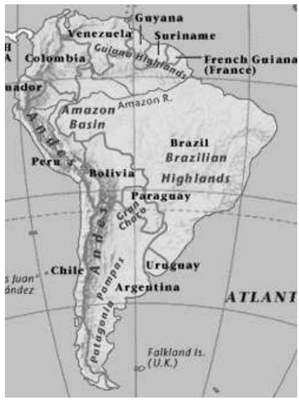
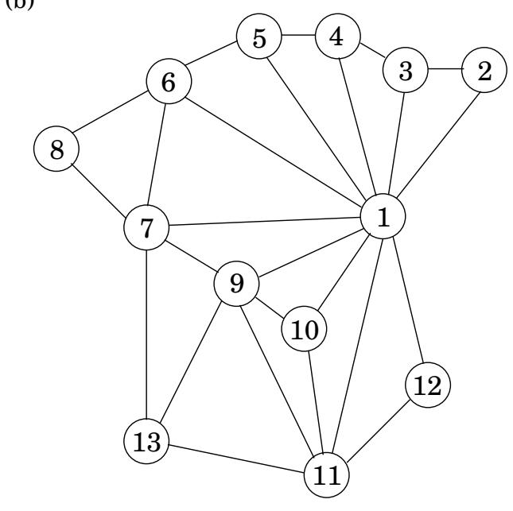

import Guide from '@/components/Guide.astro';
import Knowledge from '@/components/Knowledge.astro';
import Example from '@/components/Example.astro';
import Analysis from '@/components/Analysis.astro';
import Solution from '@/components/Solution.astro';
import Variant from '@/components/Variant.astro';
import Note from '@/components/Note.astro';
import Block from '@/components/Block.astro';
import Method from '@/components/Method.astro';
import Exercise from '@/components/Exercise.astro';

## 第 3 章：图的分解

## 3.1 为什么要用图表？

可以用图形的简洁图形语言清晰、精确地表达各种各样的问题。例如，考虑为政治地图着色的任务。邻国应使用不同颜色的明显限制下，最少需要多少种颜色？解决这个问题的困难之一是地图本身，即使是像图 3.1(a) 这样的精简版本，通常也充斥着不相关的信息：错综复杂的边界、三个或更多国家交界的边境哨所、公海和蜿蜒的河流。图 3.1(b) 的数学对象中不存在此类干扰，该图每个国家都有一个顶点（1 是巴西，11 是阿根廷）以及邻国之间的边。它仅包含着色所需的信息，仅此而已。现在的精确目标是为每个顶点分配一种颜色，以便没有边具有相同颜色的端点。

图形着色并不是地图设计师的专属领域。假设一所大学需要为其所有课程安排考试，并希望使用尽可能少的时间段。唯一的限制是，如果某个学生同时参加两项考试，则不能同时安排两项考试。要将这个问题表达为图表，请为每次考试使用一个顶点，如果存在冲突，即有人同时参加两个端点考试，则在两个顶点之间放置一条边。认为每个时间段都有自己的颜色。然后，分配时间段就和给这张图着色一样了！

图上的一些基本操作出现的频率如此之高，并且在如此多样化的上下文中，以至于人们付出了大量的努力来为它们寻找有效的过程。本章专门介绍这些算法中的一些最基本的算法，即揭示图的基本连接结构的算法。

形式上，图由一组顶点（也称为节点）V 和所选顶点对之间的边 E 指定。在地图示例中，$V = \{ 1 , 2 , 3 , \dots , 1 3 \}$ 和 E 除许多其他边外还包括 1, 2 , 9, 11 和 7, 13 。这里 x 和 y 之间的边具体表示“x 与 $y$ 共享边界”。这是一种对称关系——它还意味着 y 与 x 共享边界——我们使用集合符号 $e = \{ x , y \}$ 来表示它。这些边是无向的，并且是无向图的一部分。

有时，图表描绘的关系不具有这种互惠性，在这种情况下，它是

图 3.1 (a) 地图和 (b) 图表。

(一)  

(二)  

有必要使用带有方向的边缘。可以有从 x 到 y（写为 $e = ( x , y ) )$ ）的有向边 e，或从 $y$ 到 x（写为 $( y , x ) )$ ），或两者。有向图的一个特别巨大的例子是万维网中所有链接的图。它对于互联网上的每个站点都有一个顶点，以及一个有向边 $( u , v )$ 每当站点 $u$ 有 $\mathbf { a }$ 链接到站点 $v \colon$ 时，总共有数十亿个节点和边！了解 Web 最基本的连接属性具有巨大的经济和社会意义，尽管这个问题的规模令人望而生畏，但我们很快就会看到许多有关该问题的有价值的信息。令人高兴的是，图的结构可以在线性时间内确定。

## 3.1.1 图形是如何表示的？

我们可以用邻接矩阵来表示图；如果存在 $n = | V |$ 顶点 $v _ { 1 } , \ldots , v _ { n }$ ，这是一个 $n \times n$ 数组，其 $( i , j ) \mathrm { t h }$ 条目为

$$
a _ {i j} = \left\{ \begin{array}{l l} 1 & \text { if   there   is   an   edge   from } v _ {i} \text { to } v _ {j} \\ 0 & \text { otherwise. } \end{array} \right.
$$

对于无向图，矩阵是对称的，因为边 $\{ u , v \}$ 可以在任一方向上取。

这种格式的最大便利在于，只需一次内存访问即可在恒定时间内检查特定边缘的存在。另一方面，矩阵占用 $O ( n ^ { 2 } )$ 空间，如果图没有很多边，这会造成浪费。

另一种表示形式是 $a d j a \cdot$ cency 列表，其大小与边数成正比。它由 $| V |$ 链表组成，每个顶点一个。顶点 u 的链表保存 u 具有出边的顶点的名称，即顶点 $v$ ，其中 $( u , v ) \in E$

因此，如果图是有向的，则每条边恰好出现在一个链表中；如果图是无向的，则每条边恰好出现在两个链表中。无论哪种方式，数据结构的总大小都是 O( E )。检查特定边 $( u , v )$ 不再是恒定时间，因为它需要筛选 u 的邻接列表。但是迭代顶点的所有邻居很容易（通过运行相应的链表），而且，正如我们很快就会看到的，这在图算法中是一个非常有用的操作。同样，对于无向图，这种表示具有某种对称性：当且仅当 u 位于 v 的邻接列表中时，v 才位于 u 的邻接列表中。

## 你的图表有多大？

邻接矩阵和邻接表这两种表示形式哪个更好？那么，这取决于 V （图中的节点数）和 E （边数）之间的关系。 E 可以小到 V（如果它变得小得多，则图会退化——例如，具有孤立的顶点），或者大到 $| V | ^ { 2 }$（当所有可能的边都存在时）。当 E 接近该范围的上限时，我们称该图是稠密的。在另一个极端，如果 E 接近 V ，则图是稀疏的。正如我们将在本章和接下来的两章中看到的，E 到底在这个范围内的位置通常是选择正确的图算法的关键因素。

或者，就此而言，在选择图形表示时。如果我们希望存储在计算机内存中的是万维网图，那么在使用邻接矩阵之前我们应该三思而后行：在撰写本文时，搜索引擎知道该图的大约 80 亿个顶点，因此邻接矩阵将占用数千万太比特。同样，当我们写下这些行时，尚不清楚全世界是否有足够的计算机内存来实现这一目标。 （等待几年直到有足够的内存是不明智的：网络也会增长，而且可能会增长得更快。）

通过邻接列表，表示万维网变得可行：网络中只有几十亿个超链接，每个超链接将占用邻接列表中的几个字节。您可以在口袋中携带一个存储结果（一到两个 TB）的设备（它可能很快就能装进您的耳环，但到那时网络也会发展起来）。

邻接表在万维网中如此有效的原因是网络非常稀疏：在数十亿种可能性中，平均网页仅具有到大约六个其他页面的超链接。