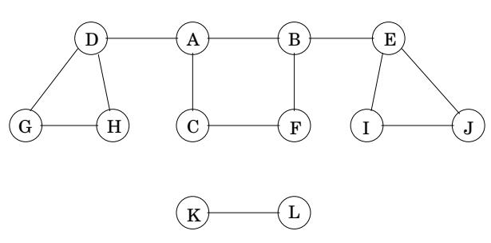
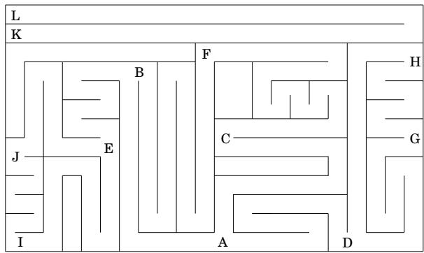
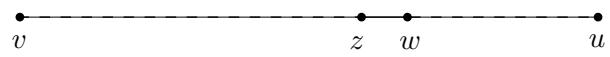
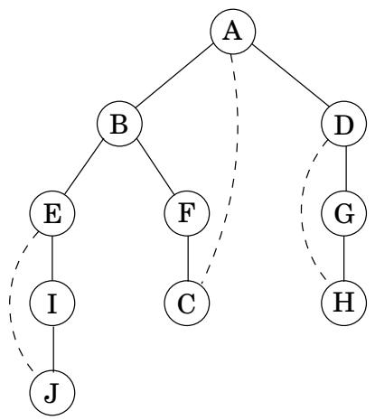
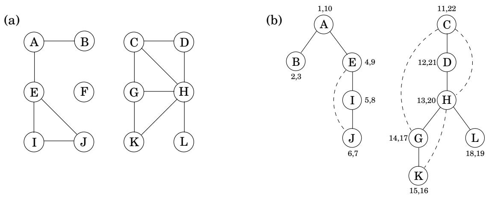
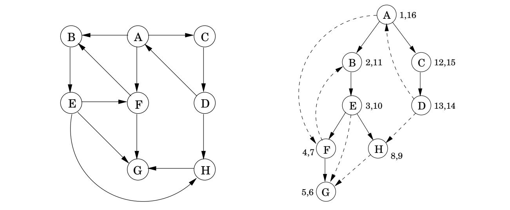

import Guide from '@/components/Guide.astro';
import Knowledge from '@/components/Knowledge.astro';
import Example from '@/components/Example.astro';
import Analysis from '@/components/Analysis.astro';
import Solution from '@/components/Solution.astro';
import Variant from '@/components/Variant.astro';
import Note from '@/components/Note.astro';
import Block from '@/components/Block.astro';
import Method from '@/components/Method.astro';
import Exercise from '@/components/Exercise.astro';

## 3.2 无向图中的深度优先搜索

## 3.2.1 探索迷宫

深度优先搜索是一种令人惊讶的通用线性时间过程，它揭示了有关图的大量信息。它解决的最基本的问题是，

从给定的顶点可以到达图的哪些部分？

要理解此任务，请尝试将自己置于刚刚获得新图（例如邻接表形式）的计算机的位置。这种表示只提供一个基本操作：查找顶点的邻居。仅使用这个原语，可达性问题就像探索迷宫（图 3.2）。你从一个固定的地方开始行走

图 3.2 探索图形就像在迷宫中导航。





图 3.3 查找从特定节点可到达的所有节点。

```python
procedure explore(G, v)
Input: G = (V, E) is a graph; v ∈ V
Output: visited(u) is set to true for all nodes u reachable from v
visited(v) = true
previsit(v)
for each edge (v, u) ∈ E:
    if not visited(u): explore(u)
postvisit(v)
```

每当您到达任何交叉点（顶点）时，您都可以遵循各种通道（边缘）。不小心选择的通道可能会让你原地踏步，或者可能会导致你忽略迷宫中一些可进入的部分。显然，您需要在探索过程中记录一些中间信息。

这个经典的挑战几个世纪以来一直为人们带来乐趣。大家都知道，探索迷宫只需要一根绳子和一支粉笔。粉笔通过标记您已经访问过的路口来防止循环。该字符串总是带您回到起始位置，使您能够返回到您之前看到但尚未调查的段落。

我们如何在计算机上模拟粉笔和绳子这两个原语？粉笔标记很简单：对于每个顶点，维护一个布尔变量，指示它是否已经被访问过。至于线球，正确的网络类比是堆栈。毕竟，字符串的确切作用是提供两个原始操作：展开以到达新的结点（堆栈相当于推送新顶点）和倒回以返回到前一个结点（弹出堆栈）。

我们将通过递归（使用激活记录堆栈实现）隐式地维护堆栈，而不是显式维护堆栈。结果算法如图所示

图 3.3.<sup>1</sup> 访问前和访问后过程是可选的，用于在第一次发现顶点以及最后一次离开时对顶点执行操作。我们很快就会看到它们的一些创造性用途。

更直接的是，我们需要确认探索始终正常工作。它当然不会冒险太远，因为它只从节点移动到它们的邻居，因此永远不会跳转到从 v 无法到达的区域。但是它是否找到从 $v ?$ 可以到达的所有顶点？好吧，如果它错过了一些 u，则选择从 v 到 u 的任何路径，并查看该过程实际访问的该路径上的最后一个顶点。将此节点称为 z，并令 w 为同一路径上紧随其后的节点。



所以 z 被访问了，但 w 没有被访问。这是一个矛盾：当探索过程位于节点 z 时，它会注意到 w 并继续前进。

顺便说一句，这种推理模式经常出现在图的研究中，本质上是一种简化的归纳法。更正式的归纳证明将首先构建一个假设，例如“对于任何 $k \geq 0 _ { ; }$ ，来自 v 的 k 跳内的所有节点都被访问”。基本情况与往常一样微不足道，因为 v 肯定会被访问。一般情况——表明如果所有 k 跳之外的节点都被访问，那么所有 k + 1 跳之外的节点也被访问——与我们刚才讨论的观点完全相同。

图 3.4 显示了在我们之前的示例图上运行 explore 的结果，从节点 A 开始，只要有选择要访问的节点，就按字母顺序打破平局。实心边是那些实际经过的边，每条边都是由探索调用引起的，并导致发现新的顶点。例如，当 B 被访问时，边 $B - E$ 被注意到，并且由于 E 未知，因此通过调用 explore(E) 来遍历。这些实边形成一棵树（没有环的连通图），因此称为树边。虚线边缘被忽略，因为它们返回到熟悉的地形，到之前访问过的顶点。它们被称为后边缘。

## 3.2.2 深度优先搜索

探索过程仅访问从起始点可到达的图形部分。为了检查图的其余部分，我们需要在其他地方（在尚未访问过的顶点）重新启动该过程。图 3.5 的算法称为深度优先搜索 (DFS)，它会重复执行此操作，直到遍历整个图。

分析 DFS 运行时间的第一步是观察每个顶点仅被探索一次，这要归功于访问数组（粉笔标记）。在探索顶点的过程中，有以下步骤：

1. 一些固定的工作量——将地点标记为访问过，以及访问前/访问后。

2. 扫描相邻边缘的循环，以查看它们是否通向新的地方。

图3.4 图3.2 中explore(A) 的结果。  


```python
Figure 3.5 Depth-first search.
procedure dfs(G)
for all v ∈ V:
    visited(v) = false
for all v ∈ V:
    if not visited(v): explore(v)
```

此循环对于每个顶点需要不同的时间，因此让我们一起考虑所有顶点。步骤 1 中完成的总功为 $O ( | V | )$ 。在步骤 2 中，在整个 DFS 过程中，每条边 $\{ x , y \} \in E$ 都被检查两次，一次在 explore(x) 期间，一次在 exp $\mathtt { l o r e } ( y )$ 期间。因此，第 2 步的总时间为 $O ( | E | )$ ，因此深度优先搜索的运行时间为 $O ( | V | + | E | )$ ，与其输入的大小呈线性关系。这与我们所希望的一样高效，因为即使只是读取邻接表也需要这么长时间。

图 3.6 显示了在 12 节点图上进行深度优先搜索的结果，再次打破了按字母顺序排列的关系（暂时忽略数字对）。 DFS 调用的外循环在 $A , C ,$ 上探索三次，最后在 F 上探索。结果，存在三棵树，每棵树都以这些起点之一为根。它们共同构成了一片森林。

## 3.2.3 无向图中的连通性

如果任意一对顶点之间存在路径，则无向图是连通的。图 3.6 的图没有连接，因为例如没有从 $A$ 到 $K$ 的路径。但是，它确实具有三个不相交的连接区域，对应于以下顶点集：

$$
\{A, B, E, I, J \} \quad \{C, D, G, H, K, L \}\tag{{F}}
$$

F

图 3.6 (a) 12 节点图。 (b) DFS 搜索林。



这些区域称为连接组件：每个区域都是一个内部连接的子图，但与其余顶点没有边。当在特定顶点开始探索时，它会精确识别包含该顶点的连接组件。每次 DFS 外循环调用 explore 时，都会挑选出一个新的连通分量。

因此，深度优先搜索通常适用于检查图是否连通，更一般地说，为每个节点 v 分配一个整数 ccnum[v]，标识其所属的连通分量。所需要的只是

```txt
procedure previsit(v)
ccnum[v] = cc
```

其中 cc 需要初始化为零，并在每次 DFS 过程调用 explore 时递增。

## 3.2.4 访问前和访问后排序

我们已经看到深度优先搜索（几行不起眼的代码）如何能够在线性时间内揭示无向图的连接结构。但它的用途远不止于此。为了进一步延伸，我们将在探索过程中收集更多的信息：对于每个节点，我们将记下两个重要事件的时间，第一次发现的时刻（对应于预访问）和最终离开的时刻（后访问）。图 3.6 显示了我们之前示例中的这些数字，其中有 24 个事件。第五个事件是 I 的发现。第 21 个事件包括永远留下 D。

使用这些数字生成 pre 和 post 数组的一种方法是定义一个简单的计数器时钟，最初设置为 1，其更新如下。

```python
procedure previsit(v)
pre[v] = clock
clock = clock + 1
```

图 3.7 有向图上的 DFS。



这些时机很快就会变得更加重要。同时，您可能从图 3.4 中注意到：

<Knowledge title="Property">

对于任何节点 u 和 v，两个区间 [pre(u), post(u)] 和 [pre(v), post(v)] 要么不相交，要么一个包含在另一个中。

</Knowledge>

为什么？因为[pre(u), post(u)]本质上是顶点u在堆栈上的时间。堆栈的后进先出行为解释了其余部分。