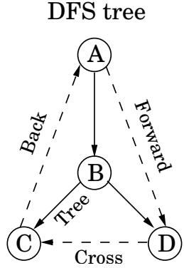
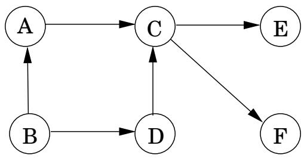

import Guide from '@/components/Guide.astro';
import Knowledge from '@/components/Knowledge.astro';
import Example from '@/components/Example.astro';
import Analysis from '@/components/Analysis.astro';
import Solution from '@/components/Solution.astro';
import Variant from '@/components/Variant.astro';
import Note from '@/components/Note.astro';
import Block from '@/components/Block.astro';
import Method from '@/components/Method.astro';
import Exercise from '@/components/Exercise.astro';

## 3.3 有向图中的深度优先搜索

## 3.3.1 边的类型

我们的深度优先搜索算法可以在有向图上逐字运行，注意仅在指定方向上遍历边缘。图 3.7 显示了一个示例以及按字典顺序考虑顶点时生成的搜索树。

在进一步分析有向案例时，了解树节点之间重要关系的术语会有所帮助。 A是搜索树的根；其他一切都是它的后代。类似地，E 具有后代 F、G 和 H，并且相反，E 是这三个节点的祖先。进一步进行家庭类比：C 是 D 的父母，D 是其孩子。

对于无向图，我们区分树边和非树边。在有向情况下，有一个稍微复杂的分类法：

树的边缘实际上是DFS森林的一部分。

前向边从一个节点通向 DFS 树中的非子后代。

后边通向 DFS 树中的祖先。

交叉的边缘既不通向后代也不通向祖先；因此，它们会指向一个已经被完全探索过的节点（即，已经被访问过）。

DFS树

  
图 3.7 有两个前边缘、两个后边缘和两个交叉边缘。你能发现它们吗？

祖先和后代关系以及边缘类型可以直接从前后编号中读取。由于深度优先探索策略，在首先发现 u 并且在 explore(u) 期间发现 v 的情况下，顶点 u 正是顶点 v 的祖先。这就是说 pre $\therefore ( u ) < \mathtt { p r e } ( v ) < \mathtt { p o s t } ( v ) < \mathtt { p o s t } ( u )$ ，我们可以将其形象地描述为两个嵌套间隔：

$$
\left[ \begin{array}{c c c c} & & \\ u & v & & \end{array} \right] \quad \left[ \begin{array}{c c c c} & & \\ & v & & \end{array} \right]
$$

后代的情况是对称的，因为当且仅当 v 是 u 的祖先时，u 才是 v 的后代。由于边缘类别完全基于祖先-后代关系，因此它们也可以从前后编号中读取。以下是边 (u, v) 的各种可能性的总结：

<table> <tr> <td> (u,v) 的预/后排序</td> <td>Edge类型</td> </tr> <tr> <td>[ [ ] ] u v v u</td> <td>树/前向</td> </tr> <tr> <td>[ [ ] ] v u u v</td> <td>返回</td> </tr> <tr> <td>[ ] [ ] v v u u</td> <td>十字</td> </tr> </table>

您可以通过查阅边缘类型图来确认每个特征。您知道为什么不可能有其他排序吗？

## 3.3.2 有向无环图

有向图中的环是一条圆形路径 $v _ { 0 } \to v _ { 1 } \to v _ { 2 } \to \cdots \to v _ { k } \to v _ { 0 }$ 。图 3.7 有相当多的例子，例如，没有环的 $B \to E \to F \to B . \mathrm { ~ A ~ }$ 图是非循环的。事实证明，我们可以通过一次深度优先搜索来测试线性时间内的非循环性。

图 3.8 具有一个源、两个汇和四种可能的线性化的有向无环图。

<Knowledge title="Property">

当且仅当有向图的深度优先搜索揭示后边缘时，有向图才具有循环。

</Knowledge>

<Solution title="证明">

一个方向非常简单：如果 $( u , v )$ 是后边缘，则存在由该边缘以及搜索树中从v到u的路径组成的循环。

</Solution>

相反，如果图有一个循环 $v _ { 0 } \to v _ { 1 } \to \cdot \cdot \cdot \to v _ { k } \to v _ { 0 }$ ，则查看该循环上要发现的第一个节点（具有最低 pre 编号的节点）。假设它是 $v _ { i } .$ 循环上的所有其他 $v _ { j }$ 都可以从它到达，因此将是其在搜索树中的后代。特别是，边 $v _ { i - 1 }  v _ { i }$（或 $v _ { k } \to v _ { 0 }$，如果 i = 0）从节点通向其祖先，因此根据定义是后边。

有向无环图（简称 dags）总是出现。它们非常适合对因果关系、层次结构和时间依赖性等关系进行建模。例如，假设您需要执行许多任务，但其中一些任务必须在某些其他任务完成后才能开始（您必须起床才能起床；您必须起床，但尚未穿好衣服才能洗澡；等等）。那么问题是，执行任务的有效顺序是什么？

这种约束可以很方便地用有向图来表示，其中每个任务都是一个节点，如果u是v的前提条件，则有从u到v的边。换句话说，在执行任务之前，必须完成指向该任务的所有任务。如果这个图有循环，那就没有希望了：任何排序都行不通。另一方面，如果图是一个 dag，我们希望如果可能的话对其进行线性化（或拓扑排序），将顶点一个接一个地排序，使得每条边从较早的顶点到较晚的顶点，从而满足所有优先约束。例如，在图 3.8 中，一种有效的排序是 $B , A , D , C , E , F$ 。 （你能认出另外三个吗？）

哪些类型的 dags 可以线性化？很简单：全部。深度优先搜索再次准确地告诉我们如何做到这一点：只需按照帖子编号的降序执行任务即可。毕竟，图中 post(u) &lt;post(v) 的唯一边 $( u , v )$ 是后边（回想一下第 95 页上的边类型表），并且我们已经看到 dag 不能有后边。因此：

## 属性 在 dag 中，每条边都通向一个具有较低后编号的顶点。

这为我们提供了一种用于对 dag 节点进行排序的线性时间算法。而且，结合我们之前的观察，它告诉我们三个听起来相当不同的属性——非循环性、线性化性和深度优先搜索期间不存在后边缘——实际上是一个并且

同样的事情。

由于 dag 是通过减少 post 编号来线性化的，因此具有最小 post 编号的顶点在此线性化中排在最后，并且它必须是一个汇点 - 没有传出边。对称地，具有最高职位的节点是源，是没有传入边的节点。

<Knowledge title="Property">

每个 dag 至少有一个源和至少一个汇

</Knowledge>

保证源的存在提出了另一种线性化方法：

找到一个源，输出它，然后将其从图中删除。

重复直到图表为空。

您能明白为什么这会为任何 dag 生成有效的线性化吗？如果图形有循环会发生什么？那么，这个算法如何在线性时间内实现呢？ （练习 3.14。）