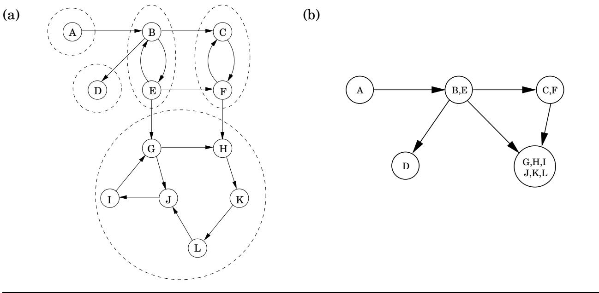
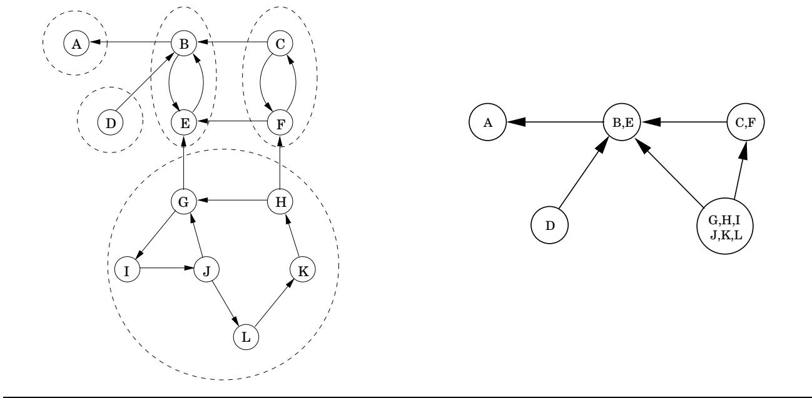

import Guide from '@/components/Guide.astro';
import Knowledge from '@/components/Knowledge.astro';
import Example from '@/components/Example.astro';
import Analysis from '@/components/Analysis.astro';
import Solution from '@/components/Solution.astro';
import Variant from '@/components/Variant.astro';
import Note from '@/components/Note.astro';
import Block from '@/components/Block.astro';
import Method from '@/components/Method.astro';
import Exercise from '@/components/Exercise.astro';

## 3.4 强连通分量

## 3.4.1 定义有向图的连通性

无向图中的连通性非常简单：一个不连通的图可以以自然且明显的方式分解为多个连通的组件（图 3.6 就是一个例子）。正如我们在第 3.2.3 节中看到的，深度优先搜索可以轻松地完成此操作，每次重新启动都标记一个新的连接组件。

在有向图中，连通性更加微妙。在某种原始意义上，图 3.9(a) 的有向图是“连接的”——可以这么说，如果不破坏边，它就不能被“拉开”。但这个概念一点也不有趣，也没有什么信息。该图不能被认为是连通的，因为例如没有从 G 到 B 或从 F 到 A 的路径。定义有向图连通性的正确方法是：

如果存在从 u 到 v 的路径和从 v 到 u 的路径，则有向图的两个节点 u 和 v 是连接的。

这种关系将 V 划分为不相交的集合（练习 3.30），我们将其称为强连通分量。图 3.9(a) 的图表有五个。

现在将每个强连接组件缩小为单个元节点，如果它们各自的组件之间存在一条边（同一方向），则从一个元节点到另一个元节点绘制一条边（图 3.9(b)）。生成的元图必须是一个 dag。原因很简单：包含多个强连接组件的循环会将它们全部合并为一个强连接组件。重述，

<Knowledge title="Property">

每个有向图都是其强连通分量的一个DAG。

</Knowledge>

这告诉我们一些重要的事情：有向图的连接结构是双层的。在顶层，我们有一个 dag，这是一个相当简单的结构——例如，它可以被线性化。如果我们想要更详细的细节，我们可以查看该 dag 的一个节点内部并检查其中成熟的强连接组件。

图 3.9 (a) 有向图及其强连通分量。 (b) 元图。

## 3.4.2 高效算法

将有向图分解为其强连通分量非常有用且信息丰富。幸运的是，事实证明，通过进一步利用深度优先搜索，可以在线性时间内找到它。该算法基于我们已经看到的一些属性，但现在我们将更仔细地查明这些属性。

<Knowledge title="Property">

1 如果探索子例程在节点 u 处启动，那么它将在访问完从 u 到达的所有节点时准确终止。

</Knowledge>

因此，如果我们对位于接收器强连接组件（元图中的接收器的强连接组件）中某处的节点调用 explore，那么我们将准确检索该组件。图 3.9 有两个宿强连接组件。例如，从节点 K 开始探索将完全遍历其中较大的一个，然后停止。

这提出了一种寻找强连通分量的方法，但仍然存在两个主要问题：(A) 我们如何找到我们确定位于强连通分量中的节点以及(B) 一旦发现第一个分量，我们如何继续？

让我们从问题(A) 开始。没有一种简单、直接的方法来挑选出保证位于接收器强连接组件中的节点。但是有一种方法可以获取源强连通分量中的节点。

<Knowledge title="Property">

2 在深度优先搜索中接收到最高帖子编号的节点必须位于源强连通分量中。

</Knowledge>

这是从以下更一般的属性得出的。

<Knowledge title="Property">

3 如果C和 $C ^ { \prime }$ 是强连通分量并且有一条来自节点的边

</Knowledge>

图 3.10 图 3.9 的反面图。

$C$ 中的节点到 $C ^ { \prime } { } _ { \circ }$ 中的节点，则 C 中的最高帖子编号大于 $C ^ { \prime }$ 中的最高帖子编号

<Solution title="证明">

在证明性质3时，需要考虑两种情况。如果深度优先搜索在组件 $C ^ { \prime }$ 之前访问组件C，那么显然在过程卡住之前所有C和 $C ^ { \prime }$ 都将被遍历（参见属性1）。因此，在 $C$ 中访问的第一个节点将比 $C ^ { \prime }$ 中的任何节点具有更高的帖子编号。另一方面，如果首先访问 $C ^ { \prime }$ ，则深度优先搜索将在看到所有 $C ^ { \prime }$ 之后但在看到任何 $C ,$ 之前陷入困境，在这种情况下，属性会立即跟随。

</Solution>

<Knowledge title="Property">

3 可以重述为强连通分量可以通过按其最高位置编号的降序排列来线性化。这是我们早期线性化 dags 算法的概括；在 dag 中，每个节点都是一个单例强连接组件。

</Knowledge>

<Knowledge title="Property">

2 帮助我们在 $G .$ 的源强连通分量中找到一个节点。然而，我们需要的是接收器组件中的一个节点。我们的手段似乎与我们的需求相反！但考虑反向图 $G ^ { R }$ ，与 G 相同，但所有边都反转（图 3.10）。 $G ^ { R }$ 与 $G$ 具有完全相同的强连通分量（为什么？）。因此，如果我们对 $G ^ { R }$ 进行深度优先搜索，则帖子编号最高的节点将来自 $G ^ { R }$ 中的源强连通分量，也就是说 G 中的宿强连通分量。我们已经解决了问题(A) ！

</Knowledge>

继续讨论问题(B) 。识别出第一个接收器组件后我们如何继续？属性 3 也提供了解决方案。一旦我们找到第一个强连通分量并将其从图中删除，剩余节点中帖子编号最高的节点将属于 G 剩余部分的强连通分量。因此，我们可以继续使用 $G ^ { R }$ 上初始深度优先搜索的帖子编号来连续输出第二个强连通分量、第三个强连通分量，依此类推。得到的算法是这样的。

1. 在 $G ^ { R } .$ 上运行深度优先搜索

2. 在 G 上运行无向连通分量算法（来自第 3.2.3 节），并在深度优先搜索期间，按照步骤 1 中的后编号降序处理顶点。

该算法是线性时间的，只是线性项中的常数约为直接深度优先搜索的两倍。 （问题：如何在线性时间内构造 $G ^ { R }$ 的邻接表表示？以及如何在线性时间内通过递减后值对 G 的顶点进行排序？）

让我们在图 3.9 的图表上运行这个算法。如果步骤1按照字典顺序考虑顶点，那么它为第二步设置的顺序（即 $G ^ { R } )$ 深度优先搜索中递减的后编号为：G，I，J，L，K，H，D，C，F，B，E，A。然后步骤2按以下顺序剥离组件：G，H，I，J，K，L，D，C，F，乙、乙、乙。

<Knowledge title="Box: Crawling fast">

所有这些都假设图被整齐地提供给我们，顶点编号为 1 到 n，边塞在邻接列表中。万维网的现实情况截然不同。 Web图的节点是事先不知道的，必须在搜索过程中一一发现。当然，递归是不可能的。

尽管如此，网络爬行是通过与深度优先搜索非常相似的算法完成的。维护一个显式堆栈，其中包含已发现（作为超链接的端点）但尚未探索的所有节点。事实上，这个“栈”并不完全是一个后进先出的列表。它不会将最高优先级赋予最近插入的节点（也不是最早插入的节点，这将是广度优先搜索，请参阅第 4 章），而是赋予那些看起来最“有趣”的节点——这是一种启发式标准，其目的是防止堆栈溢出，并且在最坏的情况下，只留下未探索的节点，这些节点不太可能导致巨大的新扩展。

事实上，爬行通常是由许多同时运行探索的计算机完成的：每台计算机从堆栈顶部获取要探索的下一个节点，下载 http 文件（相互指向的 Web 文件类型），并扫描其中的超链接。但是，当在超链接末尾找到新的 http 文档时，不会进行递归调用：相反，新的顶点会插入到中央堆栈中。

但仍然存在一个问题：当我们看到一份“新”文档时，我们如何知道它确实是新的，或者我们之前在爬行中没有见过它？我们如何给它命名，以便将其插入堆栈并记录为“已见过”？答案是通过散列。

顺便说一句，研究人员已经在网络上运行了强连通分量算法，并发现了一些非常有趣的结构。

</Knowledge>