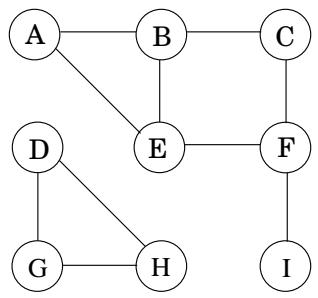
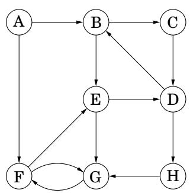
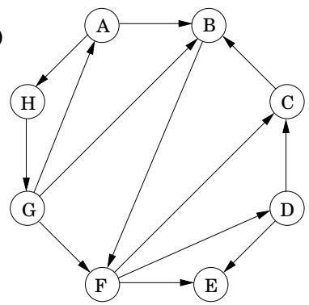
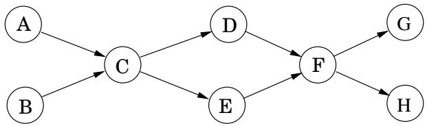
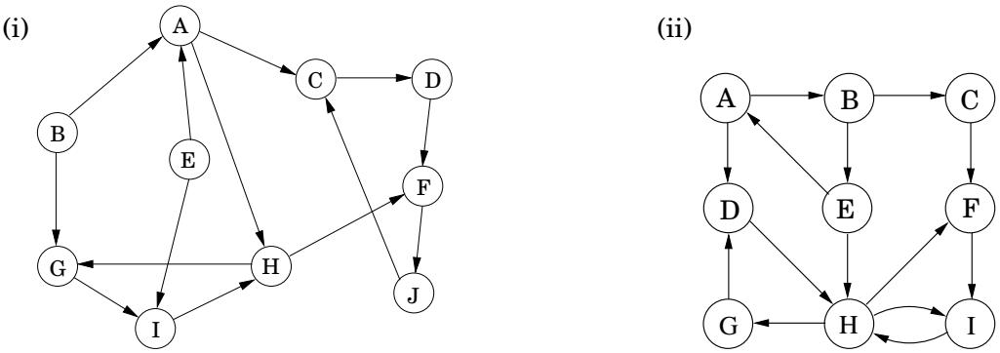
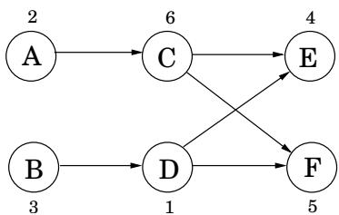
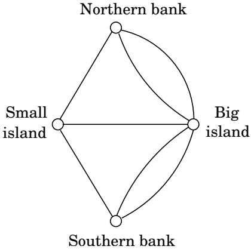
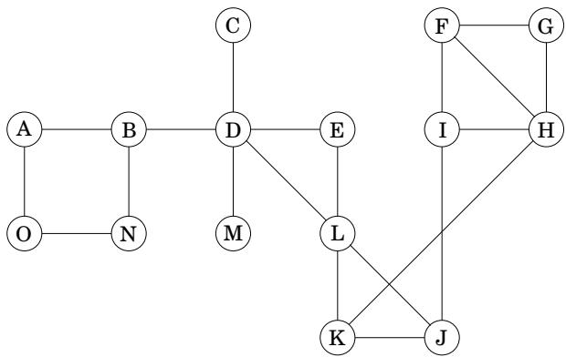

import Guide from '@/components/Guide.astro';
import Knowledge from '@/components/Knowledge.astro';
import Example from '@/components/Example.astro';
import Analysis from '@/components/Analysis.astro';
import Solution from '@/components/Solution.astro';
import Variant from '@/components/Variant.astro';
import Note from '@/components/Note.astro';
import Block from '@/components/Block.astro';
import Method from '@/components/Method.astro';
import Exercise from '@/components/Exercise.astro';

## 第 3 章练习

<Exercise title="Exercise 3.1">

对下图进行深度优先搜索；每当需要选择顶点时，请选择按字母顺序排在第一位的顶点。将每条边分类为树边或后边，并给出每个顶点的前序号和后序号。

</Exercise>

<Exercise title="Exercise 3.2">

对以下每个图执行深度优先搜索；每当需要选择顶点时，请选择按字母顺序排在第一位的顶点。将每条边分类为树边、前向边、后向边或交叉边，并给出每个顶点的前序号和后序号。

(一)  

(二)  

</Exercise>

<Exercise title="Exercise 3.3">

在下图中运行基于 DFS 的拓扑排序算法。每当您选择要探索的顶点时，请始终选择按字母顺序排列在前的那个。

(a) 指出节点的前序号和后序号。

(b) 图表的源和汇是什么？

(c) 该算法发现什么拓扑顺序？

(d) 该图有多少种拓扑排序？

</Exercise>

<Exercise title="Exercise 3.4">

在以下有向图 G 上运行强连通分量算法。在 $\mathbf { \bar { \mathit { G } } } ^ { R } \mathbf { : }$ 上执行 DFS 时：每当可以选择要探索的顶点时，始终选择按字母顺序排在第一位的顶点。

(一)  

在每种情况下回答以下问题。

(a) 强连通分量 (SCC) 是按什么顺序找到的？

(b) 哪些是源 SCC，哪些是宿 SCC？

(c) 绘制“元图”（每个元节点是 G 的一个 SCC）。

(d) 为使其强连接，必须向该图添加的边的最小数量是多少？

</Exercise>

<Exercise title="Exercise 3.5">

有向图 $G = ( V , E )$ 的反转是同一顶点集上的另一个有向图 $G ^ { R } = ( V , E ^ { R } )$，但所有边都反转；也就是说，$E ^ { R } = \{ ( v , u ) : ( u , v ) \in E \}$ 给出一个线性时间算法，用于计算邻接列表格式的图的逆过程。

</Exercise>

<Exercise title="Exercise 3.6">

在无向图中，顶点 u 的度 d(u) 是 u 具有的邻居数量，或者等效地，是入射到其上的边的数量。在有向图中，我们区分入度 $d _ { i n } ( u )$ （进入 u 的边数）和出度 $d _ { o u t } ( \boldsymbol { u } )$ （离开 u 的边数）。

(a) 证明在无向图中，$\textstyle \sum _ { u \in V } d ( u ) = 2 | E |$

(b) 利用(a)部分证明，在无向图中，度数为奇数的顶点必须有偶数个。

(c) 对于有向图中具有奇数入度的顶点数量，类似的陈述是否成立？

</Exercise>

<Exercise title="Exercise 3.7">

二部图是一个图 $G = ( V , E )$，其顶点可以分为两个集合 $( V = V _ { 1 } \cup V _ { 2 }$ 和 $V _ { 1 } \cap V _ { 2 } = \emptyset )$，使得同一集合中的顶点之间没有边（例如，如果 $u , v \in V _ { 1 }$，则u和v之间没有边）。

(a) 给出一个线性时间算法来确定无向图是否是二分图。

(b) 还有许多其他方法可以表述该性质。例如，一个无向图当且仅当它只能用两种颜色着色时才是二分图。

证明以下公式：无向图是二分图当且仅当它不包含奇数长度的循环。

(c) 最多需要多少种颜色才能为一个恰好具有一个奇数长度循环的无向图着色？

</Exercise>

<Exercise title="Exercise 3.8">

倒水。我们有三个容器，尺寸分别为 10 品脱、7 品脱和 4 品脱。 7 品脱和 4 品脱容器开始时装满了水，但 10 品脱容器最初是空的。我们允许进行一种类型的操作：将一个容器的内容倒入另一个容器中，仅当源容器为空或目标容器已满时才停止。我们想知道是否存在一系列的倒酒顺序，使得 7 品脱或 4 品脱容器中正好剩下 2 品脱。

(a) 将其建模为图形问题：给出所涉及图形的精确定义，并说明需要回答的关于该图形的具体问题。

(b) 应采用什么算法来解决该问题？

(c) 通过应用算法找到答案。

</Exercise>

<Exercise title="Exercise 3.9">

对于无向图中的每个节点 u，令two Degree[u] 为 u 邻居的度数之和。展示如何在给定邻接列表格式的图的情况下，在线性时间内计算整个二度[ ] 值数组。

</Exercise>

<Exercise title="Exercise 3.10">

重写探索过程（图 3.3），使其成为非递归的（即显式使用堆栈）。对 previsit 和 postvisit 的调用的位置应确保它们具有与递归过程中相同的效果。

</Exercise>

<Exercise title="Exercise 3.11">

设计一个线性时间算法，给定一个无向图 G 和其中的特定边 e，确定 G 是否具有包含 e 的环。

</Exercise>

<Exercise title="Exercise 3.12">

要么证明，要么给出反例：如果 $\{ u , v \}$ 是无向图中的边，并且在深度优先搜索过程中post(u)&lt;post(v)，那么v是DFS树中u的祖先。

</Exercise>

<Exercise title="Exercise 3.13">

无向连接与定向连接。

(a) 证明在任意连通无向图 $G = ( V , E )$ 中，存在一个顶点 $v \in V$，其移除使得G保持连通。 （提示：考虑 G 的 DFS 搜索树。）

(b) 给出一个强连接有向图 $G = ( V , E )$ 的示例，这样，对于每个 $v \in V _ { i }$ ，从 G 中删除 v 会留下一个非强连接的有向图。

(c) 在具有 2 个连通分量的无向图中，始终可以通过仅添加一条边来使图连通。给出一个具有两个强连通分量的有向图的示例，这样任何一条边的添加都无法使该图强连通。

</Exercise>

<Exercise title="Exercise 3.14">

本章提出了一种替代线性化算法（拓扑排序），该算法反复从图中删除源节点（第 97 页）。证明该算法可以在线性时间内实现。

</Exercise>

<Exercise title="Exercise 3.15">

Computopia 市的警察局已将所有街道改为单行道。市长认为，仍然有一种方法可以合法地从城市的任何十字路口行驶到任何其他十字路口，但反对派并不相信。需要一个计算机程序来确定市长是否正确。然而，城市选举即将到来，只有足够的时间来运行线性时间算法。

(a) 从理论上表述这个问题，并解释为什么它确实可以在线性时间内解决。

(b) 假设现在事实证明市长最初的主张是错误的。她接下来声称了一些更弱的说法：如果你从市政厅开始开车，在单向街道上行驶，那么无论你到达哪里，总有一种方法可以合法地开车回到市政厅。将这个较弱的属性表述为图论问题，并仔细展示如何在线性时间内检查它。

</Exercise>

<Exercise title="Exercise 3.16">

假设计算机科学课程由 n 门课程组成，全部是必修课。当且仅当 v 是 w 的先决条件时，先决条件图 G 对于每个课程都有一个节点，并且有一条从课程 v 到课程 w 的边。找到一种直接使用该图形表示的算法，并计算完成课程所需的最少学期数（假设学生可以在一个学期内选修任意数量的课程）。算法的运行时间应该是线性的。

</Exercise>

<Exercise title="Exercise 3.17">

无限的路径。令 $G = ( V , E )$ 为有向图，具有指定的“起始顶点”$s \in V$、一组 $V _ { G } \subseteq V \ \mathrm { o f } ^ { \infty } \mathrm { g o o d } ^ { \gg }$ 顶点和一组 $V _ { B } \subseteq V$ “坏”顶点。 G 的无限迹 $p$ 是顶点 $v _ { i } \in V$ 的无限序列 $v _ { 0 } v _ { 1 } v _ { 2 } \cdots$ ，使得 (1) $v _ { 0 } = s ,$ 和 (2) 对于所有 $i \geq 0 , ( v _ { i } , v _ { i + 1 } ) \in E$ 。 $\mathbf { i s } , p$ 是 G 中从顶点 $s .$ 开始的无限路径，由于顶点集 V 是有限的，因此 G 的每个无限迹必须无限频繁地访问某些顶点。

(a) 如果 $p$ 是无限迹，则令 $I n f ( p ) \subseteq V$ 为 $p .$ 中无限频繁出现的顶点集合，证明 $I n f ( p )$ 是 $G _ { \ast }$ 的强连通分量的子集

(b) 描述一个确定 G 是否有无限迹的算法。

(c) 描述一种算法，确定 G 是否具有无限频繁地访问 $V _ { G }$ 中的一些好顶点的无限迹线。

(d) 描述一种算法，确定 G 是否具有无限频繁地访问 $V _ { G }$ 中的一些好顶点，但无限频繁地访问 $V _ { B }$ 中的坏顶点。

</Exercise>

<Exercise title="Exercise 3.18">

您将获得一棵二叉树 $T = ( V , E )$ （邻接列表格式），以及指定的根节点 $r \in V$ 。回想一下，如果 $T$ 中从 $r$ 到 v 的路径经过 u，则 u 被称为有根树中 v 的祖先。

您希望对树进行预处理，以便可以在恒定时间内回答“is u an anancers of $v ? ^ { \mathfrak { n } }$”形式的查询。预处理本身应该花费线性时间。如何做到这一点？

</Exercise>

<Exercise title="Exercise 3.19">

与上一个问题一样，您将获得一棵具有指定根节点的二叉树 $T = ( V , E )$。此外，还有一个数组 $x [ \cdot ]$ ，其中 $V$ 中的每个节点都有一个值。定义一个新数组 $z [ \cdot ]$ 如下：对于每个 $u \in V$

z[u] = 与 u 的后代关联的 x 值的最大值。

给出计算整个 z 数组的线性时间算法。

</Exercise>

<Exercise title="Exercise 3.20">

您将获得一棵树 $T = ( V , E )$ 以及指定的根节点 $r \in V$ 。任何节点 v $\neq r ,$ 表示为 $p ( v )$ ，其父节点被定义为从 r 到 v 的路径中与 v 相邻的节点。按照约定，为 $p ( r ) = r$ 。对于 $k > 1$ ，定义 $p ^ { k } ( v ) = p ^ { k - 1 } ( p ( v ) )$ ）和 $p ^ { 1 } ( v ) = p ( v )$ （因此 $p ^ { k } ( v )$ 是 $v )$ 的第 k 个祖先。树的每个顶点 v 都有一个关联的非负整数标签 $l ( v )$ . 给出一个线性时间算法，根据以下规则更新 $T$ 中所有顶点的标签： $l _ { n e w } ( v ) =$ $l ( \bar { p ^ { l ( v ) } } ( v ) )$

</Exercise>

<Exercise title="Exercise 3.21">

给出一个线性时间算法来查找有向图中的奇数长度循环。 （提示：首先在图强连通的假设下解决这个问题。）

</Exercise>

<Exercise title="Exercise 3.22">

给出一个有效的算法，该算法将有向图 $G = ( V , E )$ 作为输入，并确定是否存在可以到达所有其他顶点的顶点 $s \in V$。

</Exercise>

<Exercise title="Exercise 3.23">

给出一个高效的算法，以有向无环图 $G = ( V , E )$ 和两个顶点 $s , t \in V$ 作为输入，并输出 G 中从 s 到 t 的不同有向路径的数量。

</Exercise>

<Exercise title="Exercise 3.24">

给出以下任务的线性时间算法。

输入：有向无环图 G

问题：G 是否包含一条与每个顶点恰好接触一次的有向路径？

</Exercise>

<Exercise title="Exercise 3.25">

给您一个有向图，其中每个节点 $u \in V$ 都有一个关联的价格 $p _ { u }$，它是一个正整数。定义数组成本如下：对于每个 $u \in V$

cost[u] = 从 u 可到达的最便宜节点的价格（包括 u 本身）。

例如，在下图中（显示每个顶点的价格），节点 A、B、C、D、E、F 的成本值分别为 2、1、4、1、4、5。

您的目标是设计一种填充整个成本数组（即所有顶点）的算法。

(a) 给出适用于有向无环图的线性时间算法。 （提示：按特定顺序处理顶点。）

(b) 将其扩展到适用于所有有向图的线性时间算法。 （提示：回想一下有向图的“两层”结构。）

</Exercise>

<Exercise title="Exercise 3.26">

无向图中的欧拉游览是一个循环，允许多次通过每个顶点，但必须仅使用每条边一次。

这个简单的概念被欧拉于 1736 年用来解决著名的柯尼斯堡桥问题，从而开创了图论领域。柯尼斯堡市（现称加里宁格勒，位于俄罗斯西部）是两条河流的交汇点，中间有一个小岛。河流上有七座桥梁，当时一个流行的娱乐问题是确定是否可以进行每座桥梁都只穿过一次的游览。

欧拉将相关信息表述为具有四个节点（表示陆地）和七个边（表示桥梁）的图，如下所示。

请注意此问题的一个不寻常特征：某些节点对之间存在多个边。

(a) 证明无向图具有欧拉巡当且仅当其所有顶点的度数为偶数时。结论是柯尼斯堡桥不存在欧拉之旅。

(b) 欧拉路径是每条边恰好使用一次的路径。您能否对哪些无向图具有欧拉路径给出类似的当且仅当特征？

(c) 你能给出有向图的 (a) 部分的类比吗？

</Exercise>

<Exercise title="Exercise 3.27">

如果图中的两条路径没有公共边，则它们称为边不相交。证明在任何无向图中，可以将奇数度的顶点配对并找到每个这样的对之间的路径，使得所有这些路径都是边不相交的。

</Exercise>

<Exercise title="Exercise 3.28">

在 2SAT 问题中，给定一组子句，其中每个子句都是两个文字（文字是布尔变量或布尔变量的否定）的析取 (OR)。您正在寻找一种方法来为每个变量分配值 true 或 false，以便满足所有子句 - 也就是说，每个子句中至少有一个 true 文字。例如，这是 2SAT 的一个实例：

$$
(x _ {1} \vee \overline {{x}} _ {2}) \wedge (\overline {{x}} _ {1} \vee \overline {{x}} _ {3}) \wedge (x _ {1} \vee x _ {2}) \wedge (\overline {{x}} _ {3} \vee x _ {4}) \wedge (\overline {{x}} _ {1} \vee x _ {4}).
$$

该实例有一个令人满意的分配：将 $x _ { 1 } , x _ { 2 } , x _ { 3 }$ 和 $x _ { 4 }$ 分别设置为 true、false、false 和 true。

(a) 这个 2SAT 公式还有其他令人满意的真值分配吗？如果是这样，请将它们全部找到。

(b) 给出一个具有四个变量且没有令人满意的赋值的 2SAT 实例。

此问题的目的是引导您找到一种有效解决 2SAT 的方法，将其简化为查找有向图的强连通分量的问题。给定一个具有 n 个变量和 m 个子句的 2SAT 实例 I，构造一个有向图 $G _ { I } = ( V , E )$ 如下。

$G _ { I }$ 有 2n 个节点，每个变量及其否定一个。

$G _ { I }$ 有 2m 条边：对于 I 的每个子句 $( \alpha \lor \beta )$（其中 $\alpha , \beta$ 是文字），$G _ { I }$ 有一条从 α 的否定到 $\beta ,$ 的边，以及一条来自 α 的否定的边 $\beta$ 至 α。

请注意，子句 $( \alpha \lor \beta )$ 相当于任一含义 $\overline { { \alpha } } \Rightarrow \beta \ \mathbf { o r } \ \overline { { \beta } } \Rightarrow \alpha$ 。从这个意义上说，$G _ { I }$ 记录了I中的所有含义。

(c) 对上面给出的 2SAT 实例以及您在 (b) 中构造的实例执行此构造。

(d) 证明如果 $G _ { I }$ 对于某个变量 x 具有包含 x 和 $\textstyle { \overline { { x } } }$ 的强连通分量，那么我没有令人满意的赋值。

(e) 现在展示 (d) 的逆过程：即，如果 $G _ { I } { \bf \ ' _ { S } }$ 强连通分量都不包含文字及其否定，则实例 I 必须是可满足的。 （提示：按如下方式为变量赋值：重复选择 $G _ { I }$ 的接收器强连接组件。将值 true 分配给接收器中的所有文字，将 false 分配给它们的否定，然后删除所有这些。表明这最终会发现令人满意的分配。）

(f) 得出结论，存在求解 2SAT 的线性时间算法。

</Exercise>

<Exercise title="Exercise 3.29">

令 S 为有限集。 S 上的二元关系只是有序对 $( x , y ) \in S \times S$ 的集合 R。例如，S 可能是一组人，每个这样的对 $( x , y ) \in R$ 可能意味着“x 知道 y”。等价关系是满足三个属性的二元关系：

自反性：$( x , x ) \in R$ 对于所有 $x \in S$

对称性：如果 $( x , y ) \in R$ 则 $( y , x ) \in R$

• 传递性： $\mathbf { i f } \left( x , y \right) \in R$ 和 $( y , z ) \in R$ 然后 $( x , z ) \in R$

例如，二元关系“具有相同的生日 $\mathbf { a s } ^ { \mathfrak { n } }$”是等价关系，而“是父亲 $\mathbf { o f } ^ { \mathfrak { n } }$”则不是等价关系，因为它违反了所有三个属性。

证明等价关系将集合 S 划分为不相交的组 $S _ { 1 } , S _ { 2 } , \ldots , S _ { k }$（换句话说，对于所有 $i \neq j )$，$S = S _ { 1 } \cup S _ { 2 } \cup \cdot \cdot \cdot \cup S _ { k }$ 和 $S _ { i } \cap S _ { j } = \emptyset$，使得：

组中的任何两个成员都是相关的，即 $( x , y ) \in R$ 对于任何 $x , y \in S _ { i }$ ，对于任何 i。

不同组的成员没有关联，也就是说，对于所有 $i \neq j ,$ ，对于所有 $x \in S _ { i }$ 和 $y \in S _ { j }$ 我们有 $( x , y ) \notin R$

（提示：用无向图表示等价关系。）

</Exercise>

<Exercise title="Exercise 3.30">

在第 97 页，我们定义了有向图顶点集上的“连通”二元关系。证明这是一个等价关系（参见练习 3.29），并得出结论，它将顶点划分为不相交的强连通分量。

</Exercise>

<Exercise title="Exercise 3.31">

双连通分量 令 $G = ( V , E )$ 为无向图。对于任何两条边 $\boldsymbol { e } , \boldsymbol { e } ^ { \prime } \in E$ ，如果 $e = e ^ { \prime }$ 或存在一个包含 e 和 $e ^ { \prime } .$ 的（简单）循环，我们会说 $e \sim e ^ { \prime }$

(a) 显示 是边上的等价关系（回想练习 3.29）。

这种关系将边划分成的等价类称为 G 的双连通分量。桥是一条边，它本身位于双连通分量中。

分离顶点是指其移除会断开图的顶点。

(b) 将下图的边划分为双连通分量，并识别桥和分离顶点。

双连通分量不仅对图的边进行划分，而且还几乎在以下意义上对顶点进行划分。

(c) 将作为其边的端点的所有顶点与每个双连通分量相关联。证明对应于两个不同双连通分量的顶点要么不相交，要么相交在单个分离顶点中。

(d) 将每个双连通分量折叠成单个元节点，并为每个分离顶点保留单独的节点。 （因此每个组件节点及其分离顶点之间都有边。）表明生成的图是一棵树。

DFS 可用于在线性时间内识别图的双连通分量、桥和分离顶点。

(e) 表明 DFS 树的根是一个分离顶点当且仅当它在树中具有多个子节点时。

(f) 表明 DFS 树的非根顶点 v 是一个分离顶点，当且仅当它有一个子 $v ^ { \prime }$ 其后代（包括其自身）都不具有到 $v .$ 的正确祖先的后边

(g) 对于每个顶点 u 定义：

pre(u) low(u) = min pre(w) 其中 (v, w) 是 u 的某些后代 v 的后沿

表明可以在线性时间内计算整个低值数组。

(h) 展示如何在线性时间内计算图的所有分离顶点、桥和双连通分量。 （提示：使用 low 来识别分离顶点，并使用额外的边堆栈运行另一个 DFS，以一次删除一个双连通分量。）

</Exercise>