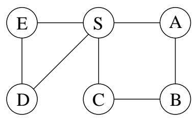
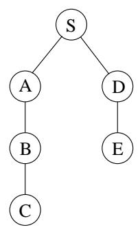
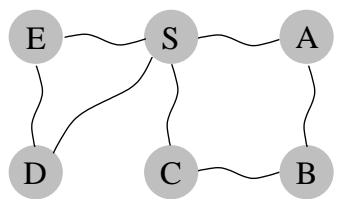
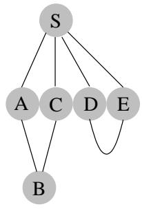

import Guide from '@/components/Guide.astro';
import Knowledge from '@/components/Knowledge.astro';
import Example from '@/components/Example.astro';
import Analysis from '@/components/Analysis.astro';
import Solution from '@/components/Solution.astro';
import Variant from '@/components/Variant.astro';
import Note from '@/components/Note.astro';
import Block from '@/components/Block.astro';
import Method from '@/components/Method.astro';
import Exercise from '@/components/Exercise.astro';

## 第 4 章：图中的路径

## 4.1 距离

深度优先搜索很容易识别从指定起点可以到达的图的所有顶点。它还找到到这些顶点的显式路径，总结在其搜索树中（图 4.1）。然而，这些路径可能不是最经济的路径。在图中，通过仅遍历一条边就可以从 S 到达顶点 C，而 DFS 树显示长度为 3 的路径。本章介绍在图中查找最短路径的算法。

路径长度使我们能够定量地讨论图的不同顶点彼此分离的程度：

两个节点之间的距离是它们之间的最短路径的长度。

为了对这个概念有一个具体的感受，请考虑一个图的物理实现，该图的每个顶点都有一个球，每条边有一条绳子。如果将顶点 s 的球举得足够高，则与它一起被拉起的其他球正是从 s 可到达的顶点。要找到它们与 s 的距离，您只需测量它们悬挂在 s 下方多远即可。

例如，在图 4.2 中，顶点 B 距 S 的距离为 2，并且有两条到它的最短路径。当 S 被举起时，沿着这些路径的琴弦就会拉紧。另一方面，边（D，E）在任何最短路径中不起作用，因此保持松弛。

图 4.1 (a) 一个简单的图和 (b) 其深度优先搜索树。

(一)  


(二)  


图 4.2 图的物理模型。





```python
Figure 4.3 Breadth-first search.

procedure bfs(G,s)

Input: Graph G=(V,E), directed or undirected; vertex s∈V
Output: For all vertices u reachable from s, dist(u) is set to the distance from s to u.

for all u∈V:
    dist(u)=∞

dist(s)=0
Q=[s] (queue containing just s)
while Q is not empty:
    u=eject(Q)
    for all edges (u,v)∈E:
    if dist(v)=∞:
    inject(Q,v)
    dist(v)=dist(u)+1
```