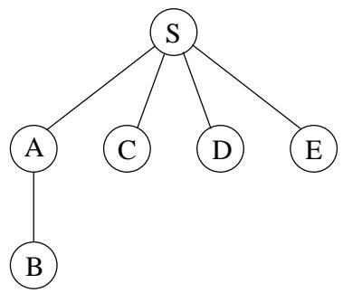
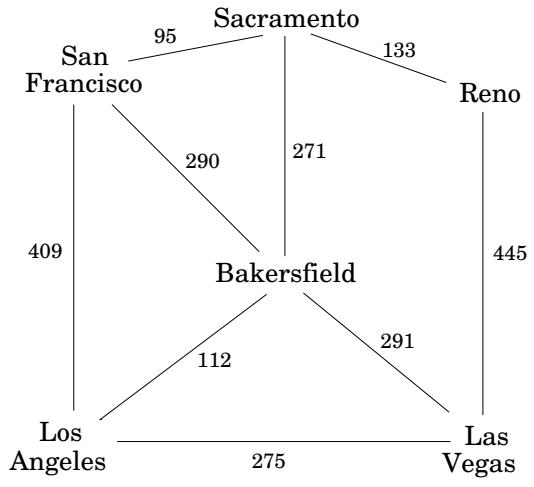

import Guide from '@/components/Guide.astro';
import Knowledge from '@/components/Knowledge.astro';
import Example from '@/components/Example.astro';
import Analysis from '@/components/Analysis.astro';
import Solution from '@/components/Solution.astro';
import Variant from '@/components/Variant.astro';
import Note from '@/components/Note.astro';
import Block from '@/components/Block.astro';
import Method from '@/components/Method.astro';
import Exercise from '@/components/Exercise.astro';

## 4.2 广度优先搜索

在图 4.2 中，s 的提升将图划分为多个层：s 本身、距它距离 1 的节点、距它距离 2 的节点，依此类推。计算从 s 到其他顶点的距离的一种便捷方法是逐层进行。一旦我们选出了距离 $0 , 1 , 2 , \ldots , d ,$ 处的节点，$d + 1$ 处的节点就很容易确定：它们正是与距离 d 处的层相邻的尚未见过的节点。这表明了一种迭代算法，其中两个层在任何给定时间都处于活动状态：某个层 $d ,$ 已被完全识别，以及 $d + 1$ ，这是通过扫描层 d 的邻居发现的。

广度优先搜索（BFS）直接实现了这个简单的推理（图4.3）。最初，队列 $Q$ 仅由 $s ,$ 距离 0 处的一个节点组成。对于每个后续距离 $d = 1 , 2 , 3 , . . . ,$ ，都有一个时间点，在该时间点 Q 包含距离 d 处的所有节点，而没有其他节点。当这些节点被处理时（从队列的前面弹出），它们尚未见过的邻居被注入到队列的末尾。

让我们在之前的示例（图 4.1）中尝试一下这个算法，以确认它的作用是正确的。如果 S 是起始点，并且节点按字母顺序排序，那么它们将按图 4.4 所示的顺序被访问。右侧的广度优先搜索树包含最初发现每个节点的边。与我们之前看到的 DFS 树不同，它具有这样的特性：从 S 开始的所有路径都是最短的。因此它是一棵最短路径树。

图 4.4 图 4.1 的图上广度优先搜索的结果。

<table> <tr> <td>访问顺序</td> <td>处理后的队列内容节点</td> </tr> <tr> <td> </td> <td>[ S]</td> </tr> <tr> <td>S</td> <td>[A C D E]</td> </tr> <tr> <td>A</td> <td>[C D E B]</td> </tr> <tr> <td>C</td> <td>[D E B]</td> </tr> <tr> <td>D</td> <td>[E B]</td> </tr> <tr> <td>E</td> <td>[ B]</td> </tr> <tr> <td>B</td> <td>[ ]</td> </tr> </table>

## 正确性和效率

我们已经发展了广度优先搜索背后的基本直觉。为了检查算法是否正确工作，我们需要确保它忠实地执行这种直觉。准确地说，我们期望的是

对于每个 $d = 0 , 1 , 2 , . . . ,$ ，有一个时刻 (1) 距 s 距离为 $\leq d$ 的所有节点都正确设置了距离； (2) 所有其他节点的距离设置为 $\infty ;$ 并且 (3) 队列恰好包含距离 d 处的节点。

这句话的措辞考虑了归纳论证。我们已经讨论了基本情况和归纳步骤。您能填写详细信息吗？

该算法的整体运行时间是线性的，$O ( \left| V \right| + \left| E \right| )$，其原因与深度优先搜索完全相同。每个顶点在第一次遇到时都会被放入队列一次，因此存在 $2 | V |$ 队列操作。其余的工作在算法的最内层循环中完成。在执行过程中，该循环会查看每条边一次（在有向图中）或两次（在无向图中），因此需要 $O ( | E | )$ 时间。

现在我们面前有 BFS 和 DFS：它们的探索风格如何比较？深度优先搜索对图进行深度入侵，只有当没有新节点可供访问时才撤退。这种策略赋予了它我们在第 3 章中看到的奇妙、微妙和极其有用的属性。但这也意味着 DFS 最终可能会采取一条漫长而复杂的路线到达实际上非常接近的顶点，如图 4.1 所示。广度优先搜索确保按照距起点距离递增的顺序访问顶点。这是一种更广泛、更浅的搜索，就像波浪在水面上的传播一样。它是使用与 DFS 几乎完全相同的代码来实现的，但用队列代替了堆栈。

图 4.5 边长通常很重要。  

还要注意与 DFS 的一个风格差异：由于我们只对距 s 的距离感兴趣，因此我们不会在其他连接组件中重新开始搜索。无法从 s 到达的节点将被简单地忽略。