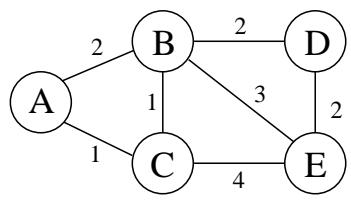
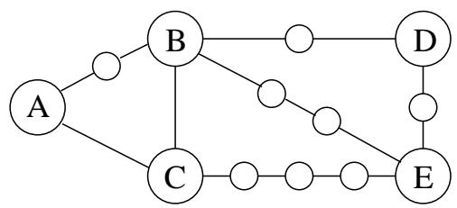
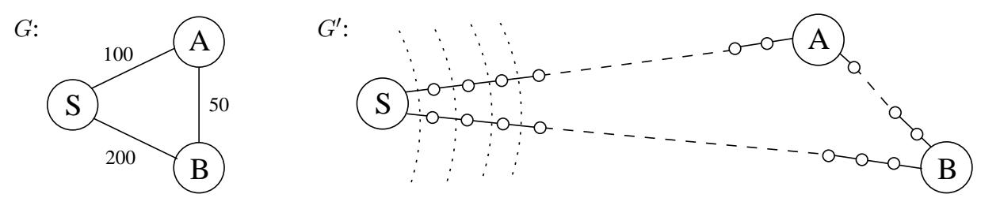
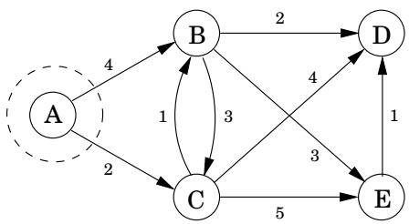
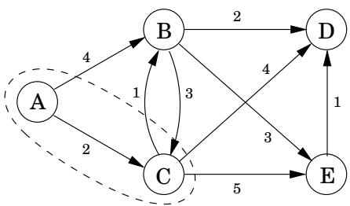
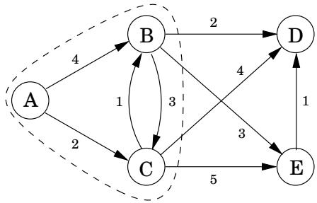
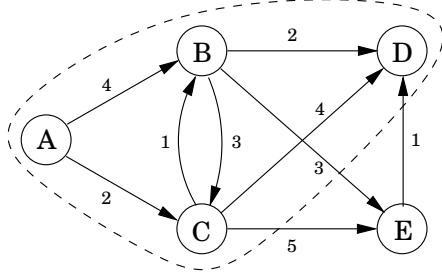
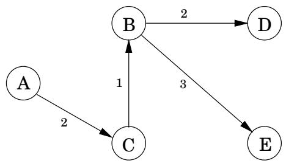
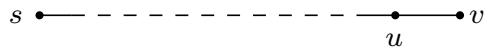
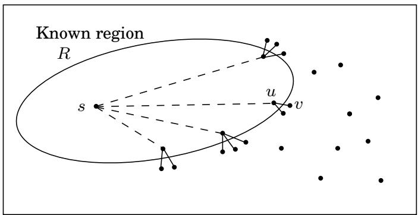

import Guide from '@/components/Guide.astro';
import Knowledge from '@/components/Knowledge.astro';
import Example from '@/components/Example.astro';
import Analysis from '@/components/Analysis.astro';
import Solution from '@/components/Solution.astro';
import Variant from '@/components/Variant.astro';
import Note from '@/components/Note.astro';
import Block from '@/components/Block.astro';
import Method from '@/components/Method.astro';
import Exercise from '@/components/Exercise.astro';

## 4.4 Dijkstra算法

## 4.4.1 广度优先搜索的改进

广度优先搜索在任何边具有单位长度的图中查找最短路径。我们能否将其适应更通用的图 $G = ( V , E )$，其边长 $l _ { e }$ 是正整数？

## 更方便的图表

这里有一个简单的技巧，可以将 G 转换为 BFS 可以处理的东西：通过引入“虚拟”节点，将 $G \mathbf { \vec { s } }$ 长边分解为单位长度的片段。图 4.6 显示了这种转换的示例。构造新图 $G ^ { \prime } { _ { \ 3 } }$

图 4.6 将边缘分成单位长度的碎片。  




对于 $E ,$ 的任何边 $\boldsymbol { e } = \left( u , v \right)$ ，通过在 u 和 v 之间添加 $l _ { e } - 1$ 虚拟节点，将其替换为长度为 1 的 $l _ { e }$ 边。

图 $G ^ { \prime }$ 包含了我们感兴趣的所有顶点V，它们之间的距离与G中的完全相同。最重要的是，$G ^ { \prime }$ 的边都有单位长度。因此，我们可以通过在 $G ^ { \prime }$ 上运行 BFS 来计算 G 中的距离

## 闹钟

如果效率不是问题，我们就可以到此为止。但是当 G 具有很长的边时，它生成的 $G ^ { \prime }$ 中充满了虚拟节点，并且 BFS 花费大部分时间来努力计算到我们根本不关心的这些节点的距离。

为了更具体地了解这一点，请考虑图 4.7 中的图 G 和 $G ^ { \prime }$，并想象从 $G ^ { \prime }$ 的节点 s 开始的 BFS 每分钟前进一个单位的距离。在前 99 分钟里，它沿着 $S - A$ 和 $S - B$ 乏味地前进，这是一片无尽的虚拟节点沙漠。有没有什么方法可以让我们在这些无聊的阶段打个小盹，并在发生有趣的事情时让警报叫醒我们——具体来说，每当到达一个真实节点（来自原始图 G）时？

为此，我们在一开始就设置两个警报，一个用于节点 A，设置为在时间 $T = 1 0 0$ 关闭，另一个用于节点 B，在时间 $T = 2 0 0$ 关闭。这些是根据当前正在遍历的边缘估计的到达时间。我们打瞌睡，在 $T = 1 0 0$ 醒来，发现 A 已经被发现。此时，B 的预计到达时间调整为 $T = 1 5 0$，并且我们相应地更改其警报。

图 4.7 $\overline { { G ^ { \prime } } }$ 上的 BFS 基本上很平静。虚线显示了一些早期的“波前”。  


更一般地，在任何给定时刻，广度优先搜索都沿着 G 的某些边缘前进，并且对于它正在移动的每个端点节点都有一个警报，并设置为在到达该节点的估计时间时发出警报。其中一些可能被高估，因为 BFS 可能会因未来抵达其他地方而找到捷径。在前面的示例中，到达 A 后发现了一条到 B 的更快路线。但是，在警报响起之前不可能发生任何有趣的事情。因此，下一个警报的响起必须通过 BFS 发出波前到达真实节点 uV 的信号。到那时，BFS 也可能开始沿着 u 之外的一些新边前进，并且需要为其端点设置警报。

下面的“闹钟算法”忠实地模拟了BFS在G0上的执行。

在时间0为节点s设置闹钟。

重复直到不再有警报：

假设节点 u 的下一个警报在时间 T 响起。然后：

– 从 s 到 u 的距离是 T。

– 对于 G 中 u 的每个邻居 v：

如果 v 还没有警报，则为时间 $T + l ( u , v )$ 设置一个警报

如果 v 的闹钟设置晚于 $T + l ( u , v )$ ，则将其重置为更早的时间。

Dijkstra 算法。闹钟算法计算任何具有正积分边长的图中的距离。它几乎已经可以使用了，只是我们需要以某种方式实现警报系统。该作业的正确数据结构是优先级队列（通常通过堆实现），它维护一组具有关联数字键值（警报时间）的元素（节点）并支持以下操作：

插入。将新元素添加到集合中。

减少键。适应特定元素键值的减少。<sup>1</sup>

删除分钟。返回具有最小键的元素，并将其从集合中删除。

建立队列。使用给定的键值从给定的元素构建优先级队列。 （在许多实现中，这比逐一插入元素要快得多。）

前两个让我们设置闹钟，第三个告诉我们下一个要响的闹钟。将所有这些放在一起，我们得到了 Dijkstra 算法（图 4.8）。

代码中，dist(u)指的是节点u当前的闹钟设置。值表示警报目前尚未设置。还有一个特殊的数组 prev，它保存每个节点 u 的一条关键信息：从 s 到 u 的最短路径上紧邻该节点之前的节点的身份。通过遵循这些后向指针，我们可以轻松地重建最短路径，因此该数组是找到的所有路径的紧凑摘要。图 4.9 显示了算法操作的完整示例以及最终的最短路径树。

综上所述，我们可以将 Dijkstra 算法视为 BFS，只不过它使用优先级队列而不是常规队列，以便以考虑边长度的方式对节点进行优先级排序。这种观点给出了算法如何以及为何工作的具体理解，但还有一种更直接、更抽象的推导，完全不依赖于 BFS。我们现在从头开始进行这种补充性的解释。

```txt
Figure 4.8 Dijkstra's shortest-path algorithm.

procedure dijkstra(G,l,s)

Input: Graph G=(V,E), directed or undirected;
positive edge lengths {le:e∈E}; vertex s∈V

Output: For all vertices u reachable from s, dist(u) is set to the distance from s to u.

for all u∈V:
    dist(u)=∞
    prev(u)=nil
dist(s)=0

H=makequeue(V) (using dist-values as keys)
while H is not empty:
    u=deletemin(H)
    for all edges (u,v)∈E:
    if dist(v)>dist(u)+l(u,v):
    dist(v)=dist(u)+l(u,v)
    prev(v)=u
    decreasekey(H,v)
```

图 4.9 Dijkstra 算法的完整运行，以节点 A 为起点。还显示了相关的 dist 值和最终的最短路径树。



<table> <tr> <td>A：0</td> <td>D： ∞</td> </tr> <tr> <td>B：4</td> <td>E： ∞</td> </tr> <tr> <td>C： 2</td> <td> </td> </tr> </table>



<table> <tr> <td>A：0</td> <td>D： 6</td> </tr> <tr> <td>B：3</td> <td>E： 7</td> </tr> <tr> <td>C： 2</td> <td> </td> </tr> </table>



<table> <tr> <td>A：0</td> <td>D： 5</td> </tr> <tr> <td>B：3</td> <td>E： 6</td> </tr> <tr> <td>C： 2</td> <td> </td> </tr> </table>



<table> <tr> <td>A：0</td> <td>D： 5</td> </tr> <tr> <td>B：3</td> <td>E： 6</td> </tr> <tr> <td>C： 2</td> <td> </td> </tr> </table>





图 4.10 已知最短路径的单边延伸。



## 4.4.2 另一种推导

下面是计算最短路径的计划：从起点 s 向外扩展，稳步增长已知距离和最短路径的图区域。这种增长应该是有序的，首先合并最近的节点，然后移动到更远的节点。更准确地说，当“已知区域”是包含 s 的顶点 R 的某个子集时，下一个添加到它的应该是 R 外部最接近 s 的节点。让我们称这个节点为v；问题是：我们如何识别它？

为了回答这个问题，请考虑 u，即从 s 到 v 的最短路径中 v 之前的节点：

由于我们假设所有边长均为正，因此 u 必须比 v 更接近 s。这意味着 u 在 R 中，否则就会与 v 作为 R 之外距离 s 最近的节点的状态相矛盾。因此，从 s 到 v 的最短路径只是一条由单条边延伸的已知最短路径。

但当前已知的最短路径通常会有许多单边扩展（图 4.10）；其中哪一个标识 v？答案是这些延长路径中最短的一条。因为，如果存在更短的单边延伸路径，这将再次与 v 作为 R 外部最接近 s 的节点的状态相矛盾。因此，很容易找到v：它是R之外的节点，当u在R范围内时，达到距离 $( s , u ) + l ( u , v )$ 的最小值。换句话说，尝试当前已知的最短路径的所有单边扩展，找到最短的此类扩展路径，并将其端点声明为R的下一个节点。

我们现在有了一个通过查看当前最短路径集的扩展来增长 R 的算法。一些额外的效率来自于注意到在任何给定的迭代中，唯一的新扩展是那些涉及最近添加到区域 R 的节点的扩展。所有其他扩展都将在之前进行过评估，并且不需要重新计算。在下面的伪代码中，dist(v)是当前通往v的最短单边扩展路径的长度；它适用于与 R 不相邻的节点。

```python
Initialize dist(s) to 0, other dist(·) values to ∞
R = { } (the ``known region'�)
while R ≠ V:
    Pick the node v∉R with smallest dist(·)
    Add v to R
    for all edges (v,z) ∈ E:
    if dist(z) > dist(v) + l(v,z):
    dist(z) = dist(v) + l(v,z)
```

结合优先级队列操作让我们回到了 Dijkstra 算法（图 4.8）。为了正式证明该算法的合理性，我们将使用归纳证明，就像广度优先搜索一样。这是一个适当的归纳假设。

在 while 循环的每次迭代结束时，满足以下条件：（1）存在一个值 d，使得 R 中的所有节点与 s 的距离为 $\leq \ d$，并且 R 外部的所有节点与 s 的距离为 d，并且（2）对于每个节点 u，值 dist(u) 是从 s 到 u 的最短路径的长度，其中间节点被限制在 R 中（如果不存在这样的路径，则该值为）。

基本情况很简单（d = 0），归纳步骤的细节可以从前面的讨论中补充。

## 4.4.3 运行时间

在图 4.8 的抽象层次上，Dijkstra 算法在结构上与广度优先搜索相同。然而，它速度较慢，因为优先级队列基元在计算上比 BFS 的恒定时间弹出和注入要求更高。由于 makequeue 最多需要 V 个 insert 操作，因此我们总共得到 V 个 deletemin 和 V + E 个 insert/decreasekey 操作。这些所需的时间因实施而异；例如，二进制堆的总体运行时间为 $O ( ( | V | + | E | ) \log | V | )$

## 哪个堆最好？

Dijkstra 算法的运行时间在很大程度上取决于所使用的优先级队列实现。以下是典型的选择。

<table> <tr> <td>实现</td> <td>删除</td> <td>插入/减少键</td> <td> $|V| \times \text{deletemin} + (|V| + |E|) \times \text{insert}$ </td> </tr> <tr> <td>数组</td> <td> $O(|V|)$ </td> <td> $O(1)$ </td> <td> $O(|V|^2)$ </td> </tr> <tr> <td>二进制堆</td> <td> $O(\log |V|)$ </td> <td> $O(\log |V|)$ </td> <td> $O((|V| + |E|) \log |V|)$ </td> </tr> <tr> <td>d 进制堆</td> <td> $O(\frac{d \log |V|}{\log d})$ </td> <td> $O(\frac{\log |V|}{\log d})$ </td> <td> $O((|V| \cdot d + |E|)\frac{\log |V|}{\log d})$ </td> </tr> <tr> <td>斐波那契堆</td> <td> $O(\log |V|)$ </td> <td> $O(1) (\text{amortized})$ </td> <td> $O(|V| \log |V| + |E|)$ </td> </tr> </table>

例如，即使是简单的数组实现也会给出 $O ( | V | ^ { 2 } )$ 相当可观的时间复杂度，而使用二进制堆我们会得到 $O ( ( \left| V \right| + \left| E \right| )$ log V ）。哪个更可取？

这取决于图是稀疏（有很少的边）还是密集（有很多边）。对于所有图， E 都小于 $| V | ^ { 2 }$ 。如果是 $\Omega ( | V | ^ { 2 } )$ ，那么显然数组实现速度更快。另一方面，一旦 E 低于 $| V | ^ { 2 } / \log | V |$，二叉堆就变得更可取

d 进制堆是二叉堆的泛化（对应于 $d = 2 )$ 并导致运行时间是 d 的函数。最佳选择是 $d \approx | E | / | V | ;$ 换句话说，为了优化，我们必须将堆的度数设置为等于图的平均度数。这对于稀疏图和稠密图都适用。对于非常稀疏的图，其中 $| E | = O ( | V | )$ ，运行时间为 $O ( | V |$ log $| V | )$ ，与二叉堆一样好。 对于密集图， $| \boldsymbol { E } | = \Omega ( | V | ^ { 2 } )$ ，运行时间为 $O ( | V | ^ { 2 } )$ ，与链表一样好。中等密度 $| E | = | V | ^ { 1 + \delta }$ ，运行时间为 $O ( | E | )$ ，线性！

表中的最后一行使用称为斐波那契堆的复杂数据结构给出了运行时间。尽管其效率令人印象深刻，但这种数据结构比其他数据结构需要更多的工作来实现，这往往会削弱其在实践中的吸引力。除了提到它的时间限制的一个奇怪特征之外，我们不会谈论它。它的插入操作需要不同的时间，但保证在算法过程中平均 $O ( 1 )$。在这种情况下（我们将在第 5 章中遇到其中一种情况），我们说堆插入的摊余成本为 $O ( 1 )$