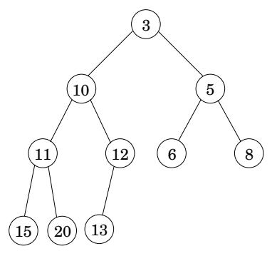
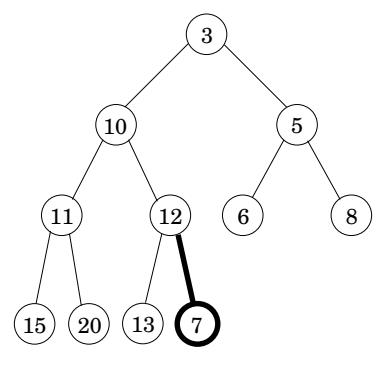
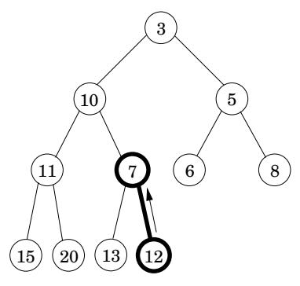
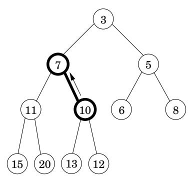
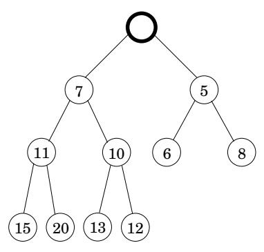
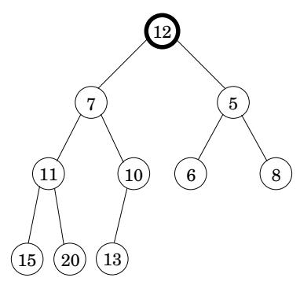
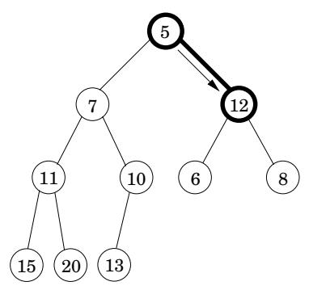
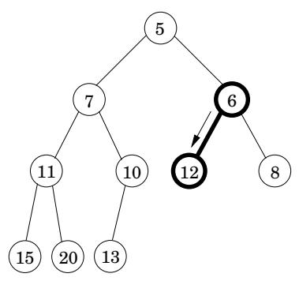
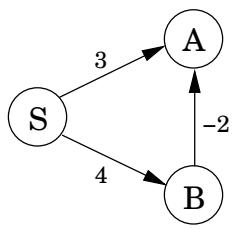

import Guide from '@/components/Guide.astro';
import Knowledge from '@/components/Knowledge.astro';
import Example from '@/components/Example.astro';
import Analysis from '@/components/Analysis.astro';
import Solution from '@/components/Solution.astro';
import Variant from '@/components/Variant.astro';
import Note from '@/components/Note.astro';
import Block from '@/components/Block.astro';
import Method from '@/components/Method.astro';
import Exercise from '@/components/Exercise.astro';

## 4.5 优先级队列实现

## 4.5.1 数组

优先级队列最简单的实现是作为所有潜在元素（在 Dijkstra 算法的情况下是图的顶点）的键值的无序数组。最初，这些值设置为 。

插入或减少键速度很快，因为它只涉及调整键值，即 O(1) 操作。另一方面，要删除min，需要对列表进行线性时间扫描。

## 4.5.2 二叉堆

这里的元素存储在一个完全二叉树中，即每一层都是从左到右填充的二叉树，必须填满后才能开始下一层。此外，还强制执行特殊的排序约束：树的任何节点的键值都小于或等于其子节点的键值。特别是，因此，根总是包含最小的元素。示例见图 4.11(a)。

插入时，将新元素放在树的底部（第一个可用位置），并让它“冒泡 $\mathrm { { u p . } } ^ { \mathfrak { p } }$”，即如果它小于其父元素，则交换两个元素并重复（图4.11(b) –(d) ）。交换次数最多为树的高度，当有n个元素时为 $\lfloor \log _ { 2 } n \rfloor$。递减键为类似，只不过该元素已经在树中，所以我们让它从当前位置向上冒泡。

要删除min，请返回根值。要从堆中删除此元素，请获取树中的最后一个节点（位于底行的最右侧位置）并将其放置在根处。让它“向下筛选”：如果它比任何一个子项都大，则与较小的子项交换并重复（图 4.11(e)–(g)）。这又需要 $O ( \log n )$ 时间。

完全二叉树的规律性使得使用数组来表示变得容易。树节点具有自然的顺序：逐行，从根开始并在每行内从左到右移动。如果有 n 个节点，则此顺序指定它们在数组中的位置 1，$, 2 , \ldots , n$。使用节点号 j 具有父节点 $\lfloor j / 2 \rfloor$ 和子节点 2j 和 $2 j + 1$ 的事实，可以在数组上轻松模拟上下移动树（练习 4.16）。

## 4.5.3 d 进制堆

d 元堆与二元堆相同，只是节点有 d 个子节点而不是只有两个。这会将具有 n 个元素的树的高度降低到 $\Theta ( \log _ { d } n ) = \Theta ( ( \log n ) / ( \log d ) )$ 。因此，插入速度提高了 $\Theta ( \log d )$ 倍。然而，Deletemin 操作需要更长的时间，即 $O ( d \log _ { d } n )$ （你明白为什么吗？）。

二叉堆的数组表示很容易扩展到 d 进制情况。这次，节点号 j 有父节点 $\lceil ( j - 1 ) / d \rceil$ 和子节点 $\{ ( j - 1 ) d + 2 , \ldots , \operatorname* { m i n } \{ n , ( j - 1 ) d + d + 1 \} \}$（练习 4.16）。

图 4.11 (a) 有 10 个元素的二叉堆。仅显示关键值。 (b)–(d) 插入带有键 7 的元素时的中间“冒泡”步骤。(e)–(g) 删除最小操作中的“筛选”步骤。

(一)  

(二)  

(三)  

(四)  

（五）  

（六）  

（克）  

（八）  

$$
\begin{array}{l} \underline {{\text { procedure\_update}}} ((u, v) \in E) \\ \underline {{\text { dist } (v) = \min \{\text { dist } (v) , \text { dist } (u) + l (u , v) \}}} \end{array}
$$

图 4.12 如果存在负边沿，Dijkstra 算法将不起作用。

