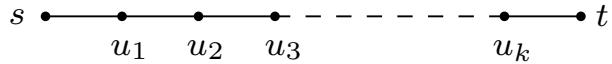
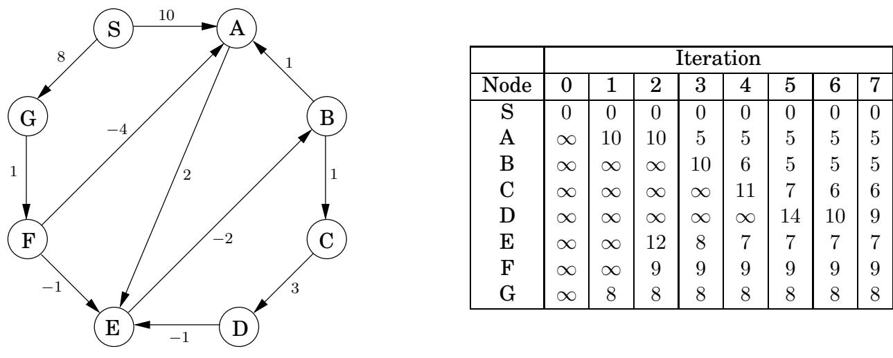

import Guide from '@/components/Guide.astro';
import Knowledge from '@/components/Knowledge.astro';
import Example from '@/components/Example.astro';
import Analysis from '@/components/Analysis.astro';
import Solution from '@/components/Solution.astro';
import Variant from '@/components/Variant.astro';
import Note from '@/components/Note.astro';
import Block from '@/components/Block.astro';
import Method from '@/components/Method.astro';
import Exercise from '@/components/Exercise.astro';

## 4.6 存在负边沿时的最短路径

## 4.6.1 负边沿

Dijkstra 算法之所以有效，部分原因是从起点 s 到任何节点 v 的最短路径必须专门通过比 v 更近的节点。当边长度可以为负时，这不再成立。在图4.12中，从S到A的最短路径经过距离较远的节点B！

为了适应这种新的并发症，需要改变什么？为了回答这个问题，让我们对 Dijkstra 算法进行一个特定的高级视图。一个关键的不变量是它维护的 dist 值总是要么高估要么完全正确。它们从 $\infty ,$ 开始，它们改变的唯一方法是沿着边缘更新：

这个更新操作只是一个事实的表达，即到 v 的距离不可能大于到 u 的距离加上 $l ( u , v )$ 。它具有以下属性。

1. 在特定情况下，它给出了到 v 的正确距离，其中 u 是到 v 的最短路径中的倒数第二个节点，并且 dist(u) 被正确设置。

2.它永远不会使dist(v)太小，从这个意义上来说它是安全的。例如，大量无关的更新不会造成伤害。

此操作非常有用：它是无害的，并且如果小心使用，将正确设置距离。事实上，Dijkstra 算法可以简单地视为更新序列。我们知道这个特定的序列不适用于负边沿，但是还有其他序列可以吗？为了了解这个序列必须具备的属性，让我们选择一个节点 t 并查看从 s 到它的最短路径。



这条路径最多可以有 $| V | - 1$ 条边（你明白为什么吗？）。如果执行的更新序列包括 $( s , u _ { 1 } ) , ( u _ { 1 } , u _ { 2 } ) , ( u _ { 2 } , u _ { 3 } ) , \ldots , ( u _ { k } , t )$ ，按该顺序（尽管不一定连续），则通过第一个属性，将正确计算到 t 的距离。这些边上发生的其他更新或图表的其余部分发生的情况并不重要，因为更新是安全的。

```txt
Figure 4.13 The Bellman-Ford algorithm for single-source shortest paths in general graphs.

procedure shortest-paths(G,l,s)

Input: Directed graph G=(V,E);
    edge lengths {le:e∈E} with no negative cycles;
    vertex s∈V

Output: For all vertices u reachable from s, dist(u) is set to the distance from s to u.

for all u∈V:
    dist(u)=∞
    prev(u)=nil

dist(s)=0
repeat |V|-1 times:
    for all e∈E:
    update(e)
```

但是，如果我们事先不知道所有最短路径，我们如何确保以正确的顺序更新右边缘？这是一个简单的解决方案：只需更新所有边 $| V | - 1$ 次！由此产生的 $O ( | V | \cdot | E | )$ 过程称为 Bellman-Ford 算法，如图 4.13 所示，运行示例如图 4.14 所示。

关于实现的注意事项：对于许多图，任何最短路径中的最大边数远小于 $| V | - 1$ ，结果是需要更少的更新轮次。因此，向最短路径算法添加额外的检查是有意义的，以使其在没有发生更新的任何一轮之后立即终止。

## 4.6.2 负循环

如果图 4.14 中边 $( E , B )$ 的长度改为 4，则该图将出现负循环 $A \to E \to B \to A$。在这种情况下，询问最短路径是没有意义的。从 A 到 E 有一条长度为 2 的路径。但是绕一圈，还有一条长度为 1 的路径，并且绕多次，我们找到长度为 0、1、2 等的路径。

最短路径问题在具有负​​循环的图中是不适定的。正如所预料的，我们第 4.6.1 节中的算法仅在不存在此类循环的情况下才有效。但这个假设在算法的推导过程中出现在哪里呢？好吧，当我们断言存在从 s 到 t 的最短路径时，它就出现了。

幸运的是，很容易自动检测负循环并发出警告。这样的循环将允许我们无休止地应用多轮更新操作，每次都会减少 dist 估计。因此，不要在 V 1 次迭代后停止，而是额外执行一轮。当且仅当在最后一轮中减少某个 dist 值时，才会出现负循环。



图 4.14 示例图所示的贝尔曼-福特算法。

<table> <tr> <td> </td> <td colspan="8">迭代</td> </tr> <tr> <td>节点</td> <td>0</td> <td>1</td> <td>2</td> <td>3</td> <td>4</td> <td>5</td> <td>6</td> <td>7</td> </tr> <tr> <td>S</td> <td>0</td> <td>0</td> <td>0</td> <td>0</td> <td>0</td> <td>0</td> <td>0</td> <td>0</td> </tr> <tr> <td>A</td> <td>∞</td> <td>10</td> <td>10</td> <td>5</td> <td>5</td> <td>5</td> <td>5</td> <td>5</td> </tr> <tr> <td>B</td> <td>∞</td> <td> ∞</td> <td>∞</td> <td>10</td> <td>6</td> <td>5</td> <td>5</td> <td>5</td> </tr> <tr> <td>C</td> <td>∞</td> <td>∞</td> <td>∞</td> <td>∞</td> <td>11</td> <td>7</td> <td>6</td> <td>6</td> </tr> <tr> <td>D</td> <td>∞</td> <td>∞</td> <td>∞</td> <td>∞</td> <td>∞</td> <td>14</td> <td>10</td> <td>9</td> </tr> <tr> <td>E</td> <td>∞</td> <td>∞</td> <td>12</td> <td>8</td> <td>7</td> <td>7</td> <td>7</td> <td>7</td> </tr> <tr> <td>F</td> <td>∞</td> <td>∞</td> <td>9</td> <td>9</td> <td>9</td> <td>9</td> <td>9</td> <td>9</td> </tr> <tr> <td>G</td> <td>∞</td> <td>8</td> <td>8</td> <td>8</td> <td>8</td> <td>8</td> <td>8</td> <td>8</td> </tr> </table>