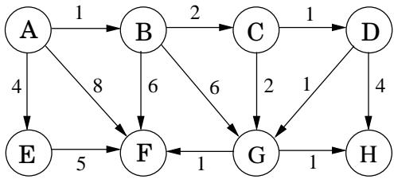
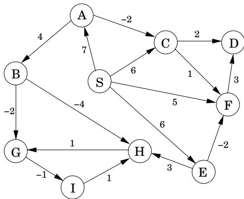
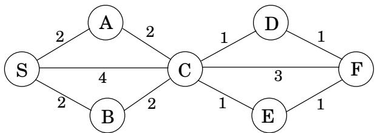

import Guide from '@/components/Guide.astro';
import Knowledge from '@/components/Knowledge.astro';
import Example from '@/components/Example.astro';
import Analysis from '@/components/Analysis.astro';
import Solution from '@/components/Solution.astro';
import Variant from '@/components/Variant.astro';
import Note from '@/components/Note.astro';
import Block from '@/components/Block.astro';
import Method from '@/components/Method.astro';
import Exercise from '@/components/Exercise.astro';

## 第 4 章练习

<Exercise title="Exercise 4.1">

假设 Dijkstra 算法在下图上运行，从节点 A 开始。



(a) 绘制一个表格，显示算法每次迭代时所有节点的中间距离值。

(b) 显示最终的最短路径树。

</Exercise>

<Exercise title="Exercise 4.2">

就像上一个问题一样，但这次使用贝尔曼-福特算法。



</Exercise>

<Exercise title="Exercise 4.3">

正方形。设计并分析一个算法，该算法以无向图 $G = ( V , E )$ 作为输入，并确定 G 是否包含长度为 4 的简单环（即不与自身相交的环）。它的运行时间最多为 $O ( | V | ^ { 3 } )$

您可以假设输入图表示为邻接矩阵或邻接列表，以哪种方式使您的算法更简单。

</Exercise>

<Exercise title="Exercise 4.4">

这是关于如何在具有单位边长的无向图中找到最短环的长度的建议。

当在深度优先搜索期间遇到后边（例如 $( v , w )$ ）时，它会与从 w 到 v 的树边形成一个循环。循环的长度为 $\mathrm { l e v e l } [ v ] - \mathrm { l e v e l } [ w ] + 1$，其中顶点的级别是其在 DFS 树中距根顶点的距离。这建议采用以下算法：

进行深度优先搜索，跟踪每个顶点的级别。

每次遇到后沿时，计算循环长度并保存它（如果它小于先前看到的最短循环长度）。

通过提供反例和简短（一两句话）解释来表明该策略并不总是有效。

</Exercise>

<Exercise title="Exercise 4.5">

图的两个节点之间通常存在多条最短路径。给出以下任务的线性时间算法。

输入：单位边长的无向图 $G = ( V , E )$；节点 $u , v \in V$

输出：从 u 到 v 的不同最短路径的数量。

</Exercise>

<Exercise title="Exercise 4.6">

证明对于由 Dijkstra 算法计算的数组 prev，边 $\{ u , \mathtt { p r e v } [ u ] \}$ （对于所有 $u \in V )$ 形成一棵树。

</Exercise>

<Exercise title="Exercise 4.7">

给你一个有向图 $G = ( V , E )$ ，带有（可能是负的）加权边，以及一个特定的节点 $s \in V$ 和一棵树 $T = ( V , E ^ { \prime } ) , E ^ { \prime } \subseteq E$ 。给出一个算法，检查 T 是否是 G 的以 s 为起点的最短路径树。您的算法应该以线性时间运行。

</Exercise>

<Exercise title="Exercise 4.8">

F. Lake 教授提出了以下算法，用于在具有一些负边的有向图中查找从节点 s 到节点 t 的最短路径：为每个边权重添加一个大常数，以便所有权重都变为正，然后从节点 s 开始运行 Dijkstra 算法，并将找到的最短路径返回到节点 t。

这是一个有效的方法吗？要么证明它正确，要么给出反例。

</Exercise>

<Exercise title="Exercise 4.9">

考虑一个有向图，其中唯一的负边是离开 s 的边；所有其他边均为正。从 s 开始的 Dijkstra 算法在这样的图上会失败吗？证明你的答案。

</Exercise>

<Exercise title="Exercise 4.10">

给定一个带有（可能为负）加权边的有向图，其中任意两个顶点之间的最短路径保证最多有 k 条边。给出一个算法，在 $O ( k | E | )$ 时间内找到两个顶点 u 和 v 之间的最短路径。

</Exercise>

<Exercise title="Exercise 4.11">

给出一个算法，该算法将具有正边长度的有向图作为输入，并返回图中最短环的长度（如果该图是非循环的，则应该这样说）。你的算法最多需要时间 $O ( | V | ^ { 3 } )$ 。

</Exercise>

<Exercise title="Exercise 4.12">

给出以下任务的 $O ( | V | ^ { 2 } )$ 算法。

输入：无向图 $G = ( V , E ) ;$；边长 $l _ { e } > 0 ;$ 边 $e \in E$

输出：包含边 $e \mathrm { . }$ 的最短循环的长度

</Exercise>

<Exercise title="Exercise 4.13">

您将以无向图 $G = ( V , E )$ 的形式获得一组城市以及它们之间的高速公路模式。每一段高速公路 $e \in E$ 连接两个城市，并且您知道其长度（以英里为单位）$l _ { e } .$ 。您想要从城市 s 前往城市 t。有一个问题：您的汽车只能容纳足够行驶 L 英里的汽油。每个城市都有加油站，但城市之间没有。因此，只有当每条边的长度为 $l _ { e } \leq L$ 时，您才能选择一条路线

(a) 考虑到汽车油箱容量的限制，展示如何在线性时间内确定从 s 到 t 是否存在可行路线。

(b) 您现在计划购买一辆新车，并且想知道从 s 行驶到 t 所需的最小油箱容量。给出一个 $O ( ( | V | + | E | ) \log | V | )$ 算法来确定这一点。

</Exercise>

<Exercise title="Exercise 4.14">

您将获得一个强连接的有向图 $G = ( V , E )$ ，其具有正边权重以及特定节点 $v _ { 0 } \in V$ 。给出一种有效的算法来查找所有节点对之间的最短路径，但有一个限制：这些路径必须全部经过 $v _ { 0 }$

</Exercise>

<Exercise title="Exercise 4.15">

最短路径并不总是唯一的：有时存在两条或更多条具有最小可能长度的不同路径。展示如何在 $O ( ( | V | + | E | ) \log | V | )$ 时间内解决以下问题。

输入：无向图 $G = ( V , E )$；边长 $l _ { e } > 0 ;$ 起始顶点 $s \in V .$

输出：布尔数组 usp[ ]：对于每个节点 $u ,$，当且仅当存在从 s 到 u 的唯一最短路径时，条目 usp[u] 才应为 true。 （注：$\mathsf { u s p } [ s ] = \mathsf { t r u e } . )$

```julia
Figure 4.16 Operations on a binary heap.

procedure insert(h, x)
bubbleup(h, x, |h| + 1)

procedure decreasekey(h, x)
bubbleup(h, x, h^{-1}(x))

function deletemin(h)
if |h| = 0:
    return null
else:
    x = h(1)
    siftdown(h, h(|h|), 1)
    return x

function makeheap(S)
h = empty array of size |S|
for x ∈ S:
    h(|h| + 1) = x
for i = |S| downto 1:
    siftdown(h, h(i), i)
return h

procedure bubbleup(h, x, i)
(place element x in position i of h, and let it bubble up)
p = [i/2]
while i ≠ 1 and key(h(p)) > key(x):
    h(i) = h(p); i = p; p = [i/2]
h(i) = x

procedure siftdown(h, x, i)
(place element x in position i of h, and let it sift down)
c = minchild(h, i)
while c ≠ 0 and key(h(c)) < key(x):
    h(i) = h(c); i = c; c = minchild(h, i)
h(i) = x

function minchild(h, i)
(return the index of the smallest child of h(i))
if 2i > |h|
    return 0 (no children)
else:
    return argmin{key(h(j)): 2i ≤ j ≤ min{|h|, 2i + 1}}
```

</Exercise>

<Exercise title="Exercise 4.16">

4.5.2节描述了一种在由 $1 , 2 , \ldots , n$ 索引的数组中存储n个节点的完整二叉树的方法

(a) 考虑数组中位置 j 处的节点。显示其父级位于位置 $\lfloor j / 2 \rfloor$，其子级位于 $2 j$ 和 $2 j + 1$（如果这些数字是 $\leq n )$）

(b) 当完整的 d-ary 树存储在数组中时，相应的索引是什么？

图 4.16 显示了二进制堆的伪代码，以 R.E. 的论述为模型。 Tarjan.<sup>2</sup> 堆存储为数组 $h ,$，假设支持两个常量时间操作：

● $| h | _ { ; }$ ，返回数组中当前元素的数量；

● $h ^ { - 1 }$ ，返回数组中元素的位置。

后者始终可以通过维护 $\cdot h ^ { - 1 }$ 的值作为辅助数组来实现。

(c) 显示在对 n 个元素的集合调用时 makeheap 过程需要 $O ( n )$ 时间。最坏情况的输入是什么？ （提示：首先显示运行时间最多为 $\textstyle \sum _ { i = 1 } ^ { n } \log ( n / i ) . )$

(a) 需要更改哪些内容才能使该伪代码适应 d 元堆？

</Exercise>

<Exercise title="Exercise 4.17">

假设我们要在边权重为 $0 , 1 , \ldots , W$ 范围内的整数的图上运行 Dijkstra 算法，其中 $W$ 是一个相对较小的数字。

(a) 展示如何使 Dijkstra 算法及时运行 $O ( W | V | + | E | )$

(b) 显示仅需要 $O ( ( | V | + | E | ) \log W )$ 时间的替代实现

</Exercise>

<Exercise title="Exercise 4.18">

如果两个节点之间存在多个不同的最短路径（并且边的长度不同），则这些路径中最方便的通常是边最少的路径。例如，如果节点代表城市，边长代表城市之间的飞行成本，则从城市 s 到城市 t 的方式可能有多种，且成本均相同。这些替代方案中最方便的是中途停留最少的一种。相应地，对于特定的起始节点s，定义

best[u] = 从 s 到 $u .$ 的最短路径中的最小边数

在下面的示例中，节点 $S , A , B , C , D , E , F$ 的最佳值分别为 0、1、1、1、2、2、3。



给出以下问题的有效算法。

输入：图 $G = ( V , E )$；正边长度 $l _ { e } ;$ 起始节点 $s \in V$

输出：应该为所有节点 $u \in V$ 设置best[u]的值

</Exercise>

<Exercise title="Exercise 4.19">

广义最短路径问题。在互联网路由中，线路上存在延迟，但更重要的是，路由器上也存在延迟。这引发了广义的最短路径问题。

假设除了边长 $\{ l _ { e } \ : \ e \ \in \ E \}$ 之外，图还具有顶点成本 $\{ c _ { v } : v \in V \}$ 。现在将路径的成本定义为其边长度的总和，加上路径上所有顶点（包括端点）的成本。给出以下问题的有效算法。

输入：有向图 $G = ( V , E )$；正边长度 $l _ { e }$ 和正顶点成本 $c _ { v } ;$ 起始顶点 $s \in V$

输出：一个数组 cos $\mathsf { t } [ \cdot ]$，使得对于每个顶点 $u , \mathsf { c o s t } [ u ]$ 是从 s 到 u 的任何路径的最低成本（$( \mathrm { i . e . } _ { \cdot }$，最便宜路径的成本），根据上面的定义。

请注意 $\mathsf { c o s t } [ s ] = c _ { s }$

</Exercise>

<Exercise title="Exercise 4.20">

有一个道路网络 $G = ( V , E )$ 连接一组城市 $V$ 。 $E$ 中的每条道路都有一个关联的长度 $l _ { e }$ 。有人提议向该网络添加一条新道路，并且有一个可以在其之间修建新道路的城市对列表 $E ^ { \prime }$。每条这样的潜在道路 $e ^ { \prime } \in E ^ { \prime }$ 都有一个相关的长度。作为公共工程部门的设计师，您需要确定道路 $e ^ { \prime } \in E ^ { \prime }$，将其添加到现有网络 $G$ 将导致网络中两个固定城市 s 和 t 之间的行驶距离最大减少。给出解决该问题的有效算法。

</Exercise>

<Exercise title="Exercise 4.21">

最短路径算法可以应用于货币交易。令 $c _ { 1 } , c _ { 2 } , \ldots , c _ { n }$ 为各种货币；例如，$c _ { 1 }$ 可能是美元，$c _ { 2 }$ 英镑和 $c _ { 3 }$ 里拉。对于任何两种货币 $c _ { i }$ 和 $c _ { j } .$，都有一个汇率 $r _ { i , j } ;$，这意味着您可以购买 $r _ { i , j }$ 单位货币 $c _ { j }$ 来换取一单位 $c _ { i }$ 。这些汇率满足 $r _ { i , j } \cdot r _ { j , i } < 1$ 的条件，因此，如果您从 $c _ { i } .$ 货币单位开始将其更改为货币 $c _ { j }$ 然后再转换回货币 $c _ { i } ,$ ，您最终得到的货币单位将少于 1 个货币单位 $c _ { i }$（差额为交易成本）。

(a) 给出以下问题的有效算法：给定一组汇率 $r _ { i , j } .$ 和两种货币s和 $t ,$，找到将货币s转换为货币t的最有利的货币兑换序列。为了实现这一目标，您应该用边长为实数的图表来表示货币和汇率。

汇率经常更新，反映各种货币的需求和供应。有时，汇率满足以下属性：存在一系列货币 $c _ { i _ { 1 } } , c _ { i _ { 2 } } , \ldots , c _ { i _ { k } }$ 使得 $r _ { i _ { 1 } , i _ { 2 } } \cdot r _ { i _ { 2 } , i _ { 3 } } \cdot \cdot \cdot r _ { i _ { k - 1 } , i _ { k } } \cdot r _ { i _ { k } , i _ { 1 } } > 1$ 。这意味着，从一个货币单位 $c _ { i 1 }$ 开始，然后依次将其转换为货币 $c _ { i _ { 2 } } , c _ { i _ { 3 } } , \ldots , c _ { i _ { k } }$ ，最后返回到 $c _ { i _ { 1 } }$ ，您最终会得到多个货币单位 $c _ { i _ { 1 } }$ 。这种异常现象在货币兑换中只持续不到一分钟，但却提供了无风险获利的机会。

(b) 给出一种有效的算法来检测这种异常的存在。使用上面找到的图形表示。

</Exercise>

<Exercise title="Exercise 4.22">

不定期轮船的问题。您是一艘轮船的所有者，该轮船可以在一组港口城市 V 之间往返。您在每个港口都可以赚钱：访问城市 i 可为您赚取 $p _ { i }$ 美元的利润。同时，从港口 i 到港口 j 的运输成本为 $c _ { i j } > 0$ 。您想要找到一条利润与成本比率最大化的循环路线。

为此，考虑一个有向图 $G = ( V , E )$，其节点是端口，并且每对端口之间都有边。对于该图中的任何周期 C，利润成本比为

$$
r (C) = \frac {\sum_ {(i , j) \in C} p _ {j}}{\sum_ {(i , j) \in C} c _ {i j}}.
$$

令 $r ^ { * }$ 为简单循环可实现的最大比率。确定 $r ^ { * }$ 的一种方法是通过二分查找：首先猜测一些比率 $r ,$，然后测试它是否太大或太小。

考虑任何积极的 $r > 0$ 。为每条边 $( i , j )$ 赋予权重 $w _ { i j } = r c _ { i j } - p _ { j }$

(a) 证明如果存在负权重循环，则 $r < r ^ { * }$

(b) 表明如果图中的所有循环都具有严格正权重，则 $r > r ^ { * }$

(c) 给出一个有效的算法，该算法将所需的精度 $\epsilon > 0$ 作为输入，并返回一个简单的循环C，其中 $r ( C ) \geq r ^ { * } - \epsilon$。证明算法的正确性并根据 $\mathbf { o f } \mid V \mid , \epsilon ,$ 和 $R = \operatorname* { m a x } _ { ( i , j ) \in E } \left( p _ { j } / c _ { i j } \right)$ 分析其运行时间。

</Exercise>