import Guide from '@/components/Guide.astro';
import Knowledge from '@/components/Knowledge.astro';
import Example from '@/components/Example.astro';
import Analysis from '@/components/Analysis.astro';
import Solution from '@/components/Solution.astro';
import Variant from '@/components/Variant.astro';
import Note from '@/components/Note.astro';
import Block from '@/components/Block.astro';
import Method from '@/components/Method.astro';
import Exercise from '@/components/Exercise.astro';
import Algorithm from '@/components/Algorithm.astro';

## 第 5 章：贪婪算法

像国际象棋这样的游戏只有提前思考才能获胜：完全专注于眼前利益的棋手很容易被击败。但在许多其他游戏中，例如拼字游戏，只需采取目前看来最好的行动，而不用过多担心未来的后果，就可以做得很好。

这种短视行为既简单又方便，使其成为一种有吸引力的算法策略。贪婪算法逐个构建解决方案，始终选择提供最明显和直接收益的下一个解决方案。尽管这种方法对于某些计算任务可能是灾难性的，但对于许多计算任务来说它是最佳的。我们的第一个例子是最小生成树。

## 5.1 最小生成树

假设您被要求通过链接选定的计算机对来将一组计算机联网。这转化为一个图问题，其中节点是计算机，无向边是潜在的链接，目标是选择足够多的边来连接节点。但这还不是全部。每个链接也有维护成本，反映在该边的权重中。最便宜的网络是什么？

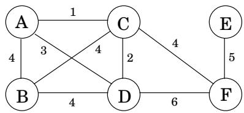

一个直接的观察结果是，最佳边集不能包含循环，因为从该循环中删除一条边可以在不影响连接性的情况下降低成本：

<Knowledge title="Property">

1 删除循环边不能断开图形。

</Knowledge>

因此，解决方案必须是连通的且非循环的：这种无向图称为树。我们想要的特定树是总权重最小的一棵树，称为最小生成树。这是它的正式定义。

输入：无向图 $G = ( V , E )$；边权重 $w _ { e }$。

输出：一棵树 $T = ( V , E ^ { \prime } )$ ，带有 $E ^ { \prime } \subseteq E _ { \mathrm { i } }$ ，最小化

$$
\mathbf {w e i g h t} (T) = \sum_ {e \in E ^ {\prime}} w _ {e}.
$$

在前面的示例中，最小生成树的成本为 16：

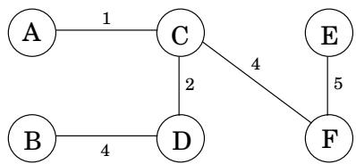

然而，这并不是唯一的最佳解决方案。你能发现另一个吗？

## 5.1.1 贪心方法

Kruskal的最小生成树算法从空图开始，然后根据以下规则从E中选择边。

重复添加不产生循环的下一个最亮的边。

换句话说，它逐边构造树，除了注意避免循环之外，还简单地选择当前最便宜的边。这是一种贪婪算法：它做出的每一个决策都是具有最明显的直接优势的决策。

图 5.1 显示了一个示例。我们从一个空图开始，然后尝试按权重递增的顺序添加边（任意打破关系）：

$$
B - C,   C - D,   B - D,   C - F,   D - F,   E - F,   A - D,   A - B,   C - E,   A - C.
$$

前两个成功，但第三个 B D 如果添加，将产生一个循环。所以我们忽略它并继续前进。最终结果是一棵成本为 14 的树，这是可能的最小值。

克鲁斯卡尔方法的正确性源于某种割属性，该属性足够普遍，足以证明一系列其他最小生成树算法的合理性。

图5.1 Kruskal算法找到的最小生成树。

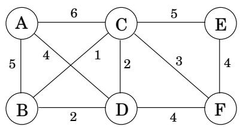

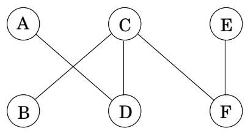

<Knowledge title="Box: Trees">

树是一种连通且非循环的无向图。树之所以如此有用，很大程度上是因为它们结构的简单性。例如，

<Knowledge title="Property">

2 有 n 个节点的树有 n - 1 条边。

</Knowledge>

这可以通过从空图开始一次构建树的一条边来看出。最初，n 个节点中的每一个都与其他节点断开连接，在其自身的连接组件中。随着边缘的添加，这些组件会合并。由于每条边联合两个不同的组件，因此在树完全形成时会添加 n - 1 个边。更详细一点：当特定边 &#123;u、v&#125; 出现时，我们可以确定 u 和 v 位于单独的连接组件中，否则它们之间已经存在一条路径，并且该边将创建一个循环。添加边然后合并这两个组件，从而将连接组件的总数减少 1。在这个增量过程的过程中，组件的数量从 n 减少到 1，这意味着在此过程中必须添加 n - 1 个边。反之亦然。

<Knowledge title="Property">

3 任意连通无向图 G = (V, E) 且 |E| =|V| - 1 是一棵树。我们只需证明 G 是无环的。实现此目的的一种方法是对其运行以下迭代过程：当图形包含循环时，从该循环中删除一条边。该过程以某个图 G' = (V, E'), E' ⊆ E 终止，该图是非循环的，并且根据属性 1（来自第 133 页）也是连通的。因此G'是一棵树，于是|E'| =|V| - 属性 2 为 1。因此 E' = E，没有删除任何边，并且 G 一开始就是非循环的。换句话说，我们可以通过计算连通图有多少条边来判断它是否是一棵树。这是另一个特征。

</Knowledge>

<Knowledge title="Property">

4 无向图当且仅当任意一对节点之间存在唯一路径时，它才是一棵树。在树中，任意两个节点之间只能有一条路径；因为如果有两条路径，这些路径的并集将包含一个环。另一方面，如果一个图在任意两个节点之间有一条路径，那么它是连通的。如果这些路径是唯一的，则该图也是非循环的（因为循环在任何一对节点之间都有两条路径）。

</Knowledge>

</Knowledge>

图 5.2 $T \cup \{ e \}$。将 e（虚线）添加到 $T$（实线）会产生一个循环。该循环必须至少包含一条其他边，此处显示为 $e ^ { \prime } ,$ 穿过切割 $( S , V - S )$

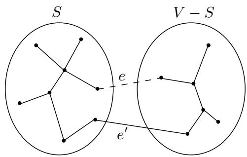

## 5.1.2 剪切属性

假设在构建最小生成树（MST）的过程中，我们已经选择了一些边并且到目前为止处于正确的轨道上。接下来我们应该添加哪条边？以下引理为我们的选择提供了很大的灵活性。

剪切属性假设边 X 是 $G = ( V , E )$ 最小生成树的一部分。选择 X 不在 $S$ 和 $V - S$ 之间交叉的节点 $S$ 的任何子集，并令 e 为跨此分区的最轻边。那么 $X \cup \{ e \}$ 是某个 MST 的一部分。

切割是将顶点任意划分为两组： S 和 $V - S .$ 。该属性表示，在任何切割上添加最轻的边始终是安全的（即，在 S 中的顶点和 $V - S )$ 中的一个顶点之间，前提是 X 没有跨越切割的边。

让我们看看为什么这是成立的。边 X 是某个 MST $T ;$ 的一部分，如果新边 e 也恰好是 $T$ 的一部分，则无需证明。因此假设 e 不在 $T$ 中。我们将通过稍微改变 $T$（仅更改其边缘之一）来构造一个包含 $X \cup \{ e \}$ 的不同 $\mathbf { M S T } \mathbf { \Omega } T ^ { \prime }$。

将边 $e$ 添加到 $T .$ 。由于 $T$ 已连接，它在 $\cdot _ { e , \cdot }$ 的端点之间已经有一条路径，因此添加e会创建一个循环。该循环还必须有一些其他边 $e ^ { \prime }$ 穿过切口 $( S , V - S )$（图 8.3）。如果我们现在删除这条边，我们就剩下 $T ^ { \prime } = T \cup \{ e \} - \{ e ^ { \prime } \}$ ，我们将把它显示为一棵树。 $T ^ { \prime }$ 通过属性 1 连接，因为 $e ^ { \prime }$ 是循环边。并且它的边数与 $T ;$ 相同；所以根据属性 $2$ 和 $^ { 3 , }$ 它也是一棵树。

此外，$T ^ { \prime }$ 是最小生成树。将其重量与 $T$ 的重量进行比较：

$$
\operatorname{weight} \left(T ^ {\prime}\right) = \operatorname{weight} (T) + w (e) - w \left(e ^ {\prime}\right).
$$

$e$ 和 $e ^ { \prime }$ 都在 $S$ 和 $V - S$ 之间交叉，并且 e 是该类型中最轻的边。因此 $w ( e ) \le w ( e ^ { \prime } )$，权重 $( T ^ { \prime } ) \leq$ 权重(T)。由于 $T$ 是一个MST，因此权重 $; ( T ^ { \prime } ) = \mathrm { w e i g h t } ( T )$ 和 $T ^ { \prime }$ 一定是一个MST。

图 5.3 显示了剪切属性的示例。哪条边是 $e ^ { \prime } 2$

## 5.1.3 克鲁斯卡尔算法

我们准备好证明 Kruskal 算法的合理性。在任何给定时刻，它已经选择的边形成部分解决方案，即连接组件的集合，每个组件都有一棵树

图5.3 工作时的切割特性。 (a) 无向图。 (b) 集合 X 具有三个边，并且是右侧 MST T 的一部分。 (c) 如果 ${ \cal S } = \{ A , B , C , D \}$ ，则穿过切割 $( S , V - S )$ 的最小权重边之一是 e = D, E 。 X e 是 MST $T ^ { \prime }$ 的一部分，如右侧所示。

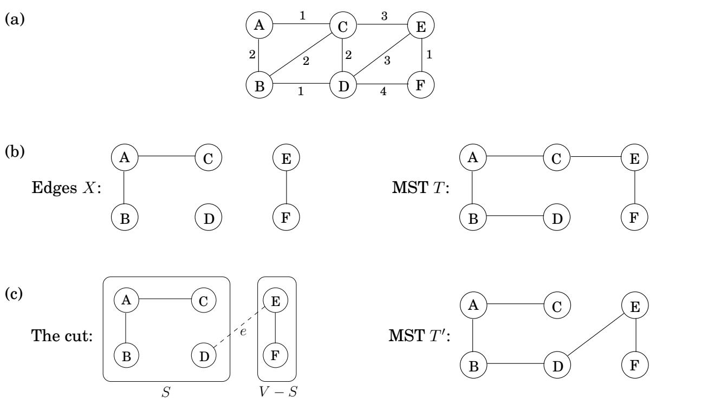

结构。要添加的下一条边 e 连接其中两个组件；称它们为 $T _ { 1 }$ 和 $T _ { 2 } .$ 。由于 e 是不产生循环的最轻边，因此它肯定是 $T _ { 1 }$ 和 $V - T _ { 1 }$ 之间的最轻边，因此满足切割属性。

现在我们填写一些实施细节。在每个阶段，算法都会选择一条边添加到其当前的部分解中。为此，它需要测试每个候选边 $u - v$ 以查看端点u和v是否位于不同的组件中；否则边缘产生循环。一旦选择了一条边，就需要合并相应的组件。什么样的数据结构支持这样的操作？

我们将算法的状态建模为不相交集合的集合，每个集合都包含特定组件的节点。最初，每个节点都单独位于一个组件中：

makeset(x)：创建一个仅包含 x 的单例集。

我们反复测试节点对，看看它们是否属于同一组。

find(x)：x 属于哪个集合？

每当我们添加一条边时，我们都会合并两个组件。

union(x, y)：合并包含 x 和 $y .$ 的集合

最终算法如图5.4所示。它使用 V makeset、2 E find 和 $| V | - 1$ 联合操作。

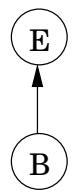

```txt
Figure 5.4 Kruskal's minimum spanning tree algorithm.

procedure kruskal(G,w)

Input: A connected undirected graph G=(V,E) with edge weights we
Output: A minimum spanning tree defined by the edges X

for all u∈V:
    makeset(u)

X = {}
Sort the edges E by weight
for all edges {u,v}∈E, in increasing order of weight:
    if find(u)≠find(v):
    add edge {u,v} to X
    union(u,v)
```

## 5.1.4 不相交集的数据结构

## 按等级联合

存储集合的一种方法是作为有向树（图 5.5）。树的节点是集合的元素，没有特定的顺序排列，每个节点都有父指针，最终指向树的根。该根元素是集合的方便代表或名称。它与其他元素的区别在于它的父指针是自循环的。

除了父指针 π 之外，每个节点还有一个等级，目前应将其解释为从该节点悬挂的子树的高度。

<Algorithm>
<u>程序makeset</u>(x)
$\pi(x) = x$
$	ext{rank}(x) = 0$

<u>函数查找</u>(x)
而$x 
等式 \pi(x)$:
    $x = \pi(x)$
返回x
</Algorithm>

## 图 5.5 两个集合 B、E 和 A、C、D、F、G、H 的有向树表示。

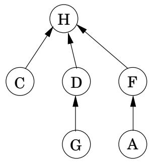

正如所预料的，makeset 是一个恒定时间操作。另一方面，find 遵循父指针指向树的根，因此所花费的时间与树的高度成正比。树实际上是通过第三个操作“并集”构建的，因此我们必须确保此过程使树保持浅层。

合并两个集合很容易：使一个集合的根指向另一个集合的根。但我们在这里有一个选择。如果集合的代表（根）是 $r _ { x }$ 和 $r _ { y } ,$，我们是否使 $r _ { x }$ 指向 $r _ { y }$ 或相反？由于树高是计算效率的主要障碍，因此一个好的策略是使较短树的根指向较高树的根。这样，只有当合并的两棵树高度相等时，整体高度才会增加。我们将使用根节点的等级数，而不是显式计算树的高度，这就是为什么该方案被称为按等级并集的原因。

<Algorithm>
<u>程序并集</u>(x, y)
$r_x = 	ext{find}(x)$
$r_y = 	ext{find}(y)$
如果 $r_x = r_y$：返回
如果 $	ext{rank}(r_x) > 	ext{rank}(r_y)$：
    $\pi(r_y) = r_x$
其他：
    $\pi(r_x) = r_y$
    如果 $	ext{rank}(r_x) = 	ext{rank}(r_y)$：
        $	ext{rank}(r_y) = 	ext{rank}(r_y) + 1$
</Algorithm>

示例见图 5.6。

根据设计，节点的等级正是以该节点为根的子树的高度。这意味着，例如，当您沿着一条路径向上移动到根节点时，沿途的排名值会严格增加。

<Knowledge title="Property">

1 对于任意 x，运行 $k ( x ) < r a n k ( \pi ( x ) )$

</Knowledge>

等级为 k 的根节点是通过合并根等级为 $k - 1$ 的两棵树而创建的。通过归纳法（尝试一下！）

<Knowledge title="Property">

2 任何秩为 k 的根节点在其树中至少有 $2 ^ { k }$ 个节点

</Knowledge>

这也扩展到内部（非根）节点：等级为 k 的节点至少有 $2 ^ { k }$ 后代。毕竟，任何内部节点都曾经是根，从那时起，它的等级和它的后代集都没有改变。此外，不同的 k 级节点不能有共同的后代，因为根据属性 1，任何元素至多有一个 k 级的祖先。这意味着

<Knowledge title="Property">

3 如果总共有 n 个元素，则最多可以有 $n / 2 ^ { k }$ 个等级为 k 的节点。

</Knowledge>

至关重要的是，最后一个观察结果意味着最大秩是 log n。因此，所有树的高度为 log n，这是查找和并集运行时间的上限。

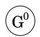

图 5.6 不相交集运算的序列。上标表示等级。

在 makeset(A)、makeset $( B ) , \ldots$ 、makeset(G) 之后：

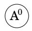

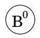

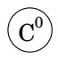

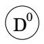

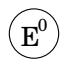

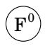

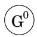

在 union(A, D)、union(B, E)、union(C, F) 之后：

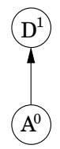

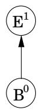

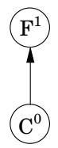

在 union(C, G)、union(E, A) 之后：

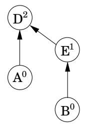

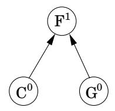

并集后（B，G）：

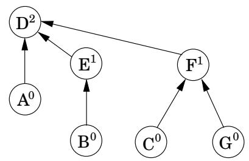

## 路径压缩

根据到目前为止所呈现的数据结构，Kruskal 算法的总时间变为用于对边进行排序的 $O ( | E | \log | V | )$（记住，记录 $| E | \approx \log | V | )$ 加上另一个 $O ( | E | \log | V | )$ 用于主导算法其余部分的并集和查找操作。因此，似乎没有什么动力让我们的数据结构变得更加高效。

但是如果给我们的边是排序的呢？或者，如果权重很小（例如，$O ( | E | ) )$，以便可以在线性时间内完成排序？那么数据结构部分就成为瓶颈，考虑将其性能提高到每次操作超过 log n 是有用的。事实证明，改进的数据结构在许多其他应用程序中都很有用。

但是我们如何才能比 log n 更快地执行并集和查找呢？答案是，通过成为

图 5.7 路径压缩的效果：find(I) 后跟 find(K)。

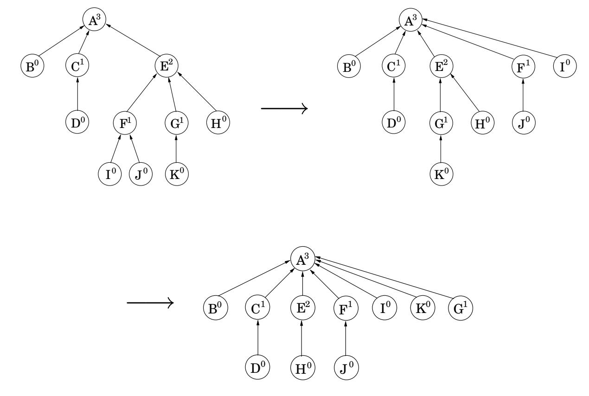

更加小心地维护我们的数据结构的良好状态。正如任何管家所知，从长远来看，在日常维护中投入一点额外的努力可以通过预防重大灾难来获得丰厚的回报。我们考虑到并查找数据结构的特定维护操作，旨在保持树的简短——在每次查找期间，当一系列父指针跟踪到树的根时，我们将更改所有这些指针，以便它们直接指向根（图 5.7）。这种路径压缩启发式仅稍微增加查找所需的时间并且易于编码。

$$
\begin{array}{l} \underline {{\text { function   find } (x)}} \\ \text { if } x \neq \pi (x): \pi (x) = \text { find } (\pi (x)) \\ \text { return } \pi (x) \end{array}
$$

这种简单更改的好处是长期的而不是瞬时的，因此需要一种特定类型的分析：我们需要从空数据结构开始查看查找和联合操作的序列，并确定每个操作的平均时间。事实证明，该摊余成本仅略高于 O(1)，低于之前的 O(log n)。

将数据结构视为具有由根节点组成的“顶层”，在其下面是树的内部。有一个分工：查找操作（有或没有路径压缩）只触及树的内部，而联合只查看顶层。因此，路径压缩对联合操作没有影响，并且顶层保持不变。

我们现在知道根节点的等级是不变的，但是非根节点呢？这里的关键点是，一旦一个节点不再是根，它就永远不会重新出现，并且它的等级永远固定。因此，路径压缩不会改变所有节点的排名，即使这些数字不再可以解释为树高。特别是，属性 1-3（第 139 页）仍然成立。

如果有 n 个元素，则根据属性 3，它们的排名值的范围可以从 0 到 log n。让我们将此范围的非零部分划分为某些精心选择的区间，原因很快就会变得清晰：

$$
\{1 \}, \{2 \}, \{3, 4 \}, \{5, 6, \dots , 1 6 \}, \{1 7, 1 8, \dots , 2 ^ {1 6} = 6 5 5 3 6 \}, \{6 5 5 3 7, 6 5 5 3 8, \dots , 2 ^ {6 5 5 3 6} \}, \dots
$$

每个组的形式为 $\{ k + 1 , k + 2 , \ldots , 2 ^ { k } \}$ ，其中 k 是 2 的幂。组的数量为 $\log ^ { * } n ,$ ，它被定义为需要应用于 n 以使其降至 1（或低于 1）的连续日志操作的数量。例如，$\log ^ { * } { 1 0 0 0 } = 4$ 因为 log log log log $1 0 0 0 \leq 1$ 实际上，只会显示前五个间隔；仅当 $n \geq 2 ^ { 6 5 5 3 6 }$ 时才需要更多，换句话说，永远不需要。

在一系列查找操作中，有些操作可能比其他操作花费更长的时间。我们将使用一些创造性的计算来限制总体运行时间。具体来说，我们会给每个节点一定数量的零用钱，使得发放的总金额最多为 n $\log ^ { * }$ n 美元。然后，我们将显示每个查找需要 $O ( \log ^ { * } n )$ 步骤，加上一些额外的时间，这些时间可以使用所涉及节点的零花钱“支付 $\mathbf { f o r } ^ { \mathbf { \mathfrak { s } } }$”——每单位时间一美元。因此，m 个查找的总时间是 $O ( m \log ^ { * } n )$ 加上最多 $O ( n \log ^ { * } n )$

更详细地说，节点一旦不再是根就会收到其配额，此时其等级是固定的。如果该排名位于区间 $\{ k + 1 , \ldots , 2 ^ { k } \}$ 内，则节点将收到 $2 ^ { k }$ 美元。根据属性 3，等级为 $> k$ 的节点数量的界限为

$$
\frac {n}{2 ^ {k + 1}} + \frac {n}{2 ^ {k + 2}} + \dots \leq \frac {n}{2 ^ {k}}.
$$

因此，在这个特定区间内给予节点的总资金最多为 n 美元，并且由于有 $\log ^ { * } \tau$ n 个区间，因此支付给所有节点的总资金 $\mathbf { i s } \leq n \log ^ { * } n$

现在，特定查找所花费的时间只是后面的指针数量。考虑沿着该节点链直至根的升序排名值。链上的节点 x 分为两类：要么 $\pi ( x )$ 的等级位于比 x 的等级更高的区间，要么位于相同的区间。第一种类型最多有 $\log ^ { * }$ n 个节点（你明白为什么吗？），因此对它们完成的工作需要 $O ( \log ^ { * } n )$ 时间。其余的节点——其父母的等级与他们的等级处于同一区间——必须从零用钱中支付一美元来支付处理时间。

仅当每个节点 x 的初始限额足以覆盖其在查找操作序列中的所有付款时，这才有效。这是一个关键的观察结果：每次 x 支付一美元，它的父级就会更改为更高级别的一个。因此，如果 x 的排名位于 $\{ k +$ $1 , \ldots , 2 ^ { k } \}$ 区间内，则在其父级排名处于更高区间之前，它最多必须支付 $2 ^ { k }$ 美元；这样它就不必再付款了。

<Knowledge title="Box: A randomized algorithm for minimum cut">

我们已经看到，生成树和砍伐是密切相关的。这是另一个连接。让我们删除 Kruskal 算法添加到生成树的最后一条边；这将树分成两个部分，从而在图中定义了一个切割 $( S , { \overline { { S } } } )$。对于这次削减我们能说些什么呢？假设我们正在使用的图是未加权的，并且其边是随机均匀排序的，以便 Kruskal 算法处理它们。这是一个值得注意的事实：至少有可能 $1 / n ^ { 2 } , ( S , { \overline { { S } } } )$ 是图中的最小割，其中割的大小 $( S , { \overline { { S } } } )$ 是 $S$ 和 ${ \overline { { S } } } .$ 之间交叉的边数，这意味着重复该过程 $O ( n ^ { 2 } )$ 次并输出找到的最小割，以高概率产生 $G$ 中的最小割：用于未加权最小割的 $O ( m n ^ { 2 } \log n )$ 算法。一些进一步的调整给出了由 David Karger 发明的 $O ( n ^ { 2 } \log n )$ 最小割算法，这是解决这个重要问题的最快的已知算法。

那么让我们看看为什么每次迭代中找到的割是概率至少为 $1 / n ^ { 2 }$ 的最小割。在 Kruskal 算法的任何阶段，顶点集 V 都会被划分为连通分量。唯一有资格添加到树中的边的两个端点位于不同的组件中。与每个组件相关的边数必须至少为 $C ,$ $G$ 中最小切割的大小（因为我们可以考虑将该组件与图的其余部分分开的切割）。因此，如果图中存在 $k$ 个分量，则符合条件的边数至少为 $k C / 2$ （每个 $k$ 分量至少有 $C$ 条边引出，我们需要补偿每条边的重复计算）。由于边是随机排序的，因此列表中下一个符合条件的边来自最小切割的机会最多为 $C / ( k C / 2 ) = 2 / k$ 。因此，至少以 $1 - 2 / k = ( k - 2 ) / k ,$ 的概率，该选择使最小割保持不变。但现在克鲁斯卡尔算法在选择最后一个生成树边之前保持最小割完整的机会至少是

$$
{\frac {n - 2}{n}} \cdot {\frac {n - 3}{n - 1}} \cdot {\frac {n - 4}{n - 2}} \dots {\frac {2}{4}} \cdot {\frac {1}{3}} = {\frac {1}{n (n - 1)}}.
$$

</Knowledge>
## 5.1.5 Prim 算法

让我们回到最小生成树算法的讨论。 cut 属性用最一般的术语告诉我们的是，任何符合以下贪婪模式的算法都保证可以工作。

<Algorithm>
$X = \{ \}$（到目前为止选取的边缘）
重复直到 $|X| = |V| - 1$：
    选择一个集合 $S \subset V$，其中 $X$ 在 $S$ 和 $V - S$ 之间没有边
    令 $e \in E$ 为 $S$ 和 $V - S$ 之间的最小权重边
    $X = X \cup \{e\}$
</Algorithm>

Kruskal 算法的一个流行替代算法是 Prim 算法，其中中间边集 X 始终形成一个子树，并且选择 S 作为该树的顶点集。

在每次迭代中，X 定义的子树都会增长一条边，即 $S$ 中的顶点和 S 外部的顶点之间的最轻边（图 5.8）。我们可以等价地将 S 视为

图5.8 Prim的算法：边X形成一棵树，S由它的顶点组成。

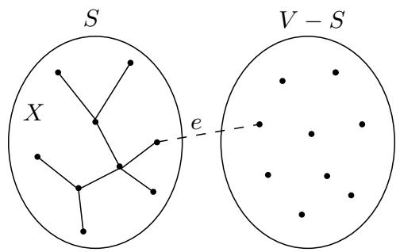

不断增长以包含成本最小的顶点 $v \not \in S$：

$$
\mathsf {c o s t} (v) = \min _ {u \in S} w (u, v).
$$

这很容易让人想起 Dijkstra 算法，事实上伪代码（图 5.9）几乎是相同的。唯一的区别在于优先级队列排序所依据的键值。在 Prim 算法中，节点的值是集合 S 中最轻的传入边的权重，而在 Dijkstra 算法中，节点的值是从起点到该节点的整个路径的长度。尽管如此，这两种算法非常相似，它们具有相同的运行时间，这取决于特定的优先级队列实现。

图 5.9 显示了 Prim 的算法在一个小的六节点图上的工作情况。请注意最终 MST 是如何完全由 prev 数组指定的。

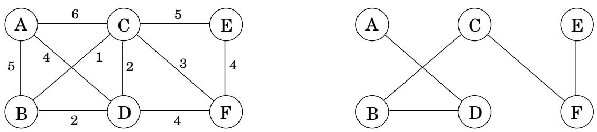

```python
Figure 5.9 Top: Prim's minimum spanning tree algorithm. Below: An illustration of Prim's algorithm, starting at node A. Also shown are a table of cost/prev values, and the final MST.
procedure prim(G,w)
Input: A connected undirected graph G=(V,E) with edge weights we
Output: A minimum spanning tree defined by the array prev
for all u∈V:
    cost(u)=∞
    prev(u)=nil
Pick any initial node u0
cost(u0)=0
H=makequeue(V) (priority queue, using cost-values as keys)
while H is not empty:
    v=deletemin(H)
    for each {v,z}∈E:
    if cost(z)>w(v,z):
    cost(z)=w(v,z)
    prev(z)=v
    decreasekey(H,z)
```

<table> <tr> <td>设置S</td> <td>A</td> <td>B</td> <td>C</td> <td>D</td> <td>E</td> <td>F</td> </tr> <tr> <td> &#123; &#125; </td> <td>0/无</td> <td>∞/无</td> <td>∞/无</td> <td>∞/无</td> <td>∞/无</td> <td>∞/无</td> </tr> <tr> <td>A</td> <td> </td> <td>5/A</td> <td>6/A</td> <td>4/A</td> <td> ∞/无</td> <td>∞/无</td> </tr> <tr> <td>A， D</td> <td> </td> <td>2/D </td> <td>2/D</td> <td> </td> <td>∞/nil</td> <td> 4/D</td> </tr> <tr> <td>A， D、 B</td> <td> </td> <td> </td> <td>1/B</td> <td> </td> <td>∞/nil</td> <td>4 /D</td> </tr> <tr> <td>A，丁、乙、 C</td> <td> </td> <td> </td> <td> </td> <td> </td> <td>5/C</td> <td>3/ C</td> </tr> <tr> <td>A， D、B、C、 F</td> <td> </td> <td> </td> <td> </td> <td> </td> <td>4/F</td> <td> </td> </tr> </table>