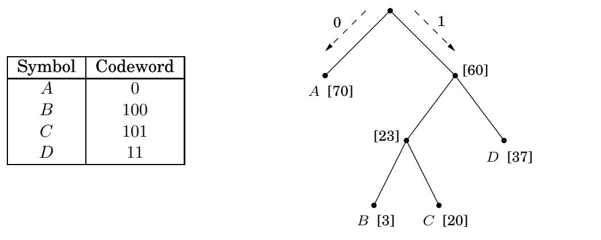
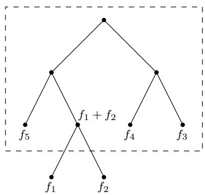

import Guide from '@/components/Guide.astro';
import Knowledge from '@/components/Knowledge.astro';
import Example from '@/components/Example.astro';
import Analysis from '@/components/Analysis.astro';
import Solution from '@/components/Solution.astro';
import Variant from '@/components/Variant.astro';
import Note from '@/components/Note.astro';
import Block from '@/components/Block.astro';
import Method from '@/components/Method.astro';
import Exercise from '@/components/Exercise.astro';
import Algorithm from '@/components/Algorithm.astro';

## 5.2 霍夫曼编码

在MP3音频压缩方案中，声音信号通过三个步骤进行编码。

1. 通过定期采样进行数字化，产生实数序列 $s _ { 1 } , s _ { 2 } , \ldots , s _ { T }$。例如，以每秒 44,100 个样本的速率，一首 50 分钟的交响曲将对应于 $T = 5 0 \times 6 0 \times 4 4 , 1 0 0 \approx 1 3 0$ 百万次测量。1

2. 每个实值样本 $s _ { t }$ 都被量化：用有限集 Γ 中的附近数字来近似。该集合经过精心选择，以利用人类感知限制，其目的是使人耳无法区分近似序列与 $s _ { 1 } , s _ { 2 } , \ldots , s _ { T }$。

3. 字母表 Γ 上长度为 T 的结果字符串以二进制编码。

最后一步使用霍夫曼编码。为了理解它的作用，让我们看一个简单的例子，其中 T 是 1.3 亿，字母 Γ 仅由四个值组成，用符号 $A , B , C , D$ 表示。将这个长字符串以二进制形式写入最经济的方法是什么？显而易见的选择是每个符号使用 2 位，例如 A 为码字 00，B 为 01，C 为 10，D 为 11，在这种情况下总共需要 260 兆位。可能有比这更好的编码吗？

为了寻找灵感，我们仔细观察了特定的序列，发现这四个符号的丰富程度并不相同。

<table> <tr> <td>符号</td> <td>频率</td> </tr> <tr> <td>A</td> <td>70百万</td> </tr> <tr> <td>B</td> <td>3百万</td> </tr> <tr> <td>C</td> <td>20百万</td> </tr> <tr> <td>D</td> <td>37百万</td> </tr> </table>

是否存在某种可变长度编码，其中仅使用一位来表示频繁出现的符号 A，而代价可能是需要三位或更多位来表示不太常见的符号？

具有不同长度的码字的危险在于所得到的编码可能无法唯一地破译。例如，如果码字是 0, 01, 11, 001 ，则像 001 这样的字符串的解码是不明确的。我们将通过坚持无前缀属性来避免这个问题：任何码字都不能是另一个码字的前缀。

任何无前缀编码都可以用完整二叉树表示，即每个节点都有零个或两个子节点的二叉树，其中符号位于叶子，每个码字由从根到叶子的路径生成，将左解释为 0，将右解释为 1（练习 5.28）。图 5.10 显示了四个符号 A、B、C、D 的编码示例。解码是唯一的：从根开始，从左到右读取字符串并向下移动，然后每当到达叶子时，输出相应的符号并返回到根，从而解密一串位。这是一个简单的方案，对于我们的玩具示例来说效果很好，其中（在图 5.10 的代码下）二进制字符串的总大小下降到 213 兆位，提高了 17%。

图 5.10 无前缀编码。频率显示在方括号中。

<table> <tr> <td>符号</td> <td>代码字</td> </tr> <tr> <td>A</td> <td>0</td> </tr> <tr> <td>B</td> <td>100</td> </tr> <tr> <td>C</td> <td>101</td> </tr> <tr> <td>D</td> <td>11</td> </tr> </table>

一般来说，给定n个符号的频率 $f _ { 1 } , f _ { 2 } , \ldots , f _ { n }$，我们如何找到最佳编码树？为了使问题更加精确，我们需要一棵树，其每个叶子对应一个符号，并且最小化编码的总长度，

$$
\text { cost   of   tree } = \sum_ {i = 1} ^ {n} f _ {i} \cdot (\text { depth   of   } i \text { th   symbol   in   tree })
$$

（符号所需的位数正是其在树中的深度）。

还有另一种编写此成本函数的方法非常有用。虽然我们只给出了叶子的频率，但我们可以将任何内部节点的频率定义为其后代叶子的频率之和；毕竟，这是在编码或解码期间访问内部节点的次数。在编码过程中，每次我们沿着树向下移动时，我们经过的每个非根节点都会得到一位输出。因此，总成本（输出的总位数）也可以表示为：

树的成本是除根之外的所有叶子和内部节点的频率之和。

成本函数的第一个公式告诉我们，频率最小的两个符号必须位于最优树的底部，作为最低内部节点的子节点（该内部节点有两个子节点，因为树是 $f u l l )$ 。否则，将这两个符号与树中最低的符号交换将改善编码。

这表明我们开始贪婪地构建树：找到频率最小的两个符号，例如 i 和 $j ,$ ，并使它们成为新节点的子节点，然后该节点的频率为 $f _ { i } + f _ { j }$ 。为了保持符号简单，我们假设它们是 $f _ { 1 }$ 和 $f _ { 2 }$ 。根据成本函数的第二个公式，任何其中 $f _ { 1 }$ 和 $f _ { 2 }$ 是兄弟叶子的树都具有成本 $f _ { 1 } + f _ { 2 }$ 加上具有频率 $( f _ { 1 } + f _ { 2 } ) , f _ { 3 } , f _ { 4 } , \dotsc , f _ { n } ;$ 叶子的树的成本 $n - 1$

后一个问题只是我们开始问题的一个较小版本。因此，我们将 $f _ { 1 }$ 和 $f _ { 2 }$ 从频率列表中拉出，插入 $( f _ { 1 } + f _ { 2 } )$ ，然后循环。由此产生的算法可以用优先级队列操作（如第 114 页上定义的）来描述，并且如果使用二进制堆（第 4.5.2 节），则需要 O(n log n) 时间。

<Algorithm title="procedure Huffman(f)">
输入：频率数组 $f[1\cdots n]$
输出：一棵有 n 个叶子的编码树

令 H 为整数优先级队列，按 f 排序
对于 i = 1 到 n：
    插入（H，我）
对于 k = n + 1 到 2n - 1：
    i = 删除min(H), j = 删除min(H)
    创建一个编号为 k 的节点，其子节点为 i、j
    $f[k] = f[i] + f[j]$
    插入（H，k）
</Algorithm>

转向我们的玩具示例：您能判断图 5.10 中的树是否是最优的吗？

<Knowledge title="Box: Entropy">

一年一度的县赛马比赛将带来三匹从未相互竞争过的纯种马。您兴奋地研究了他们过去 200 场比赛，并将其总结为四种结果的概率分布：第一（“第一名”）、第二、第三和其他。

<table> <tr> <td>结果</td> <td>极光</td> <td>旋风</td> <td>幻象</td> </tr> <tr> <td>第一个</td> <td>0.15</td> <td>0.30</td> <td>0 .20</td> </tr> <tr> <td>第二</td> <td>0.10</td> <td>0.05</td> <td>0.30</td> </tr> <tr> <td>第三</td> <td>0.70</td> <td>0.25</td> <td>0.30</td> </tr> <tr> <td>其他</td> <td>0.05</td> <td>0.40</td> <td>0.20</td> </tr> </table>

哪匹马最有预测性？解决这个问题的一种定量方法是查看可压缩性。将每匹马的历史记录为包含 200 个值（第一、第二、第三、其他）的字符串。然后可以使用霍夫曼算法计算对这些跟踪记录字符串进行编码所需的总位数。 Aurora 的计算结果为 290 位，Whirlwind 的计算结果为 380 位，Phantasm 的计算结果为 420 位（检查一下！）。 Aurora 的编码最短，因此在很大程度上是最可预测的。

概率分布固有的不可预测性或随机性可以通过从该分布中提取的数据的压缩程度来测量。

$$
\text { more   compressible } \equiv \text { less   random } \equiv \text { more   predictable }
$$

假设有 n 种可能的结果，概率为 $p _ { 1 } , p _ { 2 } , \ldots , p _ { n }$ 。如果从分布中提取一系列 $m$ 值，则第 i 个结果将大约弹出 $m p _ { i }$ 次（如果 m 很大）。为了简单起见，假设这些正是观察到的频率，而且 $p _ { i } \mathbf { \dot { s } }$ 都是2的幂（即，形式为 $1 / 2 ^ { k } )$）。通过归纳（练习5.19）可以看出，对序列进行编码所需的位数是 $\textstyle \sum _ { i = 1 } ^ { n } m p _ { i } \log ( 1 / p _ { i } )$，因此对从分布是

$$
\sum_ {i = 1} ^ {n} p _ {i} \log {\frac {1}{p _ {i}}}.
$$

这是分布的熵，衡量它包含多少随机性。

例如，一枚公平的硬币有两种结果，每种结果的概率为 $1 / 2 .$ 。所以它的熵是

$$
\frac {1}{2} \log 2 + \frac {1}{2} \log 2 = 1.
$$

这是很自然的：抛硬币包含一点随机性。但是，如果硬币不公平，如果它有 $3 / 4$ 出现正面的机会怎么办？那么熵就是

$$
\frac {3}{4} \log {\frac {4}{3}} + \frac {1}{4} \log 4 = 0. 8 1.
$$

有偏差的硬币比公平的硬币更容易预测，因此具有较低的熵。随着偏差变得更加明显，熵下降到零。

我们在练习 5.18 和 5.19 中进一步探讨这些概念。

</Knowledge>