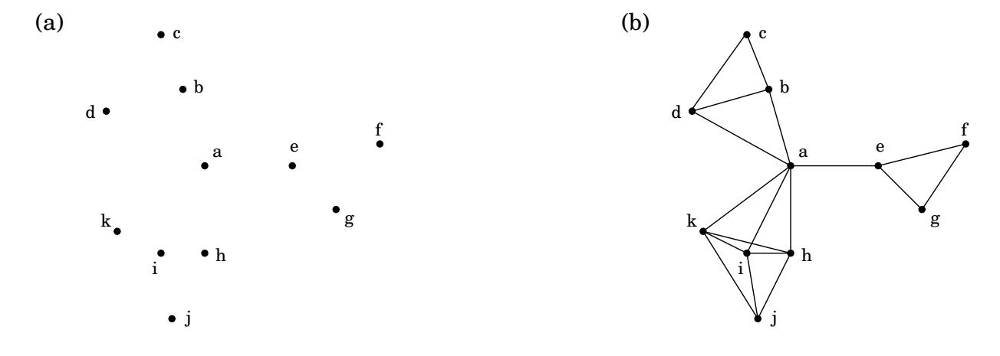
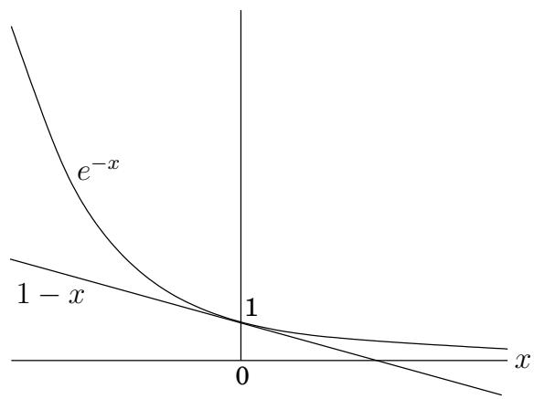

import Guide from '@/components/Guide.astro';
import Knowledge from '@/components/Knowledge.astro';
import Example from '@/components/Example.astro';
import Analysis from '@/components/Analysis.astro';
import Solution from '@/components/Solution.astro';
import Variant from '@/components/Variant.astro';
import Note from '@/components/Note.astro';
import Block from '@/components/Block.astro';
import Method from '@/components/Method.astro';
import Exercise from '@/components/Exercise.astro';

## 5.4 设置封面

图 5.11 中的点代表城镇的集合。该县正处于规划的早期阶段，正在决定学校的选址。只有两个限制：每所学校都应该位于一个城镇，并且任何人都不应行驶超过 30 英里才能到达其中一所学校。最少需要多少所学校？

这是一个典型的集合覆盖问题。对于每个城镇 x，令 $S _ { x }$ 为其 30 英里范围内的城镇集合。 x 的学校基本上将“覆盖”这些其他城镇。那么问题是，需要选取多少组 $S _ { x }$ 才能覆盖该县的所有城镇？

套盖

输入：一组元素 $B ;$ 集 $S _ { 1 } , \dots , S _ { m } \subseteq B$

输出： $S _ { i }$ 的选择，其并集为 $B .$ 。

成本：挑选的组数。

（在我们的示例中，B 的元素是城镇。）这个问题立即适合贪婪的解决方案：

图 5.11 (a) 11 个乡镇。 (b) 彼此相距 30 英里以内的城镇。

重复直到 B 的所有元素都被覆盖：

选择未覆盖元素数量最多的集合 $S _ { i }$。

这是极其自然和直观的。让我们看看它在前面的示例中会做什么：它首先会在 $^ { a , }$ 镇放置一所学校，因为该镇覆盖了最多数量的其他城镇。此后，它将再选择三所学校 - c、j 以及 $f$ 或 $g { \mathrm { - } } \mathbf { f o r }$，总共四所学校。然而，存在一个只有三所学校的解决方案，即 $b , e ,$ 和i。贪心方案并不是最优的！

但幸运的是，它离最佳状态并不算太远。

假设 B 包含 n 个元素，并且最优覆盖由 k 组组成。然后 k ln n 2

令 $n _ { t }$ 为贪婪算法 t 次迭代后仍未覆盖的元素数量（因此 $n _ { 0 } = n )$ 。由于这些剩余元素被最优 k 集合覆盖，因此必须存在某个集合至少包含 $n _ { t } / k$ 。因此，贪婪策略将确保

$$
n _ {t + 1} \leq n _ {t} - \frac {n _ {t}}{k} = n _ {t} \left(1 - \frac {1}{k}\right),
$$

通过重复应用意味着 $n _ { t } \le n _ { 0 } ( 1 - 1 / k ) ^ { t }$。可以从有用的不等式中获得更方便的界限

$1 - x \leq e ^ { - x }$ 对于所有 x，当且仅当 $x = 0 _ { i }$ 相等

最容易用一张图来证明：

因此

$$
n _ {t} \leq n _ {0} \left(1 - \frac {1}{k}\right) ^ {t} <   n _ {0} (e ^ {- 1 / k}) ^ {t} = n e ^ {- t / k}.
$$

因此，在 $t = k$ ln n 处，$n _ { t }$ 严格小于 $n e ^ { - \ln n } = 1$ ，这意味着没有元素需要被覆盖。

贪心算法的解与最优解之间的比率因输入而异，但始终小于 ln $n .$ 。并且某些输入的比率非常接近 ln n （练习 5.33）。我们将这个最大比率称为贪心算法的近似因子。似乎还有很大的改进空间，但实际上这样的希望是不合理的：事实证明，在某些广泛持有的复杂性假设下（当我们到达第 8 章时会更清楚），可以证明不存在具有更小的逼近因子的多项式时间算法。