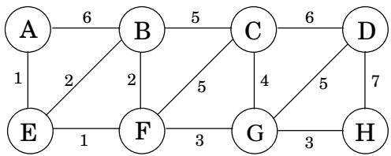
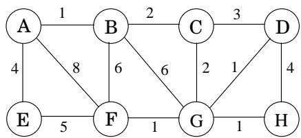

import Guide from '@/components/Guide.astro';
import Knowledge from '@/components/Knowledge.astro';
import Example from '@/components/Example.astro';
import Analysis from '@/components/Analysis.astro';
import Solution from '@/components/Solution.astro';
import Variant from '@/components/Variant.astro';
import Note from '@/components/Note.astro';
import Block from '@/components/Block.astro';
import Method from '@/components/Method.astro';
import Exercise from '@/components/Exercise.astro';
import Algorithm from '@/components/Algorithm.astro';

## 第 5 章练习

<Exercise title="Exercise 5.1">

考虑下图。

(a) 其最小生成树的代价是多少？

(b) 它有多少个最小生成树？

(c) 假设在此图上运行 Kruskal 算法。边以什么顺序添加到 MST 中？对于该序列中的每条边，给出一个剪切以证明其添加的合理性。

</Exercise>

<Exercise title="Exercise 5.2">

假设我们想要找到下图的最小生成树。

(a) 运行Prim的算法；每当有节点选择时，始终使用字母顺序（例如，从节点 A 开始）。绘制一个表格，显示成本数组的中间值。

(b) 在同一张图上运行 Kruskal 算法。假设使用路径压缩，展示不相交集数据结构在每个中间阶段（包括有向树的结构）的外观。

</Exercise>

<Exercise title="Exercise 5.3">

为以下任务设计线性时间算法。

输入：连通的无向图 G。

问题：是否有一条边可以从 G 中移除，同时仍保持 G 连接？

您能否将算法的运行时间减少到 $O ( | V | ) ?$

</Exercise>

<Exercise title="Exercise 5.4">

证明如果一个有 n 个顶点的无向图有 k 个连通分量，那么它至少有 $n - k$ 条边。

</Exercise>

<Exercise title="Exercise 5.5">

考虑一个具有非负边权重 $w _ { e } \geq 0$ 的无向图 $G = ( V , E )$ 。假设您已经计算了 $G ,$ 的最小生成树，并且还计算了从特定节点 $s \in V$ 到所有节点的最短路径

现在假设每条边权重增加 1：新权重为 $w _ { e } ^ { \prime } = w _ { e } + 1$

(a) 最小生成树是否改变？举一个它改变的例子或者证明它不能改变。

(b) 最短路径会改变吗？举一个他们改变或证明他们无法改变的例子。

</Exercise>

<Exercise title="Exercise 5.6">

令 $G = ( V , E )$ 为无向图。证明如果它的所有边权都不同，那么它有一个唯一的最小生成树。

</Exercise>

<Exercise title="Exercise 5.7">

展示如何找到图的最大生成树，即总权值最大的生成树。

</Exercise>

<Exercise title="Exercise 5.8">

假设给你一个加权图 $G = ( V , E )$ ，它有一个显着的顶点 s ，并且所有边的权重都是正的且不同。从 s 开始的最短路径树和 G 中的最小生成树是否可以不共享任何边？如果是这样，请举个例子。如果没有，请给出理由。

</Exercise>

<Exercise title="Exercise 5.9">

以下陈述可能正确，也可能不正确。在每种情况下，要么证明它（如果它是正确的），要么给出一个反例（如果它不正确）。始终假设图 $G = ( V , E )$ 是无向的。除非特别说明，否则不要假设边权重是不同的。

(a) 如果图 G 具有多于 V 1 条边，并且存在唯一的最重边，则该边不能是最小生成树的一部分。

(b) 如果 G 具有一个具有唯一最重边 e 的环，则 e 不能是任何 MST 的一部分。

(c) 令 e 为 G 中最小权重的任意边。那么 e 必定是某个 MST 的一部分。

(d) 如果图中最亮的边是唯一的，那么它一定是每个 MST 的一部分。

(e) 如果 e 是 G 的某个 MST 的一部分，那么它一定是穿过 G 的某个切口的最轻边。

(f) 如果 G 具有一个具有唯一最轻边 e 的环，则 e 必须是每个 MST 的一部分。

(g) Dijkstra 算法计算出的最短路径树必然是 MST。

(h) 两个节点之间的最短路径必然是某个 MST 的一部分。

(i) 当存在负边沿时，Prim 算法可以正确工作。

(j) （对于任何 $r > 0 ,$，定义一条r路径为边都具有权重的路径 $< r . )$，如果G包含从节点s到t的r路径，则G的每个MST也必须包含从节点s到节点t的r路径。

</Exercise>

<Exercise title="Exercise 5.10">

令 T 为图 G 的 MST。给定 G 的连通子图 H，证明 $T \cap H$ 包含在 H 的某个 MST 中。

</Exercise>

<Exercise title="Exercise 5.11">

从单例集 $\{ 1 \} , \ldots , \{ 8 \}$ 开始，给出以下操作序列后不相交集数据结构的状态。使用路径压缩。如果是平局，请始终使编号较低的根指向编号较高的根。

联合(1, 2), 联合(3, 4), 联合(5, 6), 联合(7, 8), 联合(1, 4), 联合(6, 7), 联合(4, 5), 查找(1)

</Exercise>

<Exercise title="Exercise 5.12">

假设您使用按并集而不是路径压缩来实现不相交集数据结构。给出一个由 m 个元素组成的并集和查找运算，需要 Ω(m log n) 时间。

</Exercise>

<Exercise title="Exercise 5.13">

一个长字符串由四个字符 $A , C , G , T ;$ 组成，它们出现的频率分别为31%、20%、9%和40%。这四个字符的霍夫曼编码是什么？

</Exercise>

<Exercise title="Exercise 5.14">

假设符号 $a , b , c , d ,$ e 出现的频率分别为 $1 / 2 , 1 / 4 , 1 / 8 , 1 / 1 6 , 1 / 1 6 ,$ 。

(a) 字母表的霍夫曼编码是什么？

(b) 如果将此编码应用于包含给定频率的 1,000,000 个字符的文件，则编码文件的长度（以位为单位）是多少？

</Exercise>

<Exercise title="Exercise 5.15">

我们使用霍夫曼算法获得字母表 $\{ a , b , c \}$ 和频率 $f _ { a } , f _ { b } , f _ { c } .$ 的编码。在以下每种情况下，要么给出一个可以产生指定代码的频率 $( f _ { a } , f _ { b } , f _ { c } )$ 的示例，要么解释为什么不可能获得该代码（无论频率是多少）。

(a) 代码：0、10、11

(b) 代码：0、1、00

(c) 代码： &#123; 10, 01， 00 &#125;

</Exercise>

<Exercise title="Exercise 5.16">

证明霍夫曼编码方案的以下两个性质。

(a) 如果某个字符出现的频率超过 $2 / 5 ,$ ，则保证存在长度为 1 的码字。

(b) 如果所有字符出现的频率都小于 $1 / 3 ,$，则保证不存在长度为 1 的码字。

</Exercise>

<Exercise title="Exercise 5.17">

在频率为 $f _ { 1 } , f _ { 2 } , \ldots , f _ { n }$ 的 n 个符号的霍夫曼编码下，码字的最长可能是多少？给出会产生这种情况的一组频率示例。

</Exercise>

<Exercise title="Exercise 5.18">

下表给出了特定语料库中英语字母（包括分隔单词的空格）的频率。

$$
\begin{array}{c c c c c c} \text {blank} & 1 8.3\% & \text {r} & 4.8\% & \text {y} & 1.6\% \\ \text {e} & 10.2\% & \text {d} & 3.5\% & \text {p} & 1.6\% \\ \text {t} & 7.7\% & \text {l} & 3.4\% & \text {b} & 1.3\% \\ \text {a} & 6.8\% & \text {c} & 2.6\% & \text {v} & 0.9\% \\ \text {o} & 5.9\% & \text {u} & 2.4\% & \text {k} & 0.6\% \\ \text {i} & 5.8\% & \text {m} & 2.1\% & \text {j} & 0.2\% \\ \text {n} & 5.5\% & \text {w} & 1.9\% & \text {x} & 0.2\% \\ \text {s} & 5.1\% & \text {f} & 1.8\% & \text {q} & 0.1\% \\ \text {h} & 4.9\% & \text {g} & 1.7\% & \text {z} & 0.1\% \end{array}
$$

(a) 该字母表的最佳霍夫曼编码是什么？

(b) 每个字母的预期位数是多少？

(c) 假设现在我们计算这些频率的熵

$$
H = \sum_ {i = 0} ^ {2 6} p _ {i} \log {\frac {1}{p _ {i}}}
$$

（参见第 150 页的方框）。您希望它比您上面的答案更大还是更小？解释一下。

(d) 你认为这是否是英语文本可以压缩的极限？除了字母及其频率之外，更好的压缩方案还应该考虑英语的哪些特征？

</Exercise>

<Exercise title="Exercise 5.19">

熵。考虑 n 个可能结果的分布，概率为 $p _ { 1 } , p _ { 2 } , \ldots , p _ { n } .$

(a) 仅对于问题的这一部分，假设每个 $p _ { i }$ 是 2 的幂（即，形式为 $1 / 2 ^ { k } )$ ）。假设从分布中提取 m 个样本的长序列，并且对于所有 $1 \leq i \leq n ,$ ，$i ^ { \mathrm { t h } }$ 结果恰好出现序列中的 $m p _ { i }$ 次表明，如果对该序列应用霍夫曼编码，则所得编码将具有长度。

$$
\sum_ {i = 1} ^ {n} m p _ {i} \log {\frac {1}{p _ {i}}}.
$$

(b) 现在考虑任意分布，即概率 $p _ { i }$ 不限于 2 的幂。分布中随机性最常用的度量是熵

$$
\sum_ {i = 1} ^ {n} p _ {i} \log {\frac {1}{p _ {i}}}.
$$

对于哪种分布（针对 n 个结果），熵是最大可能的？最小的可能吗？

</Exercise>

<Exercise title="Exercise 5.20">

给出一个线性时间算法，该算法将树作为输入并确定它是否具有完美匹配：一组与每个节点恰好接触一次的边。

无向图 $G = ( V , E )$ 的反馈边集是与图的每个周期相交的边 $E ^ { \prime } \subseteq E$ 的子集。因此，删除边 $E ^ { \prime }$ 将使图呈现非循环。

给出解决以下问题的有效算法：

输入：具有正边权重 $w _ { e }$ 的无向图 $G = ( V , E )$

输出：最小总权重 $\textstyle \sum _ { e \in E ^ { \prime } } w _ { e }$ 的反馈边集 $E ^ { \prime } \subseteq E$

</Exercise>

<Exercise title="Exercise 5.21">

在这个问题中，我们将开发一种新的算法来寻找最小生成树。它基于以下属性：

选择图中的任意环，并令 e 为该环中最重的边。那么有一个不包含e的最小生成树。

(a) 仔细证明该性质。

(b) 这是新的 MST 算法。输入是一些无向图 $G = ( V , E )$ （邻接列表格式），其边权重为 $\{ w _ { e } \}$

<Algorithm>
根据边的权重对边进行排序
对于每条边 $e \in E$，按 $w_e$ 降序排列：
    如果 e 是 G 循环的一部分：
        G = G - e（即从G中去掉e）
返回G
</Algorithm>

证明这个算法是正确的。

(c) 在每次迭代中，算法必须检查是否存在包含特定边 e 的循环。给出该任务的线性时间算法，并证明其正确性。

(d) 该算法花费的总时间是多少（用 E 表示）？解释你的答案。

</Exercise>

<Exercise title="Exercise 5.22">

给你一个带有正边权重的图 $G = ( V , E )$，以及一个关于这些权重的最小生成树 $T = \left( V , E ^ { \prime } \right)$；您可以假设 G 和 T 作为邻接表给出。现在假设特定边 $e \in E$ 的权重从 $w ( e )$ 修改为新值 $\hat { w } ( e )$ 。您希望快速更新最小生成树 T 以反映此更改，而不需要从头开始重新计算整个树。有四种情况。在每种情况下给出更新树的线性时间算法。

(a) $e \notin E ^ { \prime }$ 和 ${ \hat { w } } ( e ) > w ( e )$

(b) $e \notin E ^ { \prime }$ 和 $\hat { w } ( e ) < w ( e )$

(c) $e \in E ^ { \prime }$ 和 $\hat { w } ( e ) < w ( e )$

(d) $e \in E ^ { \prime }$ 和 ${ \hat { w } } ( e ) > w ( e )$

</Exercise>

<Exercise title="Exercise 5.23">

有时我们需要具有某些特殊属性的光跨越树。这是一个例子。

输入：无向图 $G = ( V , E )$；边权重 $w _ { e } ;$ 顶点子集 $U \subset V$

输出：最轻的生成树，其中 U 的节点是叶子（该树中也可能有其他叶子）。

（答案不一定是最小生成树。）

给出该问题的算法，该算法在 $O ( | E | \log | V | )$ 时间内运行。 （提示：当你从最优解中删除节点 U 时，还剩下什么？）

</Exercise>

<Exercise title="Exercise 5.24">

未指定长度的二进制计数器支持两种操作：递增（将其值加一）和重置（将其值设置回零）。表明，从最初为零的计数器开始，任何 n 个递增和重置操作序列都需要时间 $O ( n ) ;$，即每个操作的摊余时间为 $O ( 1 )$

</Exercise>

<Exercise title="Exercise 5.25">

这是自动程序分析中出现的一个问题。对于一组变量 $x _ { 1 } , \ldots , x _ { n } ,$，您将获得一些形式为 $^ { \ast } x _ { i } = { x _ { j } } ^ { \ast }$ 的等式约束和一些形式为 $^ { \ast } x _ { i } \neq x _ { j } . ^ { \ast }$ 的不等式约束，是否可以满足所有这些约束？

例如，约束条件

$$
x _ {1} = x _ {2}, x _ {2} = x _ {3}, x _ {3} = x _ {4}, x _ {1} \neq x _ {4}
$$

无法满足。给出一个有效的算法，该算法将 n 个变量的 m 个约束作为输入，并决定是否可以满足约束。

</Exercise>

<Exercise title="Exercise 5.26">

具有规定度数序列的图表。给定一个包含 n 个正整数的列表 $d _ { 1 } , d _ { 2 } , \ldots , d _ { n } .$ ，我们想要有效地确定是否存在一个无向图 $G = ( V , E )$ ，其节点的度数精确为 $d _ { 1 } , d _ { 2 } , \ldots , d _ { n }$ 。也就是说，如果 $V = \{ v _ { 1 } , \ldots , v _ { n } \}$ ，那么 $v _ { i }$ 的度数应该恰好是 $d _ { i } .$ 。我们将 $( d _ { 1 } , \ldots , d _ { n } )$ 称为度数序列 $o f G$ 。该图 G 不应包含自环（两个端点等于同一节点的边）或同一对节点之间的多条边。

(a) 给出一个 $d _ { 1 } , d _ { 2 } , d _ { 3 } , d _ { 4 }$ 的例子，其中所有 $d _ { i } \leq 3$ 和 $d _ { 1 } + d _ { 2 } + d _ { 3 } + d _ { 4 }$ 都是偶数，但不存在度数序列为 $( d _ { 1 } , d _ { 2 } , d _ { 3 } , d _ { 4 } )$ 的图。

(b) 假设 $d _ { 1 } \geq d _ { 2 } \geq \cdot \cdot \cdot \geq d _ { n }$ 且存在度数序列为 $( d _ { 1 } , \ldots , d _ { n } )$ 的图 $G = ( V , E )$ 。我们想要证明，必须存在一个具有此度数序列的图，并且另外 $v _ { 1 }$ 的邻居是 $v _ { 2 } , v _ { 3 } , \ldots , v _ { d _ { 1 } + 1 }$ 这个想法是逐渐将 G 转换为具有所需附加属性的图。

岛假设 $G$ 中 $v _ { 1 }$ 的邻居不是 $v _ { 2 } , v _ { 3 } , \ldots , v _ { d _ { 1 } + 1 }$ 。证明存在 $i <$ $j \leq n$ 和 $u \in V$ 使得 $\{ v _ { 1 } , v _ { i } \} , \{ u , v _ { j } \} \notin E$ 和 $\{ v _ { 1 } , v _ { j } \} , \{ u , v _ { i } \} \in E$

二.指定对 G 进行的更改，以获得新图 $G ^ { \prime } = ( V , E ^ { \prime } )$，其度数序列与 $G$ 相同，其中 $( v _ { 1 } , v _ { i } ) \in E ^ { \prime }$

三.现在证明必须存在一个具有给定度数序列的图，但其中 $v _ { 1 }$ 具有邻居 v2、$v _ { 3 } , \ldots , v _ { d _ { 1 } + 1 }$

(c) 使用 (b) 部分的结果，描述一种算法，该算法根据输入 $d _ { 1 } , \ldots , d _ { n }$ （不一定已排序）决定是否存在具有此度数序列的图。您的算法应该在 n 和 $\textstyle m = \sum _ { i = 1 } ^ { n } d _ { i }$ 中运行时间多项式

</Exercise>

<Exercise title="Exercise 5.27">

爱丽丝想要举办一个聚会，正在决定给谁打电话。她有n个人可供选择，并且她已经列出了其中哪些人彼此认识的名单。她想挑选尽可能多的人，但有两个限制：在聚会上，每个人应该至少有五个他们认识的人和另外五个他们不认识的人。

给出一个有效的算法，将 n 个人的列表和彼此认识的配对列表作为输入，并输出聚会受邀者的最佳选择。给出以 n 为单位的运行时间。

</Exercise>

<Exercise title="Exercise 5.28">

有限字母表 γ 的无前缀编码为 γ 中的每个符号分配一个二进制码字，使得没有码字是另一个码字的前缀。

证明这样的编码可以用完整的二叉树来表示，其中每个叶子对应于 Γ 的一个唯一元素，其码字是由从根到该叶子的路径生成的（将左分支解释为 0，将右分支解释为 1）。

</Exercise>

<Exercise title="Exercise 5.29">

三元霍夫曼。 Trimedia Disks Inc. 开发了“三态”硬盘。磁盘上的每个单元现在可以存储值 0、1 或 2（而不仅仅是 0 或 1）。为了利用这项新技术，请提供修改后的霍夫曼算法，用于压缩大小为 $n ,$ 的字母表中的字符序列，其中字符以已知频率 $f _ { 1 } , f _ { 2 } , \ldots , f _ { n } .$ 出现。您的算法应该使用值 0、1、2 上的可变长度码字对每个字符进行编码，这样没有码字是另一个码字的前缀，从而获得最大可能的压缩。证明你的算法是正确的。

</Exercise>

<Exercise title="Exercise 5.30">

霍夫曼算法背后的基本直觉，即频繁的块应该有短的编码，不频繁的块应该有长的编码，在英语中也起作用，典型的单词，如 I、you、is、and、to、from 等都很短，而很少使用的单词，如 velociraptor 则较长。

然而，像“火！”、“救命！”和“跑！”这样的词。时间短并不是因为它们频繁，而是因为在使用它们的情况下时间很宝贵。

为了使事情变得理论化，假设我们有一个由 m 个不同单词组成的文件，其频率为 $f _ { 1 } , \ldots , f _ { m }$ 。还假设对于第 i 个字，每位编码的成本为 $c _ { i } .$ 。因此，如果我们找到一个无前缀代码，其中第 i 个单词的码字长度为 $l _ { i } ,$ ，那么编码的总成本将为 $\textstyle \sum _ { i } f _ { i } \cdot c _ { i } \cdot l _ { i }$

展示如何修改霍夫曼算法来找到总成本最小的无前缀编码。

</Exercise>

<Exercise title="Exercise 5.31">

一个服务员有n个顾客等待服务。每个客户所需的服务时间是预先知道的：客户 i 为 $t _ { i }$ 分钟。因此，例如，如果按照增加 $i ,$ 的顺序为客户提供服务，则第 i 个客户必须等待 $\textstyle \sum _ { j = 1 } ^ { i } t _ { j }$ 分钟。

我们希望尽量减少总等待时间

$$
T = \sum_ {i = 1} ^ {n} (\text { time   spent   waiting   by   customer } i).
$$

给出一个有效的算法来计算处理客户的最佳顺序。

</Exercise>

<Exercise title="Exercise 5.32">

展示如何及时实现 Horn 公式可满足性（第 5.3 节）的吝啬算法，该算法与公式长度（其中文字出现的次数）呈线性关系。 （提示：使用有向图，每个变量一个节点，来表示含义。）

</Exercise>

<Exercise title="Exercise 5.33">

证明对于任何 2 的幂的整数 n，都存在一个具有以下属性的集合覆盖问题的实例（第 5.4 节）：

岛基集中有 n 个元素。

二.最佳封面仅使用两套。

三.贪心算法至少选择 log n 个集合。

因此，我们在本章中得出的近似比率是严格的。

</Exercise>