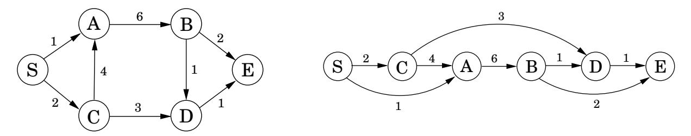

import Guide from '@/components/Guide.astro';
import Knowledge from '@/components/Knowledge.astro';
import Example from '@/components/Example.astro';
import Analysis from '@/components/Analysis.astro';
import Solution from '@/components/Solution.astro';
import Variant from '@/components/Variant.astro';
import Note from '@/components/Note.astro';
import Block from '@/components/Block.astro';
import Method from '@/components/Method.astro';
import Exercise from '@/components/Exercise.astro';
import Algorithm from '@/components/Algorithm.astro';

## 第 6 章：动态规划

在前面的章节中，我们已经看到了一些优雅的设计原则，例如分而治之、图探索和贪婪选择，它们为各种重要的计算任务产生了明确的算法。这些工具的缺点是它们只能用于非常特定类型的问题。现在我们转向算法技术的两个大锤，动态规划和线性规划，这些技术具有非常广泛的适用性，当更专业的方法失败时可以调用它们。可以预见的是，这种普遍性往往会以效率为代价。

## 6.1 dags 中的最短路径，重新审视

在我们对最短路径的研究结束时（第 4 章），我们发现这个问题在有向无环图（dags）中特别容易。让我们回顾一下这个案例，因为它是动态规划的核心。

dag 的特殊之处在于它的节点可以线性化；也就是说，它们可以排列在一条线上，以便所有边都从左到右（图 6.1）。要了解为什么这有助于最短路径，假设我们想要计算从节点 S 到其他节点的距离。具体来说，让我们关注节点 D。到达它的唯一方法是通过它的前辈 B 或 $C ;$，因此要找到到 D 的最短路径，我们只需要比较这两条路线：

$$
\operatorname{dist} (D) = \min \{\operatorname{dist} (B) + 1, \operatorname{dist} (C) + 3 \}.
$$

可以为每个节点编写类似的关系。如果我们计算这些 dist 值

图 6.1 dag 及其线性化（拓扑排序）。

按照图 6.1 从左到右的顺序，我们总是可以确定，当我们到达节点 v 时，我们已经拥有计算 dist(v) 所需的所有信息。因此，我们能够在一次传递中计算所有距离：

<Algorithm>
将所有 $	ext{dist}(\cdot)$ 值初始化为 $\infty$
$	ext{dist}(s) = 0$
对于每个 $v \in V \setminus \{s\}$，按线性顺序：
    $	ext{dist}(v) = \min_{(u, v) \in E} \{	ext{dist}(u) + \ell(u, v)\}$
</Algorithm>

请注意，该算法正在解决一系列子问题，$\{ \mathsf { d i s t } ( u ) : u \in V \}$。我们从其中最小的 dist(s) 开始，因为我们立即知道它的答案是 0。然后我们继续处理逐渐“更大”的子问题——在线性化中越来越远的顶点的距离——如果我们需要先解决很多其他子问题才能解决这个子问题，那么我们就会认为这个子问题很大。

这是一种非常通用的技术。在每个节点，我们计算该节点前驱值的某个函数。碰巧我们的特定函数是总和的最小值，但我们也可以将其设为最大值，在这种情况下，我们将在 dag 中获得最长的路径。或者我们可以使用乘积而不是括号内的和，在这种情况下，我们最终将计算具有最小边长度乘积的路径。

动态规划是一种非常强大的算法范例，其中通过识别一组子问题并逐一解决它们（首先解决最小的问题）来解决问题，然后使用小问题的答案来帮助找出更大的问题，直到解决所有问题。在动态规划中，我们没有得到任何提示； dag 是隐式的。它的节点是我们定义的子问题，它的边是子问题之间的依赖关系：如果为了解决子问题 B，我们需要子问题 A 的答案，那么从 A 到 B 就存在一条（概念上的）边。在这种情况下，A 被认为是比 B 更小的子问题——而且从明显的意义上来说，它总是会更小。

但现在是我们看一个例子的时候了。