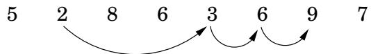
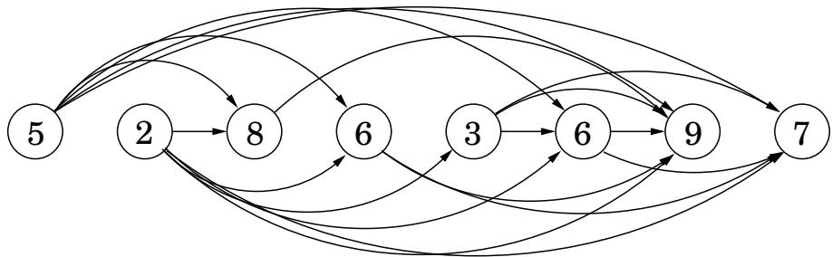
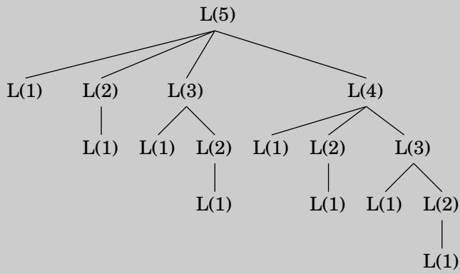

import Guide from '@/components/Guide.astro';
import Knowledge from '@/components/Knowledge.astro';
import Example from '@/components/Example.astro';
import Analysis from '@/components/Analysis.astro';
import Solution from '@/components/Solution.astro';
import Variant from '@/components/Variant.astro';
import Note from '@/components/Note.astro';
import Block from '@/components/Block.astro';
import Method from '@/components/Method.astro';
import Exercise from '@/components/Exercise.astro';

## 6.2 最长递增子序列

在最长递增子序列问题中，输入是数字序列 $a _ { 1 } , \ldots , a _ { n }$ 子序列是按顺序获取的这些数字的任何子集，其形式为 $a _ { i _ { 1 } } , a _ { i _ { 2 } } , \ldots , a _ { i _ { k } }$ 其中 $1 \leq i _ { 1 } < i _ { 2 } < \cdot \cdot \cdot < i _ { k } \leq n$ ，而递增子序列是其中数字严格变得更大的序列。任务是找到最大长度的递增子序列。例如，最长递增子序列 5, 2, 8, 6, 3, 6, 9, 7 是 2, 3, 6, 9：

在此示例中，箭头表示最佳解决方案的连续元素之间的转换。更一般地，为了更好地理解解空间，让我们创建一个所有允许的转换的图：为每个元素 $^ { a _ { i } , }$ 建立一个节点 i，并在 $a _ { i }$ 和 $a _ { j }$ 可能是递增子序列中的连续元素时添加有向边 $( i , j )$，即，每当 $i < j$ 和 $a _ { i } < a _ { j }$（图 6.2）。

图 6.2 递增子序列的 dag。  

请注意，(1) 此图 $G = ( V , E )$ 是一个 dag，因为所有边 $( i , j )$ 都有 $i < j ,$ ，并且 (2) 此 dag 中的递增子序列和路径之间存在一一对应关系。因此，我们的目标只是找到 dag 中最长的路径！

这是算法：

$$
\begin{array}{l} \text {for} j = 1, 2, \ldots , n: \\ L (j) = 1 + \max \{L (i): (i, j) \in E \} \\ \text {return} \max _ {j} L (j) \end{array}
$$

$L ( j )$ 是最长路径的长度——最长的递增子序列——以 $j$ 结束（加 1，因为严格来说我们需要计算路径上的节点，而不是边）。通过与最短路径相同的方式进行推理，我们发现到节点 $j$ 的任何路径都必须经过其前驱节点之一，因此 $L ( j )$ 是 1 加上这些前驱节点的最大 $L ( \cdot )$ 值。如果 $j ,$ 中没有边，我们就取空集上的最大值零。最终答案是最大的 $L ( j )$ ，因为任何结束位置都是允许的。

这就是动态规划。为了解决我们原来的问题，我们定义了子问题的集合 $\{ L ( j ) : 1 \leq j \leq n \}$，具有以下关键属性，允许它们在一次传递中得到解决：

(\*) 子问题有一个排序，以及一个关系，该关系显示如何在给定“较小”子问题（即排序中较早出现的子问题）答案的情况下解决子问题。

在我们的例子中，每个子问题都是使用关系来解决的

$$
L (j) = 1 + \max \{L (i): (i, j) \in E \},
$$

仅涉及较小子问题的表达式。这一步需要多长时间？需要知道 $\cdot _ { j }$ 的前辈；为此，可在线性时间内构造反向图 $G ^ { R }$ 的邻接表（回想练习 3.5），非常方便。 $L ( j )$ 的计算所花费的时间与 $j ,$ 的入度成正比，从而使总体运行时间与 $| E |$ 呈线性关系。这最多为 $O ( n ^ { 2 } )$ ，输入数组按升序排序时的最大值。因此动态规划解决方案既简单又高效。

还有最后一个问题需要解决：L 值仅告诉我们最优子序列的长度，那么我们如何恢复子序列本身呢？这可以使用我们在第 4 章中用于最短路径的相同簿记设备轻松管理。在计算 $L ( j )$ 时，我们还应该记下 $\mathtt { p r e v } ( j )$ ，它是到 $j .$ 的最长路径上的倒数第二个节点。然后可以通过遵循这些反向指针来重建最佳子序列。

<Knowledge title="Box: Recursion? No, thanks">

回到我们对最长递增子序列的讨论：$L ( j )$ 的公式还建议了一种替代的递归算法。那不是更简单吗？

实际上，递归是一个非常糟糕的主意：生成的过程将需要指数时间！要了解原因，假设 dag 包含所有 $i < j \cdot$ 的边 $( i , j )$ — 也就是说，给定的数字序列 $a _ { 1 } , a _ { 2 } , \ldots , a _ { n }$ 已排序。在这种情况下，子问题 $L ( j )$ 的公式变为

$$
L (j) = 1 + \max \{L (1), L (2), \ldots , L (j - 1) \}.
$$

下图揭示了 $L ( 5 )$ 的递归。请注意，相同的子问题会被一遍又一遍地解决！

对于 $L ( n )$，这棵树有指数级数量的节点（你能绑定它吗？），因此递归解决方案是灾难性的。

那么为什么递归在分而治之的情况下效果这么好呢？关键点是，在分治法中，问题是用小得多的子问题来表达的，比如一半大小。例如，归并排序通过递归地对两个大小为 $n / 2$ 的子数组进行排序来对大小为 n 的数组进行排序。由于问题大小急剧下降，完整递归树仅具有对数深度和多项式数量的节点。

相反，在典型的动态规划公式中，问题被简化为仅稍小的子问题，例如， $L ( j )$ 依赖于 $L ( j - 1 )$ 。因此，完整递归树通常具有多项式深度和指数数量的节点。然而，事实证明，这些节点大多数都是重复的，它们之间没有太多不同的子问题。因此，通过显式枚举不同的子问题并按正确的顺序解决它们来获得效率。

</Knowledge>
## 编程？

动态编程这个术语的起源与编写代码关系不大。它是由理查德·贝尔曼 (Richard Bellman) 在 20 世纪 50 年代首次创造的，当时计算机编程还是一项深奥的活动，很少有人参与，甚至连名字都没有。当时，编程意味着“规划”，而“动态编程”被认为是为了优化规划多阶段过程。图 6.2 的 dag 可以被认为描述了这样一个过程可能演化的方式：每个节点表示一个状态，最左边的节点是起点，离开状态的边代表可能的动作，导致下一个单位时间的不同状态。

第 7 章的主题线性规划的词源是相似的。