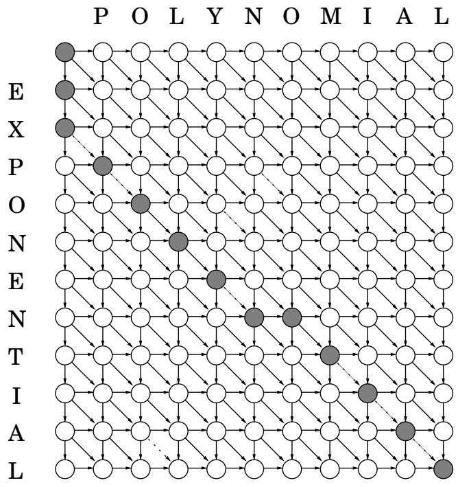
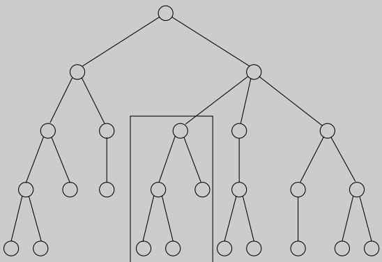

import Guide from '@/components/Guide.astro';
import Knowledge from '@/components/Knowledge.astro';
import Example from '@/components/Example.astro';
import Analysis from '@/components/Analysis.astro';
import Solution from '@/components/Solution.astro';
import Variant from '@/components/Variant.astro';
import Note from '@/components/Note.astro';
import Block from '@/components/Block.astro';
import Method from '@/components/Method.astro';
import Exercise from '@/components/Exercise.astro';
import Algorithm from '@/components/Algorithm.astro';

## 6.3 编辑距离

当拼写检查器遇到可能的拼写错误时，它会在字典中查找附近的其他单词。在这种情况下，适当的亲密概念是什么？

两个字符串之间距离的自然度量是它们可以对齐或匹配的程度。从技术上讲，对齐只是将字符串写在另一个之上的一种方式。例如，以下是 SNOWY 和 SUNNY 的两种可能的对齐方式：

$$
\begin{array}{c c c c c c} \text {S} & - & \text {N} & \text {O} & \text {W} & \text {Y} \\ \text {S} & \text {U} & \text {N} & \text {N} & - & \text {Y} \\ \hline & & \text {Cost: 3} \end{array} \qquad \qquad \begin{array}{c c c c c c} - & \text {S} & \text {N} & \text {O} & \text {W} & - & \text {Y} \\ \text {S} & \text {U} & \text {N} & - & - & \text {N} & \text {Y} \\ \hline & & & & & \text {Cost: 5} \end{array}
$$

“ ”表示 $\boldsymbol { \mathfrak { s a p } } ^ { \mathfrak { n } } ;$ 任意数量的这些都可以放置在任一字符串中。对齐的成本是字母不同的列数。两个字符串之间的编辑距离是它们最佳对齐的成本。您是否发现没有比此处显示的成本为 3 的 SNOWY 和 SUNNY 对齐方式更好的了？

编辑距离之所以如此命名，是因为它也可以被视为将第一个字符串转换为第二个字符串所需的最小编辑次数（插入、删除和替换字符）。例如，左侧显示的对齐方式对应于三个编辑：插入 U、替换 $0 \longrightarrow \mathbb { N } ,$ 和删除 W。

一般来说，两个字符串之间存在多种可能的对齐方式，因此在所有字符串中搜索最佳对齐方式的效率非常低。相反，我们转向动态规划。

## 动态规划解决方案

当用动态规划解决问题时，最关键的问题是，子问题是什么？只要它们被选择为具有第 163 页中的属性 (\*)。写出算法是一件容易的事情：按照大小增加的顺序迭代地解决一个又一个的子问题。

我们的目标是找到两个字符串 $x [ 1 \cdots m ]$ 和 $y [ 1 \cdots n ]$ 之间的编辑距离。什么是好的子问题？嗯，它应该是解决整个问题的一部分；那么如何查看第一个字符串的某些前缀 $x [ 1 \cdots i ]$ 和第二个字符串的某些前缀 $y [ 1 \cdots j ] ?$ 之间的编辑距离，将此子问题称为 $E ( i , j )$ （见图 6.3）。那么，我们的最终目标是计算 $E ( m , n )$

图 6.3 子问题 E(7, 5)。

<table> <tr> <td colspan="2">指数</td> </tr> <tr> <td colspan="2">多项式</td> </tr> </table>

为了实现这一点，我们需要以某种方式用更小的子问题来表达 $E ( i , j )$。让我们看看 - 我们对 $x [ 1 \cdots i ]$ 和 $y [ 1 \cdots j ] \dag$ 之间的最佳对齐了解多少？嗯，它最右边的列只能是以下三项之一：

$$
\begin{array}{c c c c c} x [ i ] & \mathbf {o r} & - & \mathbf {o r} & x [ i ] \\ - & & y [ j ] & & y [ j ] \end{array}
$$

第一种情况对该特定列的成本为 1，并且仍然需要将 $x [ 1 \cdots i - 1 ]$ 与 $y [ 1 \cdots j ]$ 对齐。但这正是子问题 $E ( i - 1 , j ) !$ 我们似乎有所进展。在第二种情况下，同样成本为 1，我们仍然需要将 $x [ 1 \cdots i ]$ 与 $y [ 1 \cdot \cdot \cdot j - 1 ]$ 对齐。这又是另一个子问题，$E ( i , j - 1 )$。在最后一种情况下，成本为 $1 ( \mathrm { i f } x [ i ] \neq y [ j ] )$ 或 $0 \ ( \mathrm { i f } \ x [ i ] = y [ j ] )$ ，剩下的就是子问题 $E ( i - 1 , j - 1 )$ 。简而言之，我们用三个较小的子问题 $E ( i - 1 , j ) , E ( i , j - 1 ) , E ( i - 1 , j - 1 )$ 来表达 $E ( i , j )$ 。我们不知道哪一个是正确的，所以我们需要尝试所有并选择最好的：

$$
E (i, j) = \min \{1 + E (i - 1, j), 1 + E (i, j - 1), \operatorname{diff} (i, j) + E (i - 1, j - 1) \}
$$

其中为了方便起见，$\operatorname { d i f f } ( i , j )$ 定义为 $0 \ \mathrm { i f } \ x [ i ] = y [ j ]$，否则定义为1。

例如，在计算 EXPONENTIAL 和 POLYNOMIAL 之间的编辑距离时，子问题 $E ( 4 , 3 )$ 对应于前缀 EXPO 和 POL。最佳对齐的最右列必须是以下之一：

$$
\begin{array}{c c c c c} & \text {O} & - & \text {O} \\ & - & \text {or} & \text {L} & \text {or} \\ & & & & \text {L} \\ \text {Thus,} E (4, 3) = \min \{1 + E (3, 3), 1 + E (4, 2), 1 + E (3, 2) \}. \end{array}
$$

所有子问题 $E ( i , j )$ 的答案形成一个二维表，如图6.4所示。这些子问题应该按什么顺序解决？任何顺序都可以，只要 $E ( i - 1 , j )$ $E ( i , j - 1 )$ 和 $E ( i - 1 , j - 1 )$ 在 $E ( i , j )$ 之前处理。例如，我们可以一次填充表格一行，从顶行到底行，并在每一行中从左到右移动。或者，我们也可以逐列填写。这两种方法都可以确保当我们开始计算特定的表条目时，我们需要的所有其他条目都已填充。

指定了子问题和顺序后，我们就快完成了。只剩下动态规划的“基本情况”，即最小的子问题。目前的情况是 $E ( 0 , \cdot )$ 和 $E ( \cdot , 0 )$ ，这两个问题都很容易解决。 $E ( 0 , j )$ 是 x 的 0 长度前缀（即空字符串）与 $y \colon$ 的前 $j$ 字母之间的编辑距离，显然是 j。同样，$E ( i , 0 ) = i$

至此，编辑距离的算法基本上就自己写好了。

图 6.4 (a) 子问题表。需要输入 $E(i-1,j-1)$、$E(i-1,j)$ 和 $E(i,j-1)$ 来填写 $E(i,j)$。 (b) 通过动态规划找到的最终值表。

(一)

<table> <tr> <td> </td> <td>j-1</td> <td>j</td> <td>n</td> </tr> <tr> <td>i-1</td> <td> </td> <td> </td> <td> </td> </tr> <tr> <td>i</td> <td> </td> <td> </td> <td> </td> </tr> <tr> <td>m</td> <td> </td> <td> </td> <td> </td> </tr> </table>

(二)

<table> <tr> <td> </td> <td> P</td> <td>O</td> <td>L</td> <td>Y</td> <td>N</td> <td>O</td> <td>M</td> <td>I</td> <td>A</td> <td>L</td> </tr> <tr> <td rowspan="2">E</td> <td>0</td> <td>1</td> <td>2</td> <td>3</td> <td>4</td> <td>5</td> <td>6</td> <td>7</td> <td>8</td> <td>9</td> </tr> <tr> <td>1</td> <td>1</td> <td>2</td> <td>3</td> <td>4</td> <td>5</td> <td>6</td> <td>7</td> <td>8</td> <td>9</td> </tr> <tr> <td>X</td> <td>2</td> <td>2</td> <td>2</td> <td>3</td> <td> 4</td> <td>5</td> <td>6</td> <td>7</td> <td>8</td> <td>9</td> </tr> <tr> <td>P</td> <td>3</td> <td>2</td> <td>3</td> <td>3</td> <td>4</td> <td>5</td> <td>6</td> <td>7</td> <td>8</td> <td>9</td> </tr> <tr> <td>O</td> <td>4</td> <td>3</td> <td>2</td> <td>3</td> <td>4</td> <td>5</td> <td>5</td> <td>6</td> <td>7</td> <td>8</td> </tr> <tr> <td>N</td> <td>5</td> <td>4</td> <td>3</td> <td>3</td> <td>4</td> <td>4</td> <td>5</td> <td> 6</td> <td>7</td> <td>8</td> </tr> <tr> <td>E</td> <td>6</td> <td>5</td> <td>4</td> <td>4</td> <td>4</td> <td>5</td> <td>5</td> <td>6</td> <td>7</td> <td>8</td> </tr> <tr> <td>N</td> <td>7</td> <td>6</td> <td>5</td> <td>5</td> <td>5</td> <td>4</td> <td>5</td> <td>6</td> <td>7</td> <td>8</td> </tr> <tr> <td>T</td> <td>8</td> <td>7</td> <td>6</td> <td>6</td> <td>6</td> <td>5</td> <td>5</td> <td>6</td> <td>7</td> <td>8</td> </tr> <tr> <td>I</td> <td>9</td> <td>8</td> <td>7</td> <td>7</td> <td>7</td> <td>6</td> <td>6</td> <td>6</td> <td>6</td> <td>7</td> </tr> <tr> <td>A</td> <td>10</td> <td>9</td> <td>8</td> <td>8</td> <td>8</td> <td>7</td> <td>7</td> <td>7</td> <td>7</td> <td>6</td> </tr> <tr> <td>L</td> <td>11</td> <td>10</td> <td>9</td> <td>8</td> <td>9</td> <td>8</td> <td>8</td> <td>8</td> <td>8 </td> <td>7</td> </tr> </table>

<Algorithm>
对于 $i = 0, 1, 2, \ldots, m$：
    $E(i, 0) = i$
对于 $j = 1, 2, \ldots, n$：
    $E(0, j) = j$
对于 $i = 1, 2, \ldots, m$：
    对于 $j = 1, 2, \ldots, n$：
        $E(i, j) = \min\{E(i - 1, j) + 1, E(i, j - 1) + 1, E(i - 1, j - 1) + 	ext{diff}(i, j)\}$
返回 $E(m, n)$
</Algorithm>

此过程逐行填充表格，并在每行内从左到右填充。每个条目都需要恒定的时间来填充，因此总的运行时间只是表的大小，O(mn)。

在我们的示例中，编辑距离为 6：

$$
\begin{array}{ccccccccc}E & X & P & O & N & E & N & - & T & I & A & L \\ - & - & P & O & L & Y & N & O & M & I & A & L \\ \end{array}
$$

## 底层 dag

每个动态程序都有一个底层的 dag 结构：将每个节点视为代表一个子问题，将每条边视为解决子问题的顺序的优先约束。让节点 $u _ { 1 } , \ldots , u _ { k }$ 指向 v 意味着“只有在知道 $u _ { 1 } , \ldots , u _ { k }$ 的答案后才能解决子问题 v”。

在我们当前的编辑距离应用程序中，底层 dag 的节点对应于子问题，或者等效地对应于表中的位置 $( i , j )$。它的边是优先约束，其形式为 $( i - 1 , j ) \to ( i , j ) , ( i , j - 1 ) \to ( i , j )$ 和 $( i - 1 , j - 1 ) \to ( i , j )$（图 6.5）。事实上，我们可以更进一步，在边缘上放置权重，以便编辑距离由 dag 中的最短路径给出！要看到这一点，请将所有边长度设置为 1，除了 $\{ ( i - 1 , j - 1 ) \to ( i , j ) : x [ i ] = y [ j ] \}$（图中虚线所示），其长度为 0。最终的答案就是节点 $s = ( 0 , 0 )$ 和 $t = ( m , n )$ 之间的距离。显示了一种可能的最短路径，即产生我们之前发现的对齐的路径。在此路径上，每次向下移动都是删除，每次向右移动都是插入，每次对角移动要么是匹配，要么是替换。

通过改变这个 dag 上的权重，我们可以允许编辑距离的广义形式，其中插入、删除和替换具有不同的相关成本。

<Knowledge title="Box: Common subproblems">

找到正确的子问题需要创造力和实验。但有一些标准选择似乎在动态规划中反复出现。

我。输入是 $x _ { 1 } , x _ { 2 } , \ldots , x _ { n }$，子问题是 $x _ { 1 } , x _ { 2 } , \ldots , x _ { i }$

<table> <tr> <td> $x_{1}$ </td> <td> $x_{2}$ </td> <td> $x_{3}$ </td> <td> $x_{4}$ </td> <td> $x_{5}$ </td> <td> $x_{6}$ </td> <td> $x_{7}$ </td> <td> $x_{8}$ </td> <td> $x_{9}$ </td> <td> $x_{10}$ </td> </tr> </table>

因此，子问题的数量是线性的。

二.输入是 $x _ { 1 } , \ldots , x _ { n }$ 和 $y _ { 1 } , \ldots , y _ { m }$ 。子问题是 $x _ { 1 } , \ldots , x _ { i }$ 和 $y _ { 1 } , \ldots , y _ { j }$ 。

<table> <tr> <td> $x_{1}$ </td> <td> $x_{2}$ </td> <td> $x_{3}$ </td> <td> $x_{4}$ </td> <td> $x_{5}$ </td> <td> $x_{6}$ </td> <td> $x_{7}$ </td> <td> $x_{8}$ </td> <td> $x_{9}$ </td> <td> $x_{10}$ </td> </tr> <tr> <td> $y_{1}$ </td> <td> $y_{2}$ </td> <td> $y_{3}$ </td> <td> $y_{4}$ </td> <td> $y_{5}$ </td> <td> $y_{6}$ </td> <td> $y_{7}$ </td> <td> $y_{8}$ </td> <td> </td> <td> </td> </tr> </table>

子问题数量为 $O ( m n )$

三.输入是 $x _ { 1 } , \ldots , x _ { n }$，子问题是 $x _ { i } , x _ { i + 1 } , \dotsc , x _ { j }$

<table> <tr> <td> $ x_{1} $ </td> <td> $ x_{2} $ </td> <td> $ \boxed{x_{3}\quad x_{4}\quad x_{5}\quad x_{6}} $ </td> <td> $ x_{7} $ </td> <td> $ x_{8} $ </td> <td> $ x_{9} $ </td> <td> $ x_{10} $ </td> </tr> </table>

子问题的数量为 $O ( n ^ { 2 } )$ 。

四.输入是有根树。子问题是有根子树。

如果树有n个节点，那么有多少个子问题？

我们已经遇到了前两种情况，其他情况很快就会出现。

</Knowledge>
<Knowledge title="Box: Of mice and men">

我们的身体是非凡的机器：功能灵活，适应新环境，并且能够互动和繁殖。所有这些能力都是由我们每个人独有的程序指定的，这是一个由字母 A、C、G、T 组成的 30 亿个字符长的字符串——我们的 DNA。

任何两个人的 DNA 序列仅相差 0.1% 左右。然而，这仍然留下了 300 万个不同的位置，这足以解释人类的巨大多样性。这些差异具有重大的科学和医学意义——例如，它们可能有助于预测哪些人容易患某些疾病。

DNA 是一个巨大且看似难以理解的程序，但它可以分解为更小的单元，这些单元的作用更加具体，就像子程序一样。这些被称为基因。计算机已经成为理解人类和其他生物体基因的重要工具，以至于计算基因组学现在已经成为一个独立的领域。以下是出现的典型问题的示例。

1. 当发现一个新基因时，深入了解其功能的一种方法是找到与其紧密匹配的已知基因。这对于将小鼠等经过充分研究的物种的知识转移给人类特别有帮助。

该搜索问题的基本原语是定义两个字符串何时大致匹配的有效可计算概念。生物学提出了编辑距离的概括，并且可以使用动态规划来计算它。

接下来的问题是在浩瀚的已知基因丛中进行搜索：数据库 GenBank 的总长度已经超过 1010 个，并且这个数字正在迅速增长。目前选择的方法是 BLAST，它是算法技巧和生物直觉的巧妙结合，使其成为计算生物学中使用最广泛的软件。

2. DNA 测序方法（即确定构成 DNA 的字符串）通常只能找到 500-700 个字符的片段。可以生成数十亿个随机分散的片段，但如何将它们组装成连贯的 DNA 序列呢？一方面，最终序列中任何一个片段的位置都是未知的，必须通过将重叠的片段拼凑在一起来推断。

这些努力的一个典范是 2001 年由两个团体同时完成的人类 DNA 草案：公共资助的人类基因组联盟和私人 Celera Genomics。

3. 当几个物种中的每一个的特定基因都被测序后，这些信息可以用来重建这些物种的进化历史吗？

我们将在本章末尾的练习中探讨这些问题。事实证明，动态规划对于其中一些人以及一般的计算生物学来说是一个非常宝贵的工具。

</Knowledge>