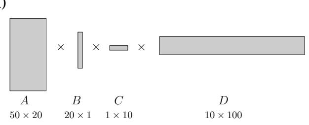
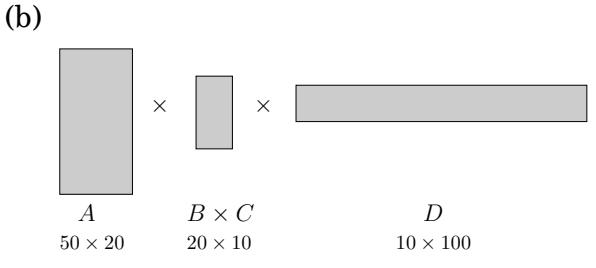
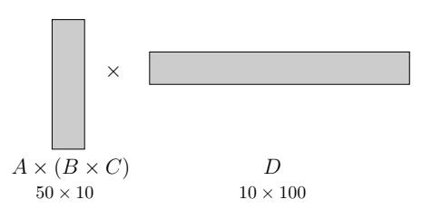
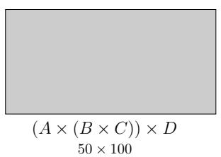

import Guide from '@/components/Guide.astro';
import Knowledge from '@/components/Knowledge.astro';
import Example from '@/components/Example.astro';
import Analysis from '@/components/Analysis.astro';
import Solution from '@/components/Solution.astro';
import Variant from '@/components/Variant.astro';
import Note from '@/components/Note.astro';
import Block from '@/components/Block.astro';
import Method from '@/components/Method.astro';
import Exercise from '@/components/Exercise.astro';
import Algorithm from '@/components/Algorithm.astro';

## 6.4 背包

在一次抢劫中，窃贼发现的赃物比他预期的要多得多，他必须决定拿走什么。他的包（或“背包”）的总重量最多为 W 磅。有 n 个物品可供选择，重量为 $w _ { 1 } , \ldots , w _ { n }$ ，美元价值为 $v _ { 1 } , \ldots , v _ { n }$ 。他可以放入包中的最有价值的物品组合是什么？1

例如，取 W = 10 且

<table> <tr> <td>项目</td> <td>重量</td> <td>值</td> </tr> <tr> <td>1</td> <td>6</td> <td> $30</td></tr><tr><td>2</td><td>3</td><td>$14</td> </tr> <tr> <td>3</td> <td>4</td> <td> $16</td></tr><tr><td>4</td><td>2</td><td>$9</td> </tr> </table>

这个问题有两个版本。如果每种商品的数量不受限制，则最佳选择是选择商品 1 和商品 4 中的两项（总计：48 美元）。另一方面，如果每种物品都有一个（例如，窃贼闯入了一家艺术画廊），则最佳背包包含物品 1 和 3（总计：$46）。

正如我们将在第 8 章中看到的，这个问题的两个版本都不可能有多项式时间算法。然而，使用动态规划，它们都可以在 $O ( n W )$ 时间内解决，当 W 很小时，这是合理的，但不是多项式，因为输入大小与 log W 成正比，而不是与 W 成正比。

## 重复的背包

让我们从允许重复的版本开始。与往常一样，动态规划的主要问题是，子问题是什么？在这种情况下，我们可以通过两种方式缩小原始问题：我们可以查看较小的背包容量 $w \leq W$ ，或者我们可以查看更少的项目（例如，项目 $1 , 2 , \dotsc , j , \operatorname { f o r } j \leq n )$ ）。通常需要进行一些实验才能弄清楚到底什么有效。

第一个限制要求较小的容量。据此，定义

K(w) = 容量为 w 的背包可达到的最大值。

我们可以用更小的子问题来表达这个问题吗？好吧，如果 $K ( w )$ 的最优解包含项目 i，那么从背包中移除该项目就会留下 $K ( w - w _ { i } )$ 的最优解。换句话说，对于某些 i， $K ( w )$ 就是 $K ( w - w _ { i } ) + v _ { i }$ 。我们不知道哪个 $i ,$，所以我们需要尝试所有可能性。

$$
K (w) = \max _ {i: w _ {i} \leq w} \{K (w - w _ {i}) + v _ {i} \},
$$

像往常一样，我们的约定是空集的最大值为 0。我们就完成了！该算法现在是自己编写的，具有简单而优雅的特点。

<Algorithm>
$K(0) = 0$
对于 $w = 1$ 至 $W$：
    $K(w) = \max \{K(w - w_i) + v_i : w_i \leq w\}$
返回 $K(W)$
</Algorithm>

该算法按从左到右的顺序填充长度为 $W + 1$ 的一维表。每个条目最多可能需要 $O ( n )$ 时间来计算，因此总体运行时间为 $O ( n W )$

一如既往，有一个潜在的问题。尝试构建它，您将获得惊人的洞察力：这种特殊的背包变体可以归结为寻找一条路径中的最长路径！

## 不重复的背包

关于第二种变体：如果不允许重复怎么办？我们之前的子问题现在变得完全无用了。例如，知道值 $K ( w - w _ { n } )$ 非常高对我们没有帮助，因为我们不知道第n项是否已经在这个部分解决方案中用完。因此，我们必须完善子问题的概念，以携带有关所使用的项目的附加信息。我们添加第二个参数，$0 \leq j \leq n \colon$

K(w, j) = 使用容量为 w 的背包和物品 $1 , \ldots , j$ 可实现的最大值

我们寻求的答案是 $K ( W , n )$

我们如何用更小的子问题来表达子问题 $K ( w , j )$？非常简单：要么需要项目 $j$ 才能达到最佳值，要么不需要：

$$
K (w, j) = \max \{K (w - w _ {j}, j - 1) + v _ {j}, K (w, j - 1) \}.
$$

（仅当 $w _ { j } \leq w . )$ 时才调用第一种情况。换句话说，我们可以用子问题 $K ( \cdot , j - 1 )$ 来表达 $K ( w , j )$

该算法包括填写一个二维表，其中包含 $W + 1$ 行和 $n + 1$ 列。每个表条目只需要恒定的时间，因此即使表比前一种情况大得多，运行时间也保持不变，$O ( n W )$。这是代码。

<Algorithm>
初始化所有 $K(0, j) = 0$ 和所有 $K(w, 0) = 0$
对于 $j = 1$ 到 n：
    对于 $w = 1$ 至 W：
        如果 $w_j > w$：
            $K(w, j) = K(w, j - 1)$
        其他：
            $K(w, j) = \max\{K(w, j - 1), K(w - w_j, j - 1) + v_j\}$
返回 $K(W, n)$
</Algorithm>

<Knowledge title="Box: Memoization">

在动态规划中，我们写出一个递归公式，用较小的问题来表达大问题，然后用它以自下而上的方式从最小的子问题到最大的子问题填写解值表。

该公式还建议采用递归算法，但我们之前看到，朴素递归的效率可能非常低，因为它一遍又一遍地解决相同的子问题。是否有一种更智能的递归实现，可以记住之前的调用，从而避免重复它们？

对于背包问题（有重复），这样的算法将使用哈希表（回想第 1.5 节）来存储已经计算出的 K(·) 的值。在每次请求 K(w) 的递归调用时，算法将首先检查答案是否已在表中，然后仅在不在表中时才继续进行计算。这个技巧称为记忆化：

哈希表最初为空，保存由 w 索引的 K(w) 值

<Algorithm>
<u>功能背包</u>(w)
如果 w 在哈希表中：返回 K(w)
$K(w) = \max\{	ext{knapsack}(w - w_i) + v_i : w_i \leq w\}$
将 $K(w)$ 插入哈希表，键为 w
返回 $K(w)$
</Algorithm>

由于该算法从不重复子问题，因此其运行时间为 O(nW)，就像动态程序一样。然而，由于递归的开销，这个大 O 表示法中的常数因子要大得多。

但在某些情况下，记忆是有回报的。原因如下：动态编程会自动解决可能需要的每个子问题，而记忆最终只能解决实际使用的问题。例如，假设W和所有权重wi都是100的倍数。如果100不能整除w，那么子问题K(w)就没用了。记忆递归算法永远不会查看这些无关的表条目。

(一)  

(二)  

(三)  
  
(四)

</Knowledge>