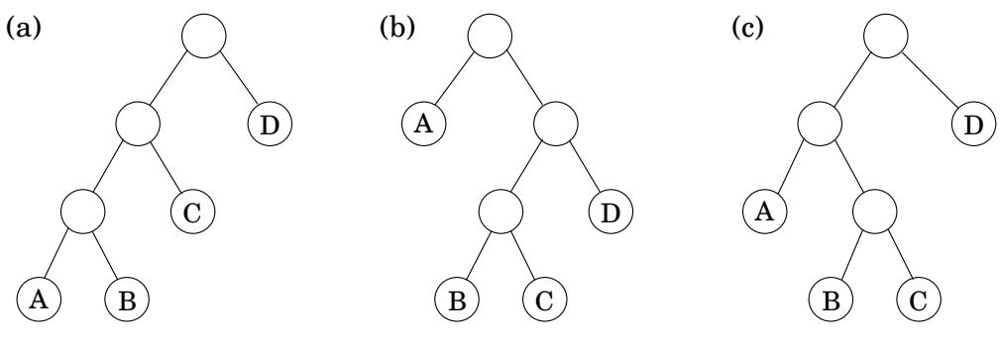

import Guide from '@/components/Guide.astro';
import Knowledge from '@/components/Knowledge.astro';
import Example from '@/components/Example.astro';
import Analysis from '@/components/Analysis.astro';
import Solution from '@/components/Solution.astro';
import Variant from '@/components/Variant.astro';
import Note from '@/components/Note.astro';
import Block from '@/components/Block.astro';
import Method from '@/components/Method.astro';
import Exercise from '@/components/Exercise.astro';

## 6.5 链式矩阵乘法

假设我们想要将四个矩阵 $A \times B \times C \times D$ 相乘，维度分别为 $5 0 \times 2 0 , 2 0 \times 1$ $1 \times 1 0 ,$ 和 $1 0 \times 1 0 0$ （图 6.6）。这将涉及一次迭代地将两个矩阵相乘。矩阵乘法不是可交换的（一般来说， $A \times B \neq B \times A )$ ，但它是结合律的，这意味着例如 $A \times ( B \times C ) = ( A \times B ) \times C$ 。因此，我们可以用许多不同的方式计算四个矩阵的乘积，具体取决于我们如何将其括起来。其中一些比其他更好吗？

将 $m \times n$ 矩阵乘以 $n \times p$ 矩阵需要 mnp 乘法，达到足够好的近似值。使用这个公式，我们来比较几种不同的评估 $A \times B \times C \times D$ 的方法

<table> <tr> <td>括号</td> <td>成本计算</td> <td>成本</td> </tr> <tr> <td> $A \times ((B \times C) \times D)$ </td> <td> $20 \cdot 1 \cdot 10 + 20 \cdot 10 \cdot 100 + 50 \cdot 20 \cdot 100$ </td> <td>120,200</td> </tr> <tr> <td> $(A \times (B \times C)) \times D$ </td> <td> $20 \cdot 1 \cdot 10 + 50 \cdot 20 \cdot 10 + 50 \cdot 10 \cdot 100$ </td> <td>60,200</td> </tr> <tr> <td> $(A \times B) \times (C \times D)$ </td> <td> $50 \cdot 20 \cdot 1 + 1 \cdot 10 \cdot 100 + 50 \cdot 1 \cdot 100$ </td> <td>7,000</td> </tr> </table>

正如您所看到的，乘法的顺序对最终的运行时间有很大的影响！此外，总是执行可用的最便宜的矩阵乘法的自然贪婪方法会导致此处显示的第二个括号，因此是失败的。

如果我们想要计算 $A _ { 1 } \times A _ { 2 } \times \cdots \times A _ { n } ,$ ，其中 $A _ { i } { \bf \dot { s } }$ 分别是维度为 $m _ { 0 } \times m _ { 1 } , m _ { 1 } \times m _ { 2 } , \ldots , m _ { n - 1 } \times m _ { n }$ 的矩阵，我们如何确定最佳顺序？首先要注意的是，特定的括号可以非常自然地用二叉树表示，其中各个矩阵对应于叶子，根是最终产品，内部节点是中间产品（图 6.7）。进行乘法的可能顺序对应于具有 n 个叶子的各种满二叉树，其

$$
\overline {{\text { Figure   6.7(a) } ((A \times B) \times C) \times D ; (\mathbf {b}) A \times ((B \times C) \times D) ; (\mathbf {c}) (A \times (B \times C)) \times D .}}
$$

数字以 n 为指数（练习 2.13）。我们当然不能尝试每棵树，因此排除了暴力，我们转向动态编程。

图 6.7 的二叉树具有启发性：对于一棵树来说，它是最优的，它的子树也必须是最优的。子树对应的子问题是什么？它们是 $A _ { i } \times A _ { i + 1 } \times \cdots \times A _ { j }$ 形式的产品。让我们看看这是否有效：对于 $1 \leq i \leq j \leq n$ ，定义

$$
C (i, j) = \text { minimum   cost   of   multiplying } A _ {i} \times A _ {i + 1} \times \dots \times A _ {j}.
$$

这个子问题的大小是矩阵乘法的次数， $| j - i |$ 最小的子问题是当 $i = j ,$ 时，在这种情况下没有什么可以相乘，所以 $C ( i , i ) = 0$ 。对于 $j > i ,$ 考虑 $C ( i , j )$ 的最佳子树。该子树中的第一个分支（位于顶部的分支）会将乘积分成两部分，其形式为 $A _ { i } \times \cdots \times A _ { k }$ 和 $A _ { k + 1 } \times \cdots \times A _ { j }$ ，对于 i 和 $j .$ 之间的某个 k 。子树的成本就是这两个部分产品的成本加上它们组合的成本：$C ( i , k ) + C ( k + 1 , j ) + m _ { i - 1 } \cdot m _ { k } \cdot m _ { j }$。我们只需要找到最小的分裂点 k：

$$
C (i, j) = \min _ {i \leq k <   j} \left\{C (i, k) + C (k + 1, j) + m _ {i - 1} \cdot m _ {k} \cdot m _ {j} \right\}.
$$

我们准备好编码了！下面，变量s表示子问题的大小。

$$
\begin{array}{l} \text {for i = 1 to n: C(i,i) = 0} \\ \text {for s = 1 to n - 1:} \\ \quad \text {for i = 1 to n - s:} \\ \quad j = i + s \\ \quad C (i, j) = \min \{C (i, k) + C (k + 1, j) + m _ {i - 1} \cdot m _ {k} \cdot m _ {j}: i \leq k <   j \} \\ \text {return C(1,n)} \end{array}
$$

子问题构成一个二维表，其中每个条目都需要 $O ( n )$ 时间来计算。因此，总运行时间为 $O ( n ^ { 3 } )$