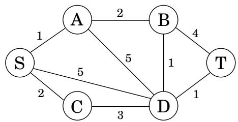
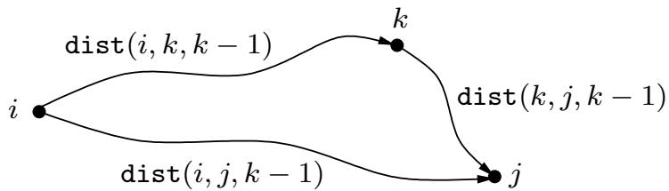
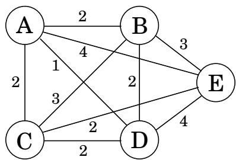

import Guide from '@/components/Guide.astro';
import Knowledge from '@/components/Knowledge.astro';
import Example from '@/components/Example.astro';
import Analysis from '@/components/Analysis.astro';
import Solution from '@/components/Solution.astro';
import Variant from '@/components/Variant.astro';
import Note from '@/components/Note.astro';
import Block from '@/components/Block.astro';
import Method from '@/components/Method.astro';
import Exercise from '@/components/Exercise.astro';
import Algorithm from '@/components/Algorithm.astro';

## 6.6 最短路径

我们从动态规划算法开始本章，该算法用于在 dag 中查找最短路径的基本任务。我们现在转向更复杂的最短路径问题

图 6.8 我们想要一条从 s 到 t 的路径既短又边少。

看看我们强大的算法技术如何适应这些问题。

## 最短可靠路径

生活是复杂的，图形、边长和最短路径等抽象概念很少能捕捉到全部真相。例如，在通信网络中，即使边长忠实地反映了传输延迟，选择路径时也可能需要考虑其他因素。例如，路径中的每个额外边缘都可能是一个额外的“跳跃”，充满不确定性和丢包的危险。在这种情况下，我们希望避免具有太多边的路径。图 6.8 用一个图说明了这个问题，其中从 S 到 T 的最短路径有四个边，而另一条路径稍长但仅使用两个边。如果四个边缘转化为令人望而却步的不可靠性，我们可能不得不选择后一条路径。

假设给定一个图 G，其边的长度，以及两个节点 s 和 t 以及一个整数 k，并且我们想要从 s 到 t 的最短路径，最多使用 k 个边。

有没有一种快速方法可以使 Dijkstra 算法适应这项新任务？不完全是：该算法专注于每条最短路径的长度，而不“记住”路径中的跳数，而这现在是一条至关重要的信息。

在动态规划中，诀窍是选择子问题，以便记住并继承所有重要信息。在这种情况下，让我们定义每个顶点 v 和每个整数 $i \le k , \mathtt { d i s t } ( v , i )$ 为使用 i 条边从 s 到 v 的最短路径的长度。起始值 dist(v, 0) 适用于除 $s ,$ 之外的所有顶点，其值为 0。自然，一般更新方程为：

$$
\operatorname{dist} (v, i) = \min _ {(u, v) \in E} \left\{\operatorname{dist} (u, i - 1) + \ell (u, v) \right\}.
$$

还需要我们多说吗？

## 全对最短路径

如果我们不仅想找到 s 和 t 之间的最短路径，还想找到所有顶点对之间的最短路径怎么办？一种方法是执行第 4.6.1 节中的通用最短路径算法（因为可能存在负边）V 次，每个起始节点一次。总运行时间将为 $O ( | V | ^ { 2 } | E | )$ 。我们现在将看到一个更好的替代方案，即基于 $O ( | V | ^ { 3 } )$ 动态编程的 Floyd-Warshall 算法。

是否有一个很好的子问题来计算图中所有顶点对之间的距离？简单地解决越来越多的对或起点的问题是没有帮助的，因为它会直接回到 $O ( | V | ^ { 2 } | E | )$ 算法。

我想到了一个想法：u 和 v 之间的最短路径 $u  w _ { 1 }  \cdot \cdot \cdot  w _ { l }  v$ 使用一定数量的中间节点——可能没有。假设我们完全禁止中间节点。然后我们可以一次解决所有对的最短路径：从 u 到 v 的最短路径就是直接边 $( u , v )$ ，如果存在的话。如果我们现在逐渐扩大允许的中间节点集会怎么样？我们可以一次执行一个节点，更新每个阶段的最短路径长度。最终这个集合增长到所有 $V ,$ ，此时所有顶点都被允许位于所有路径上，并且我们已经找到了图的顶点之间真正的最短路径！

更具体地说，将 V 中的顶点编号为 $\{ 1 , 2 , \ldots , n \}$ ，并让 $\mathtt { d i s t } ( i , j , k )$ 表示从 i 到 j 的最短路径的长度，其中只有节点 $\{ 1 , 2 , \ldots , k \}$ 可以用作中间节点。最初，di $\mathtt { s t } ( i , j , 0 )$ 是 i 和 $j ,$ 之间的直接边的长度（如果存在），否则为。

当我们扩展中间集以包含额外的节点 k 时会发生什么？我们必须重新检查所有对 $i , j$ 并检查使用 k 作为中间点是否为我们提供了从 i 到 j 的更短路径。但这很简单：从 i 到 $j$ 的最短路径使用 k 以及可能的其他编号较低的中​​间节点，仅经过 k 一次（为什么？因为我们假设不存在负循环）。我们已经仅使用编号较小的顶点计算了从 i 到 k 以及从 k 到 j 的最短路径的长度：

因此，使用 k 为我们提供了从 i 到 $j$ 的更短路径当且仅当

$$
\operatorname{dist} (i, k, k - 1) + \operatorname{dist} (k, j, k - 1) <   \operatorname{dist} (i, j, k - 1),
$$

在这种情况下，dist $( i , j , k )$ 应相应更新。

这是 Floyd-Warshall 算法 - 正如您所看到的，它需要 $O ( | V | ^ { 3 } )$ 时间。

<Algorithm>
对于 $i = 1$ 至 $n$：
    对于 $j = 1$ 至 $n$：
        $\text{dist}(i, j, 0) = \infty$
对于所有 $(i, j) \in E$：
    $\text{dist}(i, j, 0) = \ell(i, j)$
对于 $k = 1$ 至 $n$：
    对于 $i = 1$ 至 $n$：
        对于 $j = 1$ 至 $n$：
            $\text{dist}(i, j, k) = \min\{\text{dist}(i, k, k - 1) + \text{dist}(k, j, k - 1), \text{dist}(i, j, k - 1)\}$
</Algorithm>

## 旅行商问题

一位旅行推销员正在为一次大型销售之旅做准备。他将从家乡出发，提着行李箱，对每个目标城市都访问一次，然后再返回家乡。考虑到城市之间的成对距离，访问这些城市的最佳顺序是什么，以尽量减少总体旅行距离？

图 6.9 最佳旅行商旅行的长度为 10。  

用 $1 , \ldots , n ,$ 表示城市，推销员的家乡为1，并令 $D = \left( d _ { i j } \right)$ 为城际距离矩阵。目标是设计一个从 1 开始和结束、仅包含所有其他城市一次且总长度最小的游览。图 6.9 显示了涉及五个城市的示例。你能找到最佳的旅行吗？即使在这个小例子中，人类也很难找到解决方案。想象一下当数百个城市参与其中时会发生什么。

事实证明这个问题对于计算机来说也很难。事实上，旅行商问题（TSP）是最臭名昭著的计算任务之一。解决这个问题的尝试有着悠久的历史，有一段漫长的失败和部分成功的传奇，并且一路走来，算法和复杂性理论取得了重大进展。关于 TSP 的最基本的坏消息是，它不太可能在多项式时间内求解，我们将在第 8 章中更好地理解它。

那么需要多长时间？好吧，蛮力方法是评估每一个可能的旅行并返回最好的一个。因为有 $( n - 1 ) !$！可能性，该策略需要 $O ( n ! )$ 时间。我们现在将看到动态规划产生了一种更快的解决方案，尽管不是多项式解决方案。

TSP 的适当子问题是什么？子问题指的是部分解决方案，在这种情况下，最明显的部分解决方案是游览的初始部分。假设我们按照要求从城市 1 出发，访问了几个城市，现在位于城市 $j .$ 。我们需要什么信息才能延长这个部分游览？我们当然需要知道 $j ,$，因为这将决定接下来访问哪些城市最方便。我们还需要知道到目前为止访问过的所有城市，这样我们就不会重复其中任何一个。那么，这是一个适当的子问题。

对于包含 1 和 $j \in S _ { \mathrm { : } }$ 的城市子集 $S \subseteq \{ 1 , 2 , \dots , n \}$ ，令 $C ( S , j )$ 为访问 S 中每个节点一次的最短路径的长度，从 1 开始，到 $j .$ 结束。

当 $| S | > 1$ 时，我们定义 $C ( S , 1 ) = \infty$ 因为路径不能同时以 1 开始和结束。

现在，让我们用更小的子问题来表达 $C ( S , j )$。我们需要从 1 开始并在 $j ;$ 结束，我们应该选择什么作为倒数第二个 $\mathrm { c i t y ? }$ 它必须是一些 $i \in S ,$ 所以总路径长度是从 1 到 $i ,$ 的距离，即 $C ( S - \{ j \} , i )$ ，加上最后一条边的长度，

$d _ { i j }$ 。我们必须选择最好的这样的：

$$
C (S, j) = \min _ {i \in S: i \neq j} C (S - \{j \}, i) + d _ {i j}.
$$

子问题按 S 排序。这是代码。

<Algorithm>
$C(\{1\}, 1) = 0$
对于 $s = 2$ 至 $n$：
    对于大小为 s 且包含 1 的所有子集 $S \subseteq \{1, 2, \ldots, n\}$：
        $C(S, 1) = \infty$
        对于所有 $j \in S, j \neq 1$：
            $C(S, j) = \min\{C(S - \{j\}, i) + d_{ij} : i \in S, i \neq j\}$
返回 $\min_j C(\{1, \ldots, n\}, j) + d_{j1}$
</Algorithm>

最多有 $2 ^ { n } \cdot n$ 个子问题，并且每个子问题都需要线性时间来解决。因此，总运行时间为 $O ( n ^ { 2 } 2 ^ { n } )$

<Knowledge title="Box: On time and memory">

运行动态规划算法所需的时间很容易从子问题的 dag 中看出：在许多情况下，它只是 dag 中边的总数！我们真正要做的就是按线性顺序访问节点，检查每个节点的内边，并且最常见的是，对每个边执行恒定量的工作。到最后，dag 的每个边缘都已检查一次。

但需要多少计算机内存呢？没有简单的 dag 参数来描述这一点。当然可以使用与顶点（子问题）数量成比例的内存量来完成这项工作，但我们通常可以少得多。原因是，只需要记住特定子问题的值，直到解决依赖于它的更大子问题为止。此后，它占用的内存可以被释放以供重用。

例如，在 Floyd-Warshall 算法中，一旦计算了 di $\mathsf { s t } ( \cdot , \cdot , k + 1 )$ 值，就不需要 dist $( i , j , k )$ 的值。因此，我们只需要两个 $| V | \times | V |$ 数组来存储 dist 值，一个用于 k 的奇数值，一个用于偶数值：计算 dist $( i , j , k )$ 时，我们覆盖 $\mathtt { d i s t } ( i , j , k - 2 )$

（我们不要忘记，在动态编程中，我们还需要一个 ar-$\mathrm { r a y } , \mathrm { p r e v } ( i , j )$ ，存储当前从 i 到 j 的最短路径中的倒数第二个顶点，该值必须使用 dist $( i , j , k )$ 进行更新，我们从动态编程算法中省略了这一平凡但至关重要的簿记步骤。）

你能明白为什么图 6.5 中的编辑距离 dag 只需要与较短字符串的长度成比例的内存吗？

</Knowledge>