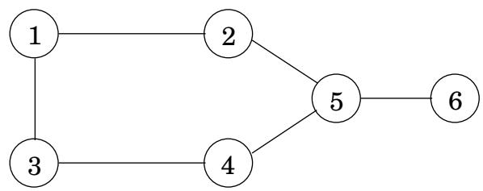
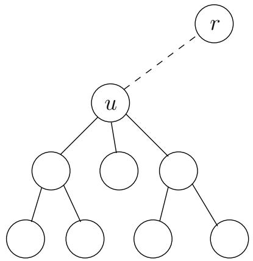

import Guide from '@/components/Guide.astro';
import Knowledge from '@/components/Knowledge.astro';
import Example from '@/components/Example.astro';
import Analysis from '@/components/Analysis.astro';
import Solution from '@/components/Solution.astro';
import Variant from '@/components/Variant.astro';
import Note from '@/components/Note.astro';
import Block from '@/components/Block.astro';
import Method from '@/components/Method.astro';
import Exercise from '@/components/Exercise.astro';

## 6.7 树中的独立集

如果节点之间没有边，则节点子集 $S \subset V$ 是图 $G = ( V , E )$ 的独立集合。例如，在图 6.10 中，节点 1、5 形成独立集，但节点 1、4、5 没有形成独立集，因为节点 4 和 5 之间有边。最大的独立集是 2, 3, 6 。

图 6.10 该图中最大的独立集的大小为 3。  

与我们在本章中看到的其他几个问题（背包、旅行推销员）一样，在图中找到最大的独立集被认为是很棘手的。然而，当图恰好是一棵树时，可以使用动态规划在线性时间内解决问题。适当的子问题是什么？在链式矩阵乘法问题中，我们注意到树的分层结构提供了子问题的自然定义——只要树的一个节点被识别为根。

所以这是算法：首先在任意节点 r 处将树作为根。现在，每个节点都定义了一个子树——挂在它上面的子树。这立即表明了子问题：

I(u) = u 悬挂的最大独立子树集的大小。

我们的最终目标是 $I ( r )$

动态规划一如既往地从较小的子问题到较大的子问题，也就是说，在有根树中自下而上。假设我们知道某个节点 $u ;$ 下面的所有子树的最大独立集，换句话说，假设我们知道 $u .$ 的所有后代w的 $I ( w )$，我们如何计算 $I ( u ) ?$ 让我们将计算分为两种情况：任何独立集要么包含u，要么不包含u（图6.11）。

$$
I (u) = \max \left\{1 + \sum_ {\text {grandchildren} w \text {of} u} I (w), \sum_ {\text {children} w \text {of} u} I (w) \right\}.
$$

如果独立集包含 $u ,$，那么我们得到一分，但我们不允许包含 u 的子代，因此我们继续讨论孙子。这是公式中的第一种情况。另一方面，如果我们不包括 u，那么我们就不会得到它的分数，但我们可以继续处理它的子项。

子问题的数量恰好是顶点的数量。只要稍加注意，运行时间就可以变得线性，$O ( | V | + | E | )$。

图6.11 I(u)是以u为根的子树的最大独立集的大小。两种情况：u 要么在这个独立集中，要么不在。

