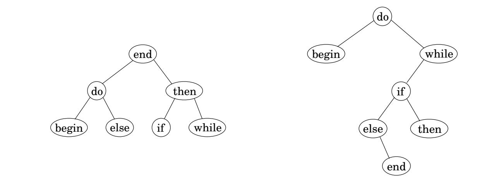
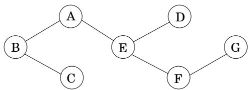
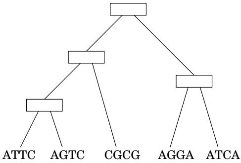

import Guide from '@/components/Guide.astro';
import Knowledge from '@/components/Knowledge.astro';
import Example from '@/components/Example.astro';
import Analysis from '@/components/Analysis.astro';
import Solution from '@/components/Solution.astro';
import Variant from '@/components/Variant.astro';
import Note from '@/components/Note.astro';
import Block from '@/components/Block.astro';
import Method from '@/components/Method.astro';
import Exercise from '@/components/Exercise.astro';

## 第 6 章练习

<Exercise title="Exercise 6.1">

列表 S 的连续子序列是由 S 的连续元素组成的子序列。例如，如果 S 是

$$
5, 1 5, - 3 0, 1 0, - 5, 4 0, 1 0,
$$

那么 $1 5 , - 3 0$ ，10 是连续子序列，但 5, 15, 40 不是。给出以下任务的线性时间算法：

输入：数字列表，$a _ { 1 } , a _ { 2 } , \ldots , a _ { n } .$

输出：最大和的连续子序列（长度为零的子序列的和为零）。

对于前面的示例，答案为 10, 5, 40, 10，总和为 55。

（提示：对于每个 $j \in \{ 1 , 2 , \dots , n \}$ ，考虑在位置 j 处精确结束的连续子序列。）

</Exercise>

<Exercise title="Exercise 6.2">

你要去长途旅行。您从里程标 0 处开始上路。沿途有 n 个酒店，位于里程标 $a _ { 1 } < a _ { 2 } < \cdots < a _ { n }$ ，其中每个 $a _ { i }$ 都是从起点开始测量的。您唯一可以停留的地方是这些酒店，但您可以选择在哪家酒店停留。您必须在最后一个酒店停下来（距离 $a _ { n } )$ ，这是您的目的地。

您理想情况下希望每天行驶 200 英里，但这可能是不可能的（取决于酒店的间距）。如果您一天行驶 x 英里，则该天的罚金为 $( 2 0 0 - x ) ^ { 2 }$ 。您希望规划您的行程，以便最大限度地减少总罚金，即所有旅行日每日罚金的总和。

给出一个有效的算法来确定停靠酒店的最佳顺序。

</Exercise>

<Exercise title="Exercise 6.3">

Yuckdonald's 正在考虑沿古雅谷高速公路 (QVH) 开设一系列餐厅。 n 个可能的位置沿着一条直线，这些位置距 QVH 起点的距离（以英里为单位并按递增顺序）为 $m _ { 1 } , m _ { 2 } , \ldots , m _ { n }$ 。约束条件如下：

在每个地点，Yuckdonald's 最多可开设一家餐厅。在位置 i 开设餐厅的预期利润为 $p _ { i } ,$，其中 $p _ { i } > 0$ 和 $i = 1 , 2 , \dots , n$

• 任意两家餐厅之间的距离应至少为<sup>k</sup> 英里，其中<sup>k</sup> 为<sup>a</sup> 正整数。

给出一个有效的算法来计算给定约束下的最大预期总利润。

</Exercise>

<Exercise title="Exercise 6.4">

给你一个包含 n 个字符的字符串 $s [ 1 \ldots n ]$ ，你认为它是一个损坏的文本文档，其中所有标点符号都消失了（所以它看起来像“itwasthebestoftimes...”）。您希望使用字典重建文档，字典以布尔函数 $\mathsf { d i c t } ( \cdot )$ 的形式提供：对于任何字符串 w，

$$
\operatorname{dict} (w) = \left\{ \begin{array}{l l} \text { true } & \text { if   } w \text {   is   a   valid   word } \\ \text { false } & \text { otherwise. } \end{array} \right.
$$

(a) 给出一个动态规划算法，确定字符串 $s [ \cdot ]$ 是否可以重构为有效单词序列。假设调用 dict 需要单位时间，运行时间最多应为 $O ( n ^ { 2 } )$。

(b) 如果字符串有效，则让算法输出相应的单词序列。

</Exercise>

<Exercise title="Exercise 6.5">

鹅卵石棋盘。给定一个 4 行 n 列的棋盘，每个方格中写有一个整数。我们还给了一组 2n 个鹅卵石，我们希望将其中部分或全部放在棋盘上（每个鹅卵石可以恰好放置在一个方格上），以便最大化鹅卵石覆盖的方格中的整数之和。有一个限制：为了合法放置鹅卵石，任何两个鹅卵石都不能位于水平或垂直相邻的方块上（对角线相邻即可）。

(a) 确定任何列中可能出现的合法模式的数量（单独地，忽略相邻列中的卵石）并描述这些模式。

如果两个模式可以放置在相邻的列上以形成合法的放置，则称它们是兼容的。让我们考虑由前 k 列 $1 \leq k \leq n$ 组成的子问题。每个子问题都可以分配一个类型，即最后一列中出现的模式。

(b) 使用兼容性和类型的概念，给出用于计算最佳放置的 $O ( n )$ 时间动态规划算法。

</Exercise>

<Exercise title="Exercise 6.6">

让我们根据下表定义三个符号 $a , b ,$ c 的乘法运算；因此 $a b = b ;$ ， ba = c ，依此类推。请注意，表定义的乘法运算既不具有结合性，也不具有交换性。

<table> <tr> <td> </td> <td>a</td> <td>b</td> <td>c</td> </tr> <tr> <td>a</td> <td>b</td> <td>b</td> <td>a</td> </tr> <tr> <td>b</td> <td>c</td> <td>b</td> <td>a</td> </tr> <tr> <td>c</td> <td>a</td> <td>c</td> <td>c</td> </tr> </table>

找到一个有效的算法来检查这些符号的字符串，例如 bbbbac，并决定是否可以用括号括起来该字符串，使得结果表达式的值为 a。例如，在输入 bbbbac 时，您的算法应返回 yes，因为 $( ( b ( b b ) ) ( b a ) ) c = a$

</Exercise>

<Exercise title="Exercise 6.7">

如果子序列无论从左到右还是从右到左读取都相同，则该子序列是回文序列。例如，序列

$$
A, C, G, T, G, T, C, A, A, A, A, T, C, G
$$

有许多回文子序列，包括 $A , C , G , C , A$ 和 A, A, A, A（另一方面，子序列 $A , C , T$ 不是回文）。设计一个算法，采用序列 $x [ 1 \ldots n ]$ 并返回最长回文子序列（的长度）。它的运行时间应该是 $O ( n ^ { 2 } )$ 。

</Exercise>

<Exercise title="Exercise 6.8">

给定两个字符串 $x = x _ { 1 } x _ { 2 } \cdot \cdot \cdot x _ { n }$ 和 $y = y _ { 1 } y _ { 2 } \cdot \cdot \cdot y _ { m }$ ，我们希望找到它们的最长公共子串的长度，即索引 i 和 j 与 $x _ { i } x _ { i + 1 } \cdot \cdot \cdot x _ { i + k - 1 } =$ $y _ { j } y _ { j + 1 } \cdot \cdot \cdot y _ { j + k - 1 }$ 的最大 k 。展示如何及时做到这一点 $O ( m n )$

</Exercise>

<Exercise title="Exercise 6.9">

某种字符串处理语言提供了将字符串分成两部分的原始操作。由于此操作涉及复制原始字符串，因此无论剪切位置如何，长度为 $n ,$ 的字符串都需要n个单位的时间。现在假设您想将一根绳子分成许多部分。中断的顺序会影响总运行时间。例如，如果要在位置 3 和 10 处剪切 20 个字符的字符串，则在位置 3 处进行第一次剪切的总成本为 $2 0 + 1 7 = 3 7$ ，而首先进行位置 10 的成本则更好，为 $2 0 + 1 0 = 3 0$

给出一个动态规划算法，给定长度为 $n ,$ 的字符串中 m 个切割的位置，找到将字符串分成 $m + 1$ 块的最小成本。

</Exercise>

<Exercise title="Exercise 6.10">

数人头。给定整数 n 和 $k ,$ 以及 $p _ { 1 } , \ldots , p _ { n } \in [ 0 , 1 ]$ ，您想要确定当 n 个有偏差的硬币随机独立投掷时，恰好获得 k 个正面朝上的概率，其中 $p _ { i }$ 是第 i 个硬币正面朝上的概率。给出一个用于此任务的 $O ( n ^ { 2 } )$ 算法。<sup>2</sup> 假设您可以在 $O ( 1 )$ 时间内对 [0, 1] 中的两个数字进行乘法和加法。

</Exercise>

<Exercise title="Exercise 6.11">

给定两个字符串 $x = x _ { 1 } x _ { 2 } \cdot \cdot \cdot x _ { n }$ 和 $y = y _ { 1 } y _ { 2 } \cdot \cdot \cdot y _ { m } .$，我们希望找到它们最长公共子序列的长度，即索引 $i _ { 1 } < i _ { 2 } < \cdots < i _ { k }$ 和 $j _ { 1 } < j _ { 2 } < \cdots < j _ { k }$ 以及 $x _ { i _ { 1 } } x _ { i _ { 2 } } \cdot \cdot \cdot x _ { i _ { k } } = y _ { j _ { 1 } } y _ { j _ { 2 } } \cdot \cdot \cdot y _ { j _ { k } }$ 的最大 k 。展示如何及时做到这一点 $O ( m n )$

</Exercise>

<Exercise title="Exercise 6.12">

给定平面中 n 个顶点的凸多边形 P（由它们的 x 和 $y$ 坐标指定）。 $P$ 的三角剖分是 P 的 $n - 3$ 对角线的集合，使得没有两条对角线相交（可能在其端点处除外）。请注意，三角剖分将多边形的内部分割成 $n - 2$ 不相交的三角形。三角剖分的成本是其中对角线长度的总和。给出一种有效的算法来找到最小成本的三角剖分。 （提示：用 $1 , \ldots , n ,$ 从任意顶点开始顺时针方向标记 ${ } ^ { \cdot } { } _ { P }$ 的顶点。对于 $1 \leq i < j \leq n$ ，让子问题 $A ( i , j )$ 表示由顶点跨越的多边形的最小成本三角剖分 $i , i + 1 , \dots , j . )$

</Exercise>

<Exercise title="Exercise 6.13">

考虑下面的游戏。 “庄家”产生一系列面朝上的“牌”$s _ { 1 } \cdots s _ { n }$，其中每张牌 $s _ { i }$ 都有一个值 $v _ { i }$。然后两名玩家轮流从序列中挑选一张牌，但只能挑选（剩余）序列中的第一张或最后一张牌。目标是收集总价值最大的卡牌。 （例如，您可以将卡片视为不同面额的钞票。）假设 n 是偶数。

(a) 显示一系列纸牌，使得第一个玩家从拿起更大价值的可用纸牌开始并不是最佳选择。 $\mathbf { i s } ,$ 自然贪婪策略不是最优的。

(b) 给出一个 $O ( n ^ { 2 } )$ 算法来计算第一个玩家的最佳策略。给定初始序列，您的算法应该在 $O ( n ^ { 2 } )$ 时间内预先计算一些信息，然后第一个玩家应该能够通过查找预先计算的信息在 $O ( 1 )$ 时间内以最佳方式做出每个动作。

</Exercise>

<Exercise title="Exercise 6.14">

剪布。给你一块尺寸为 $X \times Y$ 的矩形布料，其中 $X$ 和 Y 是正整数，以及可以使用该布料制作的 n 个产品的列表。对于每个产品 $i \in [ 1 , n ]$，您知道需要一块尺寸为 $a _ { i } \times b _ { i }$ 的矩形布料，并且该产品的最终售价为 $c _ { i }$。假设 $a _ { i } , ~ b _ { i }$ 和 $c _ { i }$ 都是正整数。您有一台机器可以将任何矩形布料水平或垂直切成两块。设计一个算法来确定 $X \times Y$ 块布的最佳回报，即切割布的策略，以便由所得块制成的产品给出最大的销售价格总和。您可以随意制作任意数量的给定产品副本，也可以根据需要不制作任何副本。

</Exercise>

<Exercise title="Exercise 6.15">

假设两支球队 A 和 B 正在进行一场比赛，看谁首先赢得 n 场比赛（对于某些特定的 n 场比赛）。我们可以假设 A 和 B 能力相同，因此每个人都有 50% 的机会赢得任何特定游戏。假设他们已经玩了 $i + j$ 场比赛，其中 A 赢得了 i，B 赢得了 $j .$ 。给出一个有效的算法来计算 A 继续赢得比赛的概率。例如，${ \mathrm { i f ~ } } i = n - 1$ 和 $j = n - 3$，那么A赢得比赛的概率是 $7 / 8 ,$，因为它必须赢得接下来三场比赛中的任何一场。

</Exercise>

<Exercise title="Exercise 6.16">

车库出售问题（由 Lofti Zadeh 教授提供）。在某个周日早上，有 n 场车库拍卖活动，$g _ { 1 } , g _ { 2 } , \ldots , g _ { n }$。对于每次车库拍卖 $g _ { j }$ ，您都有一个对其价值的估计，$v _ { j }$ 。对于任意两次车库拍卖，您可以估算从 $g _ { i }$ 到 $g _ { j }$ 的运输成本 $d _ { i j }$ 。您还将获得往返于您家和每次车库拍卖的费用 $d _ { 0 j }$ 和 $d _ { j 0 }$。您想要找到一个给定车库销售的子集的游览，从家里开始和结束，使您的总收益减去总运输成本最大化。

给出一个及时解决这个问题的算法 $O ( n ^ { 2 } 2 ^ { n } )$。 （提示：这与旅行商问题密切相关。）

</Exercise>

<Exercise title="Exercise 6.17">

给定面值 $x _ { 1 } , x _ { 2 } , \ldots , x _ { n } ,$ 的硬币的无限供应，我们希望找零价值为 $v ;$ 的硬币，也就是说，我们希望找到一组总价值为 v 的硬币。这可能是不可能的：例如，如果面值是 5 和 10，那么我们可以找 15，但不能找 12。 $O ( n v )$ 针对以下问题的动态规划算法。

输入：$x _ { 1 } , \ldots , x _ { n } ; v .$

问题：是否可以使用 $x _ { 1 } , \ldots , x _ { n } ?$ 面额的硬币为v找零

</Exercise>

<Exercise title="Exercise 6.18">

考虑找零问题的以下变体（练习 6.17）：给定面额 $x _ { 1 } , x _ { 2 } , \ldots , x _ { n }$ ，并且您想要找零 $v ,$ ，但每个面额最多只能使用一次。例如，如果面值是 1, 5, 10, 20，那么您可以找 $1 6 = 1 + 1 5$ 和 $3 1 = 1 + 1 0 + 2 0$，但不能找 40（因为 20 不能使用两次）。

输入：正整数 $x _ { 1 } , x _ { 2 } , \ldots , x _ { n } ;$ 另一个整数v。

输出：您可以使用每个面额 $x _ { i }$ 最多一次找零 $v ,$ 吗？

展示如何及时解决这个问题 $O ( n v )$

</Exercise>

<Exercise title="Exercise 6.19">

这是变革问题的另一种变体（练习 6.17）。

给定面额为 $x _ { 1 } , x _ { 2 } , \ldots , x _ { n }$ 的硬币的无限供应，我们希望使用最多 k 个硬币来兑换价值 v 的硬币；也就是说，我们希望找到一组 k 个硬币，其总价值为 v。这可能是不可能的：例如，如果面额是 5 和 10 以及 $k = 6$ ，那么我们可以找 55，但不能找 65。请为以下问题给出一个高效的动态规划算法。

输入：$x _ { 1 } , \ldots , x _ { n } ; k ; v$

问题：是否可以使用最多 k 个面额为 $x _ { 1 } , \ldots , x _ { n } ?$ 的硬币为 v 找零

</Exercise>

<Exercise title="Exercise 6.20">

最优二叉搜索树。假设我们知道某种语言的程序中关键字出现的频率，例如：

<table> <tr> <td>开始</td> <td>5%</td> </tr> <tr> <td>do</td> <td>40%</td> </tr> <tr> <td>e LSE</td> <td>8%</td> </tr> </table>

图 6.12 编程语言关键字的两个二叉搜索树。



结束 4% 如果 10% 那么 10% 而 23%

我们希望将它们组织在二叉搜索树中，以便根中的关键字按字母顺序大于左子树中的所有关键字，并且小于右子树中的所有关键字（这适用于所有节点）。

图 6.12 左侧有一个平衡良好的示例。这种情况下，查找关键字时，需要比较的次数最多为3次：例如查找“while”时，只检查“end”、“then”、“while”这三个节点。但由于我们知道关键字被访问的频率，因此我们可以使用更微调的成本函数，即查找单词的平均比较次数。对于左边的搜索树来说，

$$
\text { cost } = 1 (0. 0 4) + 2 (0. 4 0 + 0. 1 0) + 3 (0. 0 5 + 0. 0 8 + 0. 1 0 + 0. 2 3) = 2. 4 2.
$$

通过这种衡量，最好的搜索树是右边的那棵，其成本为 2.18。

给出以下任务的有效算法。

输入：n个单词（按排序顺序）；这些词出现的频率：$p _ { 1 } , p _ { 2 } , \ldots , p _ { n }$

输出：成本最低的二叉搜索树（上面定义为查找单词时的预期比较次数）。

</Exercise>

<Exercise title="Exercise 6.21">

图 $G = ( V , E )$ 的顶点覆盖是顶点 $S \subseteq V$ 的子集，其中至少包含 E 中每条边的一个端点。给出以下任务的线性时间算法。

输入：无向树 $T = ( V , E )$

输出：T 的最小顶点覆盖的大小。

例如，在下面的树中，可能的顶点覆盖包括 $\{ A , B , C , D , E , F , G \}$ 和 $\{ A , C , D , F \}$ 但不包括 $\{ C , E , F \}$ 。最小的顶点覆盖的大小为 3： B、E、G 。



</Exercise>

<Exercise title="Exercise 6.22">

给出以下任务的 $O ( n t )$ 算法。

输入：n 个正整数的列表 $a _ { 1 } , a _ { 2 } , \ldots , a _ { n } ; \mathfrak { a }$ 一个正整数 t。

问题：$a _ { i } { \bf \dot { s } }$ 的某些子集是否等于 $t ?$（每个 $a _ { i }$ 最多可以使用一次。）

（提示：查看“$\{ a _ { 1 } , a _ { 2 } , \ldots , a _ { i } \}$ 的子集是否等于 $s ? ^ { \mathfrak { P } } )$”形式的子问题

</Exercise>

<Exercise title="Exercise 6.23">

任务关键型生产系统有 n 个必须按顺序执行的阶段；第 i 阶段由机器 $M _ { i }$ 执行。每台机器 $M _ { i }$ 都有可靠运行的概率 $r _ { i }$ 和失败的概率 $1 - r _ { i }$（并且故障是独立的）。因此，如果我们用一台机器实现每个阶段，整个系统工作的概率是 $r _ { 1 } \cdot r _ { 2 } \cdot \cdot \cdot r _ { n }$ 为了提高这个概率，我们添加冗余，通过拥有执行阶段 i 的机器 $M _ { i }$ 的副本。所有 $m _ { i }$ 副本同时失败的概率仅为 $( 1 - r _ { i } ) ^ { m _ { i } }$，因此第i阶段正确完成的概率为 $1 - ( 1 - r _ { i } ) ^ { m _ { i } }$，整个系统正常工作的概率为 $\begin{array} { r } { \prod _ { i = 1 } ^ { n ^ { - } } ( 1 - ( 1 - r _ { i } ) ^ { m _ { i } } ) } \end{array}$。每台机器 $M _ { i }$ 都有成本 $c _ { i }$，并且购买机器的总预算为 $B$。 （假设 B 和 $c _ { i }$ 是正整数。）

给定概率 $r _ { 1 } , \ldots , r _ { n } ,$ 、成本 $c _ { 1 } , \ldots , c _ { n }$ 和预算 $B ,$ ，找到可用预算内的冗余 $m _ { 1 } , \ldots , m _ { n }$ ，并最大化系统正常工作的概率。

</Exercise>

<Exercise title="Exercise 6.24">

动态规划的时间和空间复杂度。我们用于计算长度为 m 和 n 的字符串之间的编辑距离的动态编程算法创建了一个大小为 $n \times m$ 的表，因此需要 $O ( m n )$ 时间和空间。实际上，它早在时间耗尽之前就会耗尽空间。如何减少这一空间需求？

(a) 表明如果我们只想计算编辑距离的值（而不是最佳编辑序列），那么只需要 $O ( n )$ 空间，因为在任何给定时间只需要维护表的一小部分。

(b) 现在假设我们还想要最佳的编辑顺序。正如我们之前看到的，这个问题可以用相应的网格状 dag 来重新表达，其中的目标是找到从节点 (0, 0) 到节点 $( n , m )$ 的最佳路径。使用这个公式会很方便，当我们谈论方便时，我们也可以假设 m 是 2 的幂。

让我们从编辑距离算法的一个小补充开始，这将是非常有用的。 dag 中的最佳路径必须经过中间节点 $( k , m / 2 )$，因为某些 $k ;$ 展示了如何修改算法以返回该值 k。

(c) 现在考虑一个递归方案：

```txt
procedure find-path((0,0) → (n,m))
compute the value k above
find-path((0,0) → (k,m/2))
find-path((k,m/2) → (n,m))
concatenate these two paths, with k in the middle
now that this scheme can be made to run in O(mn) time and O(n) sp
```

</Exercise>

<Exercise title="Exercise 6.25">

考虑以下 3-PARTITION 问题。给定整数 $a _ { 1 } , \ldots , a _ { n } ,$，我们想要确定是否可以将 $\{ 1 , \ldots , n \}$ 划分为三个不相交的子集 $I , J , K$，使得

$$
\sum_ {i \in I} a _ {i} = \sum_ {j \in J} a _ {j} = \sum_ {k \in K} a _ {k} = \frac {1}{3} \sum_ {i = 1} ^ {n} a _ {i}
$$

例如，对于输入 $( 1 , 2 , 3 , 4 , 4 , 5 , 8 )$ ，答案是肯定的，因为存在分区 $( 1 , 8 )$ ， (4, 5), (2, 3, 4)。另一方面，对于输入 (2, 2, 3, 5)，答案是否定的。

设计并分析 3-PARTITION 的动态规划算法，该算法在 n 和 $\textstyle \sum _ { i } a _ { i }$ 的时间多项式中运行

</Exercise>

<Exercise title="Exercise 6.26">

序列比对。当发现新基因时，了解其功能的标准方法是查看已知基因的数据库并找到密切匹配。两个基因的接近程度通过它们 $a l i g n e d .$ 的程度来衡量。为了形式化这一点，可以将基因视为字母表上的一长串 $\Sigma = \{ A , C , G , T \}$ 。考虑两个基因（字符串） $x = A T G C C$ 和 $y = T A C G C A$ 。 x 和 $y$ 的对齐是通过将这两个字符串写入列来匹配这两个字符串的一种方法，例如：

$$
\begin{array}{c c c c c c c} - & A & T & - & G & C & C \\ T & A & - & C & G & C & A \end{array}
$$

这里的 $^ { 6 6 } - { } ^ { 5 5 }$ 表示 $\mathbf { \check { g a p . } } ^ { \mathbf { \gamma } }$ 每个字符串的字符必须按顺序出现，并且每一列必须包含至少一个字符串中的字符。对齐的分数由大小为 $( | \Sigma | + 1 ) \times ( | \Sigma | + 1 )$ 的评分矩阵 δ 指定，其中额外的行和列用于容纳间隙。例如，前面的对齐有以下分数：

$$
\delta (-, T) + \delta (A, A) + \delta (T, -) + \delta (-, C) + \delta (G, G) + \delta (C, C) + \delta (C, A).
$$

给出一个动态规划算法，该算法以两个字符串 $x [ 1 \ldots n ]$ 和 $y [ 1 \ldots m ]$ 和一个 s 作为输入核化矩阵 $\delta ,$ 并返回得分最高的对齐方式。运行时间应为 $O ( m n )$

</Exercise>

<Exercise title="Exercise 6.27">

与差距惩罚保持一致。练习 6.26 的比对算法有助于识别彼此接近的 DNA 序列。这些紧密匹配的序列之间的差异通常是由 DNA 复制错误引起的。然而，仔细观察生物复制过程就会发现，我们之前考虑的评分函数存在一个定性问题：大自然经常插入或删除整个核苷酸子串（产生长间隙），而不是一次只编辑一个位置。因此，长度为 10 的间隙的惩罚不应是长度为 1 的间隙的惩罚的 10 倍，而应小得多。

重复练习 6.26，但这次使用修改后的评分函数，其中长度 k 的间隙的惩罚为 $c _ { 0 } + c _ { 1 } k ,$ ，其中 $c _ { 0 }$ 和 $c _ { 1 }$ 给定常量（并且 $c _ { 0 }$ 大于 $c _ { 1 } )$

</Exercise>

<Exercise title="Exercise 6.28">

局部序列比对。通常，两条 DNA 序列显着不同，但包含非常相似且高度保守的区域。设计一个算法，输入两个字符串 $x [ 1 \ldots n ]$ 和 $y [ 1 \ldots m ]$ 以及评分矩阵δ（如练习6.26中定义），并分别输出x和y的子字符串 $x ^ { \prime }$ 和 $y ^ { \prime }$，它们在所有对中具有最高评分对齐这样的子串。你的算法应该需要时间 $O ( m n )$

</Exercise>

<Exercise title="Exercise 6.29">

外显子链。每个基因对应于整个基因组的一个子区域（DNA 序列）；然而，这个区域的一部分可能是“垃圾DNA”。通常，一个基因由几个称为外显子的片段组成，这些片段被称为内含子的垃圾片段分隔开。这使得在新测序的基因组中识别基因的过程变得复杂。

假设我们有一个新的 DNA 序列，我们想要检查其中是否存在某个基因（字符串）。因为我们不能希望该基因是一个连续的子序列，所以我们寻找部分匹配——基因中也存在的 DNA 片段（实际上，即使这些部分匹配也是近似的，而不是完美的）。然后我们尝试组装这些碎片。

让 $x [ 1 \ldots n ]$ 表示 DNA 序列。每个部分匹配可以用三元组 $( l _ { i } , r _ { i } , w _ { i } )$ 表示，其中 $x [ l _ { i } \ldots r _ { i } ]$ 是片段，$w _ { i }$ 是表示匹配强度的权重（它可能是局部对齐得分或其他统计量）。许多潜在的匹配可能是错误的，因此目标是找到一致（不重叠）且具有最大总权重的三元组子集。

展示如何有效地做到这一点。

</Exercise>

<Exercise title="Exercise 6.30">

通过最大简约重建进化树。假设我们设法对一大堆不同物种的特定基因进行测序。具体来说，假设有 n 个物种，序列是字母表 $\Sigma = \{ A , C , G , T \}$ 上长度为 k 的字符串。我们如何利用这些信息来重建这些物种的进化历史？

进化历史通常用一棵树来表示，其叶子是不同的物种，其根是它们的共同祖先，其内部分支代表物种形成事件（即新物种从现有物种中分离出来的时刻）。因此我们需要找到以下内容：

叶子上有给定物种的进化树。

对于每个内部节点，一个长度为 k 的字符串：该特定祖先的基因序列。

对于每个可能的树 $T _ { i }$ ，在其每个节点 u 处用序列 $s ( u ) \in \Sigma ^ { k }$ 注释，我们可以根据简约原则分配分数：突变越少，可能性越大。

$$
\operatorname{score} (T) = \sum_ {(u, v) \in E (T)} (\text { number   of   positions   on   which } s (u) \text { and } s (v) \text { disagree }).
$$

找到得分最高的树是一个难题。这里我们只考虑其中的一小部分：假设我们知道树的结构，并且我们想要填充内部节点 u 的序列 $s ( u )$。这是使用 $k = 4$ 和 $n = 5 { : }$ 的示例



(a) 在这个特定的例子中，存在内部节点序列的几个最大简约重建。找到其中之一。

(b) 为该任务给出一个有效的（就 n 和 k 而言）算法。 （提示：尽管序列可能很长，但您一次只能做一个位置。）

</Exercise>