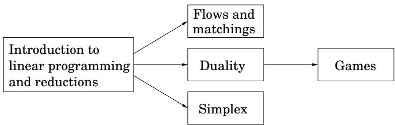
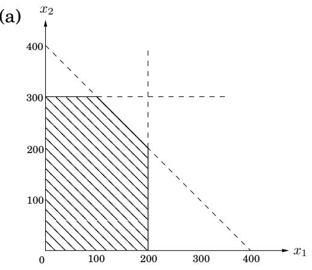
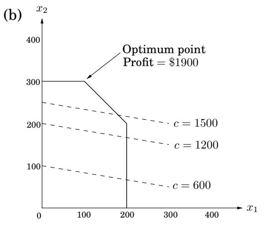
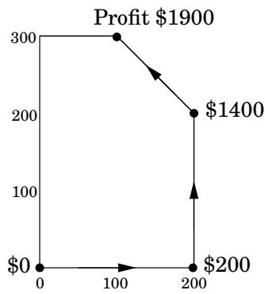
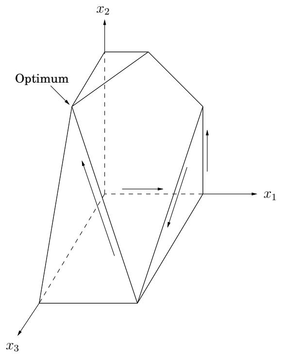
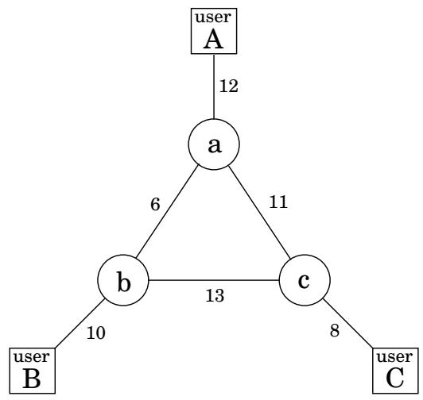
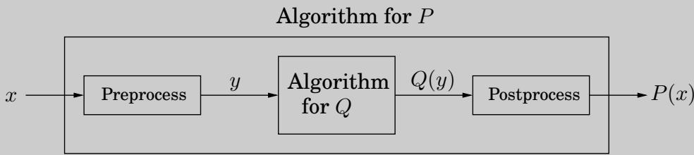

import Guide from '@/components/Guide.astro';
import Knowledge from '@/components/Knowledge.astro';
import Example from '@/components/Example.astro';
import Analysis from '@/components/Analysis.astro';
import Solution from '@/components/Solution.astro';
import Variant from '@/components/Variant.astro';
import Note from '@/components/Note.astro';
import Block from '@/components/Block.astro';
import Method from '@/components/Method.astro';
import Exercise from '@/components/Exercise.astro';

## 第 7 章：线性规划和归约

我们需要算法解决的许多问题都是优化任务：最短路径、最便宜的生成树、最长的递增子序列等等。在这种情况下，我们寻求一个解决方案：（1）满足某些约束（例如，路径必须使用图的边并从 s 到 t，树必须接触所有节点，子序列必须递增）；就某些明确定义的标准而言，(2) 是满足这些约束的所有解决方案中最好的解决方案。

线性规划描述了一类广泛的优化任务，其中约束和优化标准都是线性函数。事实证明，大量的问题都可以用这种方式表达。

鉴于其主题的广泛性，本章分为几个部分，可以根据以下依赖关系单独阅读。

## 7.1 线性规划简介

在线性规划问题中，我们给定一组变量，我们希望为它们分配实数值，以便 (1) 满足一组涉及这些变量的线性方程和/或线性不等式，以及 (2) 最大化或最小化给定的线性目标函数。

## 7.1.1 示例：利润最大化

一家精品巧克力制造商有两种产品：其旗舰品种的三角形巧克力，称为 Pyramide，以及更加颓废和豪华的 Pyramide Nuit。每种产品应该生产多少才能实现利润最大化？假设它每天生产 $x _ { 1 }$ 盒 Pyramide，利润为

图 7.1 (a) 线性规划的可行域。 (b) 目标函数的等高线：$x _ { 1 } + 6 x _ { 2 } = c$ 对于不同的利润值 c。

(一)  

每份 1 美元，以及 $x _ { 2 }$ 盒 Nuit，每份利润可观 6 美元； $x _ { 1 }$ 和 $x _ { 2 }$ 是我们希望确定的未知值。但这还不是全部。 $x _ { 1 }$ 和 $x _ { 2 }$ 也必须满足（除了明显的 $x _ { 1 } , x _ { 2 } \ge 0 )$）。首先，这些独家巧克力的每日需求仅限于最多200盒Pyramide和300盒Nuit。此外，目前的劳动力总共最多可以生产400盒每天的最佳产量是多少盒？

我们用线性规划来表示这种情况，如下所示。

目标函数

约束条件

$$
\begin{array}{r l} \max x _ {1} + 6 x _ {2} \\ x _ {1} & \leq 2 0 0 \\ x _ {2} & \leq 3 0 0 \\ x _ {1} + x _ {2} & \leq 4 0 0 \\ x _ {1}, x _ {2} & \geq 0 \end{array}
$$

$x _ { 1 }$ 和 $x _ { 2 }$ 中的线性方程定义二维 (2D) 平面中的一条线，线性不等式指定半空间，即线一侧的区域。因此，该线性规划的所有可行解的集合，即满足所有约束的点 $( x _ { 1 } , x _ { 2 } )$，是五个半空间的交集。它是一个凸多边形，如图7.1所示。

我们想要找到这个多边形中目标函数（利润）最大化的点。利润为 c 美元的点位于直线 $x _ { 1 } + 6 x _ { 2 } = c ,$ 上，该直线的斜率为 $- 1 / 6$，如图 7.1 所示，其中选择了 c 值。随着 c 的增加，这条“利润线”会平行于自身向上并向右移动。由于目标是最大化 $^ { c , }$，我们必须将线尽可能向上移动，同时仍然触及可行区域。最佳解决方案将是利润线看到的最后一个可行点，因此必须是多边形的顶点，如图所示。如果利润线的斜率不同，则其与多边形的最后接触可能是整条边而不是单个顶点。在这种情况下，最优解不会是唯一的，但肯定存在最优顶点。

线性规划的一般规则是在可行区域的顶点处实现最优。唯一的例外是没有最优值的情况；这可以通过两种方式发生：

1、线性规划不可行；也就是说，约束条件非常严格，不可能满足所有条件。例如，

$$
x \leq 1, x \geq 2.
$$

2. 约束非常宽松，可行域无界，可以实现任意高的目标值。例如，

$$
\begin{array}{c} \max x _ {1} + x _ {2} \\ x _ {1}, x _ {2} \geq 0 \end{array}
$$

## 求解线性规划

线性规划 (LP) 可以通过 George Dantzig 在 1947 年设计的单纯形法来求解。我们将在第 7.6 节中更详细地解释它，但简单地说，该算法从一个顶点开始，在我们的例子中可能是 (0, 0)，并重复寻找具有更好目标值的相邻顶点（通过可行区域的边连接）。这样它就在多边形的顶点上爬山，从一个邻居走到另一个邻居，从而一路上稳步增加利润。这是一个可能的轨迹。

当到达没有更好邻居的顶点时，单纯形声明它是最优的并停止。为什么这个局部测试意味着全局最优？通过简单的几何图形——考虑穿过该顶点的利润线。由于所有顶点的邻居都位于该线下方，因此可行多边形的其余部分也必须位于该线下方。

## 更多产品

受消费者需求的鼓舞，该巧克力制造商决定推出第三种甚至更独特的巧克力系列，称为 Pyramide Luxe。一盒可带来 13 美元的利润。

图 7.2 三变量线性规划的可行多面体。  

令 $x _ { 1 } , x _ { 2 } , x _ { 3 }$ 表示每天生产的每种巧克力的盒数，$x _ { 3 }$ 指Luxe。对 $x _ { 1 }$ 和 $x _ { 2 }$ 的旧约束仍然存在，尽管劳动力限制现在也扩展到了 $x _ { 3 }$：所有三个变量的总和最多可达 400。更重要的是，事实证明，Nuit 和 Luxe 需要相同的包装机械，只是 Luxe 使用的包装机械是前者的三倍，这又施加了另一个约束 $x _ { 2 } + 3 x _ { 3 } \leq 6 0 0$ 。最佳的生产水平是多少？

这是更新后的线性程序。

$$
\begin{array}{c} \max x _ {1} + 6 x _ {2} + 1 3 x _ {3} \\ x _ {1} \leq 2 0 0 \\ x _ {2} \leq 3 0 0 \\ x _ {1} + x _ {2} + x _ {3} \leq 4 0 0 \\ x _ {2} + 3 x _ {3} \leq 6 0 0 \\ x _ {1}, x _ {2}, x _ {3} \geq 0 \end{array}
$$

解决方案的空间现在是三维的。每个线性方程定义一个 3D 平面，每个不等式定义该平面一侧的半空间。可行区域是七个半空间的交集，即多面体（图 7.2）。看着这个图，你能看出哪个不等式对应于多面体的每个面吗？

c 的利润对应于平面 $x _ { 1 } + 6 x _ { 2 } + 1 3 x _ { 3 } = c .$ 。随着 c 的增加，该利润平面与其自身平行移动，越来越深入正向，直到不再触及可行区域。最终接触点为最优顶点：(0, 300, 100)，总利润$3100。

单纯形算法对于这个修改后的问题将如何表现？和以前一样，它会沿着多面体的边缘从一个顶点移动到另一个顶点，从而稳步增加利润。可能的轨迹如图 7.2 所示，对应于以下顶点和利润序列：

$$
\begin{array}{c c c c c c c c} (0, 0, 0) & \longrightarrow & (2 0 0, 0, 0) & \longrightarrow & (2 0 0, 2 0 0, 0) & \longrightarrow & (2 0 0, 0, 2 0 0) & \longrightarrow & (0, 3 0 0, 1 0 0) \\ \mathbb {S} 0 & & \mathbb {S} 2 0 0 & & \mathbb {S} 1 4 0 0 & & \mathbb {S} 2 8 0 0 & \longrightarrow & \mathbb {S} 3 1 0 0 \end{array}
$$

最后，当到达没有更好邻居的顶点时，它将停止并声明这是最佳点。再次通过基本几何学，如果所有顶点的邻居都位于利润平面的一侧，那么整个多面体也必须如此。

<Knowledge title="Box: A magic trick called duality">

这就是为什么您应该相信 (0, 300, 100) 的总利润为 $3100 是最优的：回顾一下线性程序。将第二个不等式与第三个不等式相加，再加上第四个不等式乘以 4。结果就是不等式 $x _ { 1 } + 6 x _ { 2 } + 1 3 x _ { 3 } \leq 3 1 0 0$

你看到了吗？这个不等式表明，没有可行的解决方案（满足约束的值 $x _ { 1 } , x _ { 2 } , x _ { 3 }$）的利润可能大于 3100。所以我们确实已经找到了最优解！唯一的问题是，我们从哪里得到这四个不等式的神秘乘数（0、1、1、4）？

在第 7.4 节中，我们将看到通过求解另一个 LP 总是可以得出这样的乘数！除了（它变得更好）我们甚至不需要解决另一个LP，因为它实际上与原始LP密切相关 - 它被称为对偶 - 解决原始LP也解决了对偶！但我们已经远远超出了我们的故事。

如果我们添加第四条巧克力或数百条巧克力会怎么样？那么问题就变得高维且难以形象化。尽管我们不能再依赖简单的几何直觉来描述和证明单纯形，但单纯形仍然在这种一般环境下发挥作用。我们将在 7.6 节中研究成熟的单纯形算法。

与此同时，我们可以放心，因为有许多专业的、工业级的软件包可以实现单纯形并处理所有棘手的细节，例如数字精度。因此，在典型应用中，主要任务是将问题正确表达为线性程序。然后该包会处理其余的事情。

考虑到这一点，让我们看一下高维应用程序。

</Knowledge>
## 7.1.2 示例：生产计划

这次我们公司生产的是手工编织地毯，这种产品的需求季节性很强。我们的分析师刚刚获得了下一个日历年所有月份的需求估计：$d _ { 1 } , d _ { 2 } , \ldots , d _ { 1 2 }$。正如所担心的那样，它们非常不均匀，从 440 到 920 不等。

这是该公司的简要概况。我们目前有 30 名员工，每人每月制作 20 块地毯，月薪为 2,000 美元。我们最初没有多余的地毯。

如何应对需求波动？有以下三种方式：

1.加班，但是加班费比正常工资高80%，所以比较贵。此外，工人最多可以投入30%的加班费。

2. 雇用和解雇，但每个工人的成本分别为 320 美元和 400 美元。

3. 储存剩余产量，但每块地毯每月花费 8 美元。目前我们手头没有储存的地毯，我们必须在年底不储存任何地毯。

这个相当复杂的问题可以用线性规划来表示和解决！

关键的第一步是定义变量。

$w _ { i }$ = 第 i 个月的工人数量； $w _ { 0 } = 3 0 .$

$x _ { i }$ = 第 i 个月制作的地毯数量。

$o _ { i }$ = 第 i 个月加班制作的地毯数量。

$h _ { i } , f _ { i }$ = 第 i 月初分别雇用和解雇的工人数量。

$s _ { i }$ = 第 i 月底存储的地毯数量； $s _ { 0 } = 0 .$

总共有 72 个变量（如果算上 $w _ { 0 }$ 和 $s _ { 0 } )$ 则有 74 个变量。

我们现在编写约束条件。首先，所有变量都必须是非负的：

$$
w _ {i}, x _ {i}, o _ {i}, h _ {i}, f _ {i}, s _ {i} \geq 0, i = 1, \ldots , 1 2.
$$

每月生产的地毯总数包括正常生产加上加班生产：

$$
x _ {i} = 2 0 w _ {i} + o _ {i}
$$

（每个 $i = 1 , \ldots , 1 2 )$ 有一个约束。工人数量可能会在每个月初发生变化：

$$
w _ {i} = w _ {i - 1} + h _ {i} - f _ {i}.
$$

每个月底储存的地毯数量是我们开始时的数量，加上我们制造的数量，减去该月的需求：

$$
s _ {i} = s _ {i - 1} + x _ {i} - d _ {i}.
$$

并且加班时间有限：

$$
o _ {i} \leq 6 w _ {i}.
$$

最后，目标函数是什么？是为了最小化总成本：

$$
\min 2 0 0 0 \sum_ {i} w _ {i} + 3 2 0 \sum_ {i} h _ {i} + 4 0 0 \sum_ {i} f _ {i} + 8 \sum_ {i} s _ {i} + 1 8 0 \sum_ {i} o _ {i},
$$

变量的线性函数。通过单纯形求解这个线性程序应该需要不到一秒钟的时间，并且将为我们公司提供最佳的业务策略。

图 7.3 三个用户 A、B 和 C 之间的通信网络。显示了带宽。

嗯，差不多了。最优解可能是分数的；例如，3 月份可能需要雇用 10.6 名工人。这个数字必须四舍五入到 10 或 11 才有意义，然后总成本就会相应增加。在本示例中，大多数变量都具有相当大（两位数）的值，因此舍入不太可能对事物产生太大影响。然而，在其他 LP 中，必须非常仔细地做出舍入决策，才能最终得到具有合理质量的整数解。

一般来说，在线性规划中，获得分数解的容易程度和整数解的可取性之间存在着矛盾。正如我们将在第 8 章中看到的，找到 LP 的最佳整数解是一个重要但非常困难的问题，称为整数线性规划。

## 7.1.3 示例：最佳带宽分配

接下来，我们转向网络服务提供商可能面临的此类问题的小型化版本。

假设我们管理的网络的线路带宽如图7.3所示，我们需要建立三个连接：用户A和B之间、B和C之间、A和C之间。每个连接至少需要两个单位的带宽，但可以分配更多。连接 A-B 每单位带宽支付 3 美元，连接 B-C 和 A-C 分别支付 2 美元和 4 美元。

每个连接可以通过两种方式进行路由：长路径和短路径，或者组合：例如，两个单位的带宽通过短路径，一个单位通过长路径。我们如何路由这些连接以最大化我们的网络收入？

这是一个线性规划。我们为每个连接和每个路径（长或短）都有变量；例如，$x _ { A B }$ 是分配给A和B之间的连接的短路径带宽，$x _ { A B } ^ { \prime }$ 是该同一连接的长路径带宽。我们要求不超过任何边缘的带宽，并且每个连接获得至少 2 个单位的带宽。

$$
\max 3 x _ {A B} + 3 x _ {A B} ^ {\prime} + 2 x _ {B C} + 2 x _ {B C} ^ {\prime} + 4 x _ {A C} + 4 x _ {A C} ^ {\prime}
$$

$$
\begin{array}{r l r} x _ {A B} + x _ {A B} ^ {\prime} + x _ {B C} + x _ {B C} ^ {\prime} \leq 1 0 & [ \text {edge} (b, B) ] \\ x _ {A B} + x _ {A B} ^ {\prime} + x _ {A C} + x _ {A C} ^ {\prime} \leq 1 2 & [ \text {edge} (a, A) ] \\ x _ {B C} + x _ {B C} ^ {\prime} + x _ {A C} + x _ {A C} ^ {\prime} \leq 8 & [ \text {edge} (c, C) ] \\ x _ {A B} + x _ {B C} ^ {\prime} + x _ {A C} ^ {\prime} \leq 6 & [ \text {edge} (a, b) ] \\ x _ {A B} ^ {\prime} + x _ {B C} + x _ {A C} ^ {\prime} \leq 1 3 & [ \text {edge} (b, c) ] \\ x _ {A B} ^ {\prime} + x _ {B C} ^ {\prime} + x _ {A C} \leq 1 1 & [ \text {edge} (a, c) ] \\ x _ {A B} + x _ {A B} ^ {\prime} \geq 2 \\ x _ {B C} + x _ {B C} ^ {\prime} \geq 2 \\ x _ {A C} + x _ {A C} ^ {\prime} \geq 2 \\ x _ {A B}, x _ {A B} ^ {\prime}, x _ {B C}, x _ {B C} ^ {\prime}, x _ {A C}, x _ {A C} ^ {\prime} \geq 0 \end{array}
$$

即使像这样的小例子也很难独自解决（尝试一下！），但通过单纯形法可以立即获得最佳解决方案：

$$
x _ {A B} = 0, x _ {A B} ^ {\prime} = 7, x _ {B C} = x _ {B C} ^ {\prime} = 1. 5, x _ {A C} = 0. 5, x _ {A C} ^ {\prime} = 4. 5.
$$

该解决方案不是积分的，但在本应用中我们不需要它是积分的，因此不需要舍入。回顾原始网络，我们发现除了 a-c 之外的每条边都已满负荷使用。

一个值得警惕的观察是：我们的 LP 对于用户之间的每一种可能的路径都有一个变量。在较大的网络中，此类路径的数量很容易呈指数级增长，因此这种将网络问题转化为 LP 的特定方式无法很好地扩展。我们将在 7.2 节中看到一个更聪明、更可扩展的表述。

这里有一个临别问题供您考虑。假设我们删除了每个连接应至少接收两个带宽单位的限制。最优值会改变吗？

<Knowledge title="Box: Reductions">

有时，计算任务非常通用，它的任何子例程也可以用于解决各种其他任务，乍一看这些任务似乎无关。例如，我们在第 6 章中看到，用于查找 dag 中最长路径的算法如何令人惊讶地也可用于查找最长递增子序列。我们通过说最长递增子序列问题简化为 dag 中的最长路径问题来描述这种现象。反过来，dag 中的最长路径会缩减为 dag 中的最短路径；以下是如何使用后者的子例程来解决前者的问题：

函数最长路径(G)

否定 G 的所有边权重

返回最短路径(G)

让我们退后一步，以更正式的方式看待缩减。如果任务 Q 的任何子例程也可以用来求解 P，我们说 P 简化为 Q。通常，P 可以通过对 Q 的子例程的一次调用来求解，这意味着 P 的任何实例 x 都可以转换为 Q 的实例 y，这样可以从 Q(y) 推导出 P(x)：

（您是否看到从 P = LONGEST PATH 到 Q = SHORTEST PATH 的减少遵循此模式？）如果预处理和后处理过程是可有效计算的，那么这会从 Q 的任何有效算法中创建一个有效的 P 算法！

约简增强了算法的能力：一旦我们有了问题 Q 的算法（例如，它可能是最短路径），我们就可以用它来解决其他问题。事实上，我们在本书中研究的大多数计算任务都被认为是计算机科学的核心问题，正是因为它们出现在许多不同的应用中，这也是许多问题归结为它们的另一种说法。对于线性规划尤其如此。

</Knowledge>
## 7.1.4 线性规划的变体

正如我们的示例所证明的，一般线性程序具有多个自由度。

1. 它可以是一个最大化问题，也可以是一个最小化问题。

2. 其约束可以是方程和/或不等式。

3. 变量通常限制为非负数，但也可以不限制符号。

我们现在将展示这些不同的 LP 选项都可以通过简单的转换彼此简化。方法如下。

1. 要将最大化问题转化为最小化问题（或反之亦然），只需将目标函数的系数乘以 1。

2a.要将像 $\textstyle \sum _ { i = 1 } ^ { n } a _ { i } x _ { i } \leq b$ 这样的不等式约束转化为方程，请引入一个新变量 s 并使用

$$
\begin{array}{r c l} \sum_ {i = 1} ^ {n} a _ {i} x _ {i} + s & = & b \\ s & \geq & 0. \end{array}
$$

这个 s 称为不等式的松弛变量。作为证明，观察向量 $( x _ { 1 } , \ldots , x _ { n } )$ 满足原始不等式约束，当且仅当存在某个 $s \geq 0$ 满足新的等式约束。

2b.将等式约束更改为不等式很容易：将 $a x = b$ 重写为等效约束对 $a x \leq b$ 和 $a x \geq b .$

3. 最后，要处理符号不受限制的变量 x，请执行以下操作：

引入两个非负变量，$x ^ { + } , x ^ { - } \geq 0 .$

将 x（无论它出现在约束或目标函数中的任何位置）替换为 $x ^ { + } - x ^ { - }$

这样，通过适当调整新变量，x 可以取任何实际值。更准确地说，涉及 x 的原始 LP 的任何可行解都可以映射到涉及 $x ^ { + } , x ^ { - }$ 的新 LP 的可行解，反之亦然。

通过应用这些变换，我们可以将任何 LP（最大化或最小化，同时具有不等式和方程，以及非负变量和无限制变量）简化为约束性更强的 LP，我们称之为标准形式，其中变量都是非负的，约束都是方程，并且目标函数要最小化。

例如，我们的第一个线性程序被重写为：

$$
\begin{array}{c} \max x _ {1} + 6 x _ {2} \\ x _ {1} \leq 2 0 0 \\ x _ {2} \leq 3 0 0 \\ x _ {1} + x _ {2} \leq 4 0 0 \\ x _ {1}, x _ {2} \geq 0 \end{array}
$$

$$
\begin{array}{c} \min - x _ {1} - 6 x _ {2} \\ x _ {1} + s _ {1} = 2 0 0 \\ x _ {2} + s _ {2} = 3 0 0 \\ x _ {1} + x _ {2} + s _ {3} = 4 0 0 \\ x _ {1}, x _ {2}, s _ {1}, s _ {2}, s _ {3} \geq 0 \end{array}
$$

最初的形式也是一种有用的形式：在某些不平等的情况下最大化目标。任何 LP 同样可以使用前面给出的缩减以这种方式重铸。

<Knowledge title="Box: Matrix-vector notation">

像 $x _ { 1 } + 6 x _ { 2 }$ 这样的线性函数可以写成两个向量的点积

$$
\mathbf {c} = \binom{1}{6} \text {   and   } \mathbf {x} = \binom{x _ {1}}{x _ {2}},
$$

表示为 $\mathbf { c } \cdot \mathbf { x }$ 或 $\mathbf { c } ^ { T } \mathbf { x } .$ 类似地，线性约束可以编译为矩阵向量形式：

$$
\begin{array}{r c l} x _ {1} & \leq & 2 0 0 \\ x _ {2} & \leq & 3 0 0 \\ x _ {1} + x _ {2} & \leq & 4 0 0 \end{array} \quad \Longrightarrow \quad \underbrace {\left( \begin{array}{c c} 1 & 0 \\ 0 & 1 \\ 1 & 1 \end{array} \right)} _ {\mathbf {A}} \quad \begin{array}{c c c} \left( \begin{array}{c} x _ {1} \\ x _ {2} \end{array} \right) & \leq & \underbrace {\left( \begin{array}{c} 2 0 0 \\ 3 0 0 \\ 4 0 0 \end{array} \right)} _ {\mathbf {b}}. \\ \mathbf {x} & \leq & \end{array}
$$

这里矩阵A的每一行对应一个约束：它与x的点积至多是b对应行中的值。换句话说，如果 A 的行是向量 $\mathbf { a } _ { 1 } , \ldots , \mathbf { a } _ { m }$ ，则语句 $\mathbf { A x } \leq$ b 相当于

$$
\mathbf {a} _ {i} \cdot \mathbf {x} \leq b _ {i} \text {   for   all   } i = 1, \dots , m.
$$

有了这些符号上的便利，通用 LP 可以简单地表示为

$$
\begin{array}{c} \max \mathbf {c} ^ {T} \mathbf {x} \\ \mathbf {A x} \leq \mathbf {b} \\ \mathbf {x} \geq 0. \end{array}
$$

</Knowledge>