import Guide from '@/components/Guide.astro';
import Knowledge from '@/components/Knowledge.astro';
import Example from '@/components/Example.astro';
import Analysis from '@/components/Analysis.astro';
import Solution from '@/components/Solution.astro';
import Variant from '@/components/Variant.astro';
import Note from '@/components/Note.astro';
import Block from '@/components/Block.astro';
import Method from '@/components/Method.astro';
import Exercise from '@/components/Exercise.astro';

## 7.2 网络中的流

## 7.2.1 船用油

图 7.4(a) 显示了一个有向图，表示可以输送石油的管道网络。目标是将尽可能多的石油从源头 s 运送到汇点 t。每条管道都有其可处理的最大容量，并且没有机会在途中储存石油。图 7.4(b) 显示了从 s 到 t 的可能流程，总共运输了 7 个单元。这是能做到的最好的事情吗？

## 7.2.2 流量最大化

我们正在处理的网络由有向图 $G = ( V , E )$ 组成；两个特殊节点 $s , t \in V$，分别是 $G ;$ 的源和汇，以及边缘上的容量 $c _ { e } > 0$。

我们希望在不超过任何边的容量的情况下从 s 向 t 发送尽可能多的石油。特定的运输方案称为流，由网络的每条边 e 的变量 $f _ { e }$ 组成，满足以下两个属性：

1.它不违反边缘容量：$0 \leq f _ { e } \leq c _ { e }$ 对于所有 $e \in E .$

2. 对于除 s 和 $t ,$ 之外的所有节点 u，进入 u 的流量等于离开的流量

图 7.4 (a) 具有边缘容量的网络。 (b) 网络中的流。

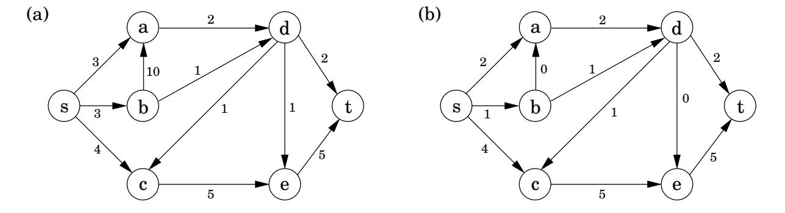

你：

$$
\sum_ {(w, u) \in E} f _ {w u} = \sum_ {(u, z) \in E} f _ {u z}.
$$

换句话说，流量是守恒的。

流量的大小是从 s 发送到 t 的总量，根据守恒定律，等于离开 s 的数量：

$$
\operatorname{size} (f) = \sum_ {(s, u) \in E} f _ {s u}.
$$

简而言之，我们的目标是为 $\{ f _ { e } : e \in E \}$ 分配满足一组线性约束并最大化线性目标函数的值。但这是一个线性规划！最大流问题简化为线性规划。

例如，对于图 7.4 的网络，LP 有 11 个变量，每条边一个。它寻求最大化 $f _ { s a } + f _ { s b } + f _ { s c }$，总共有27个约束：11个用于非负性（例如 $f _ { s a } \geq 0 )$），11个用于容量（例如 $f _ { s a } \leq 3 )$），5个用于流守恒（除了s和 $t ,$ 之外，图中的每个节点都有一个）例如 $f _ { s c } + f _ { d c } = f _ { c e } )$ 。Simplex 根本不需要时间来正确解决问题并确认，在我们的示例中，7 的流量实际上是最佳的。

## 7.2.3 仔细看看算法

到目前为止，我们所知道的单纯形算法只是模糊的几何直觉，即它不断在凸可行区域的表面上进行局部移动，不断改进目标函数，直到最终达到最优解。一旦我们更详细地研究了它（第 7.6 节），我们将能够准确地理解它如何处理流 LP，这对于设计直接最大流算法来说是有用的灵感来源。

事实证明，事实上单纯形的行为有一个基本的解释：

从零流量开始。

重复：从s到t选择一条合适的路径，并尽可能增加沿着这条路径边缘的流量。

图 7.5(a)–(d) 显示了一个小示例，其中单纯形在两次迭代后停止。最终流的大小为 2，很容易看出这是最佳的。

图 7.5 最大流量算法的图示。 (a) 玩具网络。 (b) 选择的第一条路径。 (c) 选择第二条路径。 (d) 最终流程。 (e) 我们本可以首先选择这条道路。 (f) 在这种情况下，我们必须允许第二条路径。

(一)  
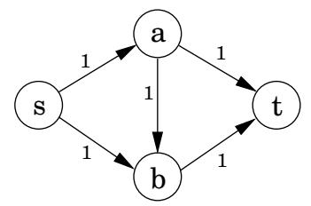

(二)  
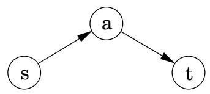

(三)  
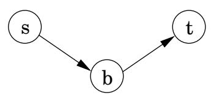

(四)  
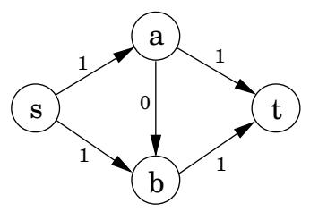

（五）  
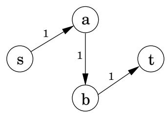

（六）  
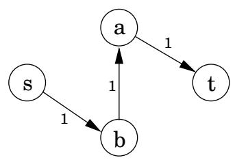

只有一个并发症。如果我们最初选择了一条不同的路径，即图 7.5(e) 中的路径，会怎样？这仅提供一个单位的流量，但似乎阻塞了所有其他路径。 Simplex 通过允许路径取消现有流来解决这个问题。在这种特殊情况下，它随后会选择图 7.5(f) 的路径。该路径的边 $( b , a )$ 不在原始网络中，并且具有取消先前分配给边 $( a , b )$ 的流的效果

总而言之，在每次迭代中单纯形都会寻找一条 $s - t$ 路径，其边 $( u , v )$ 可以有两种类型：

1. $( u , v )$ 在原网络中，尚未满负荷。

2. 反向边 $( v , u )$ 在原始网络中，并且沿着它有一些流量。

如果当前流量为 $f ,$，则在第一种情况下，边 $( u , v )$ 可以处理最多 $c _ { u v } - f _ { u v }$ 额外单位的流量，在第二种情况下，最多可以处理 $f _ { v u }$ 额外单位（取消现有流量的全部或部分） $( v , u ) )$ 。这些流量增加的机会可以在残差网络 $G ^ { f } = ( V , E ^ { f } )$ 中捕获，该网络恰好具有列出的两种类型的边，以及残差容量

比照：

$$
\left\{ \begin{array}{c l} c _ {u v} - f _ {u v} & \textbf {i f} (u, v) \in E \textbf {a n d} f _ {u v} <   c _ {u v} \\ f _ {v u} & \textbf {i f} (v, u) \in E \textbf {a n d} f _ {v u} > 0 \end{array} \right.
$$

因此，我们可以等效地将单纯形视为在残差网络中选择 $s - t$ 路径。

通过模拟单纯形的行为，我们得到了求解最大流的直接算法。它以迭代方式进行，每次显式构造 $G ^ { f }$ ，通过使用线性时间广度优先搜索在 $G ^ { f }$ 中找到合适的 $s - t$ 路径，如果不再有任何可以增加流量的此类路径，则停止。

图 7.6 说明了我们的石油示例的算法。

## 7.2.4 最优性证书

现在来看一个真正值得注意的事实：单纯形不仅正确地计算了最大流，而且还生成了该流的最优性的简短证明！

让我们看一个例子来说明这意味着什么。将石油网络的节点（图7.4）分为两组，$L = \{ s , a , b \}$ 和 $R = \{ c , d , e , t \}$：

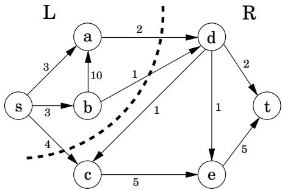

任何传输的油都必须从 L 到 R。因此，任何流量都不可能超过从 L 到 $R ,$ 的边缘的总容量，即 7。但这意味着我们之前发现的大小为 7 的流量必须是最佳的！

更一般地，$( s , t ) – c u t$ 将顶点划分为两个不相交的组 L 和 R，使得 s 在 L 中，t 在 R 中。它的容量是从 $L$ 到 $R ,$ 的边的总容量，并且如前所述，是任何流的上限：

选取任何流 f 和任何 (s, t) 切割 (L, R)。然后大小 $( f ) \ \leq$ 容量（L，R）。

有些切割很大并且给出了宽松的上限 - 切割 $( \{ s , b , c \} , \{ a , d , e , t \} )$ 的容量为 19。但也有一个容量为 7 的切割，这实际上是最大流最优性的证明。这不仅是我们石油网络的幸运财产，也是我们石油网络的幸运财产。这样的削减总是存在的。

最大流最小割定理网络中最大流的大小等于最小流的容量 $( s , t ) \ – c u t .$

此外，我们的算法会自动发现这种切割作为副产品！

让我们看看为什么这是真的。假设 f 是算法终止时的最终流程。我们知道在残差网络 $G ^ { f }$ 中，节点 t 不再可从 s 到达。令 L 为 $G ^ { f }$ 中 s 可到达的节点，并令 $R = V - L$ 为其余节点。那么 $( L , R )$ 就是图 G 中的一个割点：

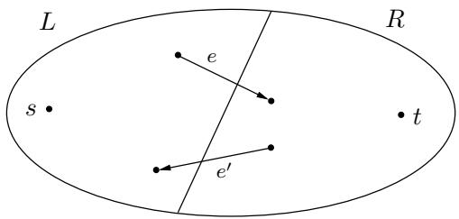

我们声称

$$
\operatorname{size} (f) = \operatorname{capacity} (L, R).
$$

要看到这一点，请观察 L 的定义方式，从 L 到 $R$ 的任何边都必须处于满容量（在当前流量 $f ) _ { - }$ 中，并且从 $R$ 到 $L$ 的任何边都必须具有零流量。$( \mathbf { S } \mathbf { 0 } ,$ 中图中，$f _ { e } = c _ { e }$ 和 $f _ { e ^ { \prime } } = 0 . )$ 因此，穿过 $( L , R )$ 的净流量正是切割的容量。

## 7.2.5 效率

我们的最大流算法的每次迭代都是高效的，如果使用深度优先或广度优先搜索来查找 $s - t$ 路径，则需要 $O ( | E | )$ 时间。但有多少次迭代呢？

假设原始网络中的所有边都具有整数容量 $\le C$。然后，归纳论证表明，在算法的每次迭代中，流量始终是整数并增加整数。因此，由于最大流量最多为 $C | E |$（为什么？），因此迭代次数最多就是这么多。但这并不是一个令人放心的界限：如果 C 达到数百万怎么办？

我们在练习 7.31 中进一步研究这个问题。事实证明，确实有可能构造出错误的示例，其中迭代次数与未仔细选择的 $C , i f s - t$ 路径成正比。然而，如果以合理的方式选择路径——特别是通过使用广度优先搜索，找到边数最少的路径——那么无论容量是多少，迭代次数最多为 $O ( | V | \cdot | E | )$ 。后一个界限给出了最大流量的总体运行时间 $O ( | V | \cdot | E | ^ { 2 } )$。

图 7.6 应用于图 7.4 网络的最大流算法。在每次迭代中，当前流显示在左侧，残差网络显示在右侧。所选路径以粗体显示。

电流

残差图

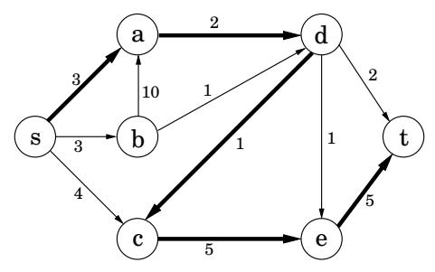

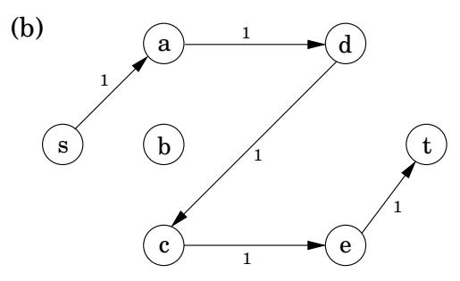

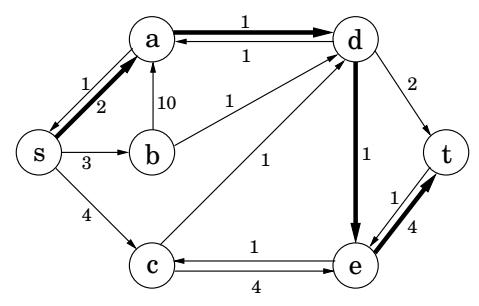

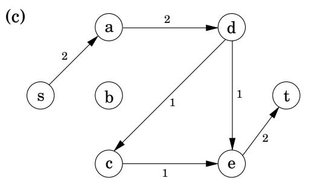

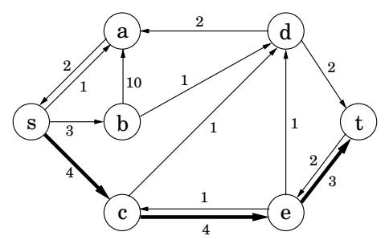

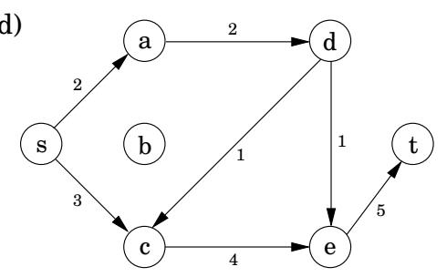

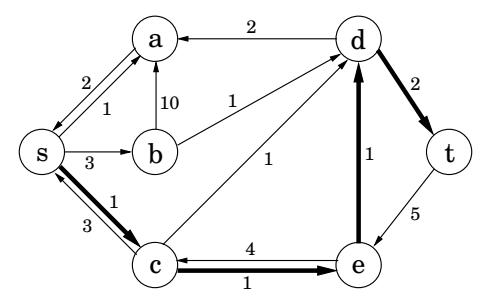

残差图

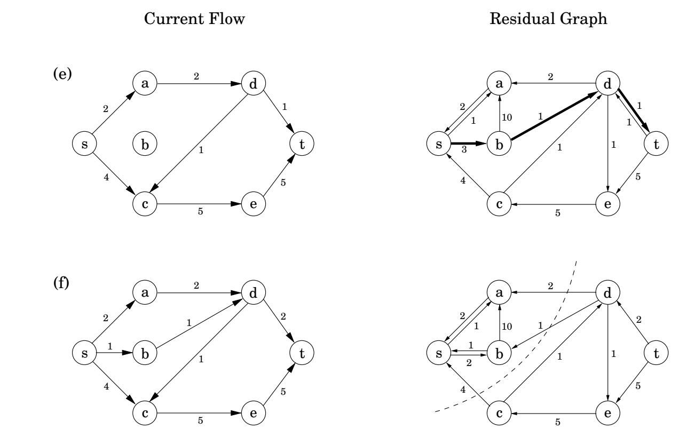

<table> <tr> <td>图7.7 两个人之间的边缘意味着他们彼此喜欢。是否可以将所有人配对开心吗？</td> </tr> <tr> <td> 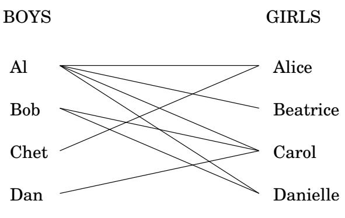 </td> </tr> </table>