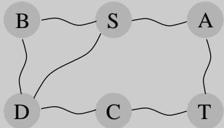

import Guide from '@/components/Guide.astro';
import Knowledge from '@/components/Knowledge.astro';
import Example from '@/components/Example.astro';
import Analysis from '@/components/Analysis.astro';
import Solution from '@/components/Solution.astro';
import Variant from '@/components/Variant.astro';
import Note from '@/components/Note.astro';
import Block from '@/components/Block.astro';
import Method from '@/components/Method.astro';
import Exercise from '@/components/Exercise.astro';
import Algorithm from '@/components/Algorithm.astro';

## 7.4 对偶性

我们已经看到，在网络中，流小于割，但最大流和最小割完全一致，因此每个都是另一个最优性的证明。尽管这种现象很引人注目，但我们现在将其从最大流推广到任何可以通过线性规划解决的问题！事实证明，每个线性最大化问题都有一个对偶最小化问题，它们之间的关系与流和割的关系非常相似。

要了解二元性是什么意思，请回忆一下我们介绍的 LP 中的两种巧克力：

$$
\begin{array}{c} \max x _ {1} + 6 x _ {2} \\ x _ {1} \leq 2 0 0 \\ x _ {2} \leq 3 0 0 \\ x _ {1} + x _ {2} \leq 4 0 0 \\ x _ {1}, x _ {2} \geq 0 \end{array}
$$

Simplex 声明最佳解决方案为 $( x _ { 1 } , x _ { 2 } ) = ( 1 0 0 , 3 0 0 )$ ，目标值为 1900。可以以某种方式检查这个答案吗？让我们看看：假设我们将第一个不等式加到第二个不等式的六倍上。我们得到

$$
x _ {1} + 6 x _ {2} \leq 2 0 0 0.
$$

这很有趣，因为它告诉我们不可能实现超过 2000 的利润。我们能否将 LP 约束的其他组合加在一起，使这个上限更接近 1900？经过一些实验，我们发现将三个不等式分别乘以 0、5 和 1，然后将它们相加得到

$$
x _ {1} + 6 x _ {2} \leq 1 9 0 0.
$$

所以1900确实是最好的价值！乘数 (0, 5, 1) 神奇地构成了最优性证书！值得注意的是，这张唱片存在这样的证书——即使我们知道有这样的证书，我们将如何系统地找到它？

让我们通过描述我们对这三个乘数的期望来调查这个问题，将它们称为 y1、y2、y3。

<table> <tr> <td>乘数</td> <td colspan="2">不平等</td> </tr> <tr> <td> $y_{1}$ </td> <td> $x_{1}$ </td> <td> $\leq 200$ </td> </tr> <tr> <td> $y_{2}$ </td> <td> </td> <td> $x_{2} \leq 300$ </td> </tr> <tr> <td> $y_{3}$ </td> <td> $x_{1} + x_{2}$ </td> <td> $\leq 400$ </td> </tr> </table>

<table> <tr> <td> </td> <td>原始可行</td> <td>原始opt</td> <td>双重选择</td> <td>双重可行</td> <td>目标值</td> </tr> <tr> <td> </td> <td colspan="5">这个对偶差距是零</td> </tr> </table>

图 7.9 根据设计，对偶可行值是原始可行值。对偶定理告诉我们，而且它们的最优值是一致的。

首先，这些 $y _ { i } \mathbf { \vec { s } }$ 必须是非负数，否则它们就没有资格乘以不等式（将不等式乘以负数会将 翻转为 ）。经过乘法和加法步骤后，我们得到了界限：

$$
(y _ {1} + y _ {3}) x _ {1} + (y _ {2} + y _ {3}) x _ {2} \leq 2 0 0 y _ {1} + 3 0 0 y _ {2} + 4 0 0 y _ {3}.
$$

我们希望左侧看起来像我们的目标函数 $x _ { 1 } + 6 x _ { 2 }$，以便右侧是最佳解决方案的上限。为此，我们需要 $y _ { 1 } + y _ { 3 }$ 为 1，$y _ { 2 } + y _ { 3 }$ 为 6。想一想，如果 $y _ { 1 } + y _ { 3 }$ 大于 1 就好了——生成的证书会更有说服力。因此，我们得到一个上限

$$
x _ {1} + 6 x _ {2} \leq 2 0 0 y _ {1} + 3 0 0 y _ {2} + 4 0 0 y _ {3} \quad \text { if } \quad \left\{ \begin{array}{l} y _ {1}, y _ {2}, y _ {3} \geq 0 \\ y _ {1} + y _ {3} \geq 1 \\ y _ {2} + y _ {3} \geq 6 \end{array} \right\}.
$$

我们可以很容易地找到满足右侧不等式的 $y \mathbf { \bar { s } }$，只需将它们设置得足够大，例如 $( y _ { 1 } , y _ { 2 } , y _ { 3 } ) = ( 5 , 3 , 6 )$。但这些特定的乘数会告诉我们，LP 的最佳解决方案最多是 $2 0 0 \cdot 5 + 3 0 0 \cdot 3 + 4 0 0 \cdot 6 = 4 3 0 0$ ，这个界限太宽松了，无法引起人们的兴趣。我们想要的是一个尽可能严格的界限，因此我们应该根据前面的不等式最小化 $2 0 0 y _ { 1 } + 3 0 0 y _ { 2 } + 4 0 0 y _ { 3 }$。这是一个新的线性规划！

因此，找到在我们的原始 LP 上给出最佳上限的乘数集合就等于求解一个新的 LP：

$$
\begin{array}{c} \min 2 0 0 y _ {1} + 3 0 0 y _ {2} + 4 0 0 y _ {3} \\ y _ {1} + y _ {3} \geq 1 \\ y _ {2} + y _ {3} \geq 6 \\ y _ {1}, y _ {2}, y _ {3} \geq 0 \end{array}
$$

根据设计，此对偶 LP 的任何可行值都是原始 LP 的上限。因此，如果我们以某种方式找到一对相等的原始可行值和对偶可行值，那么它们一定都是最优的。这就是这样的一对：

$$
\text { Primal }: (x _ {1}, x _ {2}) = (1 0 0, 3 0 0); \quad \text { Dual }: (y _ {1}, y _ {2}, y _ {3}) = (0, 5, 1).
$$

它们的值都是 1900，因此它们证明了彼此的最优性（图 7.9）。

<table> <tr> <td colspan="3">图 7.10 矩阵向量形式的通用原始 LP 及其双.</td> </tr> <tr> <td>原始LP：</td> <td>双LP：</td> <td> </td> </tr> <tr> <td> </td> <td> $\max c^T x$ </td> <td> $\min y^T b$ </td> </tr> <tr> <td> </td> <td> $Ax \leq b$ </td> <td> $y^T A \geq c^T$ </td> </tr> <tr> <td> </td> <td> $x \geq 0$ </td> <td> $y \geq 0$ </td> </tr> </table>

<Algorithm title="Figure 7.11 In the most general case of linear programming, we have a set I of inequalities and a set E of equalities (a total of ⟦ASTRO_TOK_45⟧ constraints) over n variables, of which a subset N are constrained to be nonnegative. The dual has ⟦ASTRO_TOK_46⟧ variables, of which only those corresponding to I have nonnegativity constraints.">
原始LP：
    $\max c_1 x_1 + \cdots + c_n x_n$
    $a_{i1} x_1 + \cdots + a_{in} x_n \leq b_i$ 为 $i \in I$
    $a_{i1} x_1 + \cdots + a_{in} x_n = b_i$ $i \in E$
    $x_j \geq 0$ 为 $j \in N$

双LP：
    $\min b_1 y_1 + \cdots + b_m y_m$
    $a_{1j} y_1 + \cdots + a_{mj} y_m \geq c_j$ 为 $j \in N$
    $a_{1j} y_1 + \cdots + a_{mj} y_m = c_j$ 对于 $j 
奥廷 N$
    $y_i \geq 0$ 为 $i \in I$
</Algorithm>

令人惊讶的是，这不仅仅是一个幸运的例子，而是一个普遍现象。首先，前面的构造——为每个原始约束创建一个乘数；为原始变量的每个变量在对偶中编写一个约束，其中要求总和高于相应原始变量的目标系数；优化由原始右侧加权的乘数之和——可以对任何 LP 进行，如图 7.10 所示，并且更普遍地如图 7.11 所示。第二个图有一个值得注意的补充：如果原数具有等式约束，则相应的乘数（或对偶变量）不需要是非负的，因为当乘以负数时，方程的有效性得以保留。因此，方程的乘数是不受限制的变量。还要注意两个 LP 之间的简单对称性，因为矩阵 $A = \left( a _ { i j } \right)$ 为其每一行定义一个原始约束，并为其每一列定义一个对偶约束。

通过构造，对偶的任何可行解都是原数的任何可行解的上限。但更重要的是，他们的最优值是一致的！

对偶定理 如果线性程序具有有界最优值，那么它的对偶值和两个最优值也一致。

当原始是表达最大流问题的LP时，可以将解释分配给对偶变量，以表明对偶不是别的而是最小割问题（练习7.25）。因此，流量和削减之间的关系只是对偶定理的一个具体实例。事实上，这个定理的证明脱离了单纯形算法，就像最大流最小割定理脱离了最大流算法的分析一样。

<Knowledge title="Box: Visualizing duality">

人们可以通过以下“模拟”设备来解决最短路径问题：给定一个带权无向图，构建它的物理模型，其中每条边都是长度等于边权重的字符串，每个节点都是一个结，在该结处将字符串的适当端点连接在一起。然后，要找到从 s 到 $t ,$ 的最短路径，只需将 s 拉离 t，直到小工具拉紧。直观上很明显，这找到了从 s 到 t 的最短路径。

所有这一切都没有什么值得注意或令人惊讶的地方，直到我们注意到以下几点：最短路径问题是一个最小化问题，对吧？那么为什么我们要将 s 与 t 分开，而这种行为的目的显然是最大化呢？答案：通过将 s 拉离 t，我们解决了最短路径问题的对偶问题！这个对偶有一种非常简单的形式（练习 7.28），每个节点 u 有一个变量 $x _ { u }$：

$$
\begin{array}{c} \max x _ {S} - x _ {T} \\ | x _ {u} - x _ {v} | \leq w _ {u v} \quad \text { for   all   edges } \{u, v \} \end{array}
$$

换句话说，对偶问题是将 s 和 t 拉伸得尽可能远，但受到任何边 $\{ u , v \}$ 的端点最多相隔 $w _ { u v } .$ 的距离的约束

</Knowledge>