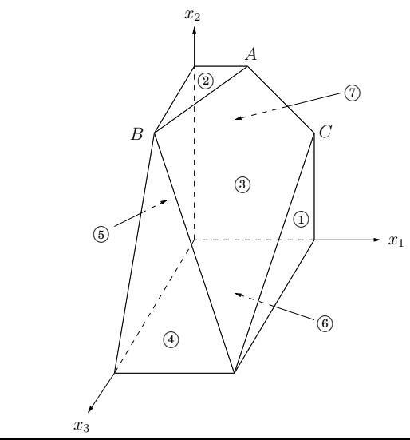
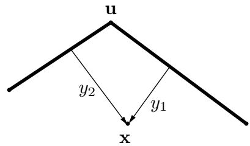
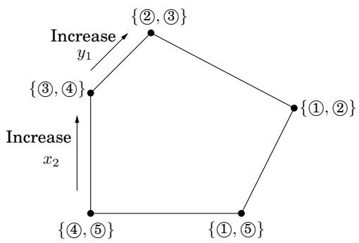

import Guide from '@/components/Guide.astro';
import Knowledge from '@/components/Knowledge.astro';
import Example from '@/components/Example.astro';
import Analysis from '@/components/Analysis.astro';
import Solution from '@/components/Solution.astro';
import Variant from '@/components/Variant.astro';
import Note from '@/components/Note.astro';
import Block from '@/components/Block.astro';
import Method from '@/components/Method.astro';
import Exercise from '@/components/Exercise.astro';
import Algorithm from '@/components/Algorithm.astro';

## 7.6 单纯形算法

如果我们没有办法有效地解决线性规划的问题，那么线性规划的非凡能力和表现力就无法给我们带来多少安慰。这就是单纯形算法的作用。

在较高层次上，单纯形算法采用一组线性不等式和一个线性目标函数，并通过以下策略找到最佳可行点：

<Algorithm>
设 v 为可行区域的任意顶点
而 v 的邻居 $v'$ 具有更好的目标值：
    设置 $v = v'$
</Algorithm>

在我们的 2D 和 3D 示例（图 7.1 和图 7.2）中，这很容易可视化并且具有直观意义。但是如果有 n 个变量呢，$x _ { 1 } , \ldots , x _ { n } ?$

$x _ { i } \mathbf { \dot { s } }$ 的任何设置都可以由实数的 n 元组表示并在 n 维空间中绘制。涉及 $x _ { i } { \bf \dot { s } }$ 的线性方程在同一空间 $\mathbb { R } ^ { n }$ 中定义了一个超平面，相应的线性不等式定义了一个半空间，所有点要么精确地位于超平面上，要么位于超平面的某一特定侧。最后，线性程序的可行区域由一组不等式指定，因此是相应半空间的交集，即凸多面体。

但在这种一般情况下，顶点和邻居的概念意味着什么？

5

6

图 7.12 由七个不等式定义的多面体。

$$
\max x _ {1} + 6 x _ {2} + 1 3 x _ {3}
$$

$$
x _ {1} \leq 2 0 0\tag{①}
$$

$$
x _ {2} \leq 3 0 0\tag{②}
$$

$$
x _ {1} + x _ {2} + x _ {3} \leq 4 0 0
$$

$$
x _ {2} + 3 x _ {3} \leq 6 0 0
$$

$$
x _ {1} \geq 0\tag{③}
$$

$$
x _ {2} \geq 0\tag{④}
$$

$$
x _ {3} \geq 0
$$

## 7.6.1 n 维空间中的顶点和邻居

图 7.12 让人回想起之前的一个例子。仔细观察，我们发现每个顶点都是超平面某些子集相交的唯一点。例如，顶点 A 是满足约束 2 、 3 和 7 相等的唯一点。另一方面，不等式4和6对应的超平面没有定义顶点，因为它们的交点不仅仅是单个点，而是整条线。

让我们使这个定义更加精确。

选择不等式的子集。如果有一个唯一的点满足它们相等，并且这个点恰好是可行的，那么它就是一个顶点。

需要多少个方程才能唯一地标识一个点？当有n个变量时，如果我们想要唯一的解决方案，我们至少需要n个线性方程。另一方面，超过 n 个方程是多余的：至少其中一个可以重写为其他方程的线性组合，因此可以忽略。简而言之，

每个顶点由一组 n 个不等式指定。3

邻居的概念现在自然而然地出现了。

如果两个顶点有 n 1 共同定义的不等式，则它们是邻居。

例如，在图 7.12 中，顶点 A 和 C 共享两个定义的不等式 $\{ \textcircled{3 } , \textcircled{7} \}$，因此是邻居。

## 7.6.2 算法

在每次迭代中，单纯形有两个任务：

1. 检查当前顶点是否最优（如果是，则停止）。

2. 确定下一步要去哪里。

正如我们将看到的，如果顶点恰好位于原点，这两个任务都很容易。如果顶点在其他地方，我们将变换坐标系，将其移动到原点！

首先我们来看看为什么origin这么方便。假设我们有一些通用的 LP

$$
\begin{array}{c} \max \mathbf {c} ^ {T} \mathbf {x} \\ \mathbf {A x} \leq \mathbf {b} \\ \mathbf {x} \geq 0 \end{array}
$$

其中 x 是变量向量 $\mathbf { x } = ( x _ { 1 } , \ldots , x _ { n } )$ 。假设原点是可行的。那么它肯定是一个顶点，因为它是 n 个不等式 $\{ x _ { 1 } \geq 0 , \ldots , x _ { n } \geq 0 \}$ 紧的唯一点。现在让我们解决两个任务。任务1：

当且仅当所有 $c _ { i } \leq 0$ 时，原点才是最优的

如果都是 $c _ { i } \leq 0$ ，那么考虑到约束 $\mathbf { x } \geq 0$ ，我们不能指望有更好的目标值。相反，如果有一些 $c _ { i } > 0$ ，那么原点不是最优的，因为我们可以通过提高 $x _ { i }$ 来增加目标函数

因此，对于任务 2，我们可以通过增加一些 $x _ { i }$ 来移动，其中 $c _ { i } > 0$ 。我们可以增加多少？直到我们遇到其他限制。也就是说，我们释放紧约束 $x _ { i } \geq 0$ 并增加 $x _ { i }$ 直到之前松散的其他不等式现在变得紧。到那时，我们再次有 n 个严格的不等式，因此我们处于一个新的顶点。

例如，假设我们正在处理以下线性程序。

$$
\begin{array}{r l r} \max 2 x _ {1} + 5 x _ {2} \\ 2 x _ {1} - x _ {2} & \leq 4 & \text {①} \\ x _ {1} + 2 x _ {2} & \leq 9 & \text {②} \\ - x _ {1} + x _ {2} & \leq 3 & \text {③} \\ x _ {1} & \geq 0 & \text {④} \\ x _ {2} & \geq 0 & \text {⑤} \end{array}
$$

Simplex 可以从原点开始，由约束 $\textcircled{4}$ 和 $\textcircled{5}$ 指定。为了移动，我们释放严格约束 $x _ { 2 } \geq 0$ 。随着 $x _ { 2 }$ 逐渐增加，它遇到的第一个约束是 $- x _ { 1 } + x _ { 2 } \leq 3$，因此它必须停在 $x _ { 2 } = 3$，此时这个新的不等式是紧的。新的顶点因此由 3 和 4 给出。

所以我们知道如果我们在原点该怎么办。但是如果我们当前的顶点 u 在其他地方怎么办？诀窍是通过将坐标系从通常的 $( x _ { 1 } , \ldots , x _ { n } )$ 移动到 u 的“局部视图”，将 u 变换到原点。这些局部坐标由到定义并包围 u 的 n 个超平面（不等式）的（适当缩放的）距离 $y _ { 1 } , \ldots , y _ { n }$ 组成：

具体来说，如果这些封闭不等式之一是 $\mathbf { a } _ { i } \cdot \mathbf { x } \leq b _ { i }$ ，那么从点 x 到该特定“墙”的距离是

$$
y _ {i} = b _ {i} - \mathbf {a} _ {i} \cdot \mathbf {x}.
$$

这种类型的 n 个方程（每面墙一个）将 $y _ { i } \mathbf { \vec { s } }$ 定义为 $x _ { i } \mathbf { \bar { s } } ,$ 的线性函数，并且可以反转此关系以将 $x _ { i } { \bf \dot { s } }$ 表示为 $y _ { i } \mathbf { \vec { s } }$ 的线性函数。因此，我们可以根据 $y ^ { \prime } \mathbf { s } .$ 重写整个 LP。这并没有从根本上改变它（例如，最优值保持不变），而是在不同的坐标系中表达它。修改后的“本地”LP 具有以下三个属性：

1. 它包括不等式 $\textbf { y } \geq 0$ ，它们只是定义 u 的不等式的变换版本。

2. u 本身是 y 空间中的原点。

3. 成本函数变为 max $c _ { \mathbf { u } } + \tilde { \mathbf { c } } ^ { T } \mathbf { y }$ ，其中 $c _ { \mathbf { u } }$ 是目标函数在 u 处的值，c~ 是变换后的成本向量。

简而言之，我们又回到了我们知道如何处理的情况！图 7.13 显示了该算法的实际应用，继续我们之前的示例。

单纯形算法现已完全定义。它从一个顶点移动到邻近的顶点，当目标函数局部最优时，即当局部成本向量的坐标全为零或负时停止。正如我们刚刚看到的，具有此属性的顶点也必须是全局最优的。另一方面，如果当前顶点不是局部最优的，则其局部坐标系包括可以改进目标函数的某个维度，因此我们沿着这个方向（沿着多面体的这条边）移动，直到到达相邻顶点。根据非简并性假设（参见第 7.6.1 节中的脚注 3），该边具有非零长度，因此我们严格改进目标值。因此，该过程最终必须停止。

图 7.13 运行中的 Simplex。

<table> <tr> <td>初始LP：$\max 2x_1 + 5x_2$ $2x_1 - x_2 \leq 4$1$x_1 + 2x_2 \leq 9$2$-x_1 + x_2 \leq 3$ 3 $x_1 \geq 0$ 4 $x_2 \geq 0$ 5</td> <td>当前顶点：&#123;4,5&#125;（原点）。目标值： 0.移动：增加 $x_2$ .5 释放，3 变紧。在 $x_2 = 3$ 停止。新顶点 &#123;4,3&#125; 具有本地坐标 $(y_1, y_2)$ : $y_1 = x_1, \quad y_2 = 3 + x_1 - x_2$ </td> </tr> <tr> <td>重写LP：$\max 15 + 7y_1 - 5y_2$ $y_1 + y_2 \leq 7$1$3y_1 - 2y_2 \leq 3$2 $y_2 \geq 0$ 3 $y_1 \geq 0$ 4 $-y_1 + y_2 \leq 3$ 5</td> <td>当前顶点： &#123;4,3&#125;。目标值：15。移动：增加 $y_1$ .4 被释放，2 变紧。在 $y_1 = 1$ 停止。新顶点 &#123;2,3&#125; 具有本地坐标 $(z_1, z_2)$ : $z_1 = 3 - 3y_1 + 2y_2, \quad z_2 = y_2$ </td> </tr> <tr> <td>重写LP：$\max 22 - \frac{7}{3}z_1 - \frac{1}{3}z_2$ $-\frac{1}{3}z_1 + \frac{5}{3}z_2 \leq 6$1$z_1 \geq 0$2 $z_2 \geq 0$ 3 $\frac{1}{3}z_1 - \frac{2}{3}z_2 \leq 1$ 4 $\frac{1}{3}z_1 + \frac{1}{3}z_2 \leq 4$ 5</td> <td>当前顶点： &#123;2,3&#125;。目标值：22。最优：全部 $c_i < 0$。求解2,3（在原始LP中）以获得最优解 $(x_1, x_2) = (1, 4)$ .</td> </tr> <tr> <td colspan="2">  </td> </tr> </table>

## 7.6.3 未解决的问题

单纯形算法中有几个重要问题我们还没有提到。

起始顶点。我们如何找到开始单纯形的顶点？在我们的 2D 和 3D 示例中，我们总是从原点开始，这是有效的，因为线性程序碰巧存在右侧为正的不等式。在一般的 LP 中我们不会总是那么幸运。然而，事实证明，找到一个起始顶点可以简化为一个LP并通过单纯形法来解决！

要了解这是如何完成的，请从任何标准形式的线性程序开始（回忆第 7.1.4 节），因为我们知道 LP 总是可以用这种方式重写。

$$
\min \mathbf {c} ^ {T} \mathbf {x} \text {   such   that   } \mathbf {A x} = \mathbf {b} \text {   and   } \mathbf {x} \geq 0.
$$

我们首先确保方程的右边都是非负的：如果 $b _ { i } < 0$ 只需将第 i 个方程的两边都乘以 1。

然后我们创建一个新的LP如下：

创建 m 个新的人工变量 $z _ { 1 } , \ldots , z _ { m } \geq 0 $ ，其中 m 是方程的数量。

$\mathbf { A d d } \ z _ { i }$ 到第 i 个方程的左侧。

令要最小化的目标为 $z _ { 1 } + z _ { 2 } + \dots + z _ { m }$

对于这个新的 LP，很容易想出一个起始顶点，即对于所有 i 和所有其他变量为零的 $z _ { i } = b _ { i }$ 。因此我们可以用单纯形法求解，得到最优解。

有两种情况。如果 $z _ { 1 } + \cdots + z _ { m }$ 的最优值为零，则通过单纯形法获得的所有 $z _ { i } \mathbf { \dot { s } }$ 都为零，因此从新 LP 的最优顶点我们得到原始 LP 的起始可行顶点，只需忽略 $z _ { i } \mathbf { \dot { s } } .$ 。我们终于可以开始单纯形了！

但如果最佳目标结果是积极的怎么办？让我们想想。我们试图最小化 $z _ { i } \mathbf { \dot { s } } ,$ 的总和，但 simplex 决定它不能为零。但这意味着原来的线性程序是不可行的：它需要一些非零的 $z _ { i } \mathbf { \dot { s } }$ 才能变得可行。这就是 simplex 发现并报告 LP 不可行的方式。

堕落。在图 7.12 的多面体中，顶点 B 是退化的。在几何上，这意味着它是多面体的多个 $n = 3$ 面的交集（在本例中为 $\textcircled { 2 } , \textcircled { 3 } , \textcircled { 4 } , \textcircled { 5 } )$。在代数上，这意味着如果我们选择四组三个不等式中的任何一组 $( \{ \textcircled { 2 } , \textcircled { 3 } , \textcircled { 4 } \} , \{ \textcircled { 2 } , \textcircled { 3 } , \textcircled { 5 } \} , \{ \textcircled { 2 } , \textcircled { 4 } , \textcircled { 5 } \}$ 和3、4、5）并求解相应的对于三个未知数的三个线性方程组，我们将在所有四种情况下得到相同的解：(0, 300, 100)。这是一个严重的问题：单纯形可能会返回次优的退化顶点，因为它的所有邻居都与它相同，因此没有更好的目标。如果我们修改单纯形，使其检测简并性并继续从一个顶点跳到另一个顶点，尽管成本没有任何改进，它可能最终会永远循环。

解决此问题的一种方法是通过扰动：将每个 $b _ { i }$ 以微小的随机量更改为 $b _ { i } \pm \epsilon _ { i }$ 这不会改变 LP 的本质，因为 $\epsilon _ { i } \mathbf { \dot { s } }$ 很小，但它具有区分线性系统的解的效果。要从几何角度了解原因，请想象四个平面 2 、 3 、 4 、 5 发生了一点震动。顶点 B 不会分裂成两个顶点吗？

无界性。在某些情况下，LP 是无界的，因为它的目标函数可以任意大（或者，如果是最小化问题，则可以任意小）。如果是这种情况，单纯形会发现它：在探索顶点的邻域时，它会注意到去掉一个不等式并添加另一个不等式会导致一个具有无穷多个解的欠定方程组。事实上（这是一个简单的测试）解决方案的空间包含一整条线，目标可以变得越来越大，一直到 $\infty .$ 。在这种情况下，Simplex 停止并抱怨。

## 7.6.4 单纯形的运行时间

对于一般线性程序，单纯形的运行时间是多少

$$
\max \mathbf {c} ^ {T} \mathbf {x} \text {   such   that   } \mathbf {A x} \leq 0 \text {   and   } \mathbf {x} \geq 0,
$$

其中有 n 个变量且 A 包含 m 个不等式约束？由于它是从一个顶点到另一个顶点的迭代算法，因此我们首先计算单次迭代所需的时间。假设当前顶点是u。根据定义，它是 n 个不等式约束满足相等的唯一点。它的每个邻居共享 $n - 1$ 这些不等式，因此 u 最多可以有 n m 个邻居：选择要删除哪个不等式以及添加哪个新不等式。

执行迭代的一种简单方法是检查每个潜在的邻居，看看它是否真的是多面体的顶点并确定其成本。找到成本很快，只是一个点积，但检查它是否是一个真正的顶点涉及求解 n 个未知数的 n 个方程组（即，精确满足 n 个选定的不等式）并检查结果是否可行。通过高斯消去法（见下框），这需要 $O ( n ^ { 3 } )$ 时间，每次迭代的运行时间令人倒胃口的 $O ( m n ^ { 4 } )$。

幸运的是，有更好的方法，并且这个 $m n ^ { 4 }$ 因子可以改进为 $m n ,$ ，使单纯形成为一种实用的算法。回想一下我们之前关于顶点 u 的局部视图的讨论（第 7.6.2 节）。事实证明，根据当前局部坐标重写 LP 的每次迭代开销仅为 $O ( ( m + n ) n )$ ；这利用了这样一个事实：局部视图在迭代之间仅发生轻微变化，仅在其定义的不等式之一中发生变化。

接下来，为了选择最佳邻居，我们回想起目标函数（的局部视图）的形式为“max $c _ { \mathbf { u } } + \tilde { \mathbf { c } } { \cdot } \mathbf { y } ^ { \mathfrak { n } }$，其中 $c _ { \mathbf { u } }$ 是目标函数在u处的值。这立即确定了一个有希望的移动方向：我们选择任何 $\tilde { c } _ { i } > 0$（如果没有，则当前顶点是最佳的并且单纯形停止）。由于 LP 的其余部分现在已根据 y 坐标重写，因此很容易确定在违反其他一些不等式之前可以增加多少 $y _ { i }$ （如果我们可以无限期地增加 $y _ { i }$，我们就知道 LP 是无界的。）

由此可见，单纯形每次迭代的运行时间仅为 $O ( m n )$ 。但可能有多少次迭代呢？当然，不能超过 $\textstyle { \binom { m + n } { n } }$ ，这是顶点数量的上限。但这个上限是 n 的指数。事实上，有一些 LP 的例子，单纯形确实需要指数迭代次数。换句话说，单纯形是一种指数时间算法。然而，这种指数级的例子在实践中并不会发生，正是这一事实使得单纯形如此有价值并如此广泛使用。

<Knowledge title="Box: Gaussian elimination">

根据我们的代数定义，仅仅写下顶点的坐标就涉及求解线性方程组。这是怎么做到的？
给定一个包含 n 个未知数的 n 个线性方程组，假设 n = 4 且
 $x_{1} - 2x_{3} = 2$ $x_{2} + x_{3} = 3$ $x_{1} + x_{2} - x_{4} = 4$ $x_{2} + 3x_{3} + x_{4} = 5$ 
解决此类方程组的高中方法是重复应用以下规则：如果我们将一个方程的倍数添加到另一个方程中，则整个方程组保持等效。例如，将第一个方程的 -1 乘以第三个方程，我们得到等效系统
 $x_{1} - 2x_{3} = 2$ $x_{2} + x_{3} = 3$ $x_{2} + 2x_{3} - x_{4} = 2$ $x_{2} + 3x_{3} + x_{4} = 5$ 
这种转换在以下意义上是巧妙的：它从第三个方程中消除了变量 $x_{1}$ ，只留下一个带有 $x_{1}$ 的方程。换句话说，忽略第一个方程，我们有一个由三个未知数组成的三个方程组：我们将 n 减少了 1！我们可以求解这个较小的系统以获得 $x_{2}, x_{3}, x_{4}$ ，然后将它们代入第一个方程以获得 $x_{1}$ 。
这提出了一种算法——再次归功于高斯。

<Algorithm title="procedure gauss(E, X)">
输入： n 个未知数 $X = \{x_1, \ldots, x_n\}$ 方程组 $E = \{e_1, \ldots, e_n\}$：
        $e_1: a_{11}x_1 + a_{12}x_2 + \cdots + a_{1n}x_n = b_1; \cdots; e_n: a_{n1}x_1 + a_{n2}x_2 + \cdots + a_{nn}x_n = b_n$
输出：系统的解决方案（如果存在）

如果所有系数 $a_{i1}$ 均为零：
    停止并显示消息“不可行或不是线性独立的”
如果 n = 1：返回 $b_1/a_{11}$

选择最大幅度的系数 $a_{p1}$，并交换方程 $e_1, e_p$
对于 i = 2 到 n：
    $e_i = e_i - (a_{i1}/a_{11}) \cdot e_1$
$(x_2, \ldots, x_n) = \text{gauss}(E - \{e_1\}, X - \{x_1\})$
$x_1 = (b_1 - \sum_{j>1} a_{1j}x_j) / a_{11}$
返回 $(x_1, \ldots, x_n)$
</Algorithm>

（当选择要交换到第一位的方程时，出于数值准确性的原因，我们选择具有最大 $|a_{p1}|$ 的方程；毕竟，我们将除以 $a_{p1}$ 。）
高斯消除使用 $O(n^{2})$ 算术运算将问题规模从n减少到n - 1，因此总体上使用 $O(n^{3})$ 运算。为了表明这也是对总运行时间的良好估计，我们需要证明所涉及的数字仍然是多项式有界的，例如，解决方案 $(x_{1}, \ldots, x_{n})$ 不需要比原始系数 $a_{ij}$ 和 $b_{i}$ 更高的精度来写。你明白为什么这是真的吗？

</Knowledge>

<Knowledge title="Box: Linear programming in polynomial time">

Simplex 不是多项式时间算法。某些罕见的线性规划会导致它从可行区域的一个角到一个更好的角，然后到一个更好的角，依此类推，步数呈指数级。很长一段时间，线性规划被认为是一个悖论，一个在实践中可以解决，但在理论上却无法解决的问题！

然后，在 1979 年，一位名叫 Leonid Khachiyan 的年轻苏联数学家提出了椭球算法，该算法与单纯形算法有很大不同，其概念极其简单（但证明复杂），但可以在多项式时间内求解任何线性规划。 Khachiyan 的算法不是将解决方案从多面体的一个角逐到下一个角，而是将其限制在越来越小的椭球体（倾斜的高维球）上。当这个算法公布时，它变成了一种“数学人造卫星”，这是一项引人注目的成就，在冷战最激烈的时期，美国当局对苏联可能拥有的科学优势感到担忧。椭球算法被证明是一个重要的理论进步，但在实践中并不能与单纯形算法很好地竞争。线性规划的悖论加深了：一个问题有两种算法，一种在理论上有效，一种在实践中有效！

几年后，加州大学伯克利分校的研究生纳伦德拉·卡马克 (Narendra Karmarkar) 提出了一个完全不同的想法，从而催生了另一种可证明的线性规划多项式算法。卡马克算法被称为内点法，因为它就是这样做的：它不是像单纯形那样通过在多面体表面上从一个角跳到另一个角来冲向最佳角，而是通过在多面体内部切割一条巧妙的路径。并且在实践中也确实表现良好。

但也许线性规划算法的最大进步不是 Khachiyan 的理论突破或 Karmarkar 的新颖方法，而是后者的一个意想不到的结果：单纯形和内点这两种方法之间的激烈竞争导致了线性规划非常快的代码的开发。

</Knowledge>