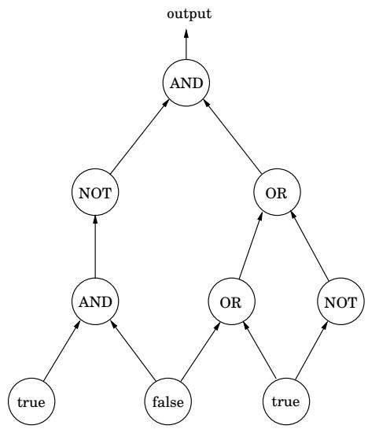
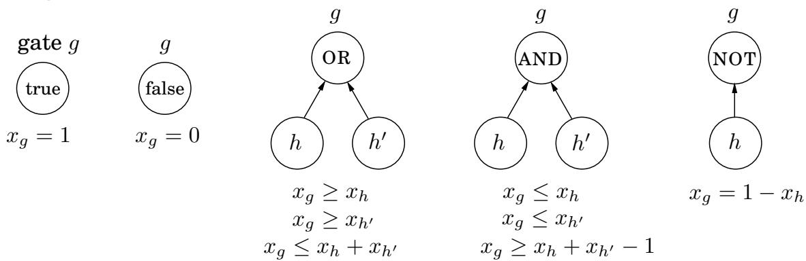

import Guide from '@/components/Guide.astro';
import Knowledge from '@/components/Knowledge.astro';
import Example from '@/components/Example.astro';
import Analysis from '@/components/Analysis.astro';
import Solution from '@/components/Solution.astro';
import Variant from '@/components/Variant.astro';
import Note from '@/components/Note.astro';
import Block from '@/components/Block.astro';
import Method from '@/components/Method.astro';
import Exercise from '@/components/Exercise.astro';

## 7.7 后记：电路评估

线性规划的重要性源于它可以解决的各种令人震惊的问题，从而证明了它的表达能力。从某种意义上说，下一个是最终的应用程序。

我们给出了一个布尔电路，即以下类型的门的 dag。

输入门的入度为零，值为 true 或 false。

AND 门和 OR 门的入度为 2。

NOT 门的入度为 1。

此外，其中一个门被指定为输出。这是一个例子。

电路值问题如下：当布尔逻辑定律按拓扑顺序应用于门时，输出结果是否为真？

有一种简单、自动的方法可以将此问题转化为线性程序。为每个门 g 创建一个变量 $x _ { g }$ ，并具有约束 $^ { g , }$ $0 \leq x _ { g } \leq 1$ 。为每种类型的门添加额外的约束：

这些约束迫使所有门都采用正确的值——0 代表假，1 代表真。我们不需要最大化或最小化任何东西，我们可以从对应于输出门的变量 $x _ { o }$ 中读取答案。

这是对线性规划的直接简化，从一个起初看起来不太有趣的问题开始。然而，电路值问题在某种意义上是多项式时间内可解决的最普遍的问题！毕竟任何算法最终都会在计算机上运行，​​而计算机最终是在芯片上实现的布尔组合电路。如果算法以多项式时间运行，则可以将其呈现为布尔电路，该布尔电路由计算机电路的多项式多个副本组成，每个单位时间一个，其中一层中的门的值用于计算下一层的值。因此，电路值简化为线性规划这一事实意味着所有可以在多项式时间内解决的问题都可以！

在我们的下一个主题“NP 完备性”中，我们将看到许多难题以大致相同的方式简化为整数规划（线性规划的困难孪生）。

另一个临别思考：还有什么其他方法可以解决电路评估问题？让我们想想——电路就是一个DAG。哪种算法技术最适合解决 dags 上的问题？没错：动态规划！与线性规划一起，是世界上两种最通用的算法技术。