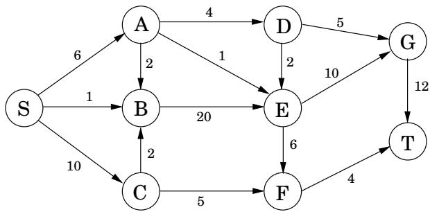
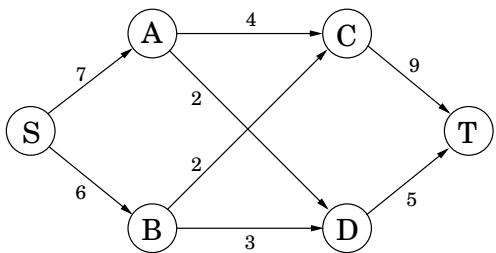
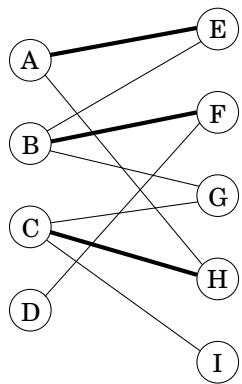
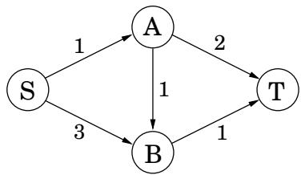
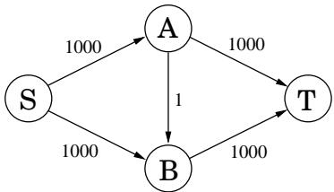

import Guide from '@/components/Guide.astro';
import Knowledge from '@/components/Knowledge.astro';
import Example from '@/components/Example.astro';
import Analysis from '@/components/Analysis.astro';
import Solution from '@/components/Solution.astro';
import Variant from '@/components/Variant.astro';
import Note from '@/components/Note.astro';
import Block from '@/components/Block.astro';
import Method from '@/components/Method.astro';
import Exercise from '@/components/Exercise.astro';

## 第 7 章练习

<Exercise title="Exercise 7.1">

考虑以下线性程序。

$$
\begin{array}{c} \text {maximize} 5 x + 3 y \\ 5 x - 2 y \geq 0 \\ x + y \leq 7 \\ x \leq 5 \\ x \geq 0 \\ y \geq 0 \end{array}
$$

绘制可行区域并确定最佳解决方案。

</Exercise>

<Exercise title="Exercise 7.2">

鸭麦产于堪萨斯州和墨西哥，消费于纽约和加利福尼亚州。堪萨斯州生产 15 粒鸭麦，墨西哥生产 8 粒。同时，纽约消耗 10 粒鸭麦，加利福尼亚州消耗 13 粒。每粒鸭麦的运输成本为：从墨西哥到纽约 4 美元，从墨西哥到加利福尼亚 1 美元，从堪萨斯到纽约 2 美元，从堪萨斯到加利福尼亚 3 美元。编写一个线性程序，决定从每个生产者运输到每个消费者的鸭麦数量（以 shnupell 和 shnupell 的分数为单位），从而最小化总体运输成本。

</Exercise>

<Exercise title="Exercise 7.3">

一架货机最大载重量为100吨，最大体积为60立方米。需要运输三种材料，货运公司可以选择运输每种材料的任意数量，但不得超过下面给出的最大可用限制。

材料1的密度为2吨/立方米，最大可用量为40立方米，每立方米收益为1000美元。

材料2的密度为1吨/立方米，最大可用量为30立方米，每立方米收益为1200美元。

材料3密度3吨/立方米，最大可用量20立方米，每立方米收益12000美元。

编写一个线性程序，在约束范围内优化收入。

</Exercise>

<Exercise title="Exercise 7.4">

Moe 正在决定每周订购多少普通达夫啤酒和多少达夫强啤酒。 Moe 每品脱普通 Duff 的售价为 1 美元，而他的售价为每品脱 2 美元； Duff Strong 的售价为每品脱 1.5 美元，而他的售价为每品脱 3 美元。然而，作为复杂营销骗局的一部分，Moe 每购买两品脱或更多普通 Duff，Duff 公司只会出售一品脱 Duff Strong。此外，由于过去的事件最好不为人所知，达夫每周向莫出售的酒量不会超过 3,000 品脱。莫伊知道，无论他有多少啤酒，他都能卖掉。制定一个线性程序来决定购买多少Regular Duff和多少Duff Strong，从而使Moe的利润最大化。对程序进行几何求解。

</Exercise>

<Exercise title="Exercise 7.5">

Canine Products 公司提供两种狗粮：Frisky Pup 和 Husky Hound，由谷物和肉类混合制成。一包“Frisky Pup”需要 1 磅谷物和 1.5 磅肉，售价为 7 美元。一包哈士奇猎犬使用 2 磅谷物和 1 磅肉，售价为 6 美元。生谷物价格为每磅 1 美元，生肉价格为每磅 2 美元。包装活泼小狗的费用为 1.40 美元，包装哈士奇猎犬的费用为 0.60 美元。每月总共提供 24 万磅谷物和 18 万磅肉类。唯一的生产瓶颈是工厂每月只能包装11万袋Frisky Pup。不用说，管理层希望利润最大化。

(a) 将问题表述为两个变量的线性规划。

(b)绘制可行区域，给出每个顶点的坐标，并圈出利润最大化的顶点。可能的最大利润是多少？

</Exercise>

<Exercise title="Exercise 7.6">

给出一个两个变量的线性规划的例子，其可行区域是无限的，但存在有界成本的最优解。

</Exercise>

<Exercise title="Exercise 7.7">

求实数 a 和 b 的充分必要条件，在该条件下线性规划

$$
\begin{array}{c} \max x + y \\ a x + b y \leq 1 \\ x, y \geq 0 \end{array}
$$

(a) 不可行。

(b) 是无界的。

(c) 具有唯一的最优解。

</Exercise>

<Exercise title="Exercise 7.8">

您将获得平面上的以下点：

$$
(1, 3), (2, 5), (3, 7), (5, 1 1), (7, 1 4), (8, 1 5), (1 0, 1 9).
$$

您想要找到一条大致穿过这些点的线 $a x + b y = c$（没有一条线是完美拟合的）。编写一个线性程序（不需要求解）来找到最小化最大绝对误差的直线，

$$
\max _ {1 \leq i \leq 7} | a x _ {i} + b y _ {i} - c |.
$$

</Exercise>

<Exercise title="Exercise 7.9">

二次规划问题寻求最大化二次目标函数（使用诸如 3x2 或 $5 x _ { 1 } x _ { 2 } )$ 之类的项，受一组线性约束的约束。给出两个变量 $x _ { 1 } , x _ { 2 }$ 的二次规划示例，使得可行区域非空且有界，但该区域的任何顶点都不能优化（二次）目标。

</Exercise>

<Exercise title="Exercise 7.10">

对于以下网络，具有如图所示的边容量，找到从 S 到 $T _ { i }$ 的最大流量以及匹配的切割。

</Exercise>

<Exercise title="Exercise 7.11">

将对偶写入以下线性程序。

$$
\begin{array}{c} \max x + y \\ 2 x + y \leq 3 \\ x + 3 y \leq 5 \\ x, y \geq 0 \end{array}
$$

找到原始 LP 和对偶 LP 的最优解。

</Exercise>

<Exercise title="Exercise 7.12">

对于线性规划

$$
\begin{array}{r} \max x _ {1} - 2 x _ {3} \\ x _ {1} - x _ {2} \leq 1 \\ 2 x _ {2} - x _ {3} \leq 1 \\ x _ {1}, x _ {2}, x _ {3} \geq 0 \end{array}
$$

证明解决方案 $( x _ { 1 } , x _ { 2 } , x _ { 3 } ) = ( 3 / 2 , 1 / 2 , 0 )$ 是最优的。

</Exercise>

<Exercise title="Exercise 7.13">

匹配的便士。在这个简单的两人游戏中，玩家（称为 R 和 C）各自选择一个结果：正面或反面。如果两个结果相等，则 C 向 $R ;$ 提供一美元；如果结果不同，则 R 向 C 提供一美元。

(a) 用 $\phantom { - } 1 2 \times 2$ 矩阵表示收益。

(b) 这个游戏的价值是什么？两个玩家的最佳策略是什么？

</Exercise>

<Exercise title="Exercise 7.14">

小镇的披萨生意由两个竞争对手托尼和乔伊瓜分。他们都在研究窃取对方业务的策略。乔伊正在考虑要么降低价格，要么削减更大的份额。托尼正在考虑开设一系列美味比萨饼，或提供户外座位，或在午餐时间提供免费苏打水。这些不同策略的效果总结在以下收益矩阵中（条目是几十个披萨，乔伊的收益和托尼的损失）。

<table> <tr> <td colspan="2"> </td> <td>美食</td> <td>TONY座位</td> <td>免费苏打水</td> </tr> <tr> <td rowspan="2">JOEY</td> <td>下价格</td> <td>+2</td> <td>0</td> <td>-3</td> </tr> <tr> <td>更大切片</td> <td>-1</td> <td>-2</td> <td>+1</td> </tr> </table>

例如，如果乔伊降低价格，而托尼选择美食选项，那么托尼将失去两打披萨的业务给乔伊。

这个游戏的价值是什么？托尼和乔伊的最佳策略是什么？

</Exercise>

<Exercise title="Exercise 7.15">

求以下支付矩阵指定的游戏价值。

$$
\begin{array}{c c c c} 0 & 0 & - 1 & - 1 \\ 0 & 1 & - 2 & - 1 \\ - 1 & - 1 & 1 & 1 \\ - 1 & 0 & 0 & 1 \\ 1 & - 2 & 0 & - 3 \\ 1 & - 1 & - 1 & - 1 \\ 0 & - 3 & 2 & - 1 \\ 0 & - 2 & 1 & - 1 \end{array}
$$

（提示：考虑混合策略 $( 1 / 3 , 0 , 0 , 1 / 2 , 1 / 6 , 0 , 0 , 0 ) \mathrm { { a n d } ( 2 / 3 , 0 , 0 , 1 / 3 ) . ) }$

</Exercise>

<Exercise title="Exercise 7.16">

沙拉是以下成分的任意组合：(1) 番茄、(2) 生菜、(3) 菠菜、(4) 胡萝卜和 (5) 油。每份沙拉必须含有：(A) 至少 15 克蛋白质，(B) 至少 2 克至多 6 克脂肪，(C) 至少 4 克碳水化合物，(D) 至多 100 毫克钠。此外，(E) 您不希望您的沙拉中蔬菜含量超过 50%。这些成分的营养成分（每100克）为

<table> <tr> <td>成分</td> <td>能量（千卡）</td> <td>蛋白质（克）</td> <td>脂肪（克）</td> <td>碳水化合物（克）</td> <td>钠（毫克）</td> </tr> <tr> <td>番茄o</td> <td>21</td> <td>0.85</td> <td>0.33</td> <td>4.64</td> <td>9.00</td> </tr> <tr> <td>let tuce</td> <td>16</td> <td>1.62</td> <td>0.20</td> <td>2.37</td> <td>8.00</td> </tr> <tr> <td>菠菜</td> <td>371</td> <td>12.78</td> <td>1.58</td> <td>74.69</td> <td>7.00</td> </tr> <tr> <td>胡萝卜</td> <td>346</td> <td>8 .39</td> <td>1.39</td> <td>80.70</td> <td>508.20</td> </tr> <tr> <td>油</td> <td>884</td> <td>0.00</td> <td>100.00</td> <td>0.00</td> <td>0.00</td> </tr> </table>

在网上找一个线性编程小程序，用它在营养限制下制作热量最少的沙拉。描述您的线性规划公式和最佳解决方案（每种成分的数量和值）。引用您使用过的网络资源。

</Exercise>

<Exercise title="Exercise 7.17">

考虑以下网络（数字是边缘容量）。

(a) 找到最大流量 f 和最小割。

(b) 绘制残差图 $G _ { f }$（及其边容量）。在这个残差网络中，标记从 S 可达的顶点和从 T 可达的顶点。

(c) 如果网络边缘的容量增加导致最大流量增加，则该边缘称为瓶颈边缘。列出上述网络中的所有瓶颈边。

(d) 给出一个非常简单的没有瓶颈边的网络示例（最多包含四个节点）。

(e) 给出一种有效的算法来识别网络中的所有瓶颈边缘。 （提示：首先运行通常的网络流算法，然后检查残差图。）

</Exercise>

<Exercise title="Exercise 7.18">

最大流量问题有许多常见的变体。这是其中的四个。

(a) 有很多源和很多汇，我们希望最大化从所有源到所有汇的总流量。

(b) 每个顶点还具有可进入该顶点的最大流量的容量。

(c) 每条边不仅具有容量，而且还具有其必须承载的流量的下限。

(d) 每个节点 u 的输出流与输入流不同，而是小 $( 1 - \epsilon _ { u } )$ 倍，其中 $\epsilon _ { u }$ 是与节点 u 相关的损失系数。

这些都可以有效解决。通过将 (a) 和 (b) 简化为原始最大流问题，并将 (c) 和 (d) 简化为线性规划来证明这一点。

</Exercise>

<Exercise title="Exercise 7.19">

假设有人向您提供了某个网络上最大流量问题的解决方案。给出一个线性时间算法来确定解是否确实给出了最大流量。

</Exercise>

<Exercise title="Exercise 7.20">

考虑以下最大流问题的概括。

您将获得一个有向网络 $G = ( V , E )$ ，其边容量为 $\{ c _ { e } \}$ 。您将获得多个 $( s _ { 1 } , t _ { 1 } ) , ( s _ { 2 } , t _ { 2 } ) , \ldots , ( s _ { k } , t _ { k } )$ ，而不是单个 $( s , t )$ 对，其中 $s _ { i }$ 是 G 的源，$t _ { i }$ 是 G 的汇。您还获得 k 个需求 $d _ { 1 } , \ldots , d _ { k }$ 。目标是找到具有以下属性的 k 个流 $f ^ { ( 1 ) } , \ldots , f ^ { ( k ) }$：

$f ^ { ( i ) }$ 是从 $s _ { i }$ 到 $t _ { i }$ 的有效流程。

对于每条边 $e ,$ ，总流量 $f _ { e } ^ { ( 1 ) } + f _ { e } ^ { ( 2 ) } + \cdot \cdot \cdot + f _ { e } ^ { ( k ) }$ 不超过容量 $c _ { e }$ 。

每个流的大小 $f ^ { ( i ) }$ 至少是需求 $d _ { i }$。

总流量（流量之和）的大小尽可能大。

你会如何解决这个问题？

</Exercise>

<Exercise title="Exercise 7.21">

如果减少流网络的边的容量导致最大流减少，则该边被称为关键边。给出一种有效的算法来找到网络中的关键边缘。

</Exercise>

<Exercise title="Exercise 7.22">

在一个特定网络 $G = ( V , E )$，其边具有整数容量 $c _ { e } ,$，我们已经找到从节点 s 到节点 t 的最大流量 $f$。然而，我们现在发现我们使用的容量值之一是错误的：对于边 $( u , v )$，我们使用了 $c _ { u v }$，而它应该是 $c _ { u v } - 1$。这是不幸的，因为流 $f$ 满负荷使用该特定边缘：$f _ { u v } = c _ { u v }$

我们可以从头开始重新进行流计算，但有一种更快的方法。展示如何在 $O ( | V | + | E | )$ 时间内计算出新的最佳流量。

</Exercise>

<Exercise title="Exercise 7.23">

无向图 $G = ( V , E )$ 的顶点覆盖是接触每条边的顶点的子集，即子集 $S \subset V$，使得对于每条边 $\{ u , v \} \in E$，$u , v$ 中的一个或两个都在S中。

证明在二部图中寻找最小顶点覆盖的问题可以简化为最大流问题。 （提示：您能否将此问题与适当网络中的最小割联系起来？）

</Exercise>

<Exercise title="Exercise 7.24">

直接二分匹配。我们已经了解了如何通过简化最大流问题在二部图中找到最大匹配。我们现在开发一种直接算法。

令 $G = ( V _ { 1 } \cup V _ { 2 } , E )$ 为二分图（因此每条边在 $V _ { 1 }$ 中都有一个端点，在 $V _ { 2 } )$ 中都有一个端点，并令 $M \in E$ 为图中的匹配项（即，一组不接触的边）。如果顶点为 M ，则称其被 M 覆盖M 中的一条边的端点。交替路径是一条奇数长度的路径，以非覆盖顶点开始和结束，其边在 M 和 $E - M$ 之间交替

(a) 在下面的二分图中，匹配的 M 以粗体显示。寻找替代路径。

(b) 证明匹配 M 是最大的当且仅当不存在相对于它的替代路径。

(c) 设计一种算法，使用广度优先搜索的变体在 $O ( | V | + | E | )$ 时间内找到替代路径。

(d) 给出一个直接的 $O ( | V | \cdot | E | )$ 算法，用于在二部图中查找最大匹配。

</Exercise>

<Exercise title="Exercise 7.25">

最大流量的对偶。考虑以下具有边缘容量的网络。

(a) 将寻找从 $S$ 到 $T$ 的最大流量的问题写成线性程序。

(b) 写出该线性程序的对偶。网络的每条边和除 S、T 之外的每个顶点都应该有一个对偶变量。

现在我们将全面解决同样的问题。回想一下一般最大流问题的线性规划（第 7.2 节）。

(c) 写下该通用流 LP 的对偶，对每条边使用变量 $y _ { e }$，对每个顶点 u $\neq s , t .$ 使用变量 $x _ { u }$

(d) 证明一般对偶 LP 的任何解必须满足以下性质：对于网络中从 s 到 t 的任何有向路径，沿该路径的 $y _ { e }$ 值之和必须至少为 1。

(e) 双变量的直观含义是什么？证明网络中的任何 $s - t$ 切割都可以转化为对偶可行解决方案，其成本正是该切割的容量。

</Exercise>

<Exercise title="Exercise 7.26">

在可满足的线性不等式系统中

$$
\begin{array}{r c l} a _ {1 1} x _ {1} + \dots + a _ {1 n} x _ {n} & \leq & b _ {1} \\ & \vdots \\ a _ {m 1} x _ {1} + \dots + a _ {m n} x _ {n} & \leq & b _ {m} \end{array}
$$

如果系统的每个解 $\mathbf { x } = ( x _ { 1 } , \ldots , x _ { n } )$ 都满足相等性，我们将第 j 个不等式描述为强制相等。同样地，如果存在满足整个系统的 x 并且满足 $\textstyle \sum _ { i } a _ { j i } x _ { i } < b _ { j }$，则 $\textstyle \sum _ { i } a _ { j i } x _ { i } \leq b _ { j }$ 不是强制相等的

$$
\begin{array}{r c l} x _ {1} + x _ {2} & \leq & 2 \\ - x _ {1} - x _ {2} & \leq & - 2 \\ x _ {1} & \leq & 1 \\ - x _ {2} & \leq & 0 \end{array}
$$

前两个不等式是强制相等的，而第三个和第四个则不是。如果对于每个非强制相等的不等式 I，x 不等式地满足 I，则系统的解 x 称为特征解。在上面的例子中，这样的解决方案是 $( x _ { 1 } , x _ { 2 } ) = ( - 1 , 3 )$，其中 $x _ { 1 } < 1$ 和 $- x _ { 2 } < 0$，而 $x _ { 1 } + x _ { 2 } = 2$ 和 $- x _ { 1 } - x _ { 2 } = - 2$

(a) 证明任何可满足的系统都有一个特征解。

(b) 给定一个可满足的线性不等式系统，展示如何使用线性规划来确定哪些不等式是强制相等的，并找到特征解。

</Exercise>

<Exercise title="Exercise 7.27">

证明改变问题（练习 6.17）可以表示为整数线性规划。我们能否将这个程序作为一个 LP 来解决，并且确定该解决方案将是积分的（如二分匹配的情况）？要么证明，要么给出反例。

</Exercise>

<Exercise title="Exercise 7.28">

最短路径的线性规划。假设我们要计算边长为 $l _ { e } > 0$ 的有向图中从节点 s 到节点 t 的最短路径

(a) 证明这等价于找到一个 $s - t$ 流 $f$ ，它可以在大小 $( f ) = 1$ 的范围内最小化 $\sum _ { e } l _ { e } f _ { e }$ 。没有容量限制。

(b) 将最短路径问题写成线性程序。

(c) 证明对偶 LP 可以写成

$$
\begin{array}{c} \max x _ {s} - x _ {t} \\ x _ {u} - x _ {v} \leq l _ {u v} \textbf {f o r a l l} (u, v) \in E \end{array}
$$

(d) 第 210 页的框中给出了对偶的解释。为什么我们的对偶 LP 与该页上的不一样？

</Exercise>

<Exercise title="Exercise 7.29">

好莱坞。一位电影制片人正在为他的新电影寻找演员和投资者。有n个可用的演员；演员我收费 $s _ { i }$ 美元。对于资金，有 m 个可用的投资者。投资者 j 将提供 $p _ { j }$ 美元，但前提是演员阵容中包含某些演员 $L _ { j } \ \subseteq \ \{ 1 , 2 , \ldots , n \}$（必须选择所有这些演员 $L _ { j }$ 才能获得投资者 j 的资金）。

制片人的利润是投资者的报酬减去演员的报酬的总和。目标是最大化该利润。

(a) 将这个问题表达为一个整数线性程序，其中变量取值&#123; 0, 1 &#125; .

(b) 现在将其放松为线性规划，并证明实际上必须存在一个积分最优解（例如，最大流量和二分匹配的情况）。

</Exercise>

<Exercise title="Exercise 7.30">

霍尔定理。回到第 7.3 节的匹配场景，假设我们有一个二部图，左边是男孩，右边是同等数量的女孩。霍尔定理指出，当且仅当以下条件成立时，才存在完美匹配：任何男孩子集 S 与至少 S 个女孩相关。

证明这个定理。 （提示：最大流最小割定理应该会有帮助。）

</Exercise>

<Exercise title="Exercise 7.31">

考虑以下具有边缘容量的简单网络，如图所示。

(a) 表明，如果在此图上运行 Ford-Fulkerson 算法，更新的粗心选择可能会导致其需要 1000 次迭代。想象一下如果容量是 100 万而不是 1000！

我们现在将找到一种选择路径的策略，在该策略下保证算法以合理的迭代次数终止。

考虑一个任意有向网络 $( G = ( V , E ) , s , t , \{ c _ { e } \} )$，我们想要在其中找到最大流量。为简单起见，假设所有边容量至少为 1，并将 s t 路径的容量定义为其组成边的最小容量。从 s 到 t 的最胖路径是容量最大的路径。

(b) 证明图中最胖的 $s - t$ 路径可以通过 Dijkstra 算法的变体来计算。

(c) 证明 G 中的最大流量是从 s 到 $t .$ 至多 $| E |$ 路径上的各个流量之和

(d) 现在证明，如果我们总是沿着残差图中最胖的路径增加流量，那么 Ford-Fulkerson 算法将在最多 $O ( | E | \log F )$ 次迭代中终止，其中 $F$ 是最大流量的大小。 （提示：回忆第 5.4 节中贪婪集合覆盖算法的证明可能会有所帮助。）

事实上，一个更简单的规则——使用广度优先搜索在残差图中查找路径——保证最多需要 $O ( | V | \cdot | E | )$ 次迭代。

</Exercise>