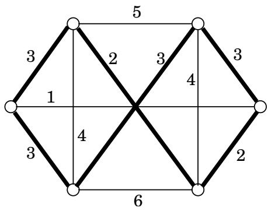
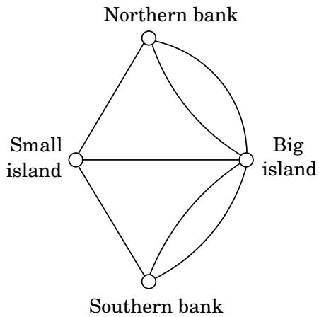
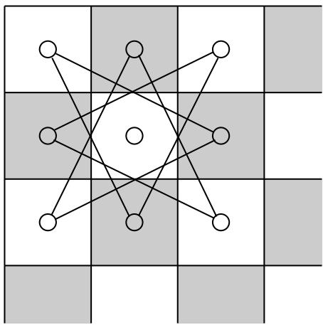
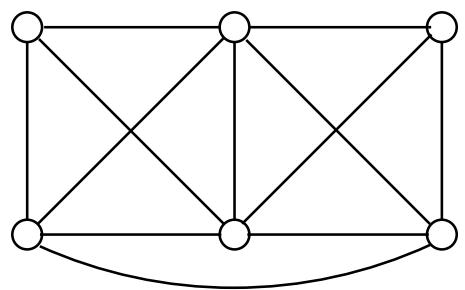
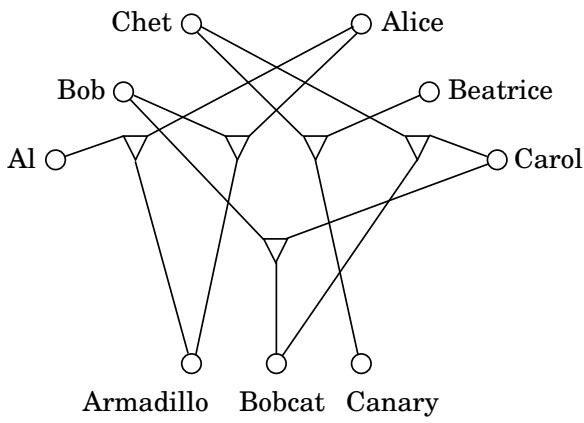
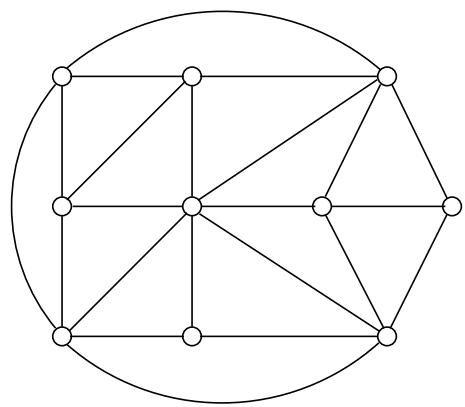

import Guide from '@/components/Guide.astro';
import Knowledge from '@/components/Knowledge.astro';
import Example from '@/components/Example.astro';
import Analysis from '@/components/Analysis.astro';
import Solution from '@/components/Solution.astro';
import Variant from '@/components/Variant.astro';
import Note from '@/components/Note.astro';
import Block from '@/components/Block.astro';
import Method from '@/components/Method.astro';
import Exercise from '@/components/Exercise.astro';

## 第 8 章：NP 完全问题

## 8.1 搜索问题

在过去的七章中，我们开发了用于在图中查找最短路径和最小生成树、二分图中的匹配、最大递增子序列、网络中的最大流等的算法。所有这些算法都是高效的，因为在每种情况下，它们的时间要求都以多项式函数的形式增长（例如输入大小的 $n , n ^ { 2 } , \mathbf { o r } \ n ^ { 3 } )$）。

为了更好地理解这种高效的算法，请考虑替代方案：在所有这些问题中，我们都在指数级的可能性中寻找解决方案（路径、树、匹配等）。确实，n个男孩可以和n个女孩配对！不同的方式，具有 n 个顶点的图具有 nn−2 个生成树，并且典型的图具有从 s 到 t 的指数数量的路径。原则上，通过逐一检查所有候选解决方案，所有这些问题都可以在指数时间内得到解决。但运行时间为 2n 或更差的算法在实践中几乎毫无用处（参见下一个方框）。对高效算法的追求就是找到巧妙的方法来绕过穷举搜索过程，使用输入中的线索来显着缩小搜索空间。

到目前为止，在本书中，我们已经看到了这一探索最辉煌的成功，战胜指数幽灵的算法技术：贪心算法、动态规划、线性规划（而分而治之通常会为我们已经可以在多项式时间内解决的问题提供更快的算法）。现在是时候面对任务中最令人尴尬和最持久的失败了。我们将看到其他一些“搜索问题”，在这些问题中，我们再次在指数级混乱的替代方案中寻找具有特定属性的解决方案。但对于这些新问题，似乎没有捷径可走。我们知道的最快的算法都是指数级的——并不比穷举搜索好多少。我们现在介绍一些重要的例子。

<Knowledge title="Box: The story of Sissa and Moore">

据传说，国际象棋游戏是由婆罗门西萨发明的，目的是为了娱乐和教育他的国王。感恩的国王问他想要什么回报，智者要求国王在棋盘的第一个格子里放一粒米，第二个格子里放两粒米，第三个格子里放四粒米，以此类推，将米粒的数量加倍，直到第 64 格子。国王当场同意了，因此他成为第一个学到指数增长这一宝贵（尽管令人羞愧）教训的人。西萨的请求量为264 1 = 18,446,744,073,709,551,615粒大米，足够铺印度好几遍了！

在自然界中，从细菌菌落到胎儿细胞，我们看到系统在一段时间内呈指数级增长。 1798年，英国哲学家T·罗伯特·马尔萨斯发表了一篇文章，预测人口的指数增长（他称之为“几何增长”）将很快耗尽线性增长的资源，这一论点对查尔斯·达尔文产生了深远的影响。马尔萨斯知道一个基本事实：指数迟早会取代任何多项式。

1965 年，计算机芯片先驱戈登·E·摩尔 (Gordon E. Moore) 注意到芯片中的晶体管密度在 20 世纪 60 年代初每年都翻倍，他预测这种趋势将持续下去。这一预测每 18 个月就会增加一倍，并扩展到计算机速度，被称为摩尔定律。 40 年来，它一直保持得非常好。而这就是过去几十年信息技术爆炸式增长的两个根本原因：摩尔定律和高效算法。

摩尔定律似乎阻碍了多项式算法的开发。毕竟，如果一个算法是指数级的，为什么不等到摩尔定律使它变得可行呢？但实际上情况恰恰相反：摩尔定律是开发高效算法的巨大动力，因为需要这样的算法才能利用计算机速度的指数增长。

这就是原因。例如，如果给布尔可满足性 (SAT) 的 O(2n) 算法运行一个小时，那么它可以在 1975 年解决具有 25 个变量的实例，在 1985 年可用的更快计算机上解决 31 个变量，在 1995 年解决 38 个变量，在今天的计算机上解决大约 45 个变量。相当大的进步——除了每个额外的变量都需要一年半的等待，而应用程序的需求（讽刺的是，其中许多与计算机设计相关）增长得更快。相比之下，通过 $O ( n )$ 或 O(n log n) 算法求解的实例大小将每十年乘以约 100 倍。在 $O ( n ^ { 2 } )$ 算法的情况下，固定时间内可解的实例大小将每十年乘以大约 10。即使是 $O ( n ^ { 6 } )$ 算法，虽然是多项式但令人倒胃口，每十年解决的实例大小也会增加一倍以上。当谈到我们可以用算法解决的问题规模的增长时，我们遇到了一个逆转：指数算法使多项式进展缓慢，而多项式算法则呈指数级快速进展！为了让摩尔定律在世界上得到体现，我们需要高效的算法。

正如西萨和马尔萨斯非常清楚的那样，在我们有限的世界中，指数扩张不可能无限期地持续下去。细菌菌落耗尽食物；芯片达到原子尺度。摩尔定律将在一两年内停止使计算机速度翻倍。然后，进步将取决于算法的独创性，或者可能取决于第 10 章探讨的量子计算等新颖的想法。

</Knowledge>
## 满意度

SATISFIABILITY 或 SAT（回想练习 3.28 和第 5.3 节）是一个具有重要实际意义的问题，其应用范围从芯片测试和计算机设计到图像分析和软件工程。这也是一个典型的难题。 SAT 实例如下所示：

$$
(x \vee y \vee z) (x \vee \overline {{y}}) (y \vee \overline {{z}}) (z \vee \overline {{x}}) (\overline {{x}} \vee \overline {{y}} \vee \overline {{z}}).
$$

这是一个合取范式 (CNF) 的布尔公式。它是子句（括号）的集合，每个子句由多个文字的析取（逻辑或，表示为 ）组成，其中文字要么是布尔变量（例如 x），要么是一的否定（例如 x）。令人满意的真值赋值是为每个变量赋值 false 或 true，以便每个子句都包含值为 true 的文字。 SAT 问题如下：给定一个合取范式的布尔公式，要么找到一个令人满意的真值分配，要么报告不存在。

例如，在前面显示的实例中，将所有变量设置为 true 会满足除最后一个子句之外的每个子句。是否存在满足所有子句的真值分配？

稍加思考，不难看出在这种特殊情况下不存在这样的真值分配。 （提示：中间的三个子句将所有三个变量限制为具有相同的值。）但是我们一般如何决定这一点呢？当然，我们总是可以一一搜索所有真值分配，但对于有 n 个变量的公式，可能的分配数量是指数级的，即 2n。

SAT 是一个典型的搜索问题。给定一个实例 I（即，一些指定当前问题的输入数据，在本例中为合取范式的布尔公式），并要求我们找到一个解决方案 S（满足特定规范的对象，在本例中为满足每个子句的赋值）。如果不存在这样的解决方案，我们就必须这么说。

更具体地说，搜索问题必须具有以下属性：可以快速检查实例 I 的任何建议解决方案 S 的正确性。这意味着什么？一方面，S 必须至少简洁（快速阅读），其长度以多项式的形式受 I 的限制。对于 SAT 来说，这显然是正确的，其中 S 是对变量的赋值。为了形式化快速检查的概念，我们会说有一个多项式时间算法，它以 I 和 S 作为输入，并决定 S 是否是 I 的解。对于 SAT，这很容易，因为它只涉及检查 S 指定的赋值是否确实满足 I 中的每个子句。

在本章后面，转移我们的观点并将这种用于检查所提出的解决方案的有效算法视为定义搜索问题将很有用。因此：

搜索问题由一种算法指定，该算法采用两个输入（实例 I 和建议的解决方案 S），并以 I 中的时间多项式运行。当且仅当 (I, S) = true 时，我们才说 S 是 I 的解。

鉴于 SAT 搜索问题的重要性，过去 50 年来研究人员一直在努力寻找有效的方法来解决它，但没有成功。我们拥有的最快的算法在最坏情况的输入上仍然是指数级的。

然而，有趣的是，我们确实有很好的算法来应对 SAT 的两种自然变体。如果所有子句至多包含一个正数，则该布尔公式称为霍恩公式，并且如果存在的话，可以通过第 5.3 节的贪心算法找到令人满意的真值分配。或者，如果所有子句只有两个文字，则图论就会发挥作用，并且可以通过查找从实例构造的特定图的强连通分量来在线性时间内解决 SAT（回想练习 3.28）。事实上，在第 9 章中，我们将看到针对同一特殊情况的不同多项式算法，称为 2SAT。

图 8.1 最佳旅行商旅行，以粗体显示，长度为 18。  

另一方面，如果我们稍微宽松一点，允许子句包含三个文字，那么由此产生的问题，即 3SAT（我们之前看到的一个例子），将再次变得难以解决！

## 旅行商问题

在旅行商问题 (TSP) 中，我们得到 n 个顶点 $1 , \ldots , n$ 和它们之间的所有 $n ( n - 1 ) / 2$ 距离，以及预算 b。我们被要求找到一个总成本为 b 或更少的游览，即通过每个顶点一次的循环，或者报告不存在这样的游览。也就是说，我们寻求顶点的排列 $\tau ( 1 ) , \ldots , \tau ( n )$，使得当它们按此顺序游览时，所覆盖的总距离最多为 b：

$$
d _ {\tau (1), \tau (2)} + d _ {\tau (2), \tau (3)} + \dots + d _ {\tau (n), \tau (1)} \leq b.
$$

请参见图 8.1 的示例（仅显示了部分距离；假设其余距离非常大）。

请注意我们如何将 TSP 定义为搜索问题：给定一个实例，在预算范围内找到一次旅行（或报告不存在）。但是，为什么我们要以这种方式表达旅行推销员问题，而实际上它是一个寻求最短旅行的优化问题呢？为什么要把它打扮成别的东西呢？

这是有充分理由的。我们在本章中的计划是比较和关联问题。搜索问题的框架在这方面很有帮助，因为除了 SAT 等真正的搜索问题外，它还包含 TSP 等优化问题。

将优化问题转化为搜索问题根本不会改变其难度，因为这两个版本可以相互简化。任何解决优化 TSP 的算法也很容易解决搜索问题：找到最佳旅行，如果在预算之内，则返回它；如果不是，就没有解决办法。

相反，搜索问题的算法也可以用来解决优化问题。要了解原因，首先假设我们以某种方式知道最佳旅行的成本；然后我们可以通过调用搜索问题的算法来找到这次旅行，并使用最佳成本作为预算。很好，但是我们如何找到最佳成本呢？简单：通过二分查找！ （参见练习 8.1。）

顺便说一句，这里有一个微妙之处：为什么我们要引入预算？从我们正在寻找具有最优属性的解决方案的意义上来说，任何优化问题不也是一个搜索问题吗？问题在于搜索问题的解决方案应该易于识别，或者正如我们之前所说的，多项式时间可检查。给定 TSP 的潜在解决方案，很容易检查属性“是一次旅行”（只需检查每个顶点是否被访问一次）和“总长度为 b”。但如何检查该房产“是否最优”呢？

与 SAT 一样，尽管研究人员在近一个世纪的时间里付出了巨大的努力，但 TSP 还没有已知的多项式时间算法。当然，有一个指数算法可以通过尝试所有（n 1）来解决它！游览，在第 6.6 节中，我们看到了一种更快但仍呈指数增长的动态规划算法。

我们确实有有效的算法来解决最小生成树（MST）问题，但这里提供了鲜明的对比。为了将其表达为搜索问题，我们再次给出一个距离矩阵和一个边界 b，并要求找到总权重为 $\sum _ { ( i , j ) \in T } d _ { i j } \leq b$ 的树 T。 TSP 可以被认为是 MST 问题的近亲，其中树不允许分支，因此是一条路径。1 这种对树结构的额外限制导致了更困难的问题。

## 欧拉和楼德拉塔

1735 年夏天，瑞士著名数学家莱昂哈德·欧拉（Leonhard Euler，发音为“Oiler”）在东普鲁士小镇柯尼斯堡的桥梁上行走。过了一会儿，他沮丧地发现，无论他从哪里开始行走，无论他如何巧妙地继续前进，都不可能每座桥都恰好穿过一次。从这个愚蠢的野心中，图论领域诞生了。

欧拉立即找出了公园缺陷的根源。首先，将公园地图转换为一个图，其顶点是四个陆地块（两个岛屿，两个银行），其边缘是七座桥梁：

该图在两个顶点之间有多个边——这是我们在本书中到目前为止还没有允许的功能，但对于这个特定问题来说是有意义的，因为每个桥都必须单独考虑。我们正在寻找一条恰好穿过每条边一次的路径（该路径允许重复顶点）。换句话说，我们在问这个问题：什么时候可以在不把铅笔从纸上抬起的情况下绘制图表？

欧拉发现的答案是简单、优雅和直观的：当且仅当(a) 图是连通的，并且(b) 每个顶点（可能有两个顶点（行走的起始和最终顶点）除外）都有偶数度（练习 3.26）。这就是为什么柯尼斯堡公园无法遍历：所有四个顶点的度数均为奇数。

为了表达我们当前关注的问题，让我们定义一个名为 EULER PATH 的搜索问题：给定一个图，找到一条包含每条边恰好一次的路径。根据欧拉的观察和更多的思考，这个搜索问题可以在多项式时间内解决。

在欧拉在东普鲁士度过的那个决定性的夏天之前几乎一千年，一位名叫鲁德拉塔（Rudrata）的克什米尔诗人提出了这个问题：一个人能否在不重复任何方格的情况下，在一次从起始方格结束的漫长步行中访问棋盘上的所有方格，并且每一步都做出合法的马棋步？这又是一个图问题：图现在有 64 个顶点，如果骑士可以通过一次移动从一个方格移动到另一个方格（也就是说，如果它们的坐标在一个维度上相差 2，在另一个维度上相差 1），则两个方格通过一条边连接起来。请参阅图 8.2 中对应于板左上角的部分。你能在你的棋盘上找到骑士之旅吗？

图 8.2 骑士在棋盘一角的走法。  

这是图中的另一种搜索问题：我们想要一个遍历所有顶点（而不是欧拉问题中的所有边）的循环，而不重复任何顶点。没有理由固守棋盘；这个问题可以针对任何图表提出。让我们将 RUDRATA CYCLE 搜索问题定义如下：给定一个图，找到一个只访问每个顶点一次的循环，或者报告不存在这样的循环。2 这个问题不祥地让人想起 TSP，而且实际上还没有已知的多项式算法。

图 8.3 该图中的最小割是什么？  

欧拉问题和鲁德拉塔问题的定义有两个不同之处。第一个是欧拉问题访问所有边，而鲁德拉塔问题访问所有顶点。但也存在一个问题，一个需要路径，另一个需要循环。这些差异中的哪一个导致了两个问题之间计算复杂性的巨大差异？它必须是第一个，因为第二个差异可以证明纯粹是装饰性的。事实上，定义 RUDRATA PATH 问题就像 RUDRATA CYCLE 一样，只不过现在的目标是找到一条只经过每个顶点一次的路径。正如我们很快就会看到的，Rudrata 问题的两个版本之间存在精确的等价性。

## 切割和平分

切割是一组边的集合，删除这些边会使图断开连接。寻找小切割通常很有趣，而最小切割问题是在给定图和预算 b 的情况下找到最多具有 b 个边的切割。例如，图 8.3 中的最小割的大小为 3。这个问题可以通过 n 1 最大流计算在多项式时间内解决：给每条边的容量为 1，并找到某个固定节点和每个其他节点之间的最大流。最小的此类流量将对应于（通过最大流量最小割定理）最小割。你能明白为什么吗？我们还看到了针对此问题的一种非常不同的随机算法（第 143 页）。

在许多图中，例如图 8.3 中的图，最小割只在一侧留下一个单独的顶点 - 它由与该顶点相邻的所有边组成。更有趣的是小切割，将图的顶点划分成几乎相等大小的集合。更准确地说，平衡切割问题是这样的：给定一个具有 n 个顶点和预算 b 的图，将顶点划分为两个集合 S 和 T，使得 S ，$| T | \geq n / 3$ 并且使得 S 和 T 之间最多有 b 个边。另一个难题。

平衡切割出现在各种重要的应用中，例如集群。例如，考虑将图像分割为其组成部分的问题（例如，一头大象站在草地上，上方是清澈的蓝天）。做到这一点的一个好方法是创建一个图形，其中图像的每个像素都有一个节点，并在相应像素在空间上靠近并且颜色也相似的节点之间放置一条边。图像中的单个对象（例如大象）对应于图中的一组高度连接的顶点。因此，平衡切割可能会将像素分为两个簇，而不会破坏图像的任何主要成分。例如，第一次切割可能会将大象一方面与天空分开，另一方面与草分开。然后需要进一步切割以将天空与草地分开。

## 整数线性规划

尽管单纯形算法不是多项式时间算法，但我们在第 7 章中提到，线性规划有一种不同的多项式算法。因此，线性规划在实践和理论上都是可以有效解决的。但是，如果除了指定线性目标函数和线性不等式之外，我们还将解（变量的值）限制为整数，情况就会完全改变。后一个问题称为整数线性规划 (ILP)。让我们看看如何将其表述为搜索问题。我们给出一组线性不等式 $\mathbf { A x } \leq \mathbf { b }$ ，其中 A 是一个 $m \times n$ 矩阵，b 是一个 m 向量；由 n 向量 $\mathbf { c ; }$ 指定的目标函数，最后是目标 g（最大化问题中预算的对应部分）。我们想要找到一个非负整数 n 向量 x 使得 $\mathbf { A x } \leq$ b 和 $\mathbf { c } \cdot \mathbf { x } \geq g .$

但这里有一个冗余：最后一个约束 $\mathbf { c } \cdot \mathbf { x } \geq g$ 本身就是一个线性不等式，可以被吸收到 $\mathbf { A x } \leq \mathbf { b }$ 中。因此，我们将 ILP 定义为以下搜索问题：给定 A 和 b，找到 满足不等式 $\mathbf { A x } \leq \mathbf { b }$ 的非负整数向量 x ，或报告不存在。尽管这个问题有许多重要的应用，并且研究人员对此非常感兴趣，但还没有有效的算法。

ILP 有一个特别干净的特殊情况，它本身就非常困难：目标是找到一个由 0 和 1 组成的向量 x 满足 $\mathbf { A x } = \mathbf { 1 }$ ，其中 A 是一个具有 0 1 个条目的 m n 矩阵，1 是全 1 的 m 向量。从第 7.1.4 节中的减少可以明显看出，这确实是 ILP 的一个特例。我们称之为零一方程（ZOE）。

我们现在介绍了许多重要的搜索问题，其中一些问题在前面的章节中很常见，并且有有效的算法，而另一些问题则在微小但关键的方面有所不同，这使得它们成为非常困难的计算问题。为了完成我们的故事，我们将介绍一些更困难的问题，当我们联系所有这些问题的计算难度时，这些问题将在本章后面发挥作用。请读者跳至第 8.2 节，然后根据需要返回这些问题的定义。

## 三维匹配

回想一下二分匹配问题：给定一个每边都有 n 个节点的二分图（男孩和 $g i r l s )$），找到一组 n 个不相交的边，或者决定不存在这样的组。在第 7.3 节中，我们看到了如何通过减少到最大流来有效地解决这个问题。然而，有一个有趣的概括，称为 3D MATCHING，没有多项式算法已知。在这个新的设置中，有 n 个男孩和 n 个女孩，还有 n 个宠物，它们之间的兼容性由一组三元组指定，每个三元组包含一个男孩、一个女孩和一个宠物。 直观上，一个三元组 $( b , g , p )$ 意味着男孩 b、女孩 $^ { g , }$ 和宠物 $p$ 相处得很好。三倍，从而创建n个和谐家庭。

你能在图 8.4 中找到解决方案吗？

图 8.4 更精细的匹配场景。每个三元组都显示为连接男孩、女孩和宠物的三角形节点。

## 独立集、顶点覆盖和派系

在独立集问题（回忆第 6.7 节）中，我们给出一个图和一个整数 g，目标是找到独立的 g 个顶点，即其中两个顶点之间不存在边。你能在图 8.5 中找到一组独立的三个顶点吗？四个顶点怎么样？我们在第 6.7 节中看到，这个问题可以在树上有效解决，但对于一般图，没有已知的多项式算法。

图 8.5 该图中最大独立集的大小是多少？  

关于图还有许多其他搜索问题。例如，在 VERTEX COVER 中，输入是一个图和一个预算 b，其想法是找到覆盖（接触）每条边的 b 个顶点。你能用七个顶点覆盖图 8.5 的所有边吗？有六个？ （您是否看到与独立集问题的密切联系？）

VERTEX COVER 是 SET COVER 的一个特例，我们在第 5 章中遇到过。在该问题中，我们给出一个集合 E 及其几个子集 $S _ { 1 } , \ldots , S _ { m }$ 以及预算 b。我们被要求选择这些子集中的 b，以便它们的并集为 E。 VERTEX COVER 是一种特殊情况，其中 E 由图的边组成，并且每个顶点都有一个子集 $S _ { i }$，包含与该顶点相邻的边。你能明白为什么 3D MATCHING 也是 SET COVER 的一个特例吗？

最后还有 CLIQUE 问题：给定一个图和一个目标 $^ { g , }$ 找到一组 $g$ 顶点，使得它们之间的所有可能的边都存在。图 8.5 中最大的派系是什么？

## 最长路径

我们知道最短路径问题可以非常有效地解决，但是最长路径问题又如何呢？这里我们给出一个图 $G$ ，具有非负边权重和两个可区分的顶点 s 和 $t ,$ 以及目标 g。我们被要求找到一条从 s 到 t 的路径，总权重至少为 $g .$ 。当然，为了避免平凡的解决方案，我们要求路径简单，不包含重复的顶点。

对于这个问题，目前还没有有效的算法（有时也被称为 TAXICAB RIP-OFF）。

## 背包和子集总和

回想一下 KNAPSACK 问题（第 6.4 节）：我们给定 n 个项目的整数权重 $w _ { 1 } , \ldots , w _ { n }$ 和整数值 $v _ { 1 } , \ldots , v _ { n }$。我们还给出了权重容量 W 和目标 $g$（前者存在于原始优化问题中，后者被添加以使其成为搜索问题）。我们寻找一组总重量最多为 $W$ 且总价值至少为 $g .$ 的物品。一如既往，如果不存在这样的集合，我们应该这么说。

在第 6.4 节中，我们为 KNAPSACK 开发了一个运行时间为 $O ( n W )$ 的动态编程方案，我们注意到它的输入大小是指数级的，因为它涉及 W 而不是 log W。而且我们还有通常的穷举算法，它会查看项目的所有子集 — 所有 $2 ^ { n }$。 KNAPSACK 有多项式算法吗？没有人知道其中之一。

但假设我们对背包问题的变体感兴趣，其中整数以一元编码，例如，将 12 写为 IIIIIIIIIIII。这无疑是一种指数级浪费的整数表示方式，但它确实定义了一个合法的问题，我们可以将其称为 UNARY KNAPSACK。从我们的讨论中可以看出，这个有点人为的问题确实有一个多项式算法。

不同的变体：假设现在每个物品的价值等于其重量（均以二进制给出），最重要的是，目标 $g$ 与容量 W 相同。（为了适应我们首先引入背包问题的愚蠢闯入故事，这些物品都是金块，窃贼想要装满他的背包。）这种特殊情况相当于找到给定的子集总和恰好为 W 的整数集合。由于它是 KNAPSACK 的特例，因此它再难不过了。但它可以是多项式吗？事实证明，这个称为 SUBSET SUM 的问题也非常困难。

此时有人可能会问：如果 SUBSET SUM 是一种特殊情况，并且恰好与一般的 KNAPSACK 问题一样困难，那么我们为什么对它感兴趣呢？原因很简单。在我们将在本章中开发的搜索问题之间的复杂归约计算中，像 SUBSET SUM 和 3SAT 这样概念上简单的问题是非常有价值的。