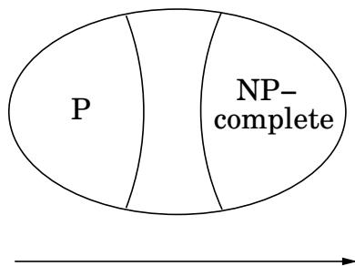
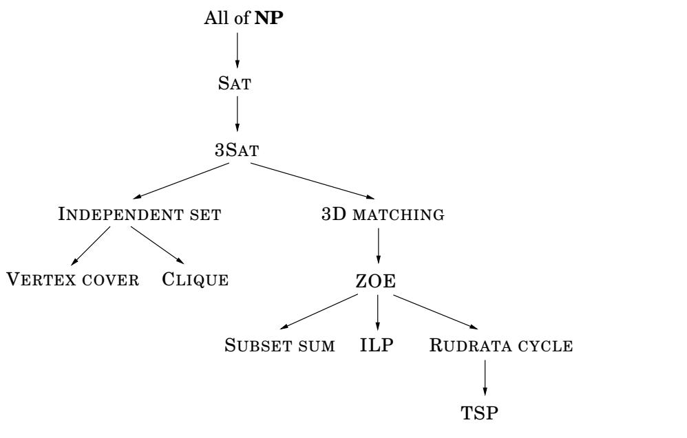

import Guide from '@/components/Guide.astro';
import Knowledge from '@/components/Knowledge.astro';
import Example from '@/components/Example.astro';
import Analysis from '@/components/Analysis.astro';
import Solution from '@/components/Solution.astro';
import Variant from '@/components/Variant.astro';
import Note from '@/components/Note.astro';
import Block from '@/components/Block.astro';
import Method from '@/components/Method.astro';
import Exercise from '@/components/Exercise.astro';

## 8.2 NP 完全问题

## 困难问题，简单问题

简而言之，世界上充满了搜索问题，其中一些可以有效解决，而另一些则似乎非常困难。下表对此进行了描述。

<table> <tr> <td>困难问题（NP完全）</td> <td>简单问题（在P)</td> </tr> <tr> <td>3SAT</td> <td>2SAT，喇叭SAT</td> </tr> <tr> <td>旅行推销员问题</td> <td>最小跨度树</td> </tr> <tr> <td>最长路径</td> <td>最短路径路径</td> </tr> <tr> <td>3D匹配</td> <td>BIPARTITE匹配</td> </tr> <tr> <td>KNAPSACK</td> <td>UNARY KNAPSACK</td> </tr> <tr> <td>独立设置</td> <td>独立设置树</td> </tr> <tr> <td>整数线性编程</td> <td>LINEAR编程</td> </tr> <tr> <td>RUDRATA 路径</td> <td>EULER路径</td> </tr> <tr> <td>平衡切割</td> <td>MINIMUM剪切</td> </tr> </table>

这张表值得深思。右边我们有可以有效解决的问题。在左边，我们有一堆硬坚果，几十年或几个世纪以来一直没有得到有效的解决方案。

右边的各种问题可以通过专门且多样化的算法来解决：动态规划、网络流、图搜索、贪心。由于各种不同的原因，这些问题很容易出现。

与此形成鲜明对比的是，左边的问题都因为同样的原因而变得困难！从本质上讲，它们都是同一个问题，只是伪装不同而已！它们都是等价的：正如我们将在第 8.3 节中看到的，它们中的每一个都可以还原为任何其他的——或者返回。

## P 和 NP

现在是介绍一些重要概念的时候了。我们知道搜索问题是什么：它的定义特征是任何提出的解决方案都可以快速检查其正确性，即存在一种有效的检查算法，该算法将给定实例 I（指定要解决的问题的数据）以及提出的解决方案 S 作为输入，并且当且仅当 S 确实是实例 I 的解决方案时输出 true。此外， (I, S) 的运行时间受到 I 中的多项式（即实例的长度）的限制。我们用 NP 来表示所有搜索问题的类别。

我们已经看到了许多可以在多项式时间内解决的 NP 搜索问题的例子。在这种情况下，有一种算法将实例 I 作为输入，并在 I 中具有运行时间多项式。如果我有一个解决方案，算法会返回这样的解决方案；如果我没有解决方案，算法会正确报告。可以在多项式时间内解决的所有搜索问题的类别表示为 P。因此，表右侧的所有搜索问题都在 P 中。

## 为什么是 P 和 NP？

好吧，P 必须代表“多项式”。但为什么要使用首字母 NP（聊天室中“没问题”的常见缩写）来描述此类搜索问题，其中一些问题非常困难？

NP 代表“非确定性多项式时间”，这个术语可以追溯到复杂性理论的根源。直观地说，这意味着任何搜索问题的解决方案都可以通过一种特殊的（而且相当不现实的）算法（称为非确定性算法）在多项式时间内找到并验证。这种算法具有在每一步都正确猜测的能力。

顺便说一句，NP 的最初定义（及其至今最常见的用法）并不是一类搜索问题，而是一类决策问题：可以用“是”或“否”来回答的算法问题。示例：“是否存在满足该布尔公式的真值赋值？”但这也反映了一个历史现实：在 NP 完备性理论正在发展的时候，计算理论的研究人员对形式语言感兴趣，在这个领域中，此类决策问题至关重要。

是否存在多项式时间内无法解决的搜索问题？换句话说，P=NP吗？大多数算法研究人员都这么认为。很难相信指数搜索总是可以避免的，一个简单的技巧就能解决所有这些几十年和几个世纪以来都没有解决的难题。数学家有充分的理由相信 $\mathbf { P } \neq \mathbf { N P } .$——为给定的数学断言找到证明的任务是一个搜索问题，因此属于 NP 问题（毕竟，当数学陈述的形式证明以令人难以忍受的细节写出来时，可以通过高效的算法逐行机械地检查）。所以如果 $\mathbf { P } = \mathbf { N P }$，就会有一个有效的方法来证明任何定理，从而消除了对数学家的需要！总而言之，人们广泛认为 $\mathbf { P } \neq \mathbf { N P }$ 的原因有多种。然而，证明这一点极其困难，是数学中最深刻、最重要的未解难题之一。

<Knowledge title="Box: Reductions">

即使我们接受 $\mathbf { P } \neq \mathbf { N P }$，那么表格左侧的具体问题又如何呢？我们基于什么证据相信这些特定问题没有有效的算法（当然，除了许多聪明的数学家和计算机科学家已经努力尝试但未能找到任何算法的历史事实）？这些证据是通过归约提供的，将一个搜索问题转化为另一个搜索问题。他们所证明的是，表格左侧的问题在某种意义上都是完全相同的问题，只不过它们是用不同的语言表述的。更重要的是，我们还将使用约简来表明这些问题是 NP 中最难的搜索问题——如果其中一个问题具有多项式时间算法，那么 NP 中的每个问题都具有多项式时间算法。因此，如果我们相信 $\mathbf { P } \neq \mathbf { N P }$ ，那么所有这些搜索问题都很难。

我们在第 7 章中定义了约简，并看到了许多例子。现在让我们将这个定义专门用于搜索问题。从搜索问题 A 到搜索问题 B 的简化是一个多项式时间算法 f，它将 A 的任何实例 I 转换为 B 的实例 $f ( I )$，以及另一个多项式时间算法 h，将 $f ( I )$ 的任何解 S 映射回 $I ;$ 的解 $h ( S )$ 请参见以下内容图表。如果 f(I) 无解，则也无解

I. 这两个转换过程 f 和 h 意味着 B 的任何算法都可以通过将其括在 f 和 h 之间来转换为 A 的算法。

A 的算法

<table> <tr> <td rowspan="2">实例 I</td> <td rowspan="2">f</td> <td rowspan="2">实例f(I)</td> <td rowspan="2">B 的算法</td> <td>的解 S f(I)</td> <td rowspan="2">h</td> <td>解 h(S) I</td> </tr> <tr> <td>f(I)无解</td> <td>无解我</td> </tr> </table>

现在我们终于可以定义最难的搜索问题的类别了。

如果所有其他搜索问题都简化为该搜索问题，则该搜索问题是 NP 完全的。

这确实是一个非常强烈的要求。对于一个 NP 完全问题，它必须对解决世界上的每个搜索问题都有用！值得注意的是，此类问题的存在。但它们确实如此，我们之前看到的表格的第一列充满了最著名的例子。在第 8.3 节中，我们将看到所有这些问题如何相互简化，以及为什么所有其他搜索问题都简化为它们。

</Knowledge>
<Knowledge title="Box: The two ways to use reductions">

到目前为止，在本书中，从问题 A 简化为问题 B 的目的是直接而光荣的：我们知道如何有效地解决 B，并且我们希望使用这些知识来解决 A。然而，在本章中，从 A 到 B 的简化服务于一个有点反常的目标：我们知道 A 是困难的，并且我们使用简化来证明 B 也是困难的！

如果我们表示从 A 到 B 的减少

$$
A \longrightarrow B
$$

那么我们可以说难度沿着箭头的方向流动，而高效的算法则沿着相反的方向流动。正是通过这种难度传播，我们知道 NP 完全问题是困难的：所有其他搜索问题都简化为它们，因此每个 NP 完全问题包含所有搜索问题的复杂性。如果 P 中有一个 NP 完全问题，则 P = NP。

归约还具有它们所组成的便利属性。

$$
\text {   If   } A \longrightarrow B \text {   and   } B \longrightarrow C, \text {   then   } A \longrightarrow C  .
$$

要看到这一点，首先观察任何约简完全由预处理和后处理函数 $f$ 和h指定（参见约简图）。如果 $\left( f _ { A B } , h _ { A B } \right)$ 和 $\left( f _ { B C } , h _ { B C } \right)$ 分别定义从 A 到 B 和从 B 到 $C ,$ 的缩减，则从 A 到 C 的缩减由以下函数的组合给出： $f _ { B C } \circ f _ { A B }$ 将 A 的实例映射到 C 的实例，并且 $h _ { A B } \circ h _ { B C }$ 将 C 的解发送回 A 的解。

这意味着一旦我们知道问题 A 是 NP 完全的，我们就可以用它来证明新的搜索问题 B 也是 NP 完全的，只需将 A 约简到 B。这种约简表明 NP 中的所有问题都可以通过 A 约简到 B。

图 8.6 所有搜索问题的空间 NP，假设 P = NP。  
  
难度增加

</Knowledge>
## 保理

最后一点：我们在本书开始时介绍了另一个著名的困难搜索问题：因子分解，即查找给定整数的所有素因数的任务。但因式分解的难度与我们刚刚看到的其他硬搜索问题的难度性质不同。例如，没有人相信因式分解是 NP 完全的。一个主要区别是，就保理而言，定义不包含现在熟悉的条款“或报告不存在”。数字总是可以因式分解为素数。

另一个区别（可能并非完全无关）是：正如我们将在第 10 章中看到的，因子分解屈服于量子计算的力量，而 SAT、TSP 和其他 NP 完全问题似乎并非如此。

图 8.7 搜索问题之间的减少。  
