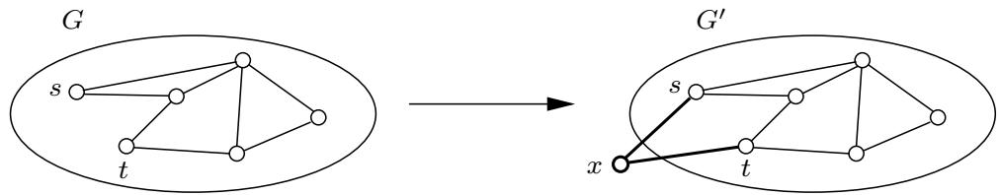
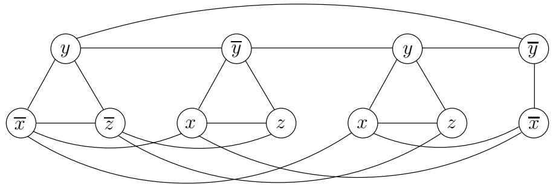
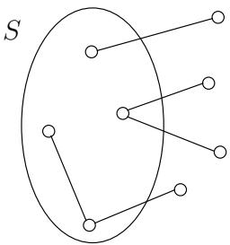
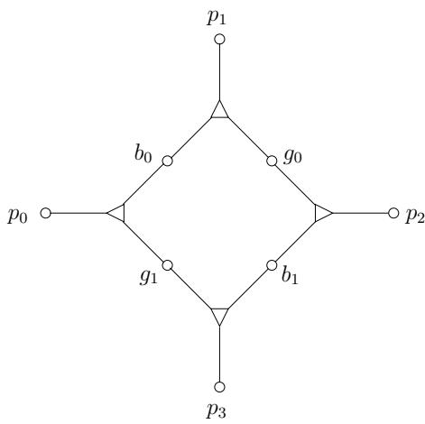
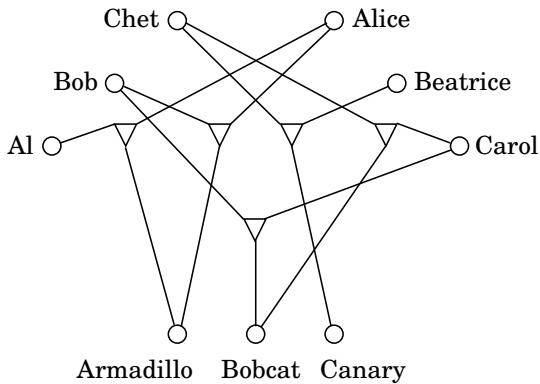
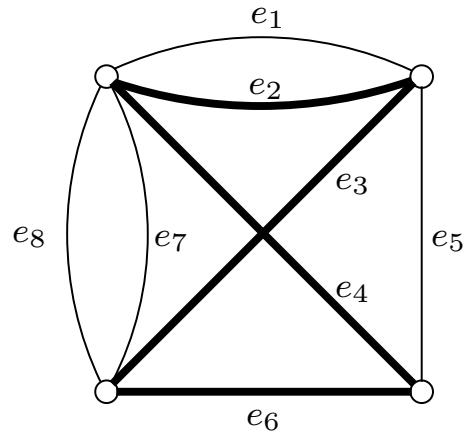
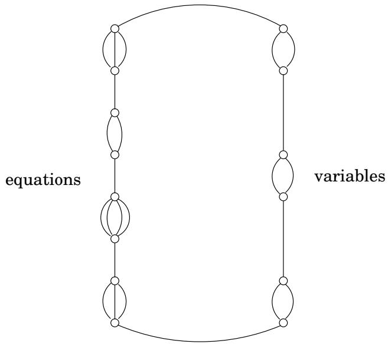
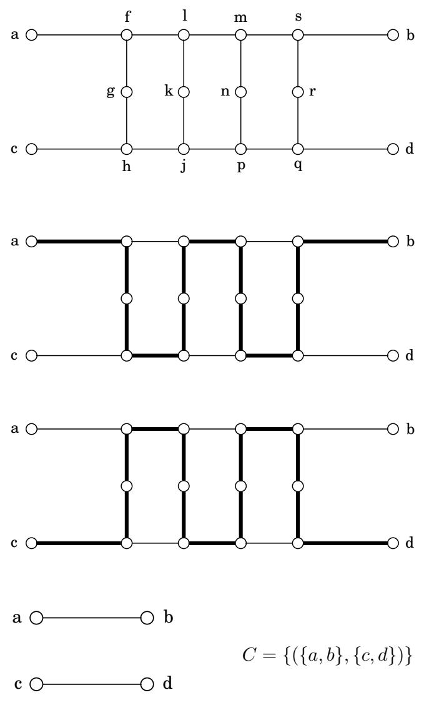
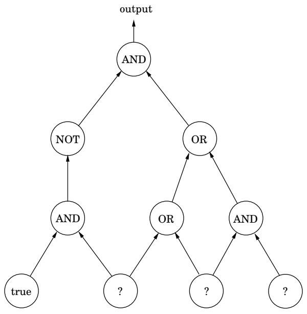
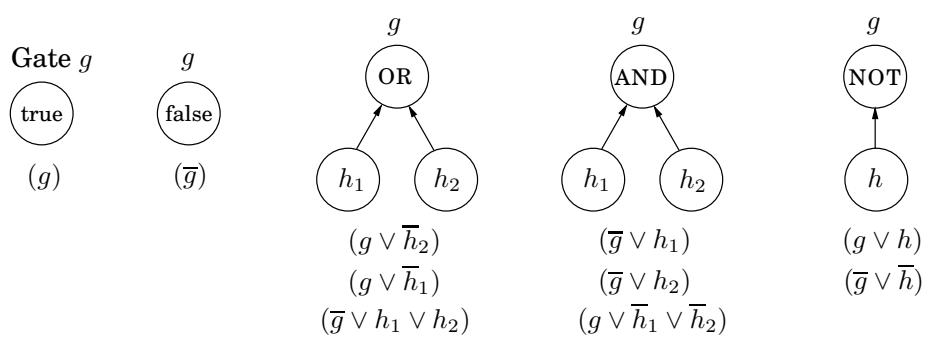

import Guide from '@/components/Guide.astro';
import Knowledge from '@/components/Knowledge.astro';
import Example from '@/components/Example.astro';
import Analysis from '@/components/Analysis.astro';
import Solution from '@/components/Solution.astro';
import Variant from '@/components/Variant.astro';
import Note from '@/components/Note.astro';
import Block from '@/components/Block.astro';
import Method from '@/components/Method.astro';
import Exercise from '@/components/Exercise.astro';

## 8.3 减少

现在我们将看到第 8.1 节的搜索问题可以相互简化，如图 8.7 所示。因此，它们都是 NP 完全的。

在我们处理树中的具体缩减之前，让我们通过关联 Rudrata 问题的两个版本来热身。

## RUDRATA (s, t)-路径 RUDRATA 循环

回想一下 RUDRATA CYCLE 问题：给定一个图，是否存在一个循环恰好通过每个顶点一次？我们还可以制定密切相关的 RUDRATA (s, t)-PATH 问题，其中指定了两个顶点 s 和 t，并且我们想要一条从 s 开始到 t 结束的路径，并且只经过每个顶点一次。 RUDRATA CYCLE 是否有可能比 RUDRATA $( s , t ) \mathbf { - P A T H ? }$ 更容易？我们将通过减少来证明答案是否定的。

缩减将 RUDRATA (s, t)-PATH 的实例 $( G = ( V , E ) , s , t )$ 映射到 RUDRATA CYCLE 的实例 $G ^ { \prime } = ( V ^ { \prime } , E ^ { \prime } )$，如下所示： $G ^ { \prime }$ 只是 G，带有一个附加顶点 x 和两个新边 $\{ s , x \}$ 和 x, t 。例如：

所以 $V ^ { \prime } = V \cup \{ x \}$ 和 $E ^ { \prime } = E \cup \{ \{ s , x \} , \{ x , t \} \}$ 。给定 $G ^ { \prime } \hat { \ ? }$ 中的任何 Rudrata 循环，我们如何恢复 $G$ 中的 Rudrata $( s , t ) \ – p a t h$ 简单，我们只需从循环中删除边 $\{ s , x \}$ 和 $\{ x , t \}$ 即可。

RUDRATA (s, t)-路径

<table> <tr> <td rowspan="2">实例：G = (V, E) 节点 s, t</td> <td rowspan="2">添加节点 x 和边&#123;s， x&#125;，&#123;x，t&#125; </td> <td rowspan="2">G'=（V'， E')</td> <td rowspan="2">RUDRATA CYCLE</td> <td>解决方案：循环</td> <td>删除边&#123;s，x&#125;，&#123;x，t&#125; </td> <td>解决方案：路径</td> </tr> <tr> <td colspan="2">无解</td> <td>无解决方案</td> </tr> </table>

为了确认这种减少的有效性，我们必须证明它在所描述的任一结果的情况下都有效。

1. 当 RUDRATA CYCLE 的实例有解决方案时。

由于新顶点 x 只有两个邻居 s 和 t，因此 $G ^ { \prime }$ 中的任何 Rudrata 循环都必须连续遍历边 $\{ t , x \}$ 和 $\{ x , s \}$ 。然后，循环的其余部分将遍历从 s 到 t 的途中的所有其他顶点。因此，从 Rudrata 循环中删除两条边 $\{ t , x \}$ 和 $\{ x , s \}$ 给出原始图 G 中从 s 到 t 的 Rudrata 路径。

## 2. 当RUDRATA CYCLE实例没有解时。

在这种情况下，我们必须证明 RUDRATA (s, t)-PATH 的原始实例也不可能有解。通常更容易证明反证，即证明如果 $G ,$ 中存在 Rudrata $( s , t )$ -路径，则 $G ^ { \prime }$ 中也存在 Rudrata 循环。但这很简单：只需将两条边 $\{ t , x \}$ 和 $\{ x , s \}$ 添加到 Rudrata 路径即可闭合循环。

最后一个细节很重要，但通常很容易检查，即预处理和后处理函数需要实例大小的多项式时间 $( G , s , t )$

也可以朝另一个方向走，将 RUDRATA CYCLE 简化为 RUDRATA $( s , t ) \mathrm { - P A T H }$ 在一起，这些简化表明这两个 Rudrata 变体本质上是同一个问题 - 这并不奇怪，因为它们的描述几乎相同。但我们将看到的大多数其他减少都是在成对的问题之间，从 $\mathrm { i t } ,$ 的表面来看，它们看起来完全不同。为了表明它们本质上是相同的，我们的缩减必须巧妙地在它们之间进行转换。

## 3SAT独立组

人们很难想象出另外两个不同的问题。在 3SAT 中，输入是一组子句，每个子句包含三个或更少的文字，例如

$$
(\overline {{x}} \vee y \vee \overline {{z}}) (x \vee \overline {{y}} \vee z) (x \vee y \vee z) (\overline {{x}} \vee \overline {{y}}),
$$

目的是找到令人满意的真值作业。在 INDEPENDENT SET 中，输入是一个图和一个数字 $^ { g , }$，问题是找到一组 $g$ 成对非相邻顶点。我们必须以某种方式将布尔逻辑与图形联系起来！

让我们想想。为了形成令人满意的真值分配，我们必须从每个子句中选择一个文字并赋予它值 true。但我们的选择必须是一致的：如果我们在一个子句中选择x，我们就不能在另一个子句中选择x。任何一致的文字选择（每个子句中都有一个）指定一个真值分配（未选择文字的变量可以采用任一值）。

因此，让我们用一个三角形表示一个子句，例如 $( x \vee \overline { { y } } \vee z )$ ，其顶点标记为 $x , { \overline { { y } } } , z .$ 。为什么是三角形？因为三角形的三个顶点最大程度地相连，因此迫使我们只选择其中一个作为独立集合。对所有子句重复此构造 - 具有两个文字的子句将简单地由连接文字的边表示。 （具有一个文字的子句是愚蠢的，可以在预处理步骤中删除，因为变量的值是确定的。）在结果图中，独立集必须从每组（子句）中选择最多一个文字。要从每个子句中强制选择一个选项，请将目标 g 设为子句的数量；在我们的示例中，g = 4。

图 8.8 (x ∨ y ∨ z) (x ∨ y ∨ z) (x ∨ y ∨ z) (x ∨ y)。  

现在缺少的是一种阻止我们在不同子句中选择相反文字（即 x 和 x）的方法。但这很简单：在对应于相反文字的任意两个顶点之间放置一条边。我们示例的结果图如图 8.8 所示。

让我们回顾一下构建过程。给定 3SAT 的实例 I，我们创建一个独立集的实例 (G, g)，如下所示。

图 G 对于每个子句都有一个三角形（或者只有一条边，如果该子句有两个文字），其顶点由子句的文字标记，并且在表示相反文字的任意两个顶点之间具有附加边。

目标 g 设置为子句的数量。

显然，这种构造需要多项式时间。然而，回想一下，为了简化，我们不仅需要一种有效的方法将第一个问题的实例映射到第二个问题的实例（第 245 页图中的函数 f），而且还需要一种从第二个问题的任何解重建第一个实例的解的方法（函数 h）。一如既往，有两件事要展示。

1. 给定 G 中 g 个顶点的独立集合 S，可以有效地恢复对 I 的令人满意的真值分配。

对于任何变量 x，集合 S 不能包含同时标记为 x 和 x 的顶点，因为任何这样的顶点对都由边连接。因此，如果 S 包含标记为 x 的顶点，则为 x 分配 true 值；如果 S 包含标记为 x 的顶点，则分配 x 值为 false（如果 S 两者都不包含，则将任一值分配给 x）。由于 S 有 g 个顶点，因此每个子句必须有一个顶点；这个真值分配满足那些特定的文字，因此满足所有子句。

2.如果图G没有大小为g的独立集，则布尔公式I不可满足。

证明反证通常更清晰，如果我有一个令人满意的赋值，那么 G 有一个大小为 $g .$ 的独立集合。这很简单：对于每个子句，选择满足赋值下值为 true 的任何文字（必须至少有一个这样的文字），并将相应的顶点添加到 S。你明白为什么集合 S 必须是独立的吗？

## SAT 3SAT

这是一种有趣且常见的还原，从问题本身到特殊情况。我们想要表明，即使其输入受到某种限制，问题仍然很困难——在本例中，即使所有子句都被限制为具有 $: \le 3$ 文字。这种减少修改给定的实例，以便摆脱禁止的功能（带有 $\geq 4$ 文字的子句），同时保持实例本质上相同，因为我们可以从修改后的任何解决方案中读出原始实例的解决方案。

下面是将 SAT 简化为 3SAT 的技巧：给定 SAT 的实例 I，对 3SAT 使用完全相同的实例，除了任何具有三个以上文字的子句 $( a _ { 1 } \lor a _ { 2 } \lor \cdots \lor a _ { k } )$ （其中 $a _ { i } \mathbf { \bar { s } }$ 是文字，$k > 3 )$ 被一组子句替换，

$$
\left(a _ {1} \vee a _ {2} \vee y _ {1}\right) \left(\overline {{y}} _ {1} \vee a _ {3} \vee y _ {2}\right) \left(\overline {{y}} _ {2} \vee a _ {4} \vee y _ {3}\right) \dots \left(\overline {{y}} _ {k - 3} \vee a _ {k - 1} \vee a _ {k}\right),
$$

其中 $y _ { i } \mathbf { \vec { s } }$ 是新变量。调用生成的 3SAT 实例 $I ^ { \prime } .$ 从 I 到 $I ^ { \prime }$ 的转换显然是多项式时间。

为什么这种减少会起作用？ I0 在可满足性方面等同于 I，因为对于 $a _ { i } \mathbf { \dot { s } }$ 的任何赋值

$$
\left\{ \begin{array}{c} (a _ {1} \vee a _ {2} \vee \dots \vee a _ {k}) \\ \text {is satisfied} \end{array} \right\} \Longleftrightarrow \left\{ \begin{array}{c} \text {there is a setting of the } y_i \text{ 's for which} \\ (a _ {1} \vee a _ {2} \vee y _ {1}) (\overline {{y}} _ {1} \vee a _ {3} \vee y _ {2}) \dots (\overline {{y}} _ {k - 3} \vee a _ {k - 1} \vee a _ {k}) \\ \text {are all satisfied} \end{array} \right\}
$$

要看到这一点，首先假设右边的子句都满足。那么至少有一个文字 $a _ { 1 } , \ldots , a _ { k }$ 必须为真，否则 $y _ { 1 }$ 也必须为真，这反过来会迫使 $y _ { 2 }$ 为真，依此类推，最终伪造最后一个子句。但这意味着 $( a _ { 1 } \lor a _ { 2 } \lor \cdots \lor a _ { k } )$ 也满足了。

相反，如果满足 $( a _ { 1 } \lor a _ { 2 } \lor \cdots \lor a _ { k } )$，则某些 $a _ { i }$ 一定为真。将 $y _ { 1 } , \ldots , y _ { i - 2 }$ 设置为 true，其余设置为 false。这确保了右侧的条款全部得到满足。

因此，任何 SAT 实例都可以转换为 3SAT 的等效实例。事实上，即使在进一步限制变量不得出现在超过三个子句中的情况下，3SAT 仍然很难。为了证明这一点，我们必须以某种方式去掉任何出现次数过多的变量。

这是从 3SAT 到其受限版本的简化。假设在 3SAT 实例中，变量 x 出现在 $k > 3$ 子句中。然后将其第一次出现替换为 $x _ { 1 }$ ，将其第二次出现替换为 $x _ { 2 }$ ，依此类推，将其 k 次出现中的每一个替换为不同的新变量。最后添加子句

$$
\left(\overline {{x}} _ {1} \vee x _ {2}\right) \left(\overline {{x}} _ {2} \vee x _ {3}\right) \dots \left(\overline {{x}} _ {k} \vee x _ {1}\right).
$$

对出现超过三次的每个变量重复此操作。

图8.9 S 是一个顶点覆盖当且仅当V S 是一个独立集。

很容易看出，在新公式中，没有任何变量出现超过三次（事实上，没有任何文字出现超过两次）。此外，涉及 $x _ { 1 } , x _ { 2 } , \ldots , x _ { k }$ 的额外子句约束这些变量具有相同的值；你明白为什么吗？因此，当且仅当约束实例可满足时，3SAT 的原始实例才可满足。

## 独立集合顶点覆盖

有些还原依赖于巧妙地将两个截然不同的问题联系起来。其他人只是简单地记录了这样一个事实：一个问题是另一个问题的薄弱伪装。要将独立集简化为顶点覆盖，我们只需要注意，当且仅当其余节点 $V - S _ { i }$ 是 G 的独立集时，一组节点 S 是图 $G =$ $( V , E )$ 的顶点覆盖（即 S 接触 E 中的每条边）（图 8.9）。

因此，要求解独立集的实例 $( G , g )$，只需查找具有 $| V | - g$ 节点的 G 顶点覆盖即可。如果存在这样的顶点覆盖，则取不在其中的所有节点。如果不存在这样的顶点覆盖，则 G 不可能有一组独立的大小为 g 的集合。

## 独立团体

独立群体和团体也很容易相互简化。将图 $G = ( V , E )$ 的补集定义为 $\overline { { G } } = ( V , \overline { { E } } )$ ，其中 $\overline { E }$ 恰好包含那些不在 E 中的无序顶点对。那么，当且仅当 S 是 $\overline { { G } } .$ 的团时，一组节点 S 是 G 的独立集合。换句话说，当且仅当这些节点在 G 中它们之间具有所有可能的边时，G 中的这些节点之间才没有边。

因此，我们可以通过将INDEPENDENT SET的实例 $( G , g )$ 映射到CLIQUE对应的实例 $( { \overline { { G } } } , g )$ 来将INDEPENDENT SET简化为CLIQUE；两者的解决方案是相同的。

## 3SAT 3D 匹配

这又是两个截然不同的问题。我们必须将 3SAT 简化为在一组男孩-女孩-宠物三元组中找到一个包含每个男孩、每个女孩和每个宠物一次的子集的问题。简而言之，我们必须设计男孩-女孩-宠物三元组的集合，它们在某种程度上表现得像布尔变量和门！

考虑以下四个三元组的集合，每个三元组由连接男孩、女孩和宠物的三角形节点表示：

假设两个男孩 $b _ { 0 }$ 和 $b _ { 1 }$ 以及两个女孩 $g _ { 0 }$ 和 $g _ { 1 }$ 不参与任何其他三元组。 （四个宠物 $p _ { 0 } , \ldots , p _ { 3 }$ 当然也属于其他三元组；否则该实例将没有解决方案。）然后任何匹配都必须包含两个三元组 $( b _ { 0 } , g _ { 1 } , p _ { 0 } ) , ( b _ { 1 } , g _ { 0 } , p _ { 2 } )$ 或两个三元组 $( b _ { 0 } , g _ { 0 } , p _ { 1 } ) , ( b _ { 1 } , g _ { 1 } , p _ { 3 } )$ ，因为这是这两个男孩和女孩找到任何匹配的唯一方法。因此，这个“小工具”有两种可能的状态：它的行为就像一个布尔变量！

然后，为了将 3SAT 实例转换为 3D MATCHING 实例，我们首先为每个变量 $x .$ 创建前面小工具的副本。调用生成的节点 $p _ { x 1 } , b _ { x 0 } , g _ { x 1 }$ ，依此类推。预期的解释是，如果 $x =$ true，则男孩 $b _ { x 0 }$ 与女孩 ${ g } _ { x 1 }$ 匹配，如果 $x = \mathtt { f a l s e }$ 则与女孩 $g _ { x 0 }$ 匹配

接下来我们必须创建以某种方式模仿子句的三元组。对于每个子句，说 $c = ( x \vee \overline { { y } } \vee z )$ 介绍一个新男孩 $b _ { c }$ 和一个新女孩 $g _ { c }$ 。它们将涉及三个三元组，一个对应子句中的每个文字。这些三元组中的 pet 必须反映满足该子句的三种方式： (1) x = true, $\left( 2 \right) y = \mathtt { f a l s e } , \left( 3 \right) z = \mathtt { t r u e }$ 。对于 (1)，我们有三元组 $\left( b _ { c } , g _ { c } , p _ { x 1 } \right)$ ，其中 $p _ { x 1 }$ 是 x 的小工具中的宠物 $p _ { 1 }$。这就是为什么我们选择 $p _ { 1 } \colon$ 如果 $x =$ true，则 $b _ { x 0 }$ 与 $g _ { x 1 }$ 匹配，$b _ { x 1 }$ 与 $g _ { x 0 }$ 匹配，所以宠物 $p _ { x 0 }$ 和 $p _ { x 2 }$ 已被采用。在这种情况下，$b _ { c }$ 和 $g _ { c }$ 可以与 $p _ { x 1 }$ 匹配。但如果是 $\boldsymbol { x } = \mathtt { f a l s e }$ ，则采用 $p _ { x 1 }$ 和 $p _ { x 3 }$ ，因此无法以这种方式容纳 $g _ { c }$ 和 $b _ { c }$ 。我们对该子句的其他两个文字执行相同的操作，这会产生涉及 $b _ { c }$ 和 $g _ { c }$ 的三元组，以及 $p _ { y 0 }$ 或 $p _ { y 2 }$ （对于否定变量 y）以及 $p _ { z 1 }$ 或 $p _ { z 3 }$（对于变量 z）。

我们必须确保子句 c 中每次出现文字时，都有一个不同的 pet 与 $b _ { c }$ 和 $g _ { c }$ 匹配。但这很容易：通过早期的减少，我们可以假设没有文字出现超过两次，因此每个变量小工具都有足够的宠物，两个用于否定的出现，两个用于未否定的。

现在看来还原已经完成：从任何匹配中，我们只需查看每个变量小工具并查看与哪个女孩 $b _ { x 0 }$ 匹配，就可以恢复令人满意的真值分配。从任何令人满意的真值分配中，我们可以匹配与每个变量 x 相对应的小工具，以便在 x = true 时选择三元组 $( b _ { x 0 } , g _ { x 1 } , p _ { x 0 } )$ 和 $( b _ { x 1 } , g _ { x 0 } , p _ { x 2 } )$，如果 x = false 则选择三元组 $( b _ { x 0 } , g _ { x 0 } , p _ { x 1 } )$ 和 $( b _ { x 1 } , g _ { x 1 } , p _ { x 3 } )$；对于每个子句 c，将 $b _ { c }$ 和 $g _ { c }$ 与与其令人满意的文字之一相对应的 pet 进行匹配。

但最后一个问题仍然存在：在最后一段末尾定义的匹配中，某些宠物可能无法匹配。事实上，如果有 $n$ 变量和 $m$ 子句，那么正好

$2 n - m$ pets 将保持不匹配（您可以检查这个数字肯定是正数，因为每个变量最多出现 3 次，并且每个子句中至少有两个文字）。但这很容易解决：添加 $2 n - m$ 新的男女情侣，它们是“通用动物爱好者”，并将它们与所有宠物进行三元组匹配！

## 3D 匹配佐伊

回想一下，在 ZOE 中，我们给出了一个具有 0 1 个条目的 $m \times n$ 矩阵 A，并且我们必须找到一个 $0 - 1$ 向量 $\mathbf { x } = ( x _ { 1 } , \ldots , x _ { n } )$ 使得 m 个方程

$$
\mathbf {A x} = \mathbf {1}
$$

满足，其中 1 表示全 1 的列向量。我们如何在这个框架中表达 3D MATCHING 问题？

ZOE 和 ILP 是非常有用的问题，正是因为它们提供了一种可以表达许多组合问题的格式。在这样的公式中，我们将 $0 - 1$ 变量视为描述解决方案，并编写表达问题约束的方程。

例如，以下是我们如何用 ZOE 语言表达 3D MATCHING 实例（m 个男孩、m 个女孩、m 个宠物和 n 个男孩-女孩-宠物三元组）。我们有 0 1 个变量 $x _ { 1 } , \ldots , x _ { n } .$ 每个三元组一个，其中 $x _ { i } = 1$ 表示选择第 i 个三元组进行匹配，$x _ { i } = 0$ 表示不选择它。

现在我们所要做的就是写出方程来表明 $x _ { i } \mathbf { \dot { s } }$ 描述的解是合法的匹配。对于每个男孩（或女孩，或宠物），假设包含他（或她，或它）的三元组编号为 $j _ { 1 } , j _ { 2 } , \dots , j _ { k } ;$，则适当的方程为

$$
x _ {j _ {1}} + x _ {j _ {2}} + \dots + x _ {j _ {k}} = 1,
$$

其中指出匹配中必须包含这些三元组之一。例如，这是我们之前看到的 3D MATCHING 实例的 A 矩阵。

$$
\mathbf {A} = \left( \begin{array}{c c c c c} 1 & 0 & 0 & 0 & 0 \\ 0 & 0 & 0 & 1 & 1 \\ 0 & 1 & 1 & 0 & 0 \\ 1 & 0 & 0 & 0 & 1 \\ 0 & 1 & 0 & 0 & 0 \\ 0 & 0 & 1 & 1 & 0 \\ 1 & 0 & 0 & 0 & 1 \\ 0 & 0 & 1 & 1 & 0 \\ 0 & 1 & 0 & 0 & 0 \end{array} \right)
$$

A 的五列对应于五个三元组，而九行分别对应于 Al、Bob、Chet、Alice、Beatrice、Carol、Armadillo、Bobcat 和 Canary。

很简单，这两种情况的解决方案可以相互转换。

这是 ILP 的两种特殊情况之间的简化：一种具有多个方程但只有 0 1 系数，另一种具有单个方程但具有任意整数系数。这种归约基于一个简单而历史悠久的想法：0 1 向量可以编码数字！

例如，给定 ZOE 的这个实例：

$$
\mathbf {A} = \left( \begin{array}{c c c c} 1 & 0 & 0 & 0 \\ 0 & 0 & 0 & 1 \\ 0 & 1 & 1 & 0 \\ 1 & 0 & 0 & 0 \\ 0 & 1 & 0 & 0 \end{array} \right),
$$

我们正在寻找 A 的一组列，它们加在一起构成全 1 的向量。但是，如果我们将列视为二进制整数（从上到下读取），我们正在寻找整数 18, 5, 4, 8 的子集，它们加起来为二进制整数 $1 1 1 1 1 _ { 2 } = 3 1$ 。这是 SUBSET SUM 的一个实例。减量完成！

除了一个细节之外，这个细节通常会破坏 0 1 向量和二进制整数之间的紧密联系：进位。由于进位，5 位二进制整数相加最多可达 31（例如，$5 + 6 + 2 0 = 3 1$ 或二进制中的 $0 0 1 0 1 _ { 2 } + 0 0 1 1 0 _ { 2 } + 1 0 1 0 0 _ { 2 } = 1 1 1 1 1 _ { 2 } )$，即使相应向量的总和不是 (1, 1, 1, 1, 1)。但这很容易解决：不要将列向量视为基数为 2 的整数，而是基数为 n + 的整数1——比列数多一个，这样，由于最多添加n个整数，并且它们的所有数字都是0和1，所以不能有进位，我们的归约就有效。

## 佐伊 ILP

3SAT 是 SAT 的特例，或者说 SAT 是 3SAT 的泛化。特殊情况是指 3SAT 的实例是 SAT 实例的子集（特别是那些没有长子句的实例），并且两个问题的解的定义是相同的（满足所有子句的作业）。因此，从 3SAT 到 SAT 的减少，其中输入不经过任何转换，并且目标实例的解也保持不变。换句话说，简化图（第 245 页）中的函数 f 和 h 都是恒等式。

这听起来很简单，但它是确定问题是 NP 完全问题的一种非常有用且常见的方法：只需注意它是已知 NP 完全问题的概括。例如，SET COVER 问题是 NP 完全问题，因为它是 VERTEX COVER 的泛化（顺便说一句，也是 3D MATCHING 的泛化）。更多示例请参见练习 8.10。

通常需要做一些工作才能确定一个问题是另一个问题的特例。从 ZOE 到 ILP 的减少就是一个很好的例子。在 ILP 中，对于给定的矩阵 A 和向量 b，我们正在寻找满足 $\mathbf { A x } \leq \mathbf { b }$ 的整数向量 x 。为了以这种精确的形式编写 ZOE 实例，我们需要将 ZOE 实例的每个方程重写为两个不等式（回想一下第 7.1.4 节的变换），并为每个变量 $x _ { i }$ 添加不等式 $x _ { i } \leq 1$ 和 $- x _ { i } \le 0$

图 8.10 带有成对边的 Rudrata 循环：$C = \{ ( e _ { 1 } , e _ { 3 } ) , ( e _ { 5 } , e _ { 6 } ) , ( e _ { 4 } , e _ { 5 } ) , ( e _ { 3 } , e _ { 7 } ) , ( e _ { 3 } , e _ { 8 } ) \}$  

## 佐伊·鲁德拉塔循环

在 RUDRATA CYCLE 问题中，我们在图中寻找一个循环，该循环只访问每个顶点一次。我们将分两个阶段证明它是 NP 完全的：首先，我们将 ZOE 简化为 RUDRATA CYCLE 的推广，称为带有配对边的 RUDRATA CYCLE，然后我们将了解如何摆脱该问题的额外特征并将其简化为简单的 RUDRATA CYCLE 问题。

在 RUDRATA CYCLE WITH PAIRED EDGES 的实例中，我们得到一个图 $G = ( V , E )$ 和一组边对集合 $C \subseteq E \times E$。我们寻求一个循环，它（1）访问所有顶点一次，就像 Rudrata 循环应该的那样，并且（2）对于 $C _ { i }$ 中的每对边 $( e , e ^ { \prime } )$ ，遍历边 e 或边 e0 - 恰好是其中之一。在图 8.10 的简单示例中，解决方案以粗体显示。请注意，我们允许两个节点之间存在两条或更多条平行边（这一功能在大多数图问题中没有意义），因为现在一条边的不同副本可以与其他边副本配对，从而产生影响。

现在将 ZOE 还原为具有成对边缘的 RUDRATA 循环。给定 ZOE 的实例，Ax = 1（其中 A 是一个具有 0 1 个条目的 $m \times n$ 矩阵，因此描述了 n 个变量中的 m 个方程），我们构建的图具有非常简单的结构，如图 8.11 所示：一个连接 m+n 个平行边集合的循环。对于每个变量 $x _ { i }$，我们有两条平行边（对应于 $x _ { i } = 1$ 和 $x _ { i } = 0 )$。对于涉及k个变量的每个方程 $x _ { j _ { 1 } } + \cdot \cdot \cdot + x _ { j _ { k } } = 1$，我们有k个平行边，方程中出现的每个变量都有一个平行边。这是整个图。显然，任何此图中的 Rudrata 循环必须逐一遍历平行边的 $m + n$ 集合，从每个集合中选择一条边，这样，循环就会为每个变量“选择”一个值（0 或 1），并为每个方程选择一个出现在其中的变量。

当然，整个削减不可能这么简单。矩阵 A 的结构（而不仅仅是其维度）必须在某处反映出来，并且还剩下一个地方：边对的集合 C，使得每对中恰好有一条边被遍历。对于每个方程（总共有 m 个），以及其中出现的每个变量 $x _ { i }$，我们将对 $( e , e ^ { \prime } )$ 添加到 C 中，其中 e 是对应于该特定方程中 $x _ { i }$ 出现的边（在图 8.11 的左侧），并且 $e ^ { \prime }$ 是变量赋值 $x _ { i } = 0$ 对应的边（在图的右侧）。这样就完成了构建。

采用带有配对边缘的 RUDRATA CYCLE 实例的任意解。如前所述，它为每个变量选择一个值，并为每个方程选择一个变量。我们声称如此选择的值是 ZOE 原始实例的解决方案。如果变量 $x _ { i }$ 的值为 1，则不会遍历边 $x _ { i } = 0$，因此必须遍历方程侧与 $x _ { i }$ 关联的所有边（因为它们在 $C$ 中与 $x _ { i } = 0$ 边缘）。因此，在每个方程中，其中出现的变量之一的值为 1，这相当于所有方程都满足。另一个方向也很简单：从 ZOE 实例的解决方案，可以轻松获得适当的 Rudrata 循环。

摆脱边缘对。到目前为止，我们已经从 ZOE 还原为带有配对边缘的 RUDRATA 循环；但我们对 RUDRATA CYCLE 非常感兴趣，这是成对边问题的一种特殊情况：其中 $C$ 的集合为空。为了实现我们的目标，我们需要像往常一样找到一种方法来消除不需要的特征——在本例中是边缘对。

考虑图 8.12 所示的图，并假设它是较大图 G 的一部分，只有四个端点 $a , b , c ,$ d 接触图的其余部分。我们声称该图具有以下重要属性：在 G 的任何 Rudrata 循环中，所示的子图必须以图 8.12(b) 和 (c) 中粗体所示的两种方式之一遍历。这就是原因。假设循环首先从顶点 $a$ 进入子图，继续到 $f .$ 。然后它必须继续到达顶点 $^ { g , }$，因为 $g$ 的度数为2，因此必须在访问其相邻节点之一后立即访问它，否则无法将其包含在循环中。因此我们必须继续到节点 $h ,$，在这里我们似乎有一个选择。我们可以继续到 $j ,$ 或返回到 $c .$ 但如果我们选择第二个选项，我们将如何访问子图的其余部分？ （Rudrata 循环必须不留任何未访问的顶点。）很容易看出这是不可能的，因此从 $h$ 开始，我们别无选择，只能继续到 $j$ 并从那里访问图的其余部分，如图 8.12(b) 所示。根据对称性，如果 Rudrata 循环在 $^ { c , }$ 进入该子图，它必须遍历它，如图 8.12(c) 所示。这是唯一的两种方法。

但这个属性告诉我们一些重要的事情：这个小工具的行为就像在 RUDRATA CYCLE WITH PAIRED EDGES 问题中配对的两条边 $\{ a , b \}$ 和 $\{ c , d \}$ 一样（见图 8.12(d)）。

其余的减少现在已经很清楚了：为了将 RUDRATA CYCLE WITH PAIRED EDGES 减少为 RUDRATA CYCLE，我们一一检查 $C$ 中的对。为了摆脱每对 $( \{ a , b \} , \{ c , d \} )$，我们用图 8.12(a) 中的小工具替换两条边。对于 $C$ 中涉及 $\{ a , b \}$ 的任何其他对，我们将边 $\{ a , b \}$ 替换为新边 $\{ a , f \}$ ，其中 $f$ 来自小工具：遍历从现在开始，$\{ a , f \}$ 指示将遍历旧图中的边 $\{ a , b \}$。类似地，$\{ c , h \}$ 替换 $\{ c , d \}$ 这样的替换（在多项式时间内执行，因为每次替换只向图中添加12个顶点）之后我们就完成了，结果图中的Rudrata循环将与原始图中符合约束的Rudrata循环一一对应 $C$

图 8.12 用于强制执行配对行为的小工具。

(一)  
(二)  
  
(三)

(四)

给定图 $G = ( V , E )$ ，构建以下 TSP 实例：城市集与 V 相同，如果 $\{ u , v \}$ 是 G 的边，则城市 u 和 v 之间的距离为 1，否则为 $1 + \alpha$ ，对于某些需要确定的 $\alpha > 1$ 。 TSP 实例的预算等于节点数量 V 。

容易看出，如果G有一个Rudrata循环，那么同一个循环也是在TSP实例预算内的一次循环；相反，如果 G 没有 Rudrata 循环，则没有解决方案：最便宜的 TSP 旅行成本至少为 $n + \alpha$ （它必须使用至少一条长度为 $1 + \alpha _ { ; }$ 的边，并且所有 $n - 1$ 其他边的总长度至少为 $n - 1 )$ 因此 RUDRATA CYCLE 减少为 TSP。

在此简化中，我们引入了参数 α，因为通过改变它，我们可以获得两个有趣的结果。如果 $\alpha = 1$ ，则所有距离不是 1 就是 2，因此 TSP 的这个实例满足三角不等式：如果 i、j、k 是城市，则 $d _ { i j } + d _ { j k } \geq d _ { i k }$ （证明：$a + b \geq c$ 对于任何数字 $1 \leq a , b , c \leq 2 )$ 都成立。这是一个具有实际意义的 TSP 特例 正如我们将在第 9 章中看到的，它在某种意义上更容易，因为它可以被有效地近似。

另一方面，如果 α 很大，则 TSP 的结果实例可能不满足三角不等式，但具有另一个重要属性：要么它具有成本 n 或更小的解决方案，要么其所有解决方案的成本至少为 $n + \alpha$（现在可以任意大于 n）。中间不能有任何事情！正如我们将在第 9 章中看到的，这个重要的间隙属性意味着，除非 $\mathbf { P } = \mathbf { N P }$ ，否则不可能有近似算法。

## NP SAT 中的任何问题

我们将 SAT 简化为图 8.7 中的各种搜索问题。现在我们回到原点，认为所有这些问题——实际上是 NP 中的所有问题——都可以归结为 SAT。

特别是，我们将证明 NP 中的所有问题都可以简化为 SAT 的推广，我们称之为电路 SAT。在 CIRCUIT SAT 中，我们给出一个（布尔）电路（参见图 8.13，并回想第 7.7 节），这是一个顶点是五种不同类型门的 dag：

AND 门和 OR 门的入度为 2。

NOT 门的入度为 1。

已知的输入门没有输入边缘并且被标记为假或真。

未知的输入门没有输入边缘，并标记为“？”。

dag 的接收器之一被指定为输出门。

给定未知输入的值，我们可以使用布尔逻辑规则（例如 false true = true）按拓扑顺序评估电路的门，直到我们获得输出门处的值。这是针对输入的特定分配的电路值。例如，图 8.13 中的电路在赋值 true、false、true（从左到右）时计算结果为 false。

CIRCUIT SAT 是以下搜索问题：给定一个电路，找到未知输入的真值分配，使得输出门评估为真，或者报告不存在这样的分配。例如，如果呈现图 8.13 中的电路，我们可能会返回赋值（假、真、真），因为如果我们将这些值替换为未知输入（从左到右），则输出将变为 true。

CIRCUIT SAT 是 SAT 的概括。 To see why, notice that SAT asks for a satisfying truth assignment for a circuit that has this simple structure: a bunch of AND gates at the top join the clauses, and the result of this big AND is the output. Each clause is the OR of its literals. And each literal is either an unknown input gate or the NOT of one. There are no known input gates.

Going in the other direction, CIRCUIT SAT can also be reduced to SAT. Here is how we can rewrite any circuit in conjunctive normal form (the AND of clauses): for each gate g in the circuit we create a variable g, and we model the effect of the gate using a few clauses:

(Do you see that these clauses do, in fact, force exactly the desired effect?) And to finish up, if g is the output gate, we force it to be true by adding the clause (g). The resulting instance of SAT is equivalent to the given instance of CIRCUIT SAT: the satisfying truth assignments of this conjunctive normal form are in one-to-one correspondence with those of the circuit.

Now that we know CIRCUIT SAT reduces to SAT, we turn to our main job, showing that all search problems reduce to CIRCUIT SAT. So, suppose that A is a problem in NP. We must discover a reduction from A to CIRCUIT SAT. This sounds very difficult, because we know almost nothing about A!

All we know about A is that it is a search problem, so we must put this knowledge to work. The main feature of a search problem is that any solution to it can quickly be checked: there is an algorithm that checks, given an instance I and a proposed solution S, whether or not S is a solution of I. Moreover, makes this decision in time polynomial in the length of I (we can assume that S is itself encoded as a binary string, and we know that the length of this string is polynomial in the length of I).

Recall now our argument in Section 7.7 that any polynomial algorithm can be rendered as a circuit, whose input gates encode the input to the algorithm. Naturally, for any input length (number of input bits) the circuit will be scaled to the appropriate number of inputs, but the total number of gates of the circuit will be polynomial in the number of inputs. If the polynomial algorithm in question solves a problem that requires a yes or no answer (as is the situation with : “Does S encode a solution to the instance encoded by I?”), then this answer is given at the output gate.

We conclude that, given any instance I of problem A, we can construct in polynomial time a circuit whose known inputs are the bits of I, and whose unknown inputs are the bits of S, such that the output is true if and only if the unknown inputs spell a solution S of I. In other words, the satisfying truth assignments to the unknown inputs of the circuit are in one-to-one correspondence with the solutions of instance I of A. The reduction is complete.

<Knowledge title="Box: Unsolvable problems">

At least an NP-complete problem can be solved by some algorithm—the trouble is that this algorithm will be exponential. But it turns out there are perfectly decent computational problems for which no algorithms exist at all!

One famous problem of this sort is an arithmetical version of SAT. Given a polynomial equation in many variables, perhaps

$$
x ^ {3} y z + 2 y ^ {4} z ^ {2} - 7 x y ^ {5} z = 6,
$$

are there integer values of $x , y , z$ that satisfy it? There is no algorithm that solves this problem. No algorithm at all, polynomial, exponential, doubly exponential, or worse! Such problems are called unsolvable.

The first unsolvable problem was discovered in 1936 by Alan M. Turing, then a student of mathematics at Cambridge, England. ] When Turing came up with it, there were no computers or programming languages (in fact, it can be argued that these things came about later exactly because this brilliant thought occurred to Turing). But today we can state it in familiar terms.

Suppose that you are given a program in your favorite programming language, along with a particular input. Will the program ever terminate, once started on this input? This is a very reasonable question. Many of us would be ecstatic if we had an algorithm, call it terminates(p,x), that took as input a file containing a program p, and a file of data x, and after grinding away, finally told us whether or not p would ever stop if started on x.

But how would you go about writing the program terminates? (If you haven't seen this before, it's worth thinking about it for a while, to appreciate the difficulty of writing such an “universal infinite-loop detector.”)

好吧，你不能。 Such an algorithm does not exist!

And here is the proof: Suppose we actually had such a program terminates $\left( \mathbb { p } , \mathbb { x } \right)$ Then we could use it as a subroutine of the following evil program:

function paradox(z:file)

1: if terminates(z,z) goto 1

Notice what paradox does: it terminates if and only if program z does not terminate when given its own code as input.

You should smell trouble. What if we put this program in a file named paradox and we executed paradox(paradox)? Would this execution ever stop?或不？ Neither answer is possible. Since we arrived at this contradiction by assuming that there is an algorithm for telling whether programs terminate, we must conclude that this problem cannot be solved by any algorithm.

By the way, all this tells us something important about programming: It will never be automated, it will forever depend on discipline, ingenuity, and hackery. We now know that you can't tell whether a program has an infinite loop. But can you tell if it has a buffer overrun? Do you see how to use the unsolvability of the “halting problem” to show that this, too, is unsolvable?

</Knowledge>