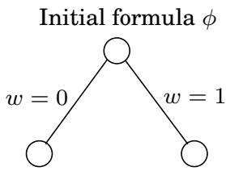
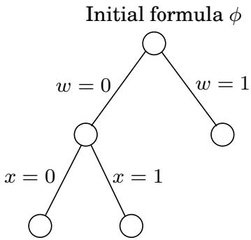
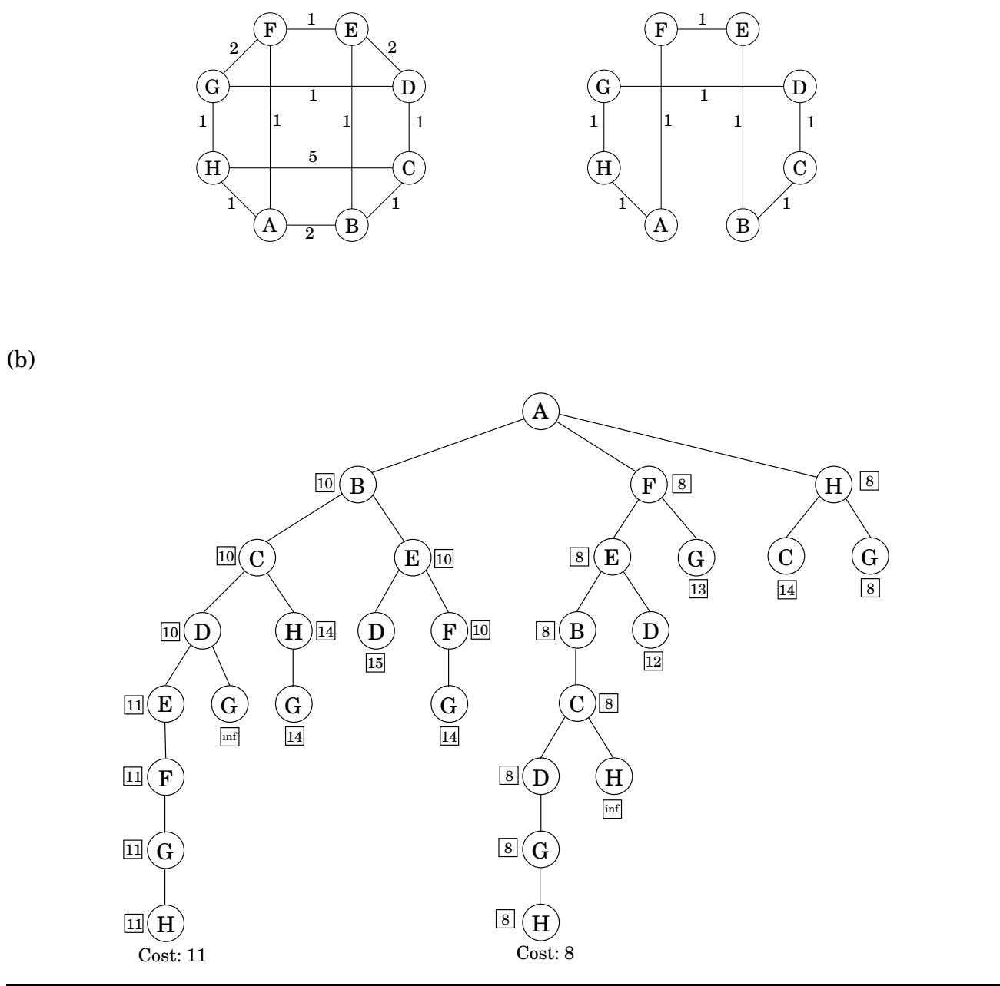

import Guide from '@/components/Guide.astro';
import Knowledge from '@/components/Knowledge.astro';
import Example from '@/components/Example.astro';
import Analysis from '@/components/Analysis.astro';
import Solution from '@/components/Solution.astro';
import Variant from '@/components/Variant.astro';
import Note from '@/components/Note.astro';
import Block from '@/components/Block.astro';
import Method from '@/components/Method.astro';
import Exercise from '@/components/Exercise.astro';
import Algorithm from '@/components/Algorithm.astro';

## 第 9 章：应对 NP 完整性

您是经验丰富的项目团队中的初级成员。您当前的任务是编写代码来解决涉及图形和数字的看似简单的问题。你应该做什么？

如果你很幸运，你的问题将是我们在本书中解决的六个有关带权重图的问题（最短路径、最小生成树、最大流等）之一。即使情况确实如此，在其自然栖息地（肮脏且被现实和背景所掩盖）中认识到这样的问题也需要实践和技巧。您更有可能需要将问题简化为这些幸运问题之一，或者使用动态规划或线性规划来解决它。

但很可能不会发生这样的事情。搜索问题的世界一片黯淡。有一些光点——辉煌的算法思想——每个都照亮了它周围的一个小区域（减少到它的问题；其中两个区域，线性和动态规划，实际上相当大）。但剩下的广阔区域一片漆黑：NP完全。你要做什么？

您可以首先证明您的问题实际上是 NP 完全的。通常，您所需要的只是泛化证明（回想一下第 254 页的讨论和练习 8.10）；有时，从 3SAT 或 ZOE 简单还原并不难找到。这听起来像是一个理论上的练习，但是，如果执行成功，它确实会带来一些实实在在的回报：现在你在团队中的地位已经提升，你不再是那个不会做的孩子，你已经成为了完成不可能任务的高贵骑士。

但不幸的是，当证明 NP 完全时，问题并不会消失。真正的问题是，你下一步做什么？

这是本章的主题，也是一些关于算法和复杂性的最重要的现代研究的灵感。 NP 完备性并不是死亡证明——它只是一场迷人冒险的开始。

您的问题的 NP 完整性证明可能会构造复杂且奇怪的图表，与您的应用程序中出现的图表非常不同。例如，即使 SAT 是 NP 完全的，也可以有效地找到 HORN SAT（逻辑编程中出现的 SAT 实例）的满足分配（回忆第 5.3 节）。或者，假设应用程序中出现的图形是树。在这种情况下，许多 NP 完全问题，例如独立集，可以通过动态规划在线性时间内解决（回忆第 6.7 节）。

不幸的是，这种方法并不总是有效。例如，我们知道 3SAT 是 NP 完全的。即使对于平面图（可以在平面上绘制而不交叉边的图），独立集问题以及许多其他 NP 完全问题仍然如此。此外，您通常无法清楚地描述应用程序中出现的实例的特征。相反，您将不得不依赖某种形式的智能指数搜索过程，例如回溯和分支定界，这些过程在最坏的情况下是指数时间的，但是，通过正确的设计，对于应用程序中出现的典型实例可能非常有效。我们在 9.1 节中讨论这些方法。

或者，您可以为 NP 完全优化问题开发一种算法，该算法未达到最佳值，但不会相差太多。例如，在第 5.4 节中，我们看到贪心算法总是产生不超过最佳集合覆盖的 log n 倍的集合覆盖。实现这种保证的算法称为近似算法。正如我们将在第 9.2 节中看到的，此类算法因许多 NP 完全优化问题而闻名，并且它们是一些最聪明和最复杂的算法。 NP 完备性理论可以再次用作这项工作的指南，通过表明，对于某些问题，它们的近似程度甚至存在严格的限制 - 当然除非 $\mathbf { P } = \mathbf { N P }$

最后，还有一些启发式算法，无法保证运行时间或近似程度。启发式方法依靠独创性、直觉、对应用的良好理解、细致的实验以及来自物理学或生物学的见解来解决问题。我们在 9.3 节中看到了一些常见的类型。

## 9.1 智能穷举搜索

## 9.1.1 回溯

回溯基于这样的观察：通常可以通过仅查看解决方案的一小部分来拒绝该解决方案。例如，如果 SAT 的实例包含子句 $( x _ { 1 } \lor x _ { 2 } )$，则可以立即消除所有带有 $x _ { 1 } = x _ { 2 } = 0 ( \mathrm { i . e . }$（假）的分配。换句话说，通过快速检查和质疑这个部分分配，我们能够修剪整个搜索空间的四分之一。这是一个有希望的方向，但它可以被系统地利用吗？

这是如何完成的。考虑由子句集指定的布尔公式 $\phi ( w , x , y , z )$

$$
(w \vee x \vee y \vee z), (w \vee \overline {{x}}), (x \vee \overline {{y}}), (y \vee \overline {{z}}), (z \vee \overline {{w}}), (\overline {{w}} \vee \overline {{z}}).
$$

我们将逐步生长一棵部分解决方案的树。我们首先对任意一个变量进行分支，例如 w：

初始公式 φ

将 $w = 0$ 和 $w = 1$ 插入到 $\phi ,$ 中，我们发现没有立即违反子句，因此这两个部分赋值都不能完全消除。所以我们需要继续分支。我们可以扩展两个可用节点中的任何一个，以及我们选择的任何变量。我们来试试这个：

这一次，我们很幸运。部分赋值 $w = 0 , x = 1$ 违反了子句 $( w \vee \overline { { x } } )$ 并且可以被终止，从而修剪大量的搜索空间。我们从这条死胡同中原路返回，并在剩下的两个活动节点之一继续探索。

以这种方式，回溯探索分配空间，仅在结果不确定的节点处生长树，并且如果在任何阶段遇到令人满意的分配则停止。

在布尔可满足性的情况下，搜索树的每个节点都可以通过部分赋值或通过将这些值插入原始公式时保留的子句来描述。例如，如果 $w = 0$ 和 $x = 0$，则任何带有 $\overline { { w } }$ 或 x 的子句都会立即满足，并且任何文字 w 或 x 都不满足，可以将其删除。剩下的就是

$$
(y \vee z), (\overline {{y}}), (y \vee \overline {{z}}).
$$

同样，$w = 0$ 和 $x = 1$ 离开

$$
( ), (y \vee \overline {{z}}),
$$

“空子句”( ) 排除了可满足性。因此，代表部分分配的搜索树的节点本身就是 SAT 子问题。

这种替代表示有助于做出重复出现的两个决策：接下来要扩展哪个子问题，以及使用哪个分支变量。由于回溯的好处在于它能够消除部分搜索空间，并且这种情况仅在遇到空子句时才会发生，因此选择包含最小子句的子问题然后在该子句中的变量上进行分支是有意义的。如果该子句恰好是单例，则至少有一个结果分支将被终止。 （如果在选择子问题时存在平局，一个合理的策略是选择树中最低的一个，希望它接近令人满意的分配。）请参阅图 9.1 了解我们前面示例的结论。

更抽象地说，回溯算法需要一个测试来查看子问题并快速声明三个结果之一：

1.失败：子问题无解。

2. 成功：找到子问题的解。

3. 不确定性。

图 9.1 回溯表明 φ 不可满足。

$$ (w \vee x \vee y \vee z), (w \vee \overline{x}), (x \vee \overline{y}), (y \vee \overline{z}), (z \vee \overline{w}), (\overline{w} \vee \overline{z}) $$

就 SAT 而言，如果有空子句，则该测试宣告失败；如果没有子句，则宣告成功；否则，宣告不确定。回溯过程则具有以下格式。

<Algorithm>
从一些问题开始 $P_0$
令 $S = \{P_0\}$ 为活动子问题集
当 S 非空时重复：
    <u>选择</u>一个子问题 $P \in S$ 并将其从S中删除
    <u>将其扩展</u>为更小的子问题 $P_1, P_2, \ldots, P_k$
    对于每个 $P_i$：
        如果<u>测试</u>($P_i$)成功：停止并宣布此解决方案
        如果<u>测试</u>($P_i$)失败：丢弃 $P_i$
        否则：将 $P_i$ 添加到 S
宣布没有解决办法
</Algorithm>

对于 SAT，选择过程选择一个子句，而扩展则选择该子句中的一个变量。我们已经讨论了做出此类选择的一些合理方法。

通过正确的测试、扩展和选择例程，回溯在实践中可以非常有效。我们为 SAT 展示的回溯算法是许多成功的可满足性计划的基础。质量的另一个标志是：如果提供 2SAT 实例，它总是会在多项式时间内找到令人满意的作业（如果存在）（练习 9.1）！

## 9.1.2 分支定界

同样的原理可以从 SAT 等搜索问题推广到优化问题。具体来说，假设我们有一个最小化问题；意志最大化

遵循相同的模式。

和以前一样，我们将处理部分解决方案，每个解决方案代表一个子问题，即完成该解决方案的最佳方法（成本）是什么？和以前一样，我们需要一个消除部分解决方案的基础，因为我们的方法没有其他效率来源。要拒绝一个子问题，我们必须确定它的成本超过我们已经遇到的其他解决方案的成本。但我们不知道其确切成本，并且通常无法有效计算。因此，我们对此成本使用快速下限。

<Algorithm>
从一些问题开始 $P_0$
令 $S = \{P_0\}$ 为活动子问题集
最好的=$\infty$
当 S 非空时重复：
    <u>选择</u>一个子问题（部分解决方案）$P \in S$ 并将其从 S 中删除
    <u>将其扩展</u>为更小的子问题 $P_1, P_2, \ldots, P_k$
    对于每个 $P_i$：
        如果 $P_i$ 是一个完整的解决方案：
            更新目前为止最好的
        否则如果<u>下限</u>($P_i$) < bestsofar：
            将 $P_i$ 添加到 S
返回迄今为止最好的
</Algorithm>

让我们看看这对于边长为 $d _ { e } > 0 . \ \mathbf { A }$ 的图 $G = ( V , E )$ 上的旅行商问题是如何工作的，部分解决方案是一条简单的路径 $a \sim b$ 穿过一些顶点 $S \subseteq V$ ，其中 S 包括端点 a 和 b。我们可以用元组 [a, S, b] 来表示这样的部分解——事实上，a 在整个算法中都是固定的。相应的子问题是找到游览的最佳完成度，即具有中间节点 $V - S$ 最便宜的互补路径 $b \sim a$ 。请注意，对于我们选择的任何 $a \in V$，初始问题的形式为 $[ a , \{ a \} , a ]$。

在分支定界算法的每个步骤中，我们将特定的部分解 $[ a , S , b ]$ 扩展为单边 $( b , x )$，其中 $x \in V - S$。最多可以有 $\vert V - S \vert$ 种方法来执行此操作，并且每个分支都会导致 $[ a , S \cup \{ x \} , x ]$ 形式的子问题

我们如何才能降低完成部分游览的成本 $[ a , S , b ] ?$ 为此开发了许多复杂的方法，但让我们看一个相当简单的方法。游览的其余部分包括一条穿过 $V - S$ 的路径，以及从 a 和 b 到 $V - S$ 的边缘。因此，其成本至少为以下各项之和：

1. 从a到 $V - S _ { \mathrm { \scriptsize { + } } }$ 最亮的边缘

2. 从b到 $V - S$ 的最亮边

3. $V - S _ { \mathrm { \scriptsize { + } } }$ 的最小生成树

（你明白为什么吗？）这个下界可以通过最小生成树算法快速计算出来。图 9.2 贯穿了一个示例：树的每个节点代表一个部分游览（具体来说，从根到该节点的路径），在某个阶段由分支定界过程考虑。请注意如何仅考虑 28 个部分解决方案，而不是暴力搜索中出现的 $7 ! = 5 { , } 0 4 0$。

图 9.2 (a) 一个图及其最优旅行商旅行。 (b) 从左到右探索的分支定界搜索树。方框内的数字表示成本的下限。

(一)  
