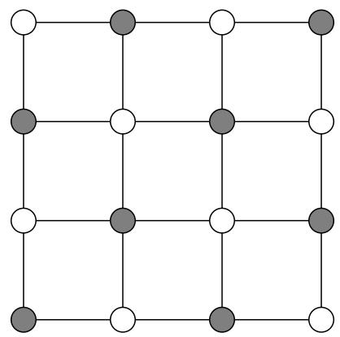
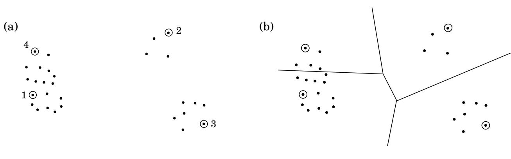
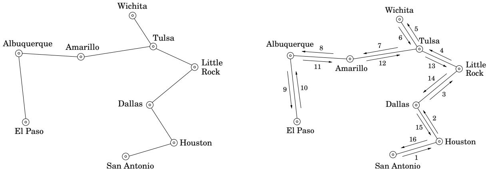
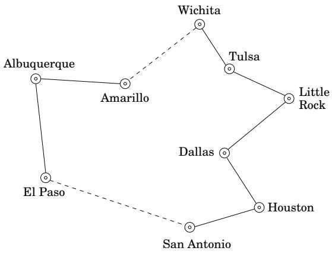

import Guide from '@/components/Guide.astro';
import Knowledge from '@/components/Knowledge.astro';
import Example from '@/components/Example.astro';
import Analysis from '@/components/Analysis.astro';
import Solution from '@/components/Solution.astro';
import Variant from '@/components/Variant.astro';
import Note from '@/components/Note.astro';
import Block from '@/components/Block.astro';
import Method from '@/components/Method.astro';
import Exercise from '@/components/Exercise.astro';
import Algorithm from '@/components/Algorithm.astro';

## 9.2 近似算法

在优化问题中，我们会得到一个实例 I，并被要求找到最佳解决方案 - 如果我们遇到像 INDEPEN-DENT SET 这样的最大化问题，则找到具有最大增益的解决方案；如果我们处理像 TSP 这样的最小化问题，则找到最小成本的解决方案。对于每个实例 I，让我们用 OPT(I) 表示最佳解决方案的值（收益或成本）。假设 OPT(I) 始终是正整数，这使数学变得更简单（并且与事实相差不远）。

我们已经在 5.4 节中看到了一个（著名的）近似算法的例子：SET COVER 的贪婪方案。对于大小为 n 的任何实例 I，我们证明了这种贪心算法保证快速找到最多 OPT(I) log n 的基数集覆盖。这个 log n 因子被称为算法的近似保证。

更一般地，考虑任何最小化问题。现在假设我们有一个解决问题的算法，给定实例 I，返回值为 (I) 的解。算法的近似比定义为

$$
\alpha_ {\mathcal {A}} = \max _ {I} \frac {\mathcal {A} (I)}{\mathrm{OPT} (I)}.
$$

换句话说，$\alpha _ { A }$ 衡量最坏情况输入下算法输出超过最优解的因子。也可以用相同的方式为最大化问题（例如独立集）定义近似比，只不过为了获得大于 1 的数，我们需要取倒数。

因此，当面对 NP 完全优化问题时，合理的目标是寻找 $\alpha _ { A }$ 尽可能小的近似算法。但这种保证可能看起来有点令人费解：如果我们无法确定最优值，我们如何才能接近最优值？让我们看一个简单的例子。

## 9.2.1 顶点覆盖

我们已经知道 VERTEX COVER 问题是 NP 困难的。

顶点覆盖

输入：无向图 $G = ( V , E )$

输出：接触每条边的顶点 $S \subseteq V$ 的子集。

目标：最小化 S 。

示例见图 9.3。

由于 VERTEX COVER 是 SET COVER 的特例，从第 5 章我们知道，它可以通过贪心算法在 O(log n) 的因子内近似：重复删除最高度的顶点并将其包含在顶点覆盖中。在某些图上，贪心算法返回的顶点覆盖确实是最优值的 log n 倍。

VERTEX COVER 的更好的近似算法基于匹配的概念，即没有公共顶点的边的子集（图 9.4）。如果不能添加更多边，则匹配是最大的。最大匹配将帮助我们找到好的顶点覆盖，而且，它们很容易生成：重复挑选与已选择的边不相交的边，直到不再可能为止。

图 9.3 最佳顶点覆盖（以阴影显示）大小为 8 的图。  

图 9.4 (a) 匹配，(b) 最大匹配的完成，以及 (c) 结果顶点覆盖。

<table> <tr> <td>(a)</td> <td>○</td> <td>○—○</td> <td>○</td> </tr> <tr> <td> </td> <td>○—○</td> <td>○</td> <td>○</td> </tr> <tr> <td> </td> <td>○</td> <td>○</td> <td>○</td> </tr> <tr> <td> </td> <td>○</td> <td>○</td> <td>○—○</td> </tr> </table>

匹配和顶点覆盖之间有什么关系？这是一个关键事实：图 G 的任何顶点覆盖必须至少与 G 中任何匹配的边数一样大；也就是说，任何匹配都会提供 OPT 的下限。这只是因为匹配的每条边都必须被任何顶点覆盖中的端点之一覆盖！找到这样的下界是设计近似算法的关键步骤，因为我们必须将算法找到的解的质量与 OPT 进行比较，OPT 的计算是 NP 完全的。

另一个观察完成了我们的近似算法的设计：设 S 是一个包含最大匹配 M 中每条边的两个端点的集合。那么 S 一定是一个顶点覆盖——如果不是，也就是说，如果它不接触某些边 $e \in E ,$ ，那么 M 不可能是最大的，因为我们仍然可以向它添加 e。但是我们的封面S有2M个顶点。从上一段我们知道任何顶点覆盖的大小必须至少为 M 。这样我们就完成了。

这是 VERTEX COVER 的算法。

找到最大匹配 $M \subseteq E$

返回 S = M 中边的所有端点

这个简单的过程总是返回一个顶点覆盖，其大小最多是最佳大小的两倍！

总而言之，即使我们无法找到最佳顶点覆盖，我们也可以轻松找到另一个结构，即最大匹配，它具有两个关键属性：

1. 它的大小为我们提供了最佳顶点覆盖的下限。

2.它可以用来构建顶点覆盖，其大小可以与使用属性1的最佳覆盖的大小相关。

因此，这个简单算法的近似率为 $\alpha _ { A } \leq 2$ 。事实上，不难找到它确实犯了 100% 错误的例子；因此 $\alpha _ { \mathscr A } = 2$

## 9.2.2 聚类

接下来我们转向聚类问题，其中我们有一些数据（例如文本文档，或图像或语音样本），我们想要将其分为几组。定义这些数据点之间的“距离”通常很有用，这些数字捕获了它们彼此之间的远近程度。通常，数据是某些高维空间中的真实点，距离是通常的欧几里得距离；在其他情况下，距离是我们对数据点进行的一些“相似性测试”的结果。假设我们有这样的距离并且它们满足通常的度量属性：

1. $d ( x , y ) \geq 0$ 对于所有 $x , y .$

2. $d ( x , y ) = 0$ 当且仅当 $x = y$

3.$d ( x , y ) = d ( y , x )$

4.（三角不等式）$d ( x , y ) \leq d ( x , z ) + d ( z , y )$

我们希望将数据点划分为在直径较小的意义上紧凑的组。

k簇

输入：具有基础距离度量 $d ( \cdot , \cdot ) _ { \ i }$ 的点 $X = \{ x _ { 1 } , \ldots , x _ { n } \}$ ；整数 $k .$

输出：将点划分为 k 个簇 $C _ { 1 } , \ldots , C _ { k }$

目标：最小化簇的直径，

$$
\max _ {j} \max _ {x _ {a}, x _ {b} \in C _ {j}} d (x _ {a}, x _ {b}).
$$

可视化此任务的一种方法是想象空间中的 n 个点，这些点将被 k 个相同大小的球体覆盖。球体的最小可能直径是多少？图 9.5 显示了一个示例。

该问题是 NP 难题，但具有非常简单的近似算法。这个想法是选择 k 个数据点作为聚类中心，然后将剩余的每个点分配给最接近它的中心，从而创建 k 个聚类。使用直观的规则一次选择一个中心：始终选择与目前选择的中心尽可能远的下一个中心（见图 9.6）。

选取任意点 $\mu _ { 1 } \in X$ 作为第一个聚类中心

对于 $i = 2 \ \textrm { t o } \ k \colon$

令 $\mu _ { i }$ 为 X 中距 $\mu _ { 1 } , \ldots , \mu _ { i - 1 }$ 最远的点

$( \mathrm { ~ i ~ . ~ e ~ . ~ } ,$ 最大化最小值 $_ { \cdot j < i } d ( \cdot , \mu _ { j } ) )$

创建 k 个簇：$C _ { i } = \{ \mathsf { a l l } \ x \in X$，其最近中心为 $\mu _ { i } \}$

  
图 9.5 一些数据点和最佳 k = 4 个簇。

图 9.6 (a) 最远优先遍历选择的四个中心。 (b) 由此产生的簇。  

很明显，该算法返回一个有效的分区。更重要的是，所得到的直径最多保证是最佳直径的两倍。

这是论证。令 $x \in X$ 为距离 $\mu _ { 1 } , \ldots , \mu _ { k }$ 最远的点（换句话说，如果我们想要其中的 $k + 1$，我们会选择下一个中心），并令 r 为其到最近中心的距离。那么 X 中的每个点都必须在其聚类中心的距离 r 之内。根据三角不等式，这意味着每个簇的直径最多为 $2 r$

但 r 与最佳聚类的直径有何关系呢？好吧，我们已经确定了 $k + 1$ 点 $\{ \mu _ { 1 } , \mu _ { 2 } , \ldots , \mu _ { k } , x \}$，它们彼此之间的距离至少为 r（为什么？）。任何分成 k 个簇的分区都必须将这些点中的两个点放在同一簇中，因此直径必须至少为 r。

该算法与我们的 VERTEX COVER 方案具有一定的高度相似性。我们不使用最大匹配，而是使用一种不同的易于计算的结构——一组 k 点，覆盖某个半径 r 内的所有 X，同时相互间隔至少 r 的距离。该结构既用于生成聚类，又用于给出最佳聚类的下限。

我们知道没有更好的近似算法来解决这个问题。

## 9.2.3 TSP

三角不等式在使 k-CLUSTER 问题可近似方面发挥了至关重要的作用。它还有助于解决旅行推销员问题：如果城市之间的距离满足度量属性，则有一种算法可以输出最多 1.5 倍最佳长度的旅行。现在我们来看一个稍弱的结果，其因子达到了 2。

继续我们之前两种近似算法的思维过程，我们可以问是否存在某种易于计算的结构，并且该结构似乎与最佳旅行推销员旅行相关（以及提供 OPT 的良好下限）。稍加思考和实验就可以得出答案：最小生成树。

我们来理解一下这个关系。从旅行推销员旅行中删除任何边会留下一条穿过所有顶点的路径，这是一棵生成树。因此，

$$
\mathrm{TSPcost} \geq \text { cost   of   this   path } \geq \mathrm{MSTcost}.
$$

现在，我们需要使用 MST 来构建旅行商之旅。如果我们可以使用每条边两次，那么通过遵循 MST 的形状，我们最终会得到一次访问所有城市的旅行，其中一些城市不止一次。下面是一个示例，左侧是 MST，右侧是生成的游览（数字显示了获取边的顺序）。

因此，这次旅行的长度最多是 MST 成本的两倍，正如我们已经看到的，这最多是 TSP 成本的两倍。

这是我们想要的结果，但我们还没有完全完成，因为我们的旅行团多次访问一些城市，因此不合法。要解决此问题，游览应该简单地跳过即将重新访问的任何城市，而是直接移动到列表中的下一个新城市：

根据三角不等式，这些绕行只能使整体行程变得更短。

## 一般 TSP

但是，如果我们对不满足三角不等式的 TSP 实例感兴趣怎么办？事实证明，这是一个更难近似的问题。

原因如下：回想一下，在第 259 页上，我们给出了多项式时间约简，给定任何图 G 和整数任何 $C > 0$ 都会生成 TSP 的实例 $I ( G , C )$，使得：

(i) 如果 G 有 Rudrata 路径，则 OPT $( I ( G , C ) ) = n _ { \mathrm { ; } }$ ，G 中的顶点数。

(ii) 如果 G 没有 Rudrata 路径，则 OPT $( I ( G , C ) ) \geq n + C .$

这意味着即使是 TSP 的近似解也能让我们解出 RUDRATA PATH！让我们来研究一下细节。

考虑 TSP 的近似算法，并令 $\alpha _ { A }$ 表示其近似率。从 RUDRATA PATH 的任何实例 G 中，我们将使用特定常量 $C = n \alpha _ { \mathcal { A } }$ 创建 TSP 的实例 $I ( G , C )$ 。当算法在此 TSP 实例上运行时会发生什么？在情况 (i) 中，它必须输出长度最多为 $\alpha _ { \mathcal { A } } \mathrm { O P T } ( I ( G , C ) ) = n \alpha _ { \mathcal { A } }$ 的游览，而在情况 (ii) 中，它必须输出长度至少为 OPT $\because I ( G , C ) ) > n \alpha _ { \mathcal { A } }$ 的游览。由此我们可以算出G是否有Rudrata路径！这是结果过程：

<Algorithm>
给定任意图 $G$：
    计算 $I(G, C)$（使用 $C = n \cdot \alpha_{\mathcal{A}}$）并在其上运行算法 $\mathcal{A}$
    如果生成的游览长度为 $\leq n\alpha_{\mathcal{A}}$：
        得出 $G$ 有一条Rudrata路径
    其他：
        结论是 $G$ 没有Rudrata路径
</Algorithm>

这告诉我们G是否有Rudrata路径；通过多次调用该过程，我们可以找到实际路径（练习8.2）。

我们已经证明，如果 TSP 有一个多项式时间近似算法，那么对于 NP 完全 RUDRATA PATH 问题也有一个多项式算法。因此，除非 $\mathbf { P } = \mathbf { N P }$，否则不可能存在有效的 TSP 近似算法。

## 9.2.4 背包

我们的最后一个近似算法是针对最大化问题，并且具有非常令人印象深刻的保证：给定任何 $\epsilon > 0 _ { : }$ ，它将返回一个值至少为 $( 1 - \epsilon )$ 倍于最佳值的解，且时间仅在输入大小和 $1 / \epsilon .$ 中按多项式缩放

问题是我们在第 6 章中第一次遇到的 KNAPSACK。有 n 个物品，其权重为 $w _ { 1 } , \ldots , w _ { n }$，值为 $v _ { 1 } , \ldots , v _ { n }$（均为正整数），目标是在总重量至多为 W 的约束下选择最有价值的物品组合。

之前我们看到了这个问题的动态编程解决方案，运行时间为 $O ( n W )$，使用类似的技术，也可以实现 $O ( n V )$ 的运行时间，其中V是值的总和。这些运行时间都不是多项式，因为 $W$ 和 V 可能非常大，输入大小呈指数级。

让我们考虑一下 $O ( n V )$ 算法。在 V 很大的糟糕情况下，如果我们简单地以某种方式缩小所有值会怎样？例如，如果

$$
v _ {1} = 1 1 7, 5 8 6, 0 0 3, v _ {2} = 7 3 8, 4 9 3, 2 9 1, v _ {3} = 2 3 8, 8 2 7, 4 5 3,
$$

我们可以简单地去掉一些精度，改用 117、738 和 238。这不会太大地改变问题，而且会使算法快得多！

现在了解详细信息。除了输入之外，还假定用户指定了一些近似因子 $\epsilon > 0 .$

<Algorithm>
丢弃任何重量 > W 的物品
让 $v_{\max} = \max_i v_i$
重新调整值 $\widehat{v}_i = \left\lfloor v_i \cdot \frac{n}{\epsilon v_{\max}} \right\rfloor$
使用值 $\{\widehat{v}_i\}$ 运行动态规划算法
输出项目的选择结果
</Algorithm>

让我们看看为什么这有效。首先，由于重新缩放后的值 $\widehat { v _ { i } }$ 最多都是 $n / \epsilon$，所以动态程序是高效的，运行时间 $O ( n ^ { 3 } / \epsilon )$

现在假设原始问题的最佳解决方案是选择项目 S 的某个子集，其总值为 $K ^ { * }$ 。该相同分配的重新缩放值是

$$
\sum_ {i \in S} \widehat {v _ {i}} = \sum_ {i \in S} \left\lfloor v _ {i} \cdot \frac {n}{\epsilon v _ {\mathrm{max}}} \right\rfloor \geq \sum_ {i \in S} \left(v _ {i} \cdot \frac {n}{\epsilon v _ {\mathrm{max}}} - 1\right) \geq K ^ {*} \cdot \frac {n}{\epsilon v _ {\mathrm{max}}} - n.
$$

因此，缩小问题的最佳分配，称为 ${ \widehat { S } } ,$ ，具有至少这么多的重新缩放值。就原始值而言，赋值 $\widehat { S }$ b 的值至少为

$$
\sum_ {i \in \widehat {S}} v _ {i} \geq \sum_ {i \in \widehat {S}} \widehat {v} _ {i} \cdot \frac {\epsilon v _ {\mathrm{max}}}{n} \geq \left(K ^ {*} \cdot \frac {n}{\epsilon v _ {\mathrm{max}}} - n\right) \cdot \frac {\epsilon v _ {\mathrm{max}}}{n} = K ^ {*} - \epsilon v _ {\mathrm{max}} \geq K ^ {*} (1 - \epsilon).
$$

## 9.2.5 近似性层次结构

给定任何 NP 完全优化问题，我们寻求可能的最佳近似算法。如果做不到这一点，我们尝试证明在多项式时间内可实现的近似比的下界（我们刚刚对一般 TSP 进行了这样的证明）。总而言之，NP完全优化问题分类如下：

那些像 TSP 一样不可能有有限近似比的情况。

那些近似比率是可能的，但该比率可以有多小是有限的。 VERTEX COVER、k-CLUSTER 和三角不等式的 TSP 都属于这里。 （对于这些问题，我们尚未对其近似性建立限制，但这些限制确实存在，并且它们的证明构成了该领域中一些最复杂的结果。）

下面我们有一类更幸运的 NP 完全问题，其近似性没有限制，并且存在误差率任意接近于零的多项式近似算法。 KNAPSACK 位于此处。

最后，在此处给出的前两个问题之间，还有另一类问题，其近似比率约为 log n。 SET COVER 就是一个例子。

（一个谦虚的提醒：所有这一切都取决于假设 P = NP。如果做不到这一点，这个层次结构就会崩溃到 P，并且所有 NP 完全优化问题都可以在多项式时间内精确解决。）

关于近似算法的最后一点：通常这些算法或其变体在典型实例上的表现比您所相信的最坏情况近似率要好得多。